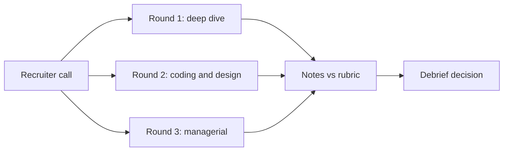

## A strong coder who did not get the offer

Nour writes clean Python. In the hands-on round she finished the coding task early, with tests. She felt sure of an offer. Then, in the last round, a hiring manager asked: "Your assistant went live. How did you know its answers stayed correct after launch?" Nour said: "We tested it well before launch, and users did not complain." The manager asked what she would have seen if quality had dropped. She had no answer.

Nour did not get the offer. Her coding was strong, but one round found a gap that the others could not cover. This chapter shows what each round looks for, so you can prepare for all of them and not only the one you like.

By the end you can name the three rounds, say what evidence each one collects, and spot the common ways candidates lose each one.

<BigWordAlert term="Interview loop" plainEnglish="The full set of interviews for one role, usually several rounds with different people, each looking for different evidence about you." whyItMatters="The decision is made from all rounds together, so one weak round can outweigh a strong one." />

## How a loop turns into a decision

Most loops start with a short call with a recruiter about the role, your timeline and your salary range. Then come the main rounds. In AI engineering roles they usually follow three themes: your own project, hands-on skill, and how you work in production with other people. Each round is often 45 to 60 minutes, but formats vary. Ask the recruiter what to expect; it is a normal question and they usually answer it.

After the rounds, the interviewers meet in a <GlossaryTerm term="debrief" definition="A meeting after the interviews where the interviewers share their notes and agree on a hire or no-hire decision." /> and compare notes. Each one writes down evidence against a <GlossaryTerm term="rubric" definition="A written list of what a good answer contains, with levels from weak to strong, so different interviewers score in the same way." />, not just a feeling. The diagram shows why that matters.



The three rounds run side by side and each feeds its own notes into the debrief. No round can see what the others saw. So a gap in one round, like Nour's, stays visible in the debrief even when another round went well.

## Round 1: the project deep dive

The interviewer asks you to describe a RAG or agent project you built, then goes deeper and deeper into one part of it. A typical path: "What did it do?", then "How did you split the documents?", then "Why that size?", then "What did you try before that?", then "How did you measure the difference?"

What it scores:

- **Ownership:** what you did yourself, not what "we" did.
- **Depth:** can you explain a choice two or three levels down?
- **Numbers:** quality, speed, cost and scale, with how you measured them.
- **Honest limits:** what did not work, and what you would change.

How candidates fail: they describe a tutorial instead of their decisions. They say "we" so often that the interviewer cannot find their part. They give no numbers, or numbers they cannot explain. Or they defend every choice as perfect, which tells the interviewer they never looked for weaknesses.

Before you read the next part, decide which answer you think scores higher in this round.

```predict
prompt: "In the deep dive, the interviewer asks why you split documents into 500-token chunks. Which answer scores higher?"
options:
  - id: tutorial
    label: "I used 500 tokens, the size most RAG tutorials recommend"
  - id: tested
    label: "I tested 200, 500 and 800 on 30 questions; 500 won"
correctOptionId: tested
explanation: "The second answer shows a decision you made and measured. The first may be true, but it shows you copied a default and never checked it on your own documents."
```

The second answer also invites a good follow-up: "What did 500 win on?" That is a question you want, because you have the numbers. Chapter 1.3 shows how to build a whole story this way.

## Round 2: hands-on coding and system design

This round has two parts. They may be one long session or two separate ones.

**Coding.** You get a practical task, not a puzzle. Examples: call a model endpoint for ten inputs at once with a limit on how many run together; parse and validate a model's JSON reply; write a small retrieval metric with tests. The interviewer watches how you work, not only the final code.

**System design.** You design a system out loud: "Design a support assistant that answers from 5,000 help articles for 20,000 users a day." You are expected to ask about requirements, sketch the parts, and talk about retrieval, the model, evaluation, safety, cost and latency.

What it scores: clarifying questions before you start; working code with tests and edge cases; thinking aloud so the interviewer can follow; in design, trade-offs with numbers and a plan to measure quality.

How candidates fail: they start coding before they understand the task. They code in silence for ten minutes. They never run or test their code. In design, they list tool names instead of reasons, forget evaluation completely, or give no rough numbers for load, cost or latency.

## Round 3: the managerial round

A hiring manager asks about your past work as a whole. Typical questions: "Tell me about a project that went wrong." "How did you deploy it?" "How did you know it worked in production?" "Tell me about a disagreement with a teammate." In AI roles, expect questions on evaluation after launch, cost surprises and incidents.

What it scores: ownership of outcomes, judgment under uncertainty, clear communication, and learning from failure. For a remote role, the manager also listens for how you work across time zones and in writing.

How candidates fail: they blame others for a failure. They say "we monitored it" without saying what was monitored or what would trigger an action. They have no story about anything after launch. Or they tell a story with no lesson, so the manager cannot see growth.

## The rounds side by side

| Round | What it scores | Common failure |
|---|---|---|
| 1. Deep dive | Ownership, depth, numbers, limits | A tutorial retold with "we" and no numbers |
| 2. Coding and design | Clarifying, tests, thinking aloud, trade-offs | Silent coding; design with no evaluation |
| 3. Managerial | Judgment, ownership, production, learning | Blame, or "we monitored it" with no detail |

<Callout type="warning" title="Never invent a number">
Interviewers ask how you measured every number you give. A made-up number fails at the first follow-up and damages every other answer. If you only have test numbers from before launch, say so plainly.
</Callout>

## Deciding where to spend your preparation time

You have limited hours, so be honest about your weakest round. If you code well but have never measured a project, the deep dive is your risk: modules 3 to 5 and the module 1 gate matter most. If your stories are good but async Python is new, put your time into module 9. If you have never deployed anything, module 10 gives you the vocabulary and a plan, and you can say "I have designed this, not run it" in the managerial round.

The trade-off is breadth against depth. One deep, measured project beats three shallow ones in round 1. But a gap in a whole round, like Nour's, is hard to cover with strength elsewhere. Aim for no empty round first, then depth.

## When an interview goes badly

You will have interviews that go badly; everyone does. Afterwards, write down every question you remember within an hour, and mark the ones where you had no number or no example. Ask the recruiter for feedback; some will give it. Then match each weak question to a module in this course. Treat it like a failed test: find the cause, fix it, and run it again.

```quiz
type: mcq
question: "In a hands-on round you are asked to write a function that sends five questions to a model endpoint at the same time, with a time limit. Besides working code, what is the interviewer most likely scoring?"
options:
  - "Whether you can name the newest models and compare their prices"
  - "Whether you clarify the limits, test edge cases and think aloud"
  - "Whether you can explain how transformer attention works inside"
  - "Whether you write the shortest solution, in the fewest lines of code"
correct: 1
explanations:
  - "Model names and prices change every few months, and this round is about engineering, not product knowledge."
  - "Right. The hands-on round scores how you work: clarifying the task, testing edge cases such as a timeout, and explaining your thinking as you go."
  - "Model internals are rarely the focus for an application engineer, and they do not show how you write and test a service."
  - "Short code is not the goal. Readable code with tests and handled edge cases scores higher than a clever one-liner."
```

## In the interview

Round 1 often opens with a broad question, and round 3 often closes with a reflective one. Practise both now, before you have the full course behind you, so you can compare later. Answer each question aloud first, then open the item.

<FaqGroup title="Practice questions">
<FaqItem question="Tell me about a project you are proud of.">

I built an assistant that helps the receptionists of a small clinic answer patient questions from 40 rule documents about appointments and vaccinations. Five receptionists used it, about 150 questions a day. My part was retrieval and the test set: I wrote 70 real questions with the right paragraph for each, and moved the right paragraph into the top three from 61 to 78 percent of the time. I am proud of it because the receptionists stopped searching folders while a patient waited on the phone.

**Follow-up probes:**

- How did you build the 70 test questions, and who checked the right answers?
- What did the assistant do when it could not find the answer?

</FaqItem>
<FaqItem question="What would you do differently if you built it again?">

I would build the test question set on day one, not in week three. I spent two weeks tuning prompts by reading answers by eye, and some of those changes made retrieval worse without me noticing. With a set of 70 questions from the start, every change would have had a number. I would also add a feedback button earlier, because real questions were different from the ones I invented.

**Follow-up probes:**

- How would you keep the test set from going stale as documents change?
- What would you track from the feedback button, and what would you do with it?

</FaqItem>
<FaqItem question="How do you prepare for an interview loop like this one?">

I prepare for each round separately, because each one collects different evidence. For the deep dive I rehearse a two-minute story with numbers and check that I can go three levels deep on each choice. For hands-on work I practise small async and validation tasks with tests, out loud. For the managerial round I prepare two stories: one about a failure and one about something after launch, each with what I changed.

**Follow-up probes:**

- Which round do you find hardest, and what are you doing about it?
- Tell me the failure story now, in under two minutes.

</FaqItem>
</FaqGroup>

**Next:** How to build the two-minute project story that round 1 starts with, and that the other rounds keep returning to.
