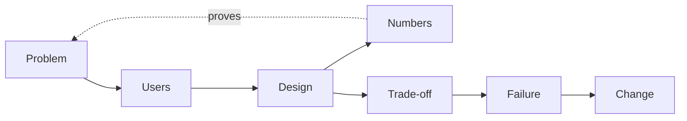

## Seven minutes about a tech stack

Yousef's interview started with an easy question: "Tell me about your project." He talked for seven minutes. He listed every library, the database, the frontend framework and the hosting. The interviewer stopped him and asked: "What problem did it solve, and how do you know it solved it?" Yousef had built something useful, but he had never said why it mattered or what it achieved.

The first answer in a deep dive sets the map for the next 45 minutes. The interviewer picks follow-up questions from what you say. If you give a list of tools, you get questions about tools. If you give a problem, a decision and a number, you get questions about your decisions, which is where you are strongest.

By the end of this chapter you can structure a two-minute story about one project, with a problem, a design, numbers, a trade-off and what you would change.

<BigWordAlert term="Project story" plainEnglish="A short spoken account of one project, built around the decisions you made and the numbers that show what happened." whyItMatters="Round 1 starts with it and the other rounds return to it, so it decides which follow-up questions you get." />

## Seven parts in two minutes

Two minutes is about 250 to 300 words at a calm speaking pace. That is short, so every sentence must do a job. This framework has seven parts. Not every story needs every part at the same length, but a missing part is usually the first thing the interviewer asks about.

| Part | What to say | Time |
|---|---|---|
| Problem | Who had what pain, with one number | 15 s |
| Users | Who used it and how many | 10 s |
| Design | The main parts, and which part was yours | 25 s |
| Numbers | Quality, speed, cost or scale, with a baseline | 25 s |
| Trade-off | One choice, what it gave and what it cost | 15 s |
| Failure | One real thing that went wrong, and the fix | 20 s |
| Change | What you would do differently now | 10 s |

The parts are connected, and the diagram shows the most important link.



The numbers must point back to the problem. If the problem was "staff answered 120 emails a week", the strongest number is how many emails they answer now. A number that does not connect to the problem, like "it used 5,000 chunks", is a detail, not a result. The lower path, from trade-off to failure to change, is where you show judgment and honesty.

## A weak story and a strong story

Tamer built an assistant for Noor Training Centre (a fictional vocational training centre). Here is the weak version, the one most candidates tell first:

> I built a chatbot for a training centre using Python, a vector database and a large language model. It used RAG to answer student questions. We used FastAPI for the backend and a simple web page for the frontend. It worked really well and the students liked it. We had some problems with the PDFs, but we fixed them. It was a great learning experience.

Nothing in it is false. But the interviewer learns almost nothing. "Worked really well" has no number. "We" hides Tamer's part. "Some problems with the PDFs" sounds like something he wants to hide.

Here is the strong version of the same project:

> **Problem.** During enrolment, four staff at a training centre answered about 120 emails a week, mostly the same questions about fees, deadlines and course rules. The answers were spread over 140 PDFs and web pages.
>
> **Users.** About 450 students used the assistant in the enrolment month, around 300 questions a day at peak.
>
> **Design.** It splits the documents into chunks of about 300 words, finds the five closest chunks, and a small model writes an answer with citations. If nothing scores above a threshold, it says it does not know and shows the staff contact form. A teammate built the web page; I built retrieval and the test set.
>
> **Numbers.** I wrote 60 test questions from real emails, each with the right paragraph. Vector search alone put the right paragraph in the top five 62 percent of the time. Adding keyword search raised it to 84 percent. Answers took 3.1 seconds at the 95th percentile. Staff emails fell from about 120 to 45 a week.
>
> **Trade-off.** A large model scored 4 points higher on my test set, but it was three times slower and eight times more expensive per question. I kept the small model and spent the effort on retrieval.
>
> **Failure.** In week two it quoted an old fee from a 2024 PDF that was still in the folder. A student complained. I added an effective date to each document, filtered out replaced ones, and added that question to the test set.
>
> **Change.** I would ask the staff to own the document folder from day one, because the failure came from the data, not the code.

Read aloud, that is about two minutes. Compare what each version gives the interviewer.

| Part | Weak version | Strong version |
|---|---|---|
| Problem | Not stated | 120 emails a week, 140 documents |
| Numbers | "Worked really well" | 62 to 84 percent; 3.1 s; 120 to 45 emails |
| Ownership | "We" throughout | "I built retrieval and the test set" |
| Failure | "Some problems", hidden | A wrong fee, the cause and the fix |

## Where your numbers come from

You need four kinds of number, and you rarely have all of them. **Scale:** documents, users, requests a day. **Quality:** how often the right source was found, or how many test questions were answered correctly. **Speed:** how long a request takes, ideally the <GlossaryTerm term="95th percentile latency" definition="The time that 95 out of 100 requests finish within. It shows the slow experience that averages hide." />. **Cost:** per request or per month.

Every quality number needs a <GlossaryTerm term="baseline" definition="The number you compare against, such as the result before your change or the simplest possible approach." />. "84 percent" alone means little. "From 62 to 84 percent on the same 60 questions" shows a decision and its effect. A small set of questions with known right answers, called a <GlossaryTerm term="golden set" definition="A fixed list of test questions with the correct sources or answers, used to measure a system the same way every time." />, is the cheapest way to get these numbers. Module 5 teaches it properly.

If your project never went to production, use the numbers you have and say where they come from: "On my 40 test questions..." is honest and strong. If you have no numbers yet, measure something before your interview. Even 20 hand-written questions give you a real number.

<Callout type="warning" title="Honest numbers only">
Never invent or round up a number to sound better. The interviewer will ask how you measured it. If you are unsure, say "about" and explain how you would measure it properly.
</Callout>

## Choosing which project to tell

Pick the project you can go deepest on, not the most impressive one. A small project where you made and measured every decision beats a big team project where you wrote one screen. For a team project, say "we" for the team's goal and "I" for your part, and be exact about the line between them.

If the work is confidential, keep the shape and change the details: "a lender's policy documents" instead of the client's name, and rounded numbers. Say that you changed the details. Interviewers respect this; it shows you will protect their data too.

## Common ways a story fails, and how to fix it

- **Too long.** You list tools. Fix: one sentence of design, then stop. Tools come out in the follow-ups.
- **No baseline.** "84 percent" with nothing to compare. Fix: always say "from X to Y".
- **A fake failure.** "I worked too hard." Fix: tell a real bug or wrong decision, with its cause.
- **No trade-off.** Every choice sounds perfect. Fix: name one option you rejected and what it would have given you.
- **Numbers you cannot explain.** Fix: for each number, prepare one sentence on how you measured it.

To debug your own story, record it on your phone and time it. Count the numbers in it; aim for at least three. Then ask a friend to say "why?" after each of your design choices, three times in a row. Where you run out of answers is where the interviewer will go.

```quiz
type: mcq
question: "Reem is preparing the numbers part of her story about a tool that routes customer messages to the right team. Which sentence should she use?"
options:
  - "The routing was very accurate and the support team was happy with it"
  - "We reached 88 percent accuracy, which is good for a classifier like ours"
  - "It handled hundreds of messages every day and it never once went down"
  - "On 200 labelled messages, correct routing rose from 71 to 88 percent"
correct: 3
explanations:
  - "There is no number at all, so the interviewer cannot judge the result and will ask for one."
  - "There is a number but no baseline and no test set, so the interviewer cannot tell whether 88 percent is an improvement."
  - "Scale and uptime matter, but this does not say whether the routing was correct, which was the point of the tool."
  - "Right. It names the test set, the baseline and the result, so it shows a measured improvement the interviewer can probe."
```

## In the interview

The story is usually the first answer in round 1, but you will also use it in system design ("in my last project I chose...") and in the managerial round. Answer each question aloud first, with a timer, then open the item.

<FaqGroup title="Practice questions">
<FaqItem question="Which part of that project did you build yourself?">

This is Tamer's answer. I built retrieval and the test set: the chunking, the search code, the keyword search I added in week three, and the score threshold for saying "I don't know". I also wrote the 60 test questions and checked each right paragraph with a member of staff. A teammate built the web page and the deployment, and we agreed together on one endpoint that takes a question and returns an answer with citations. The chunking and the test set are where I made the most decisions, so I am happy to go deep on those.

**Follow-up probes:**

- How did you choose the score threshold for "I don't know"?
- What did you try before the design you described?

</FaqItem>
<FaqItem question="Tell me about something that went wrong in that project.">

In week two the assistant told a student an old fee, from a 2024 PDF that nobody had removed from the folder. The student complained to the staff, which is how we found out. The cause was the data, not the model: two versions of the fee page were both indexed, and the old one matched the question slightly better. I added an effective date to every document, filtered out replaced versions at indexing time, and added that question to the test set so it can never come back silently. Now I check for duplicate documents before indexing anything.

**Follow-up probes:**

- How would you have found this before a student did?
- What if two documents are both current but disagree?

</FaqItem>
<FaqItem question="What was the hardest trade-off in that project?">

In Tamer's project it was the model size. A large model scored 4 points higher on the 60-question test set, but it was three times slower and eight times more expensive per question. Students were waiting on a web page at peak enrolment, so speed mattered, and the centre had a small budget. He kept the small model and improved retrieval instead, which gave 22 points on the same test set. He would revisit it if the questions became harder, for example questions that need two documents at once.

**Follow-up probes:**

- How would you know if the questions had become harder?
- What would make you switch to the large model for only some questions?

</FaqItem>
</FaqGroup>

**Next:** Set up the workspace that every build chapter extends, and get your first test to pass.
