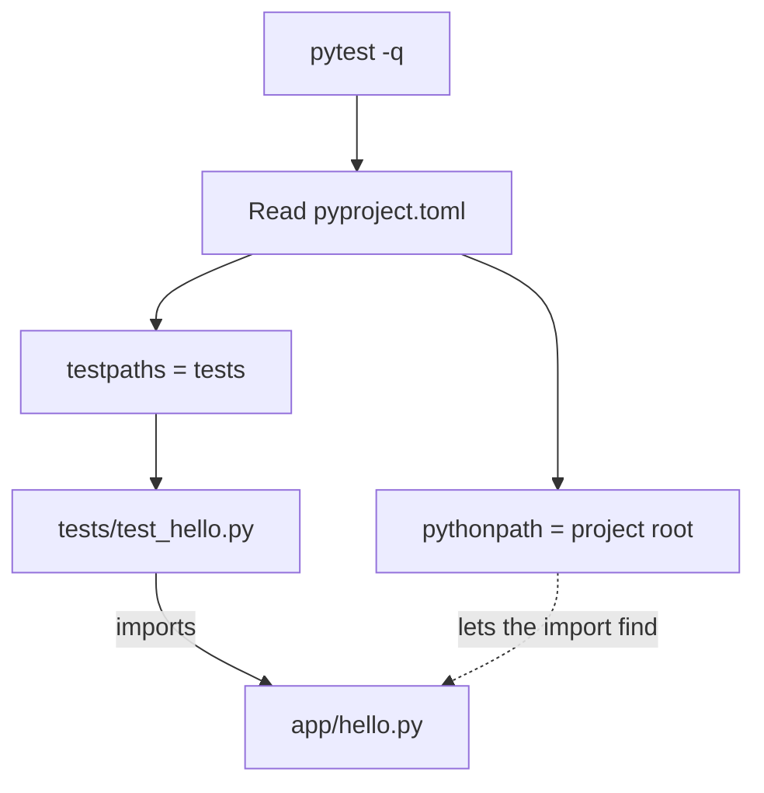

## What you will have at the end

At the end of this chapter you have a Python project called `rag-agent-service` on your laptop and on your Git host. It has a virtual environment, a configuration file that tells pytest where to look, one small function and three tests. When you run `pytest -q`, you see `3 passed`.

That sounds small, and it is. But every build chapter in this course adds to this same repository: retrieval in module 3, evaluation in module 5, an agent in module 7 and a web service in module 9. If the setup is wrong, every later chapter starts with a confusing import error. Getting it right once saves you hours later.

Interviewers care about this too. A hands-on round often starts from an empty folder: "Here is a task; set up a project and write it with tests." A candidate who can create a clean project and a first passing test in five minutes, while explaining each step, starts the round calm. A candidate who fights with imports for fifteen minutes does not.

## What you need

- A laptop or desktop with **Python 3.11 or later** and **Git**. Any operating system works.
- About **2 MB** of downloads for pytest and its small helper packages (measured on 2026-10-22). If you still need to install Python itself, that is a bigger download, so do it on a good connection.
- About 40 minutes, in one sitting if you can. The steps are short, but stopping halfway through makes the next session confusing.

<Callout type="info" title="No laptop of your own?">
Pair with a fellow who has one and take turns at the keyboard, or use a lab computer at your university or a community hub. Push to your Git host at the end of every session, so you can continue on any computer. You can read every chapter on your phone and save the laptop time for the build steps.
</Callout>

## A short Python readiness check

The build chapters assume Python basics. Before you start, check honestly whether you can do each of these without looking anything up:

- Write a function with type hints that returns a value and raises a `ValueError` for bad input.
- Write a small class with an `__init__` method and one other method.
- Read a list comprehension such as `[w.lower() for w in words if w]` and say what it returns.
- Create and activate a virtual environment and install a package with pip.
- Move between folders with `cd` and run a command in a terminal.
- Make a Git commit and push it.

If two or more of these are new to you, finish this chapter, then spend three to four hours on Python basics before chapter 3.5, the first large build. Tell your mentor; they can suggest material. There is no shame in this. A gap you close now costs far less than a gap you discover in an interview.

## Three ideas behind the setup

**A virtual environment per project.** Each project needs its own versions of its packages. Later in the course you install LangGraph and FastAPI; another project on your laptop may need different versions. A virtual environment keeps them apart.

<BigWordAlert term="Virtual environment" plainEnglish="A folder, here called .venv, that holds its own copy of the Python tools and packages for one project, separate from every other project on the computer." whyItMatters="Without it, installing a package for one project can break another, and your tests may run with packages you did not expect." />

**One configuration file.** `pyproject.toml` is the standard place for project settings. Here it holds the project name, the Python version and the pytest settings. Two pytest settings matter. `testpaths` tells pytest to look for tests in the `tests` folder. `pythonpath` adds the project folder to the places Python searches for imports, so a test can write `from app.hello import greet`.

**A test before anything real.** The first function is deliberately tiny. Its job is to prove that the whole chain works: the environment, the configuration, the import and the test runner. When this passes, any later failure is about your new code, not your setup.

The diagram shows what happens when you type `pytest -q`.



Notice that the import from the test file to `app/hello.py` only works because of the dotted line. If pytest does not read your `pyproject.toml`, for example because you are in the wrong folder, the test cannot find `app`. You will cause exactly this failure on purpose in the Verify section, so you recognise it later.

## The interface and the tests

Your repository will look like this after this chapter:

```text
rag-agent-service/
  .gitignore
  pyproject.toml
  requirements.txt
  app/
    __init__.py
    hello.py
  tests/
    test_hello.py
```

You write one function in `app/hello.py`:

```python
def greet(name: str) -> str: ...
```

Its contract: it removes spaces from both ends of `name`, then returns `Hello, ` followed by the cleaned name and `!`. So `greet("  Omar ")` returns `"Hello, Omar!"`. If nothing is left after removing the spaces, it raises `ValueError`. Hint: one string method removes spaces from both ends; check the result before you build the greeting.

These are the acceptance tests. Copy them exactly into `tests/test_hello.py`:

```python
import pytest

from app.hello import greet


def test_greet_uses_the_name():
    assert greet("Lina") == "Hello, Lina!"


def test_greet_strips_spaces():
    assert greet("  Omar ") == "Hello, Omar!"


def test_greet_rejects_an_empty_name():
    with pytest.raises(ValueError):
        greet("   ")
```

## Build it

<Steps title="Create the rag-agent-service project">
<Step title="Check your Python version" stepNumber="1">

On macOS or Linux run `python3 --version`. On Windows run `py --version`. You need 3.11 or later. If the command is not found, install Python first.

</Step>
<Step title="Create the folder and the virtual environment" stepNumber="2">

```bash
mkdir rag-agent-service
cd rag-agent-service
python3 -m venv .venv            # Windows: py -m venv .venv
source .venv/bin/activate        # Windows: .venv\Scripts\activate
```

Your prompt now starts with `(.venv)`. Activate it again every time you open a new terminal. If Windows refuses to run the activate script and says that running scripts is disabled, open the classic command window (`cmd`) and run the same command there.

</Step>
<Step title="Write the configuration and install pytest" stepNumber="3">

Create `pyproject.toml`:

```toml
[project]
name = "rag-agent-service"
version = "0.1.0"
requires-python = ">=3.11"

[tool.pytest.ini_options]
pythonpath = ["."]
testpaths = ["tests"]
markers = ["eval: quality regression tests"]
```

The `eval` marker is for module 5; declaring it now keeps pytest quiet later. Create `requirements.txt` with one line, `pytest>=8`, then run `pip install -r requirements.txt`.

</Step>
<Step title="Create the package, the function and the tests" stepNumber="4">

Create an empty `app/__init__.py`, so `app` is a Python package. Write `greet` in `app/hello.py` to match the contract above. Copy the test file into `tests/test_hello.py`.

</Step>
<Step title="Run the tests" stepNumber="5">

From the `rag-agent-service` folder, with the environment active:

<TerminalBlock title="Run the tests" cwd="rag-agent-service">
  <TerminalLine type="prompt">pytest -q</TerminalLine>
  <TerminalLine type="output">3 passed in 0.02s</TerminalLine>
</TerminalBlock>

Your timing will differ; the count of 3 passed is what matters.

</Step>
<Step title="Commit and push" stepNumber="6">

Create `.gitignore` with three lines: `.venv/`, `__pycache__/` and `.pytest_cache/`. Then:

```bash
git init
git add .
git commit -m "Set up project with a first passing test"
```

Create an empty repository on your Git host, add it as the remote `origin`, and push. Your Git host shows the exact two commands after you create the repository.

</Step>
</Steps>

Never commit the `.venv` folder. It holds hundreds of files that only work on your machine. Anyone, including you on another computer, rebuilds it in a minute from `requirements.txt`.

## Verify

First, the passing run: `pytest -q` from the project folder shows `3 passed`. Then cause one failure on purpose, so you know what it looks like.

Open `pyproject.toml` and delete the line `pythonpath = ["."]`. Save, and run `pytest -q` again. You should see an import error like this (the path and timing will differ):

<TerminalBlock title="The failure you caused on purpose" cwd="rag-agent-service">
  <TerminalLine type="prompt">pytest -q</TerminalLine>
  <TerminalLine type="output">E   ModuleNotFoundError: No module named 'app'</TerminalLine>
  <TerminalLine type="output">1 error in 0.30s</TerminalLine>
</TerminalBlock>

The tests did not fail; they never ran. Python could not find the `app` package because nothing told it to search the project folder. Put the line back, run again and see `3 passed`.

## When it does not work

**Mistake 1: the environment is not active.** You see `pytest: command not found` on macOS or Linux, or "'pytest' is not recognized" on Windows. Or the tests run with a different Python than you expect. Check that your prompt starts with `(.venv)`. If not, run the activate command from step 2. On macOS or Linux, `which python` should print a path inside `.venv`; on Windows, `where python` should list the `.venv` path first.

**Mistake 2: you are in the wrong folder.** If you run `pytest` from the folder above `rag-agent-service`, pytest does not find your `pyproject.toml`, and you get the same `No module named 'app'` error you caused above. Look at the error: if the test path starts with `rag-agent-service/tests`, you are one level too high. Run `cd rag-agent-service` and try again.

If the tests run but fail, read the first failing line. An `AssertionError` that shows `'Hello, Omar!'` against `'Hello,   Omar !'` means you did not remove the spaces before building the greeting.

## Acceptance checklist

- [ ] `python --version` inside the active environment shows 3.11 or later
- [ ] `pyproject.toml` has the `pythonpath`, `testpaths` and `markers` settings
- [ ] `pytest -q` from the project folder shows `3 passed`
- [ ] Removing the `pythonpath` line gives `No module named 'app'`, and putting it back fixes it
- [ ] `.venv` is listed in `.gitignore` and is not in the repository
- [ ] The repository is pushed to your Git host and your mentor can open it

## Submit your repository

```openquestion
prompt: "Paste the link to your rag-agent-service repository. Optionally, paste the last line of your pytest -q output below it."
required: true
minWords: 0
allowSpeechInput: true
allowUrl: true
urlRequired: true
urlLabel: "Repository link"
urlHint: "A link your mentor can open. If your repository is private, add your mentor as a reader."
modelAnswer: "Repository link added above. Last line of pytest -q: 3 passed in 0.06s."
```

**Next:** The gate for module 1, where you write the first version of your own project story.
