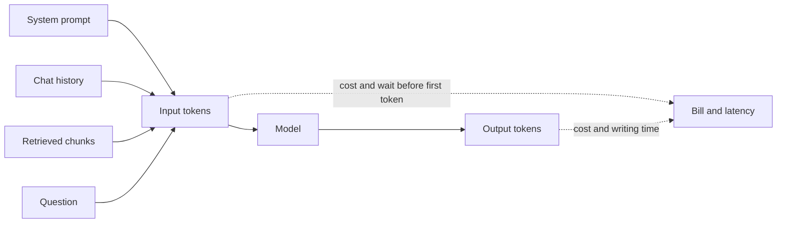

## "Why did the bill nearly triple?"

Sara's manager wants an answer by the end of the week. "The model got more information, so it costs more" is true, but it is not an answer. The manager needs to know how much each change cost, whether it bought any quality, and what Sara will change. That means turning a prompt into numbers.

This chapter gives you a method you can use for any system, in Sara's job or in a system design round. By the end you can estimate the tokens, the cost and the latency of one request and of a month of traffic, and explain why a longer prompt is not free.

## What a token is, roughly

Models do not read words or letters. A <GlossaryTerm term="tokenizer" definition="The part of a model's software that splits text into tokens and turns them into numbers. Each model family has its own, so counts differ between models." /> splits text into tokens: common words are often one token, and rare words, names and codes are split into several. A rough rule for English is about four characters, or three quarters of a word, per token. So 300 English words is roughly 400 tokens.

Treat that rule as a first guess only. Arabic text, code, tables and product codes like `ZM-NET-15` often take more tokens per word than plain English. For a real estimate, run a sample of your real prompts through your provider's token counter and use the measured average.

## Everything in the request counts

The question is a tiny part of a request. Sara's assistant sends four things every time, and the model's answer comes back as a fifth. The diagram shows where each one goes.



Read it from the right. The bill and the latency both depend on two counts: input tokens and output tokens. The input side is the sum of everything you send, and the question is usually the smallest part. Many providers also charge more per output token than per input token, so a long answer can cost more than a long prompt. Check your provider's price page for the real ratio.

<BigWordAlert term="Context window" plainEnglish="The largest number of tokens a model can handle in one request, counting what you send and, usually, what it writes back." whyItMatters="It is a hard limit, but staying under it is not enough: every token inside it adds cost and delay, and a crowded window can hide the one piece of text that matters." />

## Worked example: Sara's bill

Here are the scenario's numbers. The prices are made up for this example; never quote a real provider's price from memory in an interview. Use round example prices and say so.

| Part of the request | Before | After |
|---|---|---|
| System prompt | 600 | 600 |
| Chat history | 400 (last 2 turns) | 3,000 (whole chat) |
| Retrieved chunks | 1,200 (3 x 400) | 4,000 (10 x 400) |
| Question | 50 | 50 |
| Answer (output) | 250 | 350 |

The answers also got longer after the change, because the model had more material to summarise. Here is the arithmetic as code, so you can reuse it:

```python
def request_cost(input_tokens: int, output_tokens: int,
                 in_price: float, out_price: float) -> float:
    """Dollars for one request. Prices are dollars per million tokens."""
    return (input_tokens * in_price + output_tokens * out_price) / 1_000_000


IN_PRICE, OUT_PRICE = 1.00, 4.00   # made-up example prices
REQUESTS_PER_MONTH = 10_000 * 30

before = {"system": 600, "history": 400, "chunks": 3 * 400, "question": 50}
after = {"system": 600, "history": 3_000, "chunks": 10 * 400, "question": 50}

for name, parts, output in [("before", before, 250), ("after", after, 350)]:
    tokens_in = sum(parts.values())
    one = request_cost(tokens_in, output, IN_PRICE, OUT_PRICE)
    print(name, tokens_in, f"${one:.5f}", f"${one * REQUESTS_PER_MONTH:,.0f}")
```

```text
before 2250 $0.00325 $975
after 7650 $0.00905 $2,715
```

Input tokens went from 2,250 to 7,650 per request. At 10,000 requests a day, the month went from about $1,000 to about $2,700. Now Sara can say exactly where the money went: 2,800 tokens from extra chunks, 2,600 from full history and 100 more output tokens, on every single request.

## Latency: the first token and the last token

Users feel two different waits. The first is the <GlossaryTerm term="time to first token" definition="How long the user waits from sending a request until the first piece of the answer arrives." />: the model must read the whole input before it writes anything, so a longer prompt usually means a longer wait here. The second is the writing time: output is produced token by token, so a longer answer takes longer to finish.

A simple model: total time is the time to first token plus output tokens divided by writing speed. In this example, assume 80 tokens a second. Before the change: 0.6 seconds to the first token plus 250 / 80 = 3.1 seconds, so about 3.7 seconds. After: the longer input pushed the first token to about 1.5 seconds, and 350 / 80 = 4.4 seconds, so about 5.9 seconds.

This tells Sara where to cut. Output length dominates total time. Asking for a 150-token answer brings "after" down to about 3.4 seconds even with the long prompt. <GlossaryTerm term="Streaming" definition="Sending the answer to the user piece by piece as the model writes it, instead of waiting for the whole answer." /> helps too: the user starts reading after the first token. But streaming changes how fast it feels, not the total time or the cost.

## A bigger window is not a better prompt

Context windows differ a lot between models, from a few thousand tokens to hundreds of thousands or more. It is tempting to fill a large one. There are three reasons not to. Every token costs money on every request. Every input token adds to the wait before the first token. And more text can make answers worse.

Research on long prompts has found that some models use information near the start and the end of the context more reliably than information in the middle. How strong this effect is varies by model and task, and newer models may show it less. So do not assume it, and do not ignore it: test it on your own questions by placing the right chunk at different positions and checking the answers. In Sara's case, the right cancellation rule was chunk 6 of 10, and the model used chunk 2.

## Deciding what to cut

Each cut has a cost, so match it to your numbers:

- **Fewer, better chunks.** Go back to 3 to 5 chunks and improve which ones are chosen (module 4 adds reranking). Risk: a question that needs evidence from several places misses some. Measure with a golden set before and after (module 5).
- **Trim the history.** Keep the last few turns plus a short summary of older ones. Risk: in a long chat, the model forgets an early detail, such as the customer's bundle name.
- **Cap the answer.** Ask for a short answer and set a maximum output length. Risk: a cut-off answer if the cap is too low.
- **Route simple questions to a smaller model.** Covered in module 4. Risk: you now have two models to test and monitor.

Sara chose the first three. Her plan: 5 chunks instead of 10, the last 4 turns plus a two-sentence summary of older ones, and answers capped at about 200 tokens. With the same method, that is roughly 4,000 input tokens (600 system, about 1,350 history, 2,000 chunks, 50 question) and 200 output tokens per request, about $0.0048, or about $1,440 a month. She did not stop there. She ran 50 real customer questions before and after the change, so she could tell her manager the cost dropped by almost half and the answers were no worse.

## When the numbers surprise you

Log the token count of each part of the prompt, not only the total, on every request. Without the split, Sara could only see that the bill went up, not why. Watch percentiles, not only averages: a few very long chats can drive the bill while the average looks normal.

Two more surprises are common. First, every retry is a full new request, so a bug that retries three times triples the cost of those requests. Second, when a request is larger than the window, some systems reject it with an error and some quietly cut the oldest text. Find out which one yours does before a long conversation finds out for you.

```quiz
type: mcq
question: "A team summarises 200 call transcripts a day. Each request sends a 400-token system prompt and a 6,000-token transcript, and gets a 300-token summary. With example prices of $1 per million input tokens and $4 per million output tokens, which change cuts the cost per request the most?"
options:
  - "Ask the model for a 150-token summary instead of a 300-token one"
  - "Strip greetings and hold notes, cutting each transcript by 30%"
  - "Lower the temperature from 0.7 to 0 so the output is stable"
  - "Shorten the system prompt from 400 tokens down to 200 tokens"
correct: 1
explanations:
  - "This saves 150 output tokens at $4 per million, about 8 percent of the cost per request. Output is pricier per token, but there is little of it here."
  - "Right. Cutting 1,800 input tokens saves about 24 percent per request, because the transcript is by far the largest part of the request."
  - "Temperature changes how the model picks tokens, not how many tokens are sent or written, so the cost stays the same."
  - "This saves 200 input tokens, under 3 percent per request. The system prompt is small next to a 6,000-token transcript."
```

## In the interview

Cost and context questions appear in system design ("estimate the monthly cost") and in the managerial round ("tell me about a cost surprise"). Interviewers want the method more than the exact number: tokens per part, times price, times traffic, with stated assumptions. Answer each question aloud first, then open the item.

<FaqGroup title="Practice questions">
<FaqItem question="Our model bill doubled last month. How would you investigate?">

First I would split the bill into requests per day, input tokens per request and output tokens per request, because it doubled through one or more of those three. Then I would break input tokens down by part: system prompt, history, retrieved chunks and question, and compare the percentiles month on month. I would also check the retry rate, since every retry is a full request. In one case like this, input tokens per request tripled because someone raised the chunks from 3 to 10 and sent the whole chat history. I would then check, with a golden set, whether the extra tokens bought any quality before deciding what to roll back.

**Follow-up probes:**

- What if the requests per day doubled instead, with the same tokens per request?
- How would you stop this from happening silently next time?

</FaqItem>
<FaqItem question="Estimate the monthly cost of a support assistant for 10,000 questions a day.">

I would state my assumptions first: about 2,250 input tokens per request (a 600-token system prompt, two turns of history, three 400-token chunks and the question) and about 250 output tokens. With example prices of $1 per million input and $4 per million output, that is about $0.00325 per request. At 10,000 a day, that is about $32 a day, or about $1,000 a month. I would then say which assumption moves the number most, here the chunk count and the answer length, and add a margin for retries and growth.

**Follow-up probes:**

- How would the estimate change if users had long conversations?
- What would you measure in the first week to replace your assumptions?

</FaqItem>
<FaqItem question="Why not put all the documents in one large context window instead of using retrieval?">

For a handful of short documents it can be a reasonable start, and it removes retrieval errors. But cost and latency grow with every request: 300 articles of 400 tokens is 120,000 input tokens per question, against about 2,250 with retrieval, so roughly 50 times the input cost. The wait before the first token grows too. And quality can drop when the right passage is buried among many others. Retrieval also lets me cite exactly which article an answer came from, which matters for support.

**Follow-up probes:**

- At what document count would you switch from "send everything" to retrieval?
- How would you test whether the long-context version answers worse?

</FaqItem>
</FaqGroup>

**Next:** Embeddings and similarity: how the search chooses which chunks go into the prompt, and why it missed the exact bundle code.
