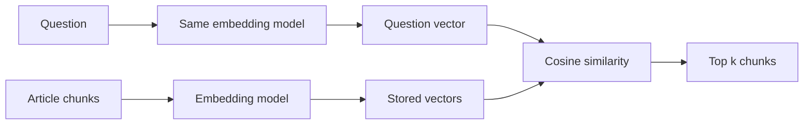

## Two searches that went wrong in opposite ways

Zaytoon Mobile's old help search matched words. A customer typed "How do I stop my data package?" and got nothing useful, because the right article was called "Cancelling a bundle". It shares no important words with the question. Sara's team replaced it with embedding search, and questions like that started to work.

Then a different problem appeared. A customer typed "Is ZM-NET-15 still active?" The new search returned a general article about bundles instead of the article for that exact bundle. The old word search would have found it instantly.

Both failures have the same root: what the search compares. This chapter explains how embedding search compares text, lets you compute it by hand, and shows where it fails, so you can explain the trade-off in an interview. By the end you can say what an embedding is, how cosine similarity ranks chunks, and when to reach for something else.

<BigWordAlert term="Embedding" plainEnglish="A list of numbers that an embedding model produces from a piece of text, arranged so that texts with similar meaning get similar lists." whyItMatters="Retrieval in most RAG systems ranks chunks by comparing these lists, so the strengths and blind spots of embeddings become the strengths and blind spots of your search." />

## From text to numbers

An embedding model reads a piece of text and returns a <GlossaryTerm term="vector" definition="An ordered list of numbers. An embedding vector often has hundreds or thousands of numbers." />. The model was trained so that texts with similar meaning land close together. "Stop my data package" and "Cancelling a bundle" get similar vectors even though they share no words.

Search then works in two paths. When you index, you embed every chunk once and store the vectors. When a question arrives, you embed the question with the same model and compare its vector with the stored ones. The diagram shows both paths meeting at the comparison.



Notice the word "same". The two paths must use the same embedding model, because each model arranges meaning in its own way. A vector from one model cannot be compared with a vector from another, even if they have the same length. If you change the model, you must embed every stored chunk again.

## Cosine similarity, by hand

To compare two vectors, most RAG systems use cosine similarity. It measures whether two vectors point in the same direction, and it ignores how long they are. A score of 1 means the same direction; 0 means unrelated. The formula has three parts: multiply the vectors number by number and add the results (the dot product), then divide by the length of each vector.

Real embeddings have hundreds of numbers, and no single number has a human meaning. For a hand example we use three numbers and pretend each one measures a topic: cancelling, bundles and coverage.

- The question "How do I stop my data package?" is `[0.6, 0.8, 0.0]`.
- Chunk A, "Cancelling a bundle", is `[0.8, 0.6, 0.0]`.
- Chunk B, "Bundle coverage in rural areas", is `[0.0, 0.6, 0.8]`.

Each vector here has length 1. For the question, the square root of 0.36 + 0.64 + 0 is 1. When both lengths are 1, the division does nothing, and cosine similarity is just the dot product:

- Question and A: 0.6 x 0.8 + 0.8 x 0.6 + 0 x 0 = 0.48 + 0.48 = **0.96**
- Question and B: 0.6 x 0 + 0.8 x 0.6 + 0 x 0.8 = **0.48**

Chunk A ranks first, as it should. Now double chunk A to `[1.6, 1.2, 0.0]`. It points the same way, but it is twice as long. The dot product doubles to 1.92, but cosine similarity divides by the length and stays 0.96. That is the point of cosine: it compares direction, which carries the meaning, not size.

Here is the same calculation in plain Python, which you can run to check your hand work:

```python
import math


def cosine(a: list[float], b: list[float]) -> float:
    dot = sum(x * y for x, y in zip(a, b))
    norm_a = math.sqrt(sum(x * x for x in a))
    norm_b = math.sqrt(sum(y * y for y in b))
    if norm_a == 0 or norm_b == 0:
        return 0.0
    return dot / (norm_a * norm_b)


query = [0.6, 0.8, 0.0]
print(round(cosine(query, [0.8, 0.6, 0.0]), 2))  # 0.96
print(round(cosine(query, [0.0, 0.6, 0.8]), 2))  # 0.48
print(round(cosine(query, [1.6, 1.2, 0.0]), 2))  # 0.96
```

Many systems <GlossaryTerm term="normalise" definition="Divide every number in a vector by the vector's length, so its length becomes 1. Then a plain dot product gives the cosine similarity." /> every vector when they store it, so search only needs the dot product. The store you build in module 3 does this.

## Where embeddings fail

Embeddings capture meaning in general. They are weaker at the things that carry little general meaning, and at small words that flip the meaning. Before you read the list, predict Sara's second problem.

```predict
prompt: "A customer asks 'Is ZM-NET-15 still active?'. The article for that bundle contains the code. Will embedding search reliably rank that article first?"
options:
  - id: found
    label: "Yes, since the same code appears in both texts"
  - id: unreliable
    label: "Not reliably; a code carries little meaning"
correctOptionId: unreliable
explanation: "A product code has no general meaning for the embedding model, so it adds little to the vector. Articles about bundles in general can score just as high. Word-matching search handles exact codes well."
```

The common failure modes:

- **Exact codes, IDs and numbers.** Bundle codes, order numbers, error codes. <GlossaryTerm term="Keyword search" definition="Search that ranks text by the words it shares with the question, giving rare words more weight. BM25 is the common method." /> finds them well. Module 4 combines both kinds of search.
- **Negation.** "You can cancel a bundle" and "You cannot cancel a bundle" often get very similar vectors, because they are about the same topic. Retrieval may return either one; the model must then read carefully.
- **Rare domain words.** Internal product names and local terms the model rarely saw in training may be placed badly.
- **Long, mixed chunks.** A chunk about three topics gets a vector that is a blur of all three, and it matches none of them strongly. This is one reason chunk size matters (module 3).
- **Scores are not probabilities.** A score of 0.8 does not mean "80 percent relevant". What counts as a high score depends on the model, so set any threshold from your own test questions.

## Choosing an embedding model

You choose between hosted models, where you pay per token and send your text to a provider, and local open models, where you run the model yourself and pay in hardware and operations. Privacy rules can make the choice for you.

Vector size is a second trade-off. Storage grows with dimensions. One million chunks with 1,024 numbers each, stored as 4-byte floats, is about 4.1 GB; with 384 numbers it is about 1.5 GB. Bigger vectors may capture more, but not always for your documents. Do not trust a general ranking: embed your own chunks with two or three candidate models and measure how often each finds the right chunk on your test questions.

## Using scores to say "I don't know"

Similarity scores have one more job. If no chunk scores well, the honest answer may be "I don't know", not a guess from a weak chunk. The pipeline you build in module 3 does exactly this: below a minimum score, it does not call the model at all. Choosing that minimum is a measurement, not a guess. Run your test questions, write down the top score when the right chunk was found and when it was not, and pick the value that separates the two groups best. Expect some overlap. A higher minimum gives fewer wrong answers and more "I don't know" replies, so agree the balance with the people who own the product.

## Debugging bad retrieval

When a question gets the wrong chunks, print the top five chunks with their scores. Then check four things in order. Is the right chunk in the store at all, with clean text and not PDF junk? Were the stored chunks and the question embedded by the same model, with the same normalisation? Is the right chunk long and mixed, so its vector is blurred? Does the question rely on a code or a negation? Each answer points to a different fix: ingestion, configuration, chunking or keyword search.

```quiz
type: mcq
question: "A team upgrades its embedding model for incoming questions but forgets to re-embed the 50,000 stored chunks. Both models produce vectors of the same length, so nothing crashes. What happens to search?"
options:
  - "Search improves a little, because the newer model understands more"
  - "Nothing changes, since cosine similarity ignores vector length"
  - "Scores stop meaning anything: the vectors come from two models"
  - "Only questions longer than a chunk fail; short ones still work"
correct: 2
explanations:
  - "Each model arranges meaning in its own way, so comparing a new question vector with old chunk vectors gives no useful signal, whatever the model's quality."
  - "Cosine ignores length, but the problem is direction. Two models point the same meaning in different directions."
  - "Right. The vectors were made by different models, so similarity between them is close to noise. Re-embed every chunk when you change the model."
  - "Question length is not the issue. Every comparison mixes vectors from two different models, so every question is affected."
```

## In the interview

Embeddings come up in the deep dive ("which embedding model did you use, and why?") and in system design ("how will you find the right documents?"). A strong answer explains the mechanism in one sentence and moves quickly to failure modes and measurement. Answer each question aloud first, then open the item.

<FaqGroup title="Practice questions">
<FaqItem question="Explain cosine similarity to a new teammate.">

An embedding model turns text into a vector, and texts with similar meaning point in similar directions. Cosine similarity measures how close two directions are: 1 means the same direction, 0 means unrelated. You compute it as the dot product divided by the two lengths, so a long vector and a short one in the same direction score the same. In practice we normalise every vector to length 1 when we store it, so search only needs a dot product. For example, a question vector and a cancellation chunk might score 0.96 while a coverage chunk scores 0.48, so the cancellation chunk ranks first.

**Follow-up probes:**

- Why might you prefer cosine over the plain dot product?
- If two chunks both score 0.82, how do you decide which goes first?

</FaqItem>
<FaqItem question="When does embedding search fail, and what would you do about it?">

It fails on exact strings like order numbers and product codes, because they carry little general meaning. It also struggles with negation, rare internal terms and long chunks that mix topics. For codes I would add keyword search and merge the two result lists, which module 4 covers as hybrid search. For mixed chunks I would make chunks smaller or split them on headings. In every case I would measure on a golden set before and after, for example the share of questions whose right chunk is in the top five.

**Follow-up probes:**

- How would you detect that a question contains a code before searching?
- What would you do if negation caused wrong answers in production?

</FaqItem>
<FaqItem question="How would you choose an embedding model for our documents?">

I would start from constraints: whether the text may leave our network, our budget, and how many chunks we store. Then I would shortlist two or three models that meet them and embed our own chunks with each. On a golden set of 50 to 100 real questions with known right chunks, I would compare how often each model puts the right chunk in the top five, plus embedding time and storage. For a million chunks, 1,024 dimensions needs about 4 GB of vectors against about 1.5 GB at 384, so a smaller model that scores the same wins.

**Follow-up probes:**

- What would you do if the best model is hosted and the documents are confidential?
- How would you migrate to a new model without downtime?

</FaqItem>
</FaqGroup>

**Next:** Prompts, sampling and structured outputs: how to get data your code can trust from a model that sometimes wraps its JSON in a sentence.
