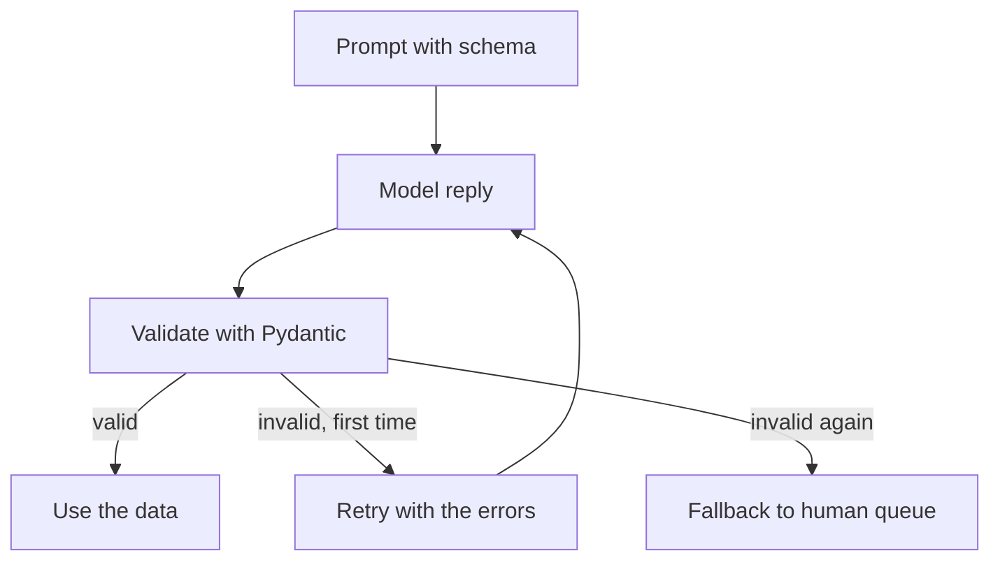

## The ticket sorter that crashed twice a day

Zaytoon Mobile's support team gets about 3,000 messages a day. Sara's teammate built a small feature that asks a model to sort each message into a category and an urgency, so it reaches the right team. The code called `json.loads()` on the model's reply and used the result.

It worked in testing. In production it crashed about twice a day. Sometimes the model replied "Sure! Here is the JSON:" before the data, and parsing failed. Once it invented a category, "refund", that no team owned, so the message went nowhere for a day. Once it set urgency to 5 on a scale of 1 to 3.

The model was not broken. The code trusted text as if it were data. This chapter shows how to ask for data, check it, and decide what to do when the check fails. By the end you can write a prompt with a schema, validate the reply with Pydantic, handle a failed validation, and choose a temperature for the task.

## The parts of a good prompt

A prompt for a task like this has five parts. A one-sentence task: "Classify this customer message." The rules: the allowed categories and what each one means. The input: the message itself, clearly marked. One or two <GlossaryTerm term="few-shot examples" definition="A small number of example inputs with their correct outputs, placed in the prompt so the model can copy the pattern." /> showing a message and its correct output. And the output format: the exact fields, types and allowed values.

Two rules make the biggest difference. First, say what to do when the model is unsure: "If no category fits, use other and set needs_human to true." Without that rule the model invents a category, as it did with "refund". Second, keep instructions that never change in the <GlossaryTerm term="system prompt" definition="Instructions sent with every request, separate from the user's message, that set the model's task and rules." /> and put the changing input in the user message, so you can see and test them separately.

## Sampling and temperature

A model writes one token at a time. At each step it gives every possible next token a probability, and a sampler picks one. Temperature controls that pick. A low temperature makes the most likely token win almost every time, so replies are consistent. A high temperature gives less likely tokens more chances, so replies vary more. <GlossaryTerm term="Top-p" definition="Another sampling setting: the model only picks from the most likely tokens whose probabilities add up to p, for example 0.9." /> is a related setting; change one of the two, not both at once.

Match the temperature to the task:

- **Classification, extraction and JSON:** low, 0 to 0.2. You want the same answer for the same input.
- **Support replies written for customers:** low to moderate, about 0.3 to 0.7. Some variety reads naturally, but facts must not drift.
- **Brainstorming names or test questions:** higher, about 0.8 to 1.0. Variety is the goal.

The ticket sorter shows why this matters. Sara's teammate had left the temperature at 0.9, copied from a chat demo. Sara ran the same 100 messages through the sorter twice. In this example, 9 messages got a different category on the second run. At temperature 0, only 1 did. A sorter that changes its mind about the same message cannot be tested, and the support team cannot trust it.

Treat these as starting points and test them. Even at temperature 0, outputs are often close to repeatable but not guaranteed identical across calls. And temperature does not change cost, does not add knowledge, and does not guarantee valid JSON. For that, you validate.

<BigWordAlert term="Structured output" plainEnglish="A model reply that follows an exact data shape, such as JSON with named fields, fixed types and allowed values, so code can use it directly." whyItMatters="Most model features end in code, not in a person reading text. Code needs data it can trust, so you must define the shape and check every reply against it." />

## Define the shape once, with Pydantic

Pydantic lets you describe the data shape as a Python class. The same class does three jobs: it generates a JSON Schema to put in the prompt, it validates the reply, and it gives the rest of your code typed data.

```python
import json
from typing import Literal

from pydantic import BaseModel, Field, ValidationError


class TicketTriage(BaseModel):
    category: Literal["billing", "network", "bundle", "other"]
    urgency: int = Field(ge=1, le=3)
    summary: str = Field(min_length=5, max_length=200)
    needs_human: bool


SCHEMA = json.dumps(TicketTriage.model_json_schema())


def build_prompt(message: str) -> str:
    return ("Classify this customer message. Reply with JSON only, "
            f"matching this JSON Schema:\n{SCHEMA}\n\nMessage: {message}")
```

`Literal` limits `category` to four values, so "refund" is rejected. `Field(ge=1, le=3)` rejects urgency 5. Many providers also offer a JSON or schema mode that makes invalid replies much less likely. Use it when you have it, and validate anyway: a schema mode cannot check your business rules, and you may change providers later.

## When validation fails: retry with the error, then fall back

The diagram shows the whole flow. Read it before the code.



There are only two exits: valid data, or a safe fallback. There is no path where bad data reaches the rest of the system, and no path that loops forever. The retry sends the specific errors back to the model, which fixes most format mistakes on the second try. The cap matters because every retry is a full new request, with its full cost.

```python
FALLBACK = TicketTriage(category="other", urgency=2,
                        summary="Could not classify automatically.",
                        needs_human=True)


def short_errors(err: ValidationError) -> str:
    return "; ".join(f"{'.'.join(map(str, e['loc'])) or 'reply'}: {e['msg']}"
                     for e in err.errors())


def triage(message: str, llm, max_attempts: int = 2) -> TicketTriage:
    prompt = build_prompt(message)
    for _ in range(max_attempts):
        raw = llm.complete(prompt)
        try:
            return TicketTriage.model_validate_json(raw)
        except ValidationError as err:
            prompt = (build_prompt(message)
                      + f"\n\nYour last reply was invalid: {short_errors(err)}."
                      + " Reply again with JSON only.")
    return FALLBACK
```

To test it without a real model, use a fake one that returns scripted replies. Here, the first reply uses category "refund" and urgency 5; the second is valid. A second fake replies with plain text twice. These are the real outputs:

```text
category: Input should be 'billing', 'network', 'bundle' or 'other'; urgency: Input should be less than or equal to 3
category='bundle' urgency=2 summary='Bundle charged twice' needs_human=False
reply: Invalid JSON: expected value at line 1 column 1
category='other' urgency=2 summary='Could not classify automatically.' needs_human=True
```

The first line is the error message the retry sends back. The second is the valid result after one retry. The third is what "Sure! Here is the JSON" turns into, and the fourth is the fallback after two invalid replies: the message goes to a human, not nowhere.

<Callout type="tip" title="Short errors, not full tracebacks">
Send the model the field name and the message only. A full validation error is long and includes text the model does not need, so it costs tokens without helping.
</Callout>

## Choosing the fallback

The fallback is a product decision, not only a code decision. For the ticket sorter, "other, needs a human" is safe because a person reads every unsorted message. For a feature that issues refunds, the fallback must be "do nothing and ask a human", never a default amount. Ask: if this fallback is used a thousand times, what is the cost? A few extra messages for a human team is fine. A thousand wrong actions is not.

## What validation cannot catch

Validation checks the shape, not the truth. A reply with category "billing" for a message about network coverage passes validation and is still wrong. To catch that, you need a set of labelled messages and a measured accuracy, which module 5 teaches. So track two numbers separately: the validation failure rate, which tells you about format problems, and the accuracy on labelled messages, which tells you about quality.

Common mistakes, and their fixes:

- **A schema stricter than reality.** A 50-character summary limit fails on every long message. Look at which field fails most often in your logs and fix the schema or the prompt.
- **A schema looser than reality.** `category: str` accepts "refund". Use `Literal` or an enum for fixed sets.
- **JSON inside a code fence.** Some replies wrap the JSON in Markdown fences, which is invalid JSON. Either strip the fence before parsing, or let the retry tell the model.
- **No logging.** Keep the raw reply of every failed validation. Without it you cannot tell a prompt problem from a schema problem.

```quiz
type: mcq
question: "An invoice feature asks a model for JSON with a total as a number. About 1 in 50 replies gives the total as the text '1,250.00 USD', so validation fails. Wrong totals would cause wrong payments. What should the code do?"
options:
  - "Raise the temperature, so the model tries a different format next time"
  - "Retry once with the error, then send the invoice to a manual review queue"
  - "Remove the number type from the schema and store whatever text comes back"
  - "Keep retrying with the same prompt until a reply finally passes validation"
correct: 1
explanations:
  - "A higher temperature makes replies more random, not more correct, and it does nothing to stop bad data reaching payments."
  - "Right. The retry with the specific error fixes most format slips, and the manual queue is a safe fallback when money is involved."
  - "This moves the problem into the payment code, which now has to parse free text and may pay a wrong amount."
  - "Without a limit, one stubborn reply can loop many times, and every retry is a full request with its full cost."
```

## In the interview

Structured outputs come up in the hands-on round ("parse and validate this model reply") and in system design ("how does the agent call tools safely?"). Interviewers listen for three things: a schema, a bounded retry, and a safe fallback. Answer each question aloud first, then open the item.

<FaqGroup title="Practice questions">
<FaqItem question="How do you get reliable JSON out of a model?">

I define the shape once as a Pydantic model, put its JSON Schema in the prompt, and use the provider's JSON or schema mode if there is one. I validate every reply with the Pydantic model, never with a bare json.loads. If validation fails, I retry once with the short error messages, then fall back to a safe default, such as sending the item to a human queue. I log every raw reply that failed and watch the failure rate; in one ticket sorter it dropped from about 2 crashes a day to zero, with roughly 1 in 500 messages going to the fallback.

**Follow-up probes:**

- Why not retry five times instead of once?
- How would you catch a reply that is valid but wrong?

</FaqItem>
<FaqItem question="What temperature would you use for a support reply, and why?">

For the customer-facing reply I would start around 0.3 to 0.5: low enough that facts and policy stay stable, high enough that replies do not all sound identical. For the classification step before it, I would use 0, because I want the same category for the same message. I would not trust the number blindly: I would run 50 labelled questions at two settings and compare both accuracy and how often the wording drifts from the policy. Temperature does not change cost, so the choice is only about quality and consistency.

**Follow-up probes:**

- Is temperature 0 fully deterministic?
- When would you use a higher temperature in a RAG system?

</FaqItem>
<FaqItem question="Validation passes, but some categories are wrong. How would you find and fix that?">

Validation only checks the shape, so this is a quality problem and needs labelled data. I would collect 200 real messages with the correct category agreed by the support team, run the classifier on them, and look at the confusion between categories. If billing and bundle are often mixed up, the fix is usually in the prompt: clearer definitions and one example for each confusing pair. I would rerun the same 200 messages after each change and only ship changes that raise accuracy.

**Follow-up probes:**

- How would you keep the 200 labelled messages up to date?
- What would you do if two support agents disagree on the right category?

</FaqItem>
</FaqGroup>

**Next:** A short quiz on tokens, cost, embeddings and structured outputs, then the gate for this module.
