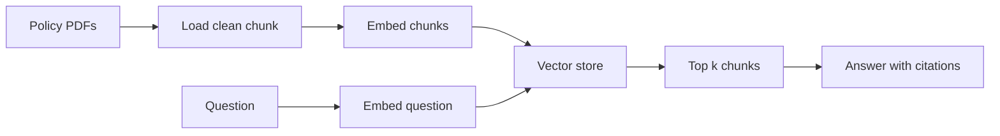

## The answer that cited last year's rule

Huda's first prototype for Najm Microfinance (a fictional lender) worked well in the demo. A week later, a loan officer asked about the late fee for a farming loan. The assistant answered "2% per month" and cited a passage. The citation was real. It came from the 2025 policy. The 2026 policy, with a lower fee, was also in the index. Both versions matched the question, and the old one happened to rank higher.

Nothing was wrong with the model. It answered faithfully from the passage it was given. The bug was earlier: when Huda added the new policy, she never removed the old one. To find bugs like this quickly, you need a map of the whole pipeline and of what can break at each step.

By the end of this chapter you can draw that map, name the failure points on it, and choose an embedding model with reasons.

<BigWordAlert term="Indexing path and query path" plainEnglish="A RAG system has two separate flows. The indexing path prepares your documents ahead of time. The query path runs for every question and uses what the indexing path stored." whyItMatters="Most RAG bugs live in one path and show up in the other. Knowing which path a step belongs to tells you where to look and when a fix takes effect." />

## Two paths, not one

The **indexing path** runs before anyone asks a question. It loads the documents, cleans the text, cuts it into <GlossaryTerm term="chunk" definition="A small piece of a document, a few sentences to a few paragraphs long, that is embedded, stored and retrieved on its own." />s, turns each chunk into a vector with an embedding model, and saves the vectors with their text and <GlossaryTerm term="metadata" definition="Extra facts stored next to each chunk, such as the document name, section heading, page number, language or the date a rule takes effect." />. It runs again only when documents change. It can be slow, because no user is waiting.

The **query path** runs every time a loan officer asks something. It embeds the question with the same model, searches the store for the nearest chunk vectors, takes the <GlossaryTerm term="top k" definition="The k highest scoring results of a search. With k = 3 you keep the three best chunks and drop the rest." /> chunks, puts them into a prompt with the question, and asks the model to answer from them and cite them. A user is waiting, so every step must be fast.

The diagram shows both paths. They meet at one place: the vector store.



Read it left to right on the top row for indexing, and from the question for the query path. Because the paths meet only at the store, the query path can only ever find what the indexing path put there. Huda's late-fee bug is exactly this: a mistake on the indexing path (an old version left in the store) that appeared as a wrong answer on the query path.

## A worked example with numbers

Najm has 40 policy PDFs, about 900 pages and 450,000 words. In this example Huda cuts them into chunks of 300 words that overlap by 50 words, so a new chunk starts every 250 words. That gives about 450,000 / 250 = 1,800 chunks.

Her embedding model returns vectors with 768 numbers each. Stored as 4-byte floats, that is 1,800 × 768 × 4 = about 5.5 MB. The whole index fits in a laptop's memory many times over. You will see in 3.4 that a collection this size needs no special search index at all.

On the query path, Huda measured these timings for one question in her prototype: embedding the question took 30 ms, searching 1,800 vectors took 5 ms, and the model call took about 1,800 ms. The prompt held three chunks, roughly 900 words or about 1,200 tokens, instead of the 600,000 or so tokens of the full policy set. Retrieval is cheap; the model call dominates both time and cost. That is a useful number to say in an interview.

## Where each step fails

Every step on both paths can fail in its own way. The table lists the failure you are most likely to meet at each step and the symptom that gives it away.

| Step | What goes wrong | How you notice |
|---|---|---|
| Load | A scanned PDF has no text layer | Questions about that policy never retrieve anything |
| Clean | Page headers repeat in every chunk | Unrelated chunks score high for any question |
| Chunk | A rule and its exception land in different chunks | Answers miss the exception |
| Embed | The model handles Arabic poorly | Arabic questions retrieve the wrong chunks |
| Store | An old version is never removed | Answers cite last year's rule |
| Retrieve | The right chunk ranks fifth with k = 3 | It is never in the prompt |
| Generate | The model adds facts not in the chunks | Claims with no matching passage |

When a user reports a wrong answer, the first question is always the same: **was the right passage in the prompt?** Print the retrieved chunks for that question. If the right passage is missing, it is a retrieval problem, and you look at loading, chunking, embedding, the store or k. If the right passage is there and the answer is still wrong, it is a generation problem, and you look at the prompt and the model. This one check halves the search space for every RAG bug.

## Choosing the embedding model

The embedding model decides which chunks count as "near" a question, so it is the biggest single choice on both paths. Interviewers expect you to choose it with criteria, not by popularity. Four criteria matter most.

**Dimension.** Each vector has a fixed length, its <GlossaryTerm term="dimension" definition="The number of values in each embedding vector, for example 384 or 1,024. More dimensions can hold more detail but cost more memory and search time." />. Memory and search time grow with it. For one million chunks, 384 dimensions need about 1.5 GB as 4-byte floats; 1,024 dimensions need about 4.1 GB. Larger is not always more accurate on your documents, so measure before paying for it.

**Language support.** Najm's loan officers often type half a question in Arabic and half in English, and some policies are in Arabic. A model trained mostly on English places Arabic text poorly, so Arabic questions miss English passages that say the same thing. Huda needs a <GlossaryTerm term="multilingual model" definition="An embedding model trained on many languages, so text with the same meaning lands close together even when the languages differ." /> and must test it on real mixed questions, not on a public English benchmark.

**Cost.** A hosted model charges per token. You pay once to embed every chunk, again whenever you re-embed, and a small amount for every question. A local model has no per-call price, but you pay for the machine and for running it.

**Local or hosted.** With a hosted model, every chunk and every question leaves your network. Najm's policies are not secret, but officers sometimes paste a borrower's name into the question. That alone can decide for a local model, or for removing names before the call.

Two rules sit on top of all four. First, the chunk must fit the model's maximum input length, or the end of the chunk is silently cut off. Second, the question and the chunks must be embedded by the same model, as the next prediction shows.

```predict
prompt: "Huda switches to a better multilingual model. To save time, she embeds only the 200 new chunks with it and keeps the 1,800 old vectors. What happens to search?"
options:
  - id: better
    label: "New chunks rank better, old chunks keep their old quality"
  - id: broken
    label: "Old and new vectors cannot be compared, so ranking breaks"
correctOptionId: broken
explanation: "Each model places text in its own vector space. A question embedded by the new model cannot be compared with vectors from the old model, so the old chunks get scores that mean nothing."
```

Vectors from two models are like map coordinates in two different systems: the numbers look similar, but comparing them gives nonsense. So changing the embedding model means re-embedding every chunk and switching the question side at the same moment. Plan that cost into any model change: with 1,800 chunks it takes minutes, with 50 million it is a project.

<Callout type="warning" title="Store the model name with the vectors">
Save the embedding model's name and version in each chunk's metadata. Then a check at start-up can refuse to search an index built with a different model, instead of returning quiet nonsense.
</Callout>

## Fixing the late-fee bug

Huda's fix had two parts, one on each path. On the indexing path, re-indexing a document now deletes all of its old chunks first, and every chunk stores an `effective_from` date. On the query path, search keeps only chunks whose rule is in effect today. The wrong answer disappeared, and she added the late-fee question to a small set of test questions so the bug cannot quietly return.

```quiz
type: mcq
question: "A week after launch, loan officers report that questions about the new microloan product return nothing useful. The product's policy PDF is in the folder, and other policies work fine. What should Huda check first?"
options:
  - "Raise k from 3 to 10 so more chunks reach the model on every question"
  - "Whether the PDF gave any text, since a scan yields no chunks to find"
  - "Switch to a larger generation model that can reason better about loans"
  - "Rewrite the system prompt so the model tries harder to find the answer"
correct: 1
explanations:
  - "Raising k cannot help if the store holds no chunks from that PDF. It only adds more unrelated text to the prompt."
  - "Right. One document fails while others work, which points to the indexing path. A scanned PDF with no text layer produces no chunks, so nothing can be retrieved."
  - "The model never sees the policy, so a better model has nothing to reason about. This is a retrieval problem."
  - "Prompt changes act on the query path. If the passage was never indexed, no prompt can make the model find it."
```

## In the interview

The pipeline question opens most RAG deep dives, usually as "walk me through your system". The interviewer listens for the two paths, a reason for each choice, and a failure you found. Answer each question below aloud first, then open it and compare.

<FaqGroup title="Practice questions">
<FaqItem question="Walk me through your RAG pipeline.">

I split it into two paths. Indexing runs when documents change: I load the PDFs, strip headers and footers, cut sections into chunks of about 300 words with 50 words of overlap, embed them with a multilingual model and store vectors with metadata such as document, section and effective date. The query path embeds the question with the same model, takes the top 3 chunks, and asks the model to answer only from them with citations. In my prototype retrieval took about 35 ms and the model call about 1,800 ms, so the model dominates latency and cost. If no chunk scores above a threshold, the system says it does not know.

**Follow-up probes:**

- Why 300 words and not 1,000?
- What happens when a policy document is updated?

</FaqItem>
<FaqItem question="How would you choose an embedding model for documents in Arabic and English?">

I would shortlist multilingual models, then test them on 30 to 50 real questions written the way users write them, including mixed Arabic and English, and measure how often the right chunk is in the top 3. Then I would compare dimension, because memory and search time grow with it, and cost per token if the model is hosted. If questions can contain personal data, I would prefer a local model or remove names before the call. Whatever I pick, I store the model name with the vectors, because changing the model means re-embedding everything.

**Follow-up probes:**

- How would you build those test questions without labelled data?
- What would make you pay for a larger dimension?

</FaqItem>
<FaqItem question="A user says an answer is wrong. How do you debug it?">

I first check whether the right passage was in the prompt, by logging the retrieved chunk ids for that request. If it was missing, the bug is on the retrieval side: the document may not have been indexed, a chunk may have split the rule, or the right chunk ranked below k. If the passage was there, the bug is generation: the prompt or the model ignored or misread the context. Either way, I add the question to my test set so the fix stays fixed.

**Follow-up probes:**

- What do you log on every request to make this possible?
- How do you tell an outdated document from a ranking problem?

</FaqItem>
</FaqGroup>

**Next:** The chunk step looks simple, but it decides what the search can find. You learn how to choose a chunk size, an overlap and a splitting rule.
