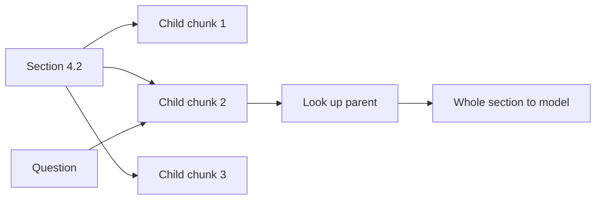

## The exception that went missing

Najm Microfinance (a fictional lender) has a rule in section 4.2 of its credit policy: "Loans above 5,000 dollars need the branch manager's approval." The next sentence says: "Exception: repeat borrowers with no late payment in 24 months need only the loan officer's approval." Huda's first chunker cut text every 200 words. The cut fell between those two sentences.

A loan officer asked whether a loyal repeat borrower's 6,000 dollar loan needed the manager. Search found the first chunk, with the rule, and the model said yes. The exception was in the next chunk, which ranked fourth and never reached the prompt. Every step worked as designed. The design was the problem.

By the end of this chapter you can choose a chunk size, an overlap and a splitting rule for a document set, and defend the choice the way an interviewer will ask.

## Why we cut documents at all

Why not embed each whole policy as one vector? Because an embedding squeezes all of a text's meaning into one fixed-length vector. A 40-page policy about loans, fees, approvals and collateral becomes one blurry average, and it is close to every loan question and very close to none. Small pieces keep their meaning sharp, so a question about late fees lands near the late-fee paragraph.

Small pieces also keep the prompt short. You saw in 3.2 that three chunks of 300 words cost about 1,200 tokens. Three whole policies could cost 60,000.

But a chunk that is too small loses the context that gives it meaning. "This limit does not apply to group loans" means nothing if the chunk does not say which limit. That is the tension behind every chunking choice.

<BigWordAlert term="Chunk size trade-off" plainEnglish="Small chunks match a question precisely but lose surrounding context. Large chunks keep context but blur their meaning and cost more tokens in the prompt." whyItMatters="There is no correct chunk size, only a size that fits your documents and your questions. Interviewers want to hear that you chose it with a reason and checked it with numbers." />

## Four ways to split

**Fixed size.** Cut every N words or tokens, whatever the text says. It is simple, fast and predictable, and every chunk has the same cost. It also cuts through sentences, tables and rules, as Huda found. It is a fair first baseline, and it is what you build in 3.5.

**By sentence or paragraph.** Cut only at sentence or paragraph ends, then pack whole sentences into chunks up to a size limit. No sentence is broken. The splitter must know the language, though: Arabic has its own question mark and comma, so a splitter that only knows English punctuation can produce one giant "sentence" from an Arabic page.

**By heading.** Use the document's own structure: each section or subsection becomes a chunk, and long sections are split further. Policies, manuals and contracts are written in sections that each cover one topic, so this often gives the cleanest chunks. It depends on the loader keeping the headings, which PDFs make hard (more on that in module 4).

**Overlap.** With any of the above, each chunk can repeat the last few sentences of the previous one. A rule near a boundary then appears whole in at least one chunk. Overlap of 10 to 20% of the chunk size is a common starting point, not a law. It costs storage and indexing time, and it can put two near-identical chunks into the same prompt.

## A worked example with numbers

Section 4 of Najm's credit policy has 900 words. Huda tries fixed chunks of 300 words with 50 words of overlap. A new chunk starts every 300 - 50 = 250 words, at word 0, 250, 500 and 750. The last chunk runs from word 750 to the end, so it has only 150 words.

That gives 4 chunks holding 300 + 300 + 300 + 150 = 1,050 words. Overlap cost her 150 extra words, about 17% more text to embed and store. In return, any rule that crosses a boundary by fewer than 50 words now sits whole in one chunk. The approval rule and its exception, about 40 words together, are safe.

Without overlap, she would have 3 chunks, with a cut every 300 words. A 40-word passage placed at random crosses a cut about 13% of the time (39 of every 300 starting points), roughly 1 in 8. Over 1,800 chunks, that is many broken rules, and nobody would know which ones.

## Small to big: search small, answer big

Huda still has a problem. Small chunks (say 100 words) match questions best, but the model needs the whole section to answer correctly. The usual fix is **parent-child retrieval**, also called **small-to-big** retrieval.

You index small child chunks for search, and each child remembers its <GlossaryTerm term="parent section" definition="The larger piece of text a small chunk was cut from, such as the whole subsection under one heading. It is stored separately and sent to the model instead of the small chunk." />. At query time you search the children, then send their parents to the model. The diagram shows the flow.



The question matches child chunk 2 precisely, because that chunk is short and sharp. But the model receives all of section 4.2, so it sees both the rule and the exception. Precision comes from the small chunk; context comes from the big one. The cost is a bigger prompt, so if two children of the same parent match, send the parent only once.

## Metadata: what each chunk should carry

A chunk's text is not enough. Store with it the document name, the section heading, the page number, the language and, for Najm, the date the rule takes effect and the loan products it covers. Metadata lets you filter ("only policies in effect today"), cite precisely ("credit policy, section 4.2, page 17") and debug ("which file did this come from?").

One cheap trick helps a lot: add the section heading to the start of the chunk text before embedding, for example "Credit policy > 4.2 Approval limits: ...". A chunk that says "This limit does not apply to group loans" now carries the words "approval limits" too, so it lands near approval questions.

```predict
prompt: "Najm's late-fee policy is a 3-page section with a short rule per loan product. Officers ask short, specific questions. Which chunking should Huda try first?"
options:
  - id: heading
    label: "Split by product heading, heading added to each chunk"
  - id: fixed
    label: "Cut every 1,000 words so each section stays whole"
correctOptionId: heading
explanation: "Each product's rule is a natural unit, and the heading tells the embedding which product it is about. A 1,000-word chunk mixes every product, so its vector is a blur and every answer must dig through the full section."
```

## How to choose and defend a size

Start from the questions, not the documents. Short factual questions ("what is the late fee for X?") favour small chunks. Questions that need a whole procedure ("how do I restructure a loan?") favour larger chunks or small-to-big. Then check two limits: the chunk must fit the embedding model's input length, and k chunks must fit your prompt budget.

Then measure. Write 30 or more real questions with the chunk that answers each one, and count how often that chunk is in the top 3 for each setting. Module 5 turns this into recall@k. A defence such as "I tried 150, 300 and 600 words; 300 with 50 overlap found the right chunk for 27 of 30 questions, against 22 and 24" is what an interviewer wants to hear.

<Callout type="tip" title="Read your chunks">
Before you measure anything, print 20 random chunks and read them. Cut sentences, repeated footers and chunks that are only a table header show up in minutes.
</Callout>

## Failure modes and debugging

- **Answers miss exceptions or conditions:** the rule and its condition are split. Add overlap, split by heading, or use small-to-big.
- **Many chunks look alike in the results:** overlap is too large, or the same boilerplate repeats across documents. Reduce overlap and strip repeated text.
- **A chunk matches but the answer is vague:** the chunk has the topic but not the detail. Send the parent section.
- **Tables answer badly:** fixed-size cuts separate rows from their headers. Module 4 treats tables properly.

## In the interview

Chunking is the most common follow-up after "walk me through your pipeline". The interviewer wants a reason tied to your documents and a number that shows you checked. Answer each question aloud first, then open it.

<FaqGroup title="Practice questions">
<FaqItem question="How did you choose your chunk size and overlap?">

I started from the questions users ask: short factual questions about policy rules, so I wanted chunks small enough to be precise. I split by section heading, capped chunks at 300 words, and added 50 words of overlap so a rule and its exception stay together. I compared 150, 300 and 600 words on 30 labelled questions; 300 found the right chunk in the top 3 for 27 of 30. Overlap added about 17% to the index size, which was cheap at our scale.

**Follow-up probes:**

- What would you change if the questions were about whole procedures?
- How would you know if your overlap is too large?

</FaqItem>
<FaqItem question="What is parent-child retrieval and when would you use it?">

You index small child chunks for search and keep a link from each one to its larger parent, such as the whole section. At query time you search the children, which match precisely, and send the parents to the model, which needs the context. I would use it when users ask specific questions but answers depend on surrounding conditions, as in policies and contracts. The cost is a bigger prompt, so I deduplicate parents and cap how many I send.

**Follow-up probes:**

- How big would you make the children and the parents?
- What happens to your token cost per question?

</FaqItem>
</FaqGroup>

**Next:** Once you have chunks and vectors, you need somewhere to keep them and a fast way to search them. You compare exact and approximate search and three kinds of vector store.
