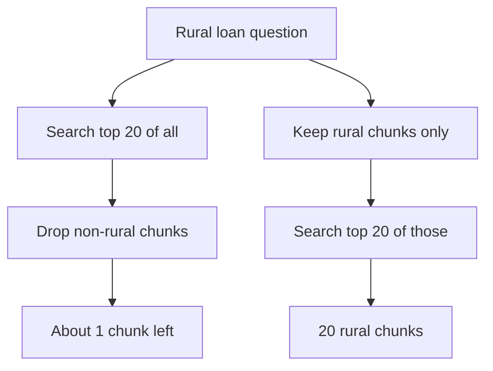

## From 1,800 chunks to 2 million

Huda's assistant for Najm Microfinance (a fictional lender) searches 1,800 policy chunks in about 5 ms. Then the credit committee asks for more: ten years of circulars, branch memos and committee notes. That is about 2 million chunks.

Her search compares the question with every stored vector. If the time grows in proportion, 2 million chunks is about 1,100 times the work, so roughly 5.5 seconds per question before the model even starts. The loan officers will not wait that long, and the server cannot serve many of them at once.

By the end of this chapter you can say when exact search is enough, what an approximate index trades away, how filters interact with search, and where to keep the vectors.

## Exact search: simple, correct, and linear

Exact search, also called brute-force or flat search, scores the question against every vector and keeps the best k. The work is the number of vectors times the dimension: 1,800 × 768 is about 1.4 million multiply-and-add steps, which a laptop does in a few milliseconds. At 2 million vectors it is about 1.5 billion steps per question.

Exact search has one big strength: it always returns the true nearest vectors. Nothing is missed except what the embedding itself gets wrong. So for small and medium collections it is often the right answer, not a beginner's shortcut. You build exactly this in 3.5.

## Approximate search: visit a few, not all

For millions of vectors, systems use an <GlossaryTerm term="index" definition="A data structure built ahead of time from the stored vectors so that a search can look at a small part of the collection instead of all of it." /> that skips most vectors.

<BigWordAlert term="Approximate nearest neighbour (ANN) search" plainEnglish="Search that checks only a small, well-chosen part of the vectors, so it is much faster than checking all of them, but it sometimes misses one of the true nearest ones." whyItMatters="At scale it is what makes vector search fast enough, and its main setting is a dial between recall and latency that you must choose and measure." />

Two index families come up in interviews.

**HNSW** builds a graph. Each vector is linked to some of its near neighbours, in several layers: the top layers have few vectors with long links, the bottom layer has all of them with short links. A search starts at the top, walks greedily toward the question, and drops down a layer each time it cannot get closer. It visits a few thousand vectors instead of 2 million. A search-time setting, often called `ef_search`, says how many candidates to keep while walking: higher means better recall and slower search. HNSW gives good recall at low latency, but the links take extra memory and building the graph takes time.

**IVF** (inverted file) first groups similar vectors into lists, for example 2,000 lists, each with a <GlossaryTerm term="centroid" definition="The average point of a group of vectors. IVF compares the question with each list's centroid to decide which lists to search." />. A search compares the question with the centroids and scans only the nearest few lists, a setting often called `nprobe`. Scanning 10 of 2,000 lists touches about 0.5% of the vectors. IVF needs less memory than HNSW, but it must be trained on sample data, and a vector near the border between two lists can be missed when only one of them is scanned.

## Measuring the trade-off

You measure an ANN index against exact search on the same vectors. Take 200 real questions, run both, and compute <GlossaryTerm term="recall@10" definition="For an approximate index: the share of the exact top 10 results that the approximate search also returned. 0.95 means it found 9.5 of the true 10 on average." />. In one test in this example, Huda's HNSW index gave recall@10 of 0.97 at 8 ms per query with a low `ef_search`, and 0.995 at 20 ms with a higher one. Exact search gave 1.0 at 5,500 ms.

Notice what that number does not say. ANN recall measures how well the index copies exact search. It says nothing about whether the embedding put the right chunk near the question in the first place. That second question is the retrieval quality you measure in module 5.

## Filters: before or after the search

Najm officers often want results from one slice of the index, for example policies for rural branches that are in effect today. That is a metadata filter, and when you apply it matters. The diagram compares two orders for the same question.



On the left is **post-filtering**: search everything, then drop chunks that fail the filter. If rural policies are 5% of the index, about 1 of the top 20 survives on average, and often none do. The answer is starved of context. On the right is **pre-filtering**: restrict to matching chunks first, then search among them, so you get a full 20.

Pre-filtering is the safer default, but it has its own cost with ANN indexes. A graph or list index was built over all the vectors, so a very narrow filter can make the walk slow or make it miss results. Many stores handle this by switching to exact search when the filtered set is small, or by widening the search when too few results survive. Check what your store does, and test filtered queries separately from unfiltered ones.

## Where to keep the vectors

There are three broad options, from simplest to most managed.

| Option | Strong at | Watch out for |
|---|---|---|
| In-process library, such as FAISS | Very fast, many index types, no extra server | You handle saving, filters, updates and sharing |
| Database extension, such as pgvector | Vectors next to your data, SQL filters, transactions | Shares one database's memory and CPU |
| Hosted vector database | Scaling and operations done for you | Monthly cost, data leaves your network, one more system |

An **in-process library** runs inside your application's memory. It suits read-mostly collections that fit one machine, such as a nightly rebuilt index of documentation. You write the code that saves the index, reloads it and keeps metadata next to it.

A **database extension** stores vectors as a column in tables you already have. pgvector adds vector types, exact search and HNSW and IVFFlat indexes to PostgreSQL. You get SQL `WHERE` filters, joins and transactions. Huda's late-fee bug from 3.2 becomes easy to prevent: delete the old version's chunks and insert the new ones in one transaction.

A **hosted vector database** is a managed service built only for vectors. It is worth it when collections are large, traffic is high, or the team does not want to run databases. You pay per month, your text leaves your network, and you must keep it in sync with your source of truth.

## Huda's decision

Najm already runs PostgreSQL for its loan records. 2 million vectors of 768 dimensions are about 6.1 GB as 4-byte floats, which one database server can hold. Huda proposes pgvector with an HNSW index, pre-filtering on effective date and branch type, and a weekly check of ANN recall against exact search on 200 saved questions. For the current 1,800 chunks she keeps exact search: it is already fast, and an index would add tuning with no benefit.

```quiz
type: mcq
question: "A team uses an IVF index trained a year ago on English documents. They add 300,000 Arabic memos. Exact search still finds good results, but the index's recall@10 against exact search fell from 0.97 to 0.88. What is the most likely fix?"
options:
  - "Lower the chunk size so each Arabic memo produces more vectors"
  - "Retrain the list centroids on a sample with the new memos"
  - "Switch from pre-filtering to post-filtering to widen every search"
  - "Raise k from 10 to 30 so that more chunks are sent to the model"
correct: 1
explanations:
  - "Exact search is still good, so the embeddings and chunks are fine. The problem is the index copying exact search."
  - "Right. The centroids were learned before the Arabic memos existed, so the new vectors fall into poorly fitting lists and are missed. Retraining on current data fixes the lists."
  - "Post-filtering removes results after the search. It does not help an index that fails to find the true neighbours."
  - "Sending more chunks to the model does not fix an index that misses true neighbours, and it raises token cost."
```

## Failure modes and debugging

- **Results got worse after adding an index:** compare with exact search on saved questions. If ANN recall is low, raise `ef_search` or `nprobe`, or retrain IVF lists.
- **Filtered questions return few or no chunks:** you are post-filtering, or a narrow filter starves the index. Pre-filter, or fall back to exact search on small subsets.
- **Deleted documents still appear:** some indexes only mark vectors as deleted. Rebuild on a schedule and test that removed documents never return.

## In the interview

Interviewers use this topic to see whether you size before you choose. Saying "I used a vector database" is weak; saying how many vectors, what latency, and why exact or approximate is strong. Answer each question aloud first, then open it.

<FaqGroup title="Practice questions">
<FaqItem question="When would you not use an approximate index?">

When the collection is small enough that exact search meets the latency budget. With a few hundred thousand vectors or fewer, exact search often takes milliseconds, always returns the true nearest neighbours, and needs no tuning. I would estimate vectors times dimensions per query, measure on real hardware, and add an ANN index only when exact search exceeds the budget. Even then I keep exact search as the reference for measuring the index's recall.

**Follow-up probes:**

- How would you measure the recall of your index?
- What would you tune first if recall is too low?

</FaqItem>
<FaqItem question="How do you combine metadata filters with vector search?">

I prefer pre-filtering: restrict to chunks that match the filter, then rank by similarity, so I always get k valid results. Post-filtering can starve the answer: if only 5% of chunks match, the top 20 may contain one or none. With an ANN index, very narrow filters can hurt speed or recall, so I check whether the store switches to exact search for small subsets, and I test filtered queries separately.

**Follow-up probes:**

- What would you store as metadata for policy documents?
- How would you handle a filter that matches only 50 chunks?

</FaqItem>
<FaqItem question="Our data is already in PostgreSQL. Where would you store the vectors?">

I would start with pgvector in the same database. The vectors sit next to the rows they describe, I can filter with SQL, and I can replace a document's chunks in one transaction, so old and new versions never mix. Backups and monitoring already exist. I would move to a hosted vector database only if the collection or query load outgrew one database server, and I would size that first: for example 2 million vectors of 768 dimensions are about 6 GB.

**Follow-up probes:**

- What would make you move off PostgreSQL?
- How would you keep a separate vector store in sync with the database?

</FaqItem>
</FaqGroup>

**Next:** You now know every step on paper. In the next chapter you build the whole minimal pipeline on your laptop, with tests that prove each step works.
