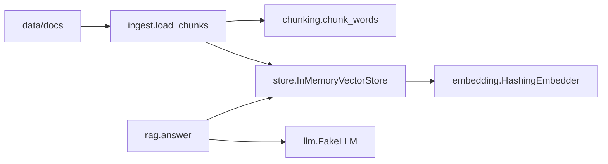

## What you will have at the end

At the end of this chapter your `rag-agent-service` repository answers questions about Bustan Books (a fictional online bookshop) from three short policy documents. It cuts them into chunks, turns each chunk into a vector, searches by cosine similarity, and returns an answer with the ids of the chunks it used. When nothing relevant is found, it says "I don't know" without calling the model at all. Twenty tests prove each part.

Why build this by hand when libraries exist? Because a hands-on interview round often asks for exactly this: "write a function that chunks this text with overlap", "rank these vectors by cosine similarity", or "return citations only for retrieved chunks". Candidates who have only called a framework get stuck on the edge cases. You will have met every edge case already, and you will be able to explain each line.

Everything runs offline. There is no API key, no model download and no paid service. The embedder is a simple hashing trick and the model is a fake that copies from the context, so every test gives the same result on every laptop. In later chapters a real model can sit behind the same interface.

## What you need

- A laptop with Python 3.11 or later, and the `rag-agent-service` repository from chapter 1.4 with its virtual environment.
- No new downloads. This chapter uses only the Python standard library and the pytest you installed in 1.4. The new files total a few kilobytes.
- About two hours. If the power goes off, everything is saved as plain files; run the tests again when you are back.

## How the pieces fit

You will add six small modules. Each one has a single job and a test group of its own. The diagram shows which module calls which.



`load_chunks` reads the documents and uses `chunk_words` to cut them. The store embeds every chunk when it is added and embeds the question when it searches. `answer` asks the store for chunks, builds a prompt, calls the model and checks the citations. Because `answer` depends only on the store and an object with a `complete` method, tests can swap in a spy model that records what it was sent.

## The interfaces

Use these exact names and signatures. Later chapters (evaluation in module 5, the agent in module 7, the service in module 9) and your capstone import them.

```text
app/chunking.py   def chunk_words(text: str, size: int = 60, overlap: int = 10) -> list[str]
app/embedding.py  class HashingEmbedder: __init__(self, dim: int = 256); embed(self, text: str) -> list[float]
app/store.py      @dataclass(frozen=True) class Chunk: id: str; doc_id: str; text: str
                  class InMemoryVectorStore: __init__(self, embedder)
                      add(self, chunks: list[Chunk]) -> None
                      search(self, query: str, k: int = 3) -> list[tuple[Chunk, float]]
app/ingest.py     def load_chunks(folder: str, size: int = 60, overlap: int = 10) -> list[Chunk]
app/llm.py        class LLM(Protocol): def complete(self, prompt: str) -> str
                  class FakeLLM: complete(self, prompt: str) -> str
app/rag.py        @dataclass class Answer: text: str; citations: list[str]
                  def build_prompt(question: str, chunks: list[Chunk]) -> str
                  def answer(question: str, store, llm, k: int = 3, min_score: float = 0.1) -> Answer
```

## The rules each function must follow

**`chunk_words`** splits the text on whitespace into words. Each chunk is up to `size` words joined by single spaces. A new chunk starts every `size - overlap` words, and you stop once a chunk reaches the last word. Empty or blank text gives an empty list. Raise `ValueError` if `size` is 0 or less, if `overlap` is negative, or if `overlap` is not smaller than `size` (otherwise the window never moves forward).

**`HashingEmbedder.embed`** lowercases the text and takes word tokens with `re.findall(r"[a-z0-9]+", text.lower())`. It drops the stopwords below, then adds 1 to one bucket per token. The bucket is `int(hashlib.md5(token.encode("utf-8")).hexdigest(), 16) % dim`. Finally it divides every value by the vector's length, the square root of the sum of squares, so the vector has length 1. If every token was a stopword, return the all-zero vector and do not divide by zero.

```python
STOPWORDS = {"a", "an", "the", "and", "or", "of", "to", "in", "on", "is", "are",
             "it", "for", "you", "your", "we", "can", "i", "do", "how", "what",
             "my", "be", "if", "with"}
```

Use `hashlib.md5`, never Python's built-in `hash()`. The built-in hash of a string changes every time Python starts, so your vectors, your rankings and your test results would change between runs.

**`InMemoryVectorStore`** keeps a list of each chunk with its vector. `search` embeds the query and scores every chunk with cosine similarity. Because both vectors already have length 1, cosine similarity is just the sum of the element-by-element products. Return the top `k` as `(chunk, score)` pairs, highest score first. When two scores are equal, the smaller chunk id comes first, so results never depend on insertion order. An empty store returns an empty list.

**`load_chunks`** reads every `.md` file in the folder in sorted name order. The `doc_id` is the file name without its extension (`returns`, not `returns.md`). Chunk ids are the `doc_id`, a `#`, and the chunk's position: `returns#0`, `returns#1`.

**`FakeLLM.complete`** looks for the first line of the prompt that has the form `[chunk-id] text`: a line that starts with `[`, an id, `]`, a space and the text. It returns the first sentence of that text (up to and including the first `.`, `!` or `?` that is followed by a space, or all of the text if there is none), then a space and the id in brackets. If no line has that form, it returns exactly `I don't know based on the documents.`

**`build_prompt`** returns one line of instructions (answer only from the context, cite chunk ids in brackets), a line `Context:`, one line per chunk in the form `[id] text`, and a last line `Question: ` followed by the question. Do not start the instruction line with `[`, or the fake model will treat it as context.

**`answer`** searches with `k` and keeps only chunks whose score is at or above `min_score`. If none are left, it returns `Answer("I don't know based on the documents.", [])` and **does not call the model**. Otherwise it builds the prompt from the kept chunks, calls `llm.complete`, and finds every `[id]` in the reply. A citation is kept only if that id was in the prompt, and each id appears once, in the order it first appears.

Here is the shape of the two small declarations, so the syntax is not a blocker:

```python
from dataclasses import dataclass
from typing import Protocol


@dataclass(frozen=True)
class Chunk:
    id: str
    doc_id: str
    text: str


class LLM(Protocol):
    def complete(self, prompt: str) -> str: ...
```

The `Protocol` means any object with a matching `complete` method counts as an `LLM`, without inheriting from anything. That is what lets a test pass in a spy model.

## Build it

<Steps title="Build the minimal pipeline">
<Step title="Open the project and activate the environment" stepNumber="1">

Open a terminal in your `rag-agent-service` folder and activate the virtual environment from 1.4.

```bash
# macOS or Linux
source .venv/bin/activate
# Windows
.venv\Scripts\activate
```

Run `pytest -q` once. Your test from 1.4 should still pass before you change anything.

</Step>
<Step title="Add the three policy documents" stepNumber="2">

Create the folder `data/docs` and the three files below. Copy the text exactly, including the heading line, because the tests count the chunks. Each file is between 120 and 145 words.

`data/docs/shipping.md`:

```text
# Shipping

Bustan Books ships paperback and hardback books to most countries. Orders placed before 2 pm are packed the same working day. Standard shipping takes 5 to 8 working days and costs 4 dollars per order. Express shipping takes 2 to 3 working days and costs 12 dollars per order. Orders over 50 dollars ship free with standard shipping.

Every order gets a tracking number by email when the parcel leaves the warehouse. You can track the parcel from the order page in your account. If tracking has not changed for 10 working days, contact support and we will open an investigation with the courier.

We cannot ship to post office boxes. Customs fees and import taxes are paid by the customer when the parcel arrives. Ebooks are not shipped: they appear in your library as soon as payment is confirmed.
```

`data/docs/returns.md`:

```text
# Returns and refunds

You can return a printed book within 30 days of delivery if it is unused and in its original condition. Start a return from the order page in your account and print the free return label. Damaged or wrong books can be returned at any time within 60 days, and we pay the return shipping.

Refunds go back to the original payment method within 5 working days after the warehouse receives the book. Shipping costs are refunded only when the book was damaged or wrong.

Ebooks cannot be returned once they have been downloaded. If an ebook file is broken, contact support within 14 days and we will send a new file or a refund. Gift cards cannot be refunded or exchanged for cash.
```

`data/docs/accounts.md`:

```text
# Your account

You need an account with an email address and a password to place an order. To reset your password, choose Forgot password on the sign-in page and follow the link we email you. The link works for 1 hour.

You can change your email address, delivery addresses and newsletter settings on the account settings page. Changes to your email address must be confirmed from the new address.

To delete your account, open account settings and choose Delete account. Deletion is permanent after 7 days, and during those 7 days you can sign in to cancel it. Deleting your account removes your library of ebooks and your order history. We keep invoices for 6 years because the law requires it.
```

</Step>
<Step title="Write the chunker" stepNumber="3">

Create `app/chunking.py` with `chunk_words`. Check the three `ValueError` cases first, then split, then move a window forward by `size - overlap` until the window has reached the last word. A `while True` loop with a `break` when `start + size` reaches the number of words is one clear way to write it.

</Step>
<Step title="Write the embedder" stepNumber="4">

Create `app/embedding.py` with `STOPWORDS` and `HashingEmbedder`. Build a list of `dim` zeros, add 1 to the bucket of each kept token, then divide by the length. Store `dim` on the object so `embed` can use it.

</Step>
<Step title="Write the store and the loader" stepNumber="5">

Create `app/store.py` with `Chunk` and `InMemoryVectorStore`, then `app/ingest.py` with `load_chunks`. For the tie rule, sort by a key of two parts: the negative score, then the chunk id. Use `pathlib.Path(folder).glob("*.md")` inside `sorted(...)` and the path's `stem` for the `doc_id`.

</Step>
<Step title="Write the fake model and the answer function" stepNumber="6">

Create `app/llm.py` with `LLM` and `FakeLLM`, then `app/rag.py` with `Answer`, `build_prompt` and `answer`. The regular expression `r"\[([^\]]+)\]"` finds every bracketed id in a reply. Put the "I don't know" check before the model call, not after it.

</Step>
<Step title="Add the acceptance tests and run them" stepNumber="7">

Create `tests/test_rag.py` from the seven parts in the next section, in order, as one file. Then run only the new tests, and then the whole suite.

```bash
pytest tests/test_rag.py -q
pytest -q
```

</Step>
</Steps>

## The acceptance tests

These tests are the definition of done. Do not change them to make them pass; change your code. Put the seven parts in one file, in order.

Part 1 holds the imports and two constants: the folder of documents and the exact "I don't know" text.

```python
# tests/test_rag.py, part 1 of 7
import math
from pathlib import Path

import pytest

from app.chunking import chunk_words
from app.embedding import HashingEmbedder
from app.ingest import load_chunks
from app.llm import FakeLLM
from app.rag import answer, build_prompt
from app.store import Chunk, InMemoryVectorStore

DOCS = Path(__file__).resolve().parent.parent / "data" / "docs"
IDK = "I don't know based on the documents."
```

Part 2 adds a spy model that records every prompt it receives, and a <GlossaryTerm term="fixture" definition="A pytest function that prepares something a test needs, such as a filled store. A test receives it by naming it as a parameter." /> that loads the real documents into a store. A fixture runs fresh for each test that asks for it.

```python
# tests/test_rag.py, part 2 of 7
class SpyLLM:
    """Records every prompt and replies with a fixed text."""

    def __init__(self, reply: str):
        self.reply = reply
        self.prompts: list[str] = []

    def complete(self, prompt: str) -> str:
        self.prompts.append(prompt)
        return self.reply


@pytest.fixture
def store():
    s = InMemoryVectorStore(HashingEmbedder())
    s.add(load_chunks(str(DOCS)))
    return s
```

Part 3 tests the chunker: sizes, overlap, short and empty text, and the four bad settings.

```python
# tests/test_rag.py, part 3 of 7
def test_chunks_have_the_right_size_and_overlap():
    words = [f"w{i}" for i in range(130)]
    chunks = chunk_words(" ".join(words), size=60, overlap=10)
    assert len(chunks) == 3
    assert chunks[0].split() == words[0:60]
    assert chunks[1].split()[0] == "w50"
    assert chunks[2].split()[-1] == "w129"


def test_short_and_empty_text():
    assert chunk_words("only four words here") == ["only four words here"]
    assert chunk_words("   ") == []


@pytest.mark.parametrize("size, overlap", [(60, 60), (60, 70), (0, 0), (10, -1)])
def test_bad_sizes_raise_value_error(size, overlap):
    with pytest.raises(ValueError):
        chunk_words("some text to split", size=size, overlap=overlap)
```

Part 4 tests the embedder and the ranking.

```python
# tests/test_rag.py, part 4 of 7
def test_embedding_is_deterministic_and_normalised():
    e = HashingEmbedder(dim=256)
    v1 = e.embed("Refunds go back to the original payment method")
    v2 = e.embed("Refunds go back to the original payment method")
    assert v1 == v2
    assert len(v1) == 256
    assert math.isclose(math.sqrt(sum(x * x for x in v1)), 1.0)


def test_embedding_ignores_case_and_stopwords():
    e = HashingEmbedder()
    assert e.embed("The REFUND") == e.embed("refund")


def test_only_stopwords_gives_a_zero_vector():
    assert HashingEmbedder(dim=8).embed("the and of") == [0.0] * 8


def test_search_ranks_by_cosine_highest_first():
    s = InMemoryVectorStore(HashingEmbedder())
    s.add([
        Chunk("a#0", "a", "express shipping takes two days"),
        Chunk("b#0", "b", "password reset link"),
        Chunk("c#0", "c", "shipping to post office boxes"),
    ])
    results = s.search("how long does express shipping take", k=3)
    assert [c.id for c, _ in results][0] == "a#0"
    scores = [score for _, score in results]
    assert scores == sorted(scores, reverse=True)
```

Part 5 tests ties, `k` and the loader.

```python
# tests/test_rag.py, part 5 of 7
def test_ties_are_broken_by_chunk_id():
    s = InMemoryVectorStore(HashingEmbedder())
    s.add([Chunk("x#1", "x", "gift cards"), Chunk("x#0", "x", "gift cards")])
    assert [c.id for c, _ in s.search("gift cards", k=2)] == ["x#0", "x#1"]


def test_search_returns_at_most_k(store):
    assert len(store.search("return a book", k=2)) == 2
    assert InMemoryVectorStore(HashingEmbedder()).search("anything") == []


def test_load_chunks_ids_and_doc_ids():
    chunks = load_chunks(str(DOCS))
    ids = [c.id for c in chunks]
    assert len(chunks) == 9
    assert {c.doc_id for c in chunks} == {"accounts", "returns", "shipping"}
    assert [i for i in ids if i.startswith("returns#")] == ["returns#0", "returns#1", "returns#2"]
    assert all(c.id.split("#")[0] == c.doc_id for c in chunks)
```

Part 6 tests the fake model and the prompt.

```python
# tests/test_rag.py, part 6 of 7
def test_fake_llm_answers_from_the_first_context_line():
    prompt = "Context:\n[returns#1] Refunds take 5 days. Keep the receipt.\nQuestion: when?"
    assert FakeLLM().complete(prompt) == "Refunds take 5 days. [returns#1]"


def test_fake_llm_without_context_says_it_does_not_know():
    assert FakeLLM().complete("Question: anything?") == IDK


def test_build_prompt_has_question_and_tagged_chunks():
    chunks = [Chunk("returns#0", "returns", "Return within 30 days.")]
    prompt = build_prompt("Can I return a book?", chunks)
    assert "Can I return a book?" in prompt
    assert "[returns#0] Return within 30 days." in prompt.splitlines()
```

Part 7 tests the full answer: a cited answer, the "I don't know" path, and citations that must come from retrieved chunks.

```python
# tests/test_rag.py, part 7 of 7
def test_answer_cites_a_retrieved_chunk(store):
    result = answer("How do I reset my password?", store, FakeLLM())
    assert result.citations == ["accounts#0"]
    assert result.text.endswith("[accounts#0]")


def test_answer_finds_the_returns_policy(store):
    result = answer("How many days do I have to return a book?", store, FakeLLM())
    assert result.citations and result.citations[0].startswith("returns#")


def test_no_good_chunk_means_no_model_call(store):
    spy = SpyLLM("should not be used")
    result = answer("Is there a student discount?", store, spy)
    assert result.text == IDK
    assert result.citations == []
    assert spy.prompts == []


def test_citations_must_be_retrieved_chunks(store):
    spy = SpyLLM("Reset it from the sign-in page [accounts#0] [ghost#7] [accounts#0]")
    result = answer("How do I reset my password?", store, spy, k=2)
    assert result.citations == ["accounts#0"]
    context_lines = [ln for ln in spy.prompts[0].splitlines() if ln.startswith("[")]
    assert len(context_lines) <= 2
```

The last test is the one interviewers like most. A model can invent a citation (`ghost#7`) or repeat one. Your code, not the model, decides which citations are real.

## Verify

Run the new tests. You should see 20 passed (the parametrised test counts as four). Timings vary from laptop to laptop.

<TerminalBlock title="Run the RAG tests" cwd="rag-agent-service">
  <TerminalLine type="prompt">pytest tests/test_rag.py -q</TerminalLine>
  <TerminalLine type="output">20 passed in 0.12s</TerminalLine>
</TerminalBlock>

Then run `pytest -q` for the whole suite. Your tests from 1.4 must still pass too.

**Break it on purpose.** In `answer`, remove the `min_score` check so every retrieved chunk is kept, whatever its score. Run the tests again. One test fails, because the spy model was called for a question the documents cannot answer, and its reply came back instead of "I don't know".

<TerminalBlock title="The failure you should see" cwd="rag-agent-service">
  <TerminalLine type="prompt">pytest tests/test_rag.py -q</TerminalLine>
  <TerminalLine type="output">E       assert 'should not be used' == "I don't know...he documents."</TerminalLine>
  <TerminalLine type="output">FAILED tests/test_rag.py::test_no_good_chunk_means_no_model_call - assert 'sh...</TerminalLine>
  <TerminalLine type="output">1 failed, 19 passed in 0.66s</TerminalLine>
</TerminalBlock>

This is the "I don't know" path doing its job. Without the threshold, every question reaches the model with whatever chunk happened to score highest, even a score of 0.06, and the model is invited to answer from unrelated text. Put the check back and confirm 20 passed again.

Look at why the threshold is 0.1. With this hashing embedder, two unrelated words can land in the same bucket by chance. "What is the capital of France?" scores about 0.12 against a shipping chunk for that reason alone, so it gets an answer it should not. A real embedding model has the same problem in a softer form. The threshold is a crude guard, and module 5 shows how to choose it with numbers instead of by feel.

**Debugging the two most likely mistakes:**

- **`test_load_chunks_ids_and_doc_ids` fails with ids like `returns.md#0`.** You used the file name instead of its stem. Use `path.stem`. If the count is not 9, compare your three files with the text above; a missing paragraph changes the chunk count.
- **Rankings or `test_answer_cites_a_retrieved_chunk` change between runs.** You used Python's `hash()` instead of `hashlib.md5`, or you forgot to normalise. Unnormalised vectors also make long chunks win just because they have more words. Print `math.sqrt(sum(x * x for x in v))` for one vector: it must be 1.0.

<Callout type="tip" title="Print what the model sees">
When an answer looks wrong, print `build_prompt(question, chunks)` for that question. Seeing the exact context is the fastest way to tell a retrieval problem from a generation problem, the same check you learned in 3.2.
</Callout>

## Acceptance checklist

- [ ] `data/docs` holds the three documents, copied exactly
- [ ] `chunk_words`, `HashingEmbedder`, `InMemoryVectorStore`, `load_chunks`, `FakeLLM`, `build_prompt` and `answer` use the exact signatures above
- [ ] The embedder uses `hashlib.md5`, never `hash()`, and returns length-1 vectors
- [ ] `pytest tests/test_rag.py -q` shows 20 passed, and `pytest -q` passes the whole suite
- [ ] With the `min_score` check removed, exactly one test failed, and I put the check back
- [ ] The repository is committed and pushed to my Git host

## Submit your repository

```openquestion
prompt: "Paste the link to your rag-agent-service repository with this chapter's work committed. Optionally, paste the last line of your pytest output as well."
required: true
minWords: 0
allowSpeechInput: true
allowUrl: true
urlRequired: true
urlLabel: "Repository link"
urlHint: "A link your mentor can open. If your repository is private, add your mentor as a reader."
modelAnswer: "Repository link to rag-agent-service with app/chunking.py, app/embedding.py, app/store.py, app/ingest.py, app/llm.py, app/rag.py, data/docs and tests/test_rag.py. Final line of pytest tests/test_rag.py -q: 20 passed in 0.12s."
```

**Next:** A short graded quiz on the pipeline, chunking and vector search, before the module gate.
