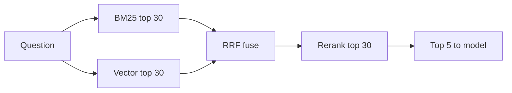

## The form nobody could find

At Najm Microfinance (a fictional lender), 60 of the 200 unhelpful answers in 4.1 had the same shape. A loan officer typed an exact code, such as "form CR-17" or "product AGR-12", and the assistant answered about forms or products in general. The chunk that named CR-17 existed. It ranked eleventh.

Vector search did what it is built to do. It matched meaning, and "CR-17" carries almost no meaning, so many chunks about forms looked equally close. Keyword search would have found it at once, but keyword search fails on the questions vector search handles well, such as "can a borrower pay back early?" when the policy says "prepayment". Huda needs both, plus a way to merge them, plus a final check on the short list.

By the end of this chapter you can combine the two searches, compute a fused score by hand, explain why a reranker reads only the top 20 to 50 chunks, and give the latency cost of each step.

## Keyword search with BM25

**BM25** is the standard scoring rule for keyword search. For each word in the question, it asks three things about a chunk. How often does the word appear in it? (More is better, but the tenth time adds much less than the second.) How rare is the word across all chunks? (CR-17 appears in 3 of Najm's 1,800 chunks, "loan" in about 1,500, so CR-17 counts far more.) And how long is the chunk? (A long chunk should not win just because it has more words.)

BM25 is strong exactly where embeddings are weak: codes, names, numbers, rare technical terms and new words the embedding model never saw. It is weak where embeddings are strong: synonyms ("repay early" against "prepayment"), paraphrases, typos and questions in a different language from the document. It is also cheap: an <GlossaryTerm term="inverted index" definition="A keyword index that maps each word to the list of chunks containing it, so a search looks up the question's words instead of reading every chunk." /> answers in a few milliseconds.

<BigWordAlert term="Hybrid search" plainEnglish="Running keyword search and vector search for the same question and merging their results into one list." whyItMatters="Each search finds chunks the other misses. Merging them raises recall for exact codes and for paraphrased questions at a small latency cost, because both searches are fast and can run at the same time." />

## Merging two lists: reciprocal rank fusion

The obvious way to merge is to add the scores. It does not work. A BM25 score might be 14.2 and has no fixed upper limit; a cosine score might be 0.62 and sits between -1 and 1. Added together, BM25 decides almost everything. You can rescale each list, but the scales shift from question to question.

**Reciprocal rank fusion** (RRF) ignores the scores and uses only positions. Each chunk gets 1 / (60 + rank) from every list it appears in, with ranks starting at 1, and the parts are added. 60 is the common default constant. It keeps first place from counting overwhelmingly more than second or third, so a chunk that both searches like beats a chunk that only one search loves.

Here is one fused score computed by hand. Huda's question is "What documents does form CR-17 need for a farming loan?" BM25 returns forms#4, forms#1, farming#7. Vector search returns farming#2, farming#7, forms#4.

- forms#4 is 1st in BM25 and 3rd in vector search: 1/61 + 1/63 = 0.01639 + 0.01587 = **0.0323**.
- farming#7 is 3rd and 2nd: 1/63 + 1/62 = 0.01587 + 0.01613 = 0.0320.
- farming#2 is only 1st in vector search: 1/61 = 0.0164. forms#1 is only 2nd in BM25: 1/62 = 0.0161.

The fused order is forms#4, farming#7, farming#2, forms#1. The chunk that names CR-17 is now first, and the farming chunk that both searches found is second. Neither search alone produced that order. You can also weight the lists, for example count BM25 twice for a catalogue of product codes, but start unweighted and change it only when your test questions say so.

## Reranking: reading question and chunk together

The embedding model you used so far is a <GlossaryTerm term="bi-encoder" definition="A model that turns the question and each chunk into vectors separately. Chunk vectors are computed once at indexing, so search only compares vectors." />. It never sees the question and the chunk at the same time, which is why it is fast: chunk vectors are computed once, at indexing. It is also why it misses details. It cannot notice that a chunk about refunds "within 30 days" does not fit a question about "after 30 days".

A <GlossaryTerm term="cross-encoder" definition="A model that reads the question and one chunk together in a single pass and returns a relevance score for that pair. Accurate, but nothing can be computed ahead of time." /> reads the question and one chunk together and outputs a relevance score. Because it sees both, it judges relevance much better. But nothing can be prepared in advance: every question needs one model pass per chunk. In this example, a small cross-encoder on a CPU scores 30 pairs in one batch in about 120 ms. Scoring all 1,800 chunks would take 1,800 / 30 × 120 ms, about 7.2 seconds.

So the reranker reads only a short list: the fused top 20 to 50. The searches are cheap and wide; the reranker is expensive and narrow. The diagram shows the whole chain.



The two searches run at the same time, so the slower of them sets the wait, not their sum. Fusion is arithmetic on 60 numbers. The reranker is the only costly retrieval stage, and its cost grows with the length of the list you give it. In Huda's example the budget looks like this: BM25 10 ms and vector search about 35 ms (embedding the question included) in parallel, fusion under 1 ms, reranking 30 chunks 120 ms, then the model about 1,800 ms. Retrieval went from about 35 ms to about 155 ms, still small next to the model.

<Callout type="warning" title="A reranker cannot find what fusion missed">
The reranker only reorders the list it receives. If the right chunk is not in the fused top 30, no reranker will bring it back. Measure how often the right chunk is in the fused list before you tune the reranker.
</Callout>

## See it run

The canvas follows one Bustan Books (a fictional online bookshop) question through both searches, fusion and a reranker. Before you open it, predict the fusion result.

```predict
prompt: "Question: 'Can I return a damaged book after 30 days?' Keyword search ranks returns#2 first and returns#1 nowhere. Vector search ranks returns#1 first and returns#2 second. Which chunk wins reciprocal rank fusion?"
options:
  - id: both
    label: "returns#2, because it is in both lists"
  - id: first
    label: "returns#1, as it tops the vector list"
correctOptionId: both
explanation: "returns#2 gets 1/61 + 1/62 = 0.0325, while returns#1 gets only 1/61 = 0.0164. Appearing in both lists beats being first in one."
```

<InteractiveCanvas slug="rag-hybrid-rerank" />

**What this shows:** keyword search and vector search return different top 3 lists for the same question. Fusion by rank puts returns#2 first with 0.0325 because both searches found it; returns#1 (0.0164), returns#0 (0.0161), shipping#1 and accounts#0 (0.0159 each) follow. The reranker then reads only those 5 candidates.

**Try this:** First, at the fusion step, check each score against 1 / (60 + rank): you should get the same numbers with a pen. Second, compare the fused order with the reranked order: returns#1, the 30-day refund window chunk, moves from second to first, and shipping#1 falls to the bottom, because the reranker read each chunk together with the question.

**What changed:** fusion changed the order by agreement between two searches; reranking changed it by reading. The model receives returns#1, returns#2 and returns#0, so it sees both the damaged-books rule and the 30-day window, which keyword search alone would have missed.

**Limits of the model:** the search results and the reranker scores (0.91, 0.88, 0.40, 0.12) are an example for one question, not output from real indexes or a real model. Real systems fuse and rerank 20 to 50 or more candidates, not 5, and query rewriting, filters and deduplication are left out.

```quiz
type: mcq
question: "Reem's job search tool fuses two lists with reciprocal rank fusion, constant 60. Job A is 2nd in keyword search and 2nd in vector search. Job B is 1st in keyword search and missing from vector search. Job C is 1st in vector search and 5th in keyword search. What is the fused order?"
options:
  - "B, then C, then A, because a first place counts the most"
  - "C, then A, then B, because C is first in the vector list"
  - "A, then C, then B, because A is near the top of both lists"
  - "A and C tie for first place, and B comes third in the list"
correct: 2
explanations:
  - "B appears in one list only, so it gets just 1/61 = 0.0164, the lowest of the three."
  - "C gets 1/61 + 1/65 = 0.0318, slightly less than A's 0.0323. A first place helps, but A's two second places add up to more."
  - "Right. A = 1/62 + 1/62 = 0.0323, C = 1/61 + 1/65 = 0.0318, B = 1/61 = 0.0164."
  - "The scores are close but not equal: A has 0.0323 and C has 0.0318."
```

## Failure modes and debugging

- **Hybrid made paraphrased questions worse:** BM25 pushes chunks that share common words. Check that stopwords are removed for BM25, or weight the vector list higher, and confirm on your test questions.
- **Reranking adds too much latency:** shorten the list (from 50 to 20), batch the pairs, use a smaller reranker, or cache results for repeated questions.
- **Recall did not improve after adding a reranker:** the right chunk was never in the fused list. Raise each search's depth or fix chunking first.

## In the interview

Hybrid search and reranking are the most common answer to "how would you improve retrieval?", so interviewers probe the details: why rank fusion, why only a short list, and what it costs. Answer each question aloud first, then open it.

<FaqGroup title="Practice questions">
<FaqItem question="Why use reciprocal rank fusion instead of adding the two scores?">

BM25 and cosine scores are on different scales: BM25 has no fixed maximum and cosine sits between -1 and 1, so a plain sum lets BM25 decide almost everything, and rescaling shifts from query to query. RRF uses only ranks: each list adds 1 / (60 + rank). A chunk ranked 1st and 3rd gets 1/61 + 1/63, about 0.0323, which beats a chunk ranked 1st in only one list at 0.0164. It needs no tuning to start, and I can add weights later if test questions show one list deserves more trust.

**Follow-up probes:**

- What does the constant 60 change if you make it 5?
- When would you weight the keyword list higher?

</FaqItem>
<FaqItem question="What is the difference between a bi-encoder and a cross-encoder, and where does each go?">

A bi-encoder embeds the question and each chunk separately, so chunk vectors are computed once at indexing and search is a fast vector comparison over the whole collection. A cross-encoder reads the question and a chunk together and scores the pair, which is more accurate but needs one model pass per chunk at query time. So the bi-encoder goes first, to search widely, and the cross-encoder goes second, on the top 20 to 50. In my example, reranking 30 chunks took about 120 ms; reranking all 1,800 would take about 7 seconds.

**Follow-up probes:**

- How would you choose between reranking 20 and 50 chunks?
- What would you do if no reranker handles Arabic well?

</FaqItem>
<FaqItem question="Your reranker adds 400 ms to every request. How do you bring that down?">

First I would check how deep the right chunk usually sits in the fused list. If it is in the top 20 for nearly every test question, I can rerank 20 instead of 50 and cut the work by more than half. Then I would batch all pairs in one call, try a smaller reranker and compare quality on the same questions, and cache results for repeated questions. If the budget is still tight, I would skip reranking for simple questions, which is the routing idea in adaptive retrieval.

**Follow-up probes:**

- How would you measure the quality you lose with a smaller reranker?
- What would you cache, and for how long?

</FaqItem>
</FaqGroup>

**Next:** Some questions fail because their answer is spread over several documents. You learn to rewrite, expand and split a question so retrieval finds every piece.
