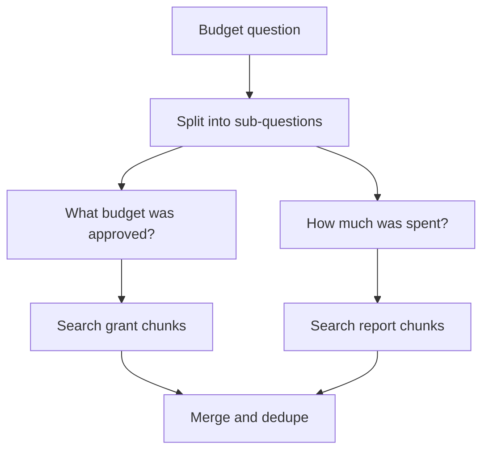

## Half an answer, stated with confidence

Sahel Relief (a fictional NGO) runs water, health and school projects in six districts. Its document store holds grant agreements with donors, quarterly field reports and partner audit reports, about 3,000 documents in all. Nour, a programme officer, asks the report assistant: "Did the northern water project stay within the budget the donor approved?"

The assistant answered: "The project has spent 41,200 dollars to date and activities are on track." That was true, and useless. The approved budget sits in the grant agreement, a different document with different words: it says "Grant G-114, approved amount, WASH component, North district". The question's words matched the field reports, which mention "northern water project" in every paragraph. Twenty field-report chunks outranked the one grant chunk, which came 23rd.

No embedding model or reranker fixes this alone, because one search can only look for one thing. By the end of this chapter you can rewrite and split a question so that retrieval finds every piece of evidence, even when the pieces live in different documents.

<BigWordAlert term="Query rewriting" plainEnglish="Changing the user's question before searching: making it complete, adding other words for the same thing, or splitting it into smaller questions." whyItMatters="Users write short, vague or compound questions in their own words. Search works better on clear, single questions in the documents' words, so rewriting often fixes retrieval without touching the index." />

## Rewrite: make the question complete

The simplest rewrite fixes follow-up questions in a chat. After the answer above, Nour types: "And the southern one?" Searching for those four words finds nothing useful. A small model call, given the chat history, rewrites it into a <GlossaryTerm term="standalone question" definition="A question that makes sense on its own, without the earlier chat, because names and references are written out in full." />: "Did the southern district water project stay within the budget the donor approved?" Any assistant that supports follow-ups needs this step.

## Expand: add the documents' words

Sahel's documents say "WASH" (water, sanitation and hygiene) where staff say "water project". They say "North district" where staff say "northern". **Query expansion** adds those other words to the search: either from a small list of synonyms and abbreviations you maintain, or from a model asked for two or three alternative phrasings. You can then search with each phrasing and merge the lists with reciprocal rank fusion, exactly as in 4.2.

Expansion helps keyword search most, because BM25 only matches exact words. A maintained synonym list is cheap and predictable; model-written phrasings cover more cases but add a model call and can drift away from what the user meant.

## HyDE: search with a made-up answer

**HyDE**, short for hypothetical document embeddings, is an idea worth explaining carefully, because it sounds wrong at first. You ask a model to write a short passage that *would* answer the question, as if it came from the documents. You embed that passage, not the question, and search with it.

Why would a made-up passage help? A question and its answer look different: the question is short and asks, the document passage is long and states. A hypothetical passage such as "Under grant G-114, the donor approved 52,000 dollars for the WASH component in North district" looks like a real grant paragraph in style and vocabulary, so its vector lands near real grant paragraphs.

The made-up passage is a search key, nothing more. Its numbers are invented and may be wrong. It must never be shown to the user or put into the answer prompt as evidence; the answer must come only from the real chunks it helped find. HyDE costs one model call before every search (about 600 ms in Sahel's prototype), and it helps less when the model knows nothing about your domain or when the question is an exact code. Test it on your own questions before keeping it.

## Decompose: split a compound question

Nour's question is really two questions joined together. **Decomposition** asks a model to split it into sub-questions, searches for each one separately, and merges the results.

```predict
prompt: "For Nour's budget question, the grant agreement chunk ranks 23rd because 20 field-report chunks match the question better. Which change is more likely to put it in the prompt?"
options:
  - id: raise-k
    label: "Raise k from 3 to 10 and send more chunks"
  - id: split
    label: "Split into two sub-questions, one search each"
correctOptionId: split
explanation: "With k = 10 the grant chunk is still 23rd and still missing. A sub-question about the approved budget searches for that fact alone, so grant chunks rank at the top."
```

The diagram shows the flow for Nour's question.



Each sub-question gets its own top 3, so each kind of evidence has a guaranteed place in the prompt. The two searches do not depend on each other, so they run at the same time. After merging, the model gets the approved amount and the spending together and can actually compare them.

The numbers from Sahel's prototype, in this example: the split is one extra model call of about 600 ms, the parallel searches add about 40 ms, and the answer prompt grows from 3 chunks to 6, so the final call takes about 2,000 ms instead of 1,800. Total time rose from about 1.8 to about 2.7 seconds. On their 50 test questions that need two documents, both needed chunks were retrieved for 38 questions, against 14 with a single search.

## Multi-hop: when the next search depends on the last answer

Some questions cannot be split up front, because the second search needs a fact from the first. "What did the last audit find about the partner that runs the Hilltop clinic?" The audit reports never mention the Hilltop clinic; they name the partner organisation. So the system searches in <GlossaryTerm term="hop" definition="One round of search and reading in a multi-step retrieval: find a fact, then use it to write the next search." />s:

1. Search "Who runs the Hilltop clinic?" and read the answer: Amal Health Partners.
2. Search "Amal Health Partners audit findings" and read the audit chunk.
3. Answer from both, citing both.

Multi-hop finds answers no single search can, and it is easy to let it run away. Each hop is a search plus a model call, so set a hard limit (two or three hops), stop as soon as the facts needed are found, and log every hop so you can see where a wrong answer started. A mistake in hop 1, such as the wrong partner name, sends every later hop in the wrong direction.

## Cross-document retrieval: remove the copies

Once you search several times, a new problem appears. Sahel's monthly reports copy the same "project background" paragraph into every report. For many questions, four of the top five chunks are that paragraph, so the prompt is full of one fact.

Three fixes work together. Remove **exact duplicates** by hashing each chunk's text after lowercasing and removing extra spaces. Remove <GlossaryTerm term="near-duplicate" definition="Two chunks with almost the same text, such as the same paragraph with a different date. Their vectors are very close, for example cosine above 0.95." />s by dropping any chunk too similar to one already kept. And cap how many chunks one document can supply, for example two, so other documents get a turn. A known method that balances relevance and variety in one score is maximal marginal relevance; a simple per-document cap is often enough to start.

<Callout type="tip" title="Keep track of which sub-question found each chunk">
When you merge, record which sub-question or hop found each chunk. If the answer is wrong, you can see at once whether a sub-question was bad or a search failed.
</Callout>

```quiz
type: mcq
question: "A team adds HyDE to a support assistant. Retrieval improves, but some answers now contain a delivery time that appears in no retrieved chunk. What is the most likely cause?"
options:
  - "The embedding model cannot handle the longer HyDE passages well"
  - "Reranking was switched off when the HyDE call was added to search"
  - "The made-up HyDE passage was put into the prompt as context"
  - "The number of retrieved chunks k is too small for HyDE queries"
correct: 2
explanations:
  - "A weak embedding would make retrieval worse, not add a number from nowhere. Retrieval improved here."
  - "Without a reranker, the order of real chunks changes, but every fact would still come from a real chunk."
  - "Right. The hypothetical passage has invented facts. It must only be used as a search key; if it reaches the answer prompt, its invented delivery time becomes the answer."
  - "A small k can leave out a real fact, but it cannot add a fact that exists in no chunk."
```

## Failure modes and debugging

- **Sub-questions miss the point:** the split prompt is vague. Log the sub-questions and review 20 of them; give the splitter two or three examples of good splits.
- **Latency doubled for every question:** you decompose even simple questions. Split only when a question has two parts; 4.5 shows how to route.
- **Multi-hop answers drift:** an early hop found the wrong entity. Check hop 1 first, and stop when a hop finds nothing new.

## In the interview

Interviewers use multi-document questions to see whether you understand that retrieval is a search problem, not a model problem. Expect a scenario like Nour's and the question "how would you fix it?". Answer each question aloud first, then open it.

<FaqGroup title="Practice questions">
<FaqItem question="Explain HyDE. When would you use it and when not?">

HyDE asks a model to write a short hypothetical passage that would answer the question, then searches with that passage's embedding instead of the question's. It helps because a passage looks like the documents, while a short question does not. I would try it when users phrase things very differently from the documents. I would avoid it for exact codes, for domains the model knows nothing about, and where an extra model call of about half a second breaks the budget. The hypothetical passage is only a search key and never reaches the answer prompt, because its facts are invented.

**Follow-up probes:**

- How would you measure whether HyDE helped?
- What could go wrong if the model refuses or writes nonsense?

</FaqItem>
<FaqItem question="A question needs facts from two different documents. How do you retrieve both?">

I decompose it: a model call splits the question into sub-questions, each sub-question gets its own search and its own top k, and I merge the results with deduplication before answering. That guarantees each kind of evidence a place in the prompt instead of letting one document fill it. If the second search depends on the first answer, I do multi-hop retrieval with a limit of two or three hops. In my example, decomposition took both-documents retrieval from 14 to 38 of 50 test questions, for about 0.9 seconds of extra latency.

**Follow-up probes:**

- How do you decide when to decompose and when not to?
- What do you log so a wrong multi-hop answer can be debugged?

</FaqItem>
<FaqItem question="Your top 5 results are four copies of the same paragraph. What do you do?">

I remove exact duplicates by hashing normalised chunk text, and near-duplicates by dropping any chunk whose cosine similarity to an already kept chunk is above a threshold such as 0.95. I also cap chunks per document, for example two, so other sources get a place. If copies come from boilerplate repeated across reports, I strip that boilerplate at indexing so it never becomes a chunk.

**Follow-up probes:**

- How would you pick the similarity threshold?
- When could deduplication remove something important?

</FaqItem>
</FaqGroup>

**Next:** Some answers hide inside tables and badly formatted PDFs, and some questions are about relationships across many documents. You learn how to index tables and PDFs, and when a knowledge graph is worth its cost.
