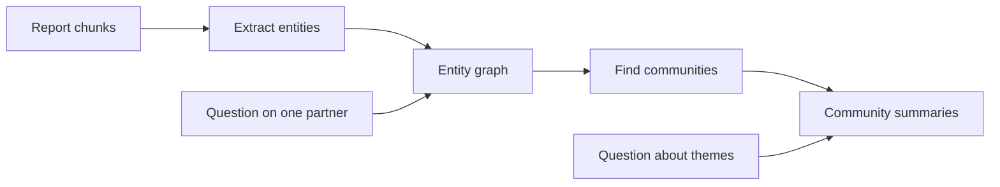

## The number without a name

Sahel Relief (a fictional NGO) sends donors a quarterly report for each district. Each report has a budget table: line item, approved budget, spent this quarter, share used. Nour asks the report assistant: "How much did North district spend on water trucking in Q3?"

The assistant answered "12,400 dollars". That is the approved budget, not the spending. The fixed-size chunker had cut the table in two. One chunk held the caption and the header row. Another held rows like "Water trucking | 12,400 | 9,850 | 79%" with no header at all. The model saw two numbers next to "water trucking" and guessed which one was the spend. It guessed wrong.

Tables and PDFs break the quiet assumption behind chapter 3: that a document is a stream of sentences. By the end of this chapter you can index tables so that every row keeps its meaning, clean up PDF text before it becomes chunks, and decide whether a knowledge graph is worth building.

## Tables: never separate a value from its header

A table row only means something together with its headers. So the first rule is simple: whatever you do, a chunk must never contain table values without the headers that name them.

```predict
prompt: "Which chunk is more likely to answer 'How much did North district spend on water trucking in Q3?' correctly?"
options:
  - id: raw
    label: "Water trucking | Q3 | 12,400 | 9,850 | 79% | North district"
  - id: serialised
    label: "North district water trucking. Q3 spend: 9,850. Budget: 12,400"
correctOptionId: serialised
explanation: "The labelled chunk names each number, so both the search and the model can tell spending from budget. In the raw row, the numbers have no labels, and the model has to guess which column is which."
```

There are three good ways to index a table, and they combine well.

**Keep small tables whole.** If a table with its caption fits within your chunk size, make it one chunk. Add the heading of the section it sits in. The model then sees every row and every header at once, which also lets it compare rows.

**Serialise rows with their headers.** For a large table, turn each row into a short self-describing line: "Table 4, North district, Q3 2026. Line item: water trucking. Approved budget: 12,400 dollars. Spent in Q3: 9,850 dollars. Share used: 79%." Each row becomes its own chunk. Both BM25 and the embedding can now match "spent", "water trucking" and "North district" in one place.

**Index a table summary.** Write a short description of the table at indexing time, by a model or from its caption: "Table 4 compares the approved budget and Q3 spending for 14 line items in North district." Search over the summary; when it matches, send the whole table to the model. This works well for questions about the table as a whole, such as "which line items are over budget?".

One limit matters in interviews. Questions that need arithmetic across many rows or tables, such as "total water trucking spend across all six districts", are not a retrieval problem. Retrieving six tables and asking the model to add them is slow and error-prone. Load the tables into a database and let the system run a query, which is the tool calling you learn in module 6.

## PDFs: clean the text before you chunk it

A PDF stores where characters sit on a page, not the order a person reads them. Three problems come up again and again in Sahel's reports.

**Layout.** Many reports use two columns. A simple text extractor reads straight across the page, so line 1 of the left column is followed by line 1 of the right column, and every sentence is mixed with another. Use an extractor that detects columns and text blocks, and always read a few extracted pages before you index thousands.

**Headers and footers.** Every page says "Sahel Relief | Field report | Confidential | Page 7 of 22". After chunking, that line is in almost every chunk. It wastes tokens, and it makes any question with "field report" in it match everything. Find lines that repeat on most pages of a document and remove them before chunking, but store the page number as metadata so citations can point to the right page.

**OCR quality.** Some district offices scan printed reports. <GlossaryTerm term="OCR" definition="Optical character recognition: software that reads the text from an image of a page, such as a scan or a photo." /> turns those images into text, with mistakes: "5,000" can become "S,OOO", Arabic letters can be confused, and table lines can vanish. Sample 20 pages, compare the OCR text with the page, and estimate the <GlossaryTerm term="character error rate" definition="The share of characters that OCR got wrong compared with a careful human reading. 2% means about 2 wrong characters in every 100." />. Flag pages where the OCR tool reports low confidence for a human to check or rescan, and never trust a number from a low-confidence page without showing its source.

<Callout type="tip" title="Keep the page with the chunk">
Store the file name and page number with every chunk from a PDF. When an answer looks wrong, a reviewer can open the exact page and see whether the PDF, the OCR or the model made the mistake.
</Callout>

## Graph RAG: when the answer is a relationship

Some questions have no single passage that answers them. Nour's director asks: "Which partners work in districts where last year's audits found cash-handling problems, and which donors fund those partners?" The facts are spread over hundreds of reports: one says who runs which clinic, another which district the clinic is in, a third what the audit found. Hybrid search finds passages; it does not connect them.

<BigWordAlert term="Graph RAG" plainEnglish="At indexing time, a model extracts the people, organisations, places and projects in your documents and the links between them, and stores them as a graph. Questions are then answered from the graph and from summaries of its groups, not only from matching passages." whyItMatters="It answers questions about connections and themes across a whole collection, which plain retrieval cannot. It also has a large indexing cost that you must justify." />

The indexing path changes. A model reads every chunk and extracts <GlossaryTerm term="entity" definition="A named thing that documents talk about, such as a partner organisation, a district, a donor, a project or a person." />s and the relations between them: "Amal Health Partners runs Hilltop clinic", "Hilltop clinic is in East district", "Grant G-114 funds North water project". These become nodes and edges. Then the system groups tightly connected entities into communities and asks a model to write a summary of each community. The diagram shows that flow.



Two kinds of question use it differently. A question about one entity, such as one partner, starts at that node, follows its links, and fetches the chunks those links came from. A broad question, such as "what are the main risks across our partners this year?", is answered from the community summaries and then combined. That second kind is where plain retrieval fails completely, because the answer is a summary of many documents, not a passage in one.

## What Graph RAG costs

The price is paid at indexing. Sahel's 3,000 documents make about 40,000 chunks, so extraction alone is about 40,000 model calls, plus one call per community summary. When documents change, the affected parts must be extracted and summarised again. And extraction makes mistakes: "Amal Health", "Amal Health Partners" and "AHP" become three nodes unless you add a step that merges names for the same thing.

So Graph RAG pays off when three things are true: your questions are about connections or themes across many documents, the documents are full of the same entities, and the collection changes slowly enough to re-index. It is overkill for single-fact lookups, for small collections, and for documents that change daily. A cheaper middle step often goes a long way: store partner, district and donor as metadata on each chunk and filter on them, as in 3.4.

```quiz
type: mcq
question: "A small online shop has a 40-page help centre that changes every week. Customers ask single-fact questions, such as delivery times. Hybrid search with reranking already answers 46 of 50 test questions. The manager proposes Graph RAG. What is the best response?"
options:
  - "Build it, since graph answers are more accurate for any question"
  - "Build it, but extract entities only from the 4 failing questions"
  - "Build it, and refresh the community summaries once every month"
  - "Keep hybrid search, and study why the 4 questions fail"
correct: 3
explanations:
  - "Graph RAG helps questions about connections and themes. Single-fact lookups are already handled well by hybrid search."
  - "Entities are extracted from documents, not from questions, and the 4 failures may have simple causes such as chunking or a missing page."
  - "Monthly summaries would be out of date most of the time for content that changes weekly, and the indexing cost buys nothing for single-fact questions."
  - "Right. The questions are single facts, the content changes weekly, and current retrieval already works. Fixing the 4 failures is cheaper and more likely to help."
```

## In the interview

Tables and PDFs come up when an interviewer asks about real documents: "Your PDFs have tables. What did you do?" Graph RAG comes up as a test of judgment: interviewers want to hear when you would not use it. Answer each question aloud first, then open it.

<FaqGroup title="Practice questions">
<FaqItem question="How do you index tables for RAG?">

I make sure no chunk holds values without their headers. Small tables stay whole as one chunk with their caption and section heading. Large tables are serialised row by row, so each row becomes a line such as "Line item: water trucking. Spent in Q3: 9,850 dollars", and I also index a short table summary that maps to the whole table. For questions that need sums or comparisons across many rows, I load the tables into a database and let the system run a query instead of asking the model to do arithmetic over retrieved text.

**Follow-up probes:**

- How would you handle a table that spans three PDF pages?
- How do you test that table questions improved?

</FaqItem>
<FaqItem question="Your documents are scanned PDFs. What can go wrong, and how do you check?">

Three things: column layouts read in the wrong order, headers and footers repeated in every chunk, and OCR errors such as 5,000 read as S,OOO. Before indexing I read extracted text from a sample of pages, remove lines that repeat on most pages, and estimate the OCR character error rate on about 20 pages against the originals. Pages with low OCR confidence go to a person to check or rescan. Every chunk keeps its file and page number so any answer can be checked against the original page.

**Follow-up probes:**

- What error rate would you accept, and why?
- How would OCR errors show up in your retrieval metrics?

</FaqItem>
<FaqItem question="When is Graph RAG worth it, and when is it overkill?">

It is worth it when questions are about relationships or themes across many documents, such as which partners in which districts had audit problems, and when documents mention the same entities again and again. The cost is at indexing: one model call per chunk to extract entities, plus community summaries, plus merging duplicate names, and it must be refreshed when documents change. For single-fact lookups, small collections or content that changes daily, hybrid search with good chunking and metadata filters is cheaper and usually enough.

**Follow-up probes:**

- How would you estimate the indexing cost before you build it?
- What would you try before a full graph?

</FaqItem>
</FaqGroup>

**Next:** Not every question needs the same retrieval, and some problems are not retrieval problems at all. You learn to route questions by complexity and to choose between RAG, fine-tuning and both.
