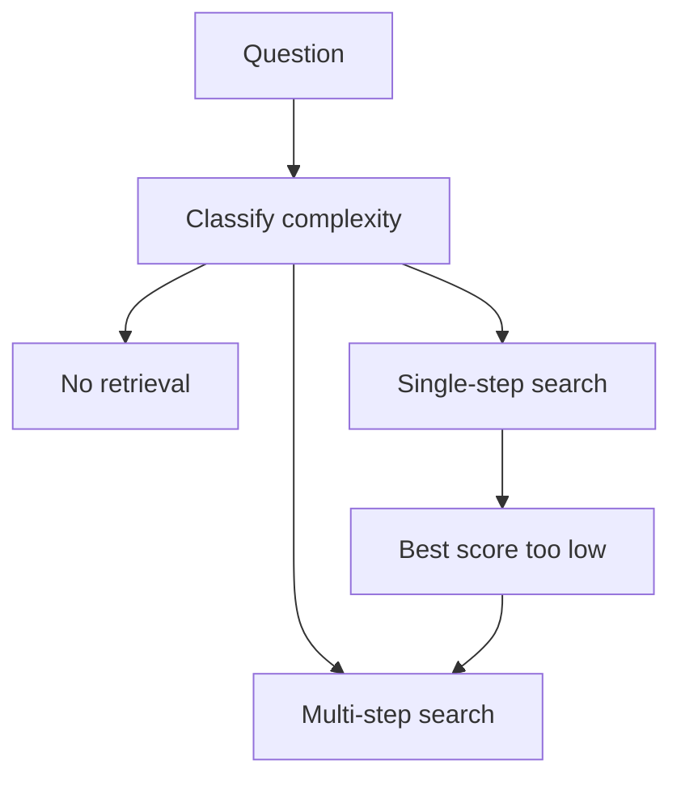

## Every question paid for the most expensive path

After the upgrades in 4.2 and 4.3, Huda's assistant for Najm Microfinance (a fictional lender) answered hard questions much better. It also became slow. Every question now went through rewriting, hybrid search, reranking and, when the splitter found two parts, decomposition. The average answer took about 4.5 seconds, and the monthly model bill nearly doubled.

Omar sampled 1,000 questions from one day. About 30% needed no policy at all: "thanks", "translate this message to Arabic", "make this note to a borrower more polite". About 55% were single facts, such as a late fee. Only about 15% truly needed several searches. The system was treating a "thank you" like a question about two loan policies.

By the end of this chapter you can route a question by its complexity, and you can answer the question every RAG project hears from a manager sooner or later: "Why not just fine-tune a model on our documents?"

## Three routes, one router

**Adaptive retrieval** means choosing how much retrieval each question gets. A small step at the start classifies the question into one of three routes.

- **No retrieval:** the answer does not depend on Najm's documents. Greetings, rewriting or translating the user's own text, general writing help. The model answers directly.
- **Single-step:** one fact from one place. Hybrid search, rerank, top 5, answer. This is the default.
- **Multi-step:** a compound or connected question. Decompose, search per sub-question or in hops, merge, answer.

The diagram shows the router, with one extra arrow that matters.



The extra arrow is an **escalation**: if single-step search finds nothing with a good score, the question is retried once on the multi-step route instead of answered weakly. The router does not need to be perfect, because a cheap route can hand a question up to a costlier one.

The classifier can be simple rules (a question under five words with "thanks" in it, or a request that contains the user's own pasted text), a small model trained or prompted to pick one of three labels, or both. Start with rules and a small labelled set, then measure.

Building that labelled set is less work than it sounds. Omar took 200 questions from the logs and gave each one a route by hand, asking one thing: what is the least retrieval that could answer this correctly? Where he was unsure, Huda labelled it too, and they talked through every disagreement. Those 200 labels became the router's test set. Every change to the rules or the classifier is now checked against them before it ships, the same way the chunking choices in 3.3 were checked against labelled questions.

The router itself must be cheap, or it eats the time it saves. Rules cost nothing. A small classifier model adds a short call, about 100 ms in Huda's tests, which is worth it only if it routes clearly better than the rules on those 200 questions.

## A worked example with numbers

In this example, Huda measured average latency per route: no retrieval 800 ms, single-step 1,900 ms, multi-step 4,500 ms. The model calls and searches on each route cost about $1.00, $4.00 and $12.00 per 1,000 questions. With Omar's mix of 30%, 55% and 15%:

0.30 × 800 + 0.55 × 1,900 + 0.15 × 4,500 = 240 + 1,045 + 675 = **1,960 ms** on average.

0.30 × $1.00 + 0.55 × $4.00 + 0.15 × $12.00 = $0.30 + $2.20 + $1.80 = **$4.30** per 1,000 questions.

Sending everything down the multi-step route costs 4,500 ms and $12.00 per 1,000 questions, and most of that work answers nothing new. Routing saves about 56% of the latency and 64% of the cost. Sending everything down the single-step route costs 1,900 ms but fails most multi-part questions. Routing gets close to the cheaper time while keeping the harder route for the questions that need it.

## How much routing saves depends on the mix

The saving above comes from Omar's mix. Most questions were easy, so most of them skipped the costly route. Before you explore the mix, predict what happens when hard questions become common.

```predict
prompt: "No retrieval stays at 30%, but multi-step questions grow from 15% to 50% of the traffic. Against sending everything multi-step, what happens to the cost saving?"
options:
  - id: same
    label: "It stays near 64%, since 30% of questions still skip retrieval"
  - id: falls
    label: "It falls to about 41%, since half still take the costly route"
correctOptionId: falls
explanation: "The cost becomes 0.30 × $1.00 + 0.20 × $4.00 + 0.50 × $12.00 = $7.10 per 1,000 questions, against $12.00 with no router. Half the questions still pay the full price, so the saving falls to about 41%."
```

<InteractiveCanvas slug="adaptive-routing-cost" />

**What this shows.** The average latency and the cost of 1,000 questions for a mix of the three routes, using the example numbers above, against sending every question down the multi-step route. You set the no-retrieval and multi-step shares. Single-step takes the rest, so the three always add up to 100%.

**Try this.** Raise no retrieval from 30% to 60%: single-step drops to 25%, latency falls to 1,630 ms and cost to $3.40, a 72% saving. Then set no retrieval to 0% and multi-step to 60%: cost rises to $8.80, and routing saves only 27%, because most questions still need the costly route.

**What changed.** Each move shifts questions between a cheap route and a costly one. The saving follows the share of questions that leave the multi-step route. It is large when many questions are easy and small when most are hard.

**Limits of the model.** The latencies and prices are this example's own numbers. The router is free and always right, no question escalates, and latency is an average, not p95. Escalations and router mistakes add some cost back, so treat the saving as an upper bound.

```quiz
type: mcq
question: "Yousef runs a legal-help assistant. His logs show 5% of questions need no retrieval, 15% need one search and 80% need several. Route latencies are 800, 1,900 and 4,500 ms, and the router is free rules. Compared with sending every question multi-step, what does routing do to average latency?"
options:
  - "It halves it, as routing did for the mix of questions at Najm"
  - "It cuts it by about 13%, as most questions still take the slow route"
  - "It raises it, because the router adds a classification step to every question"
  - "It leaves it unchanged, because routing only lowers cost and not latency"
correct: 1
explanations:
  - "Najm's saving came from a mix where 85% of questions skipped the multi-step route. Here only 20% do, so the saving is much smaller."
  - "Right. 0.05 × 800 + 0.15 × 1,900 + 0.80 × 4,500 = 3,925 ms, against 4,500 ms. Most questions still take the slow route, so the saving is about 13%."
  - "The router here is free rules. Even a 100 ms classifier would leave the average near 4,025 ms, still below 4,500 ms."
  - "No-retrieval and single-step questions finish faster than multi-step ones, so moving 20% of questions to them lowers the average latency too."
```

## Not all routing mistakes cost the same

Huda's router will make mistakes, and the two kinds are not equal. Sending a greeting to retrieval wastes about one second. Sending a policy question to the no-retrieval route can produce a confident, invented rule, the exact failure from 3.1, because the model's memory does not know Najm's rules. So bias the router: when it is unsure, retrieve. Measure it on 200 labelled questions and look first at one cell of the results: policy questions labelled "no retrieval". Keep that number close to zero, even if it means more wasted searches.

## RAG or fine-tuning?

Najm's operations manager asks: "Wouldn't it be simpler to fine-tune a model on our policies, so it just knows them?" It is a fair question, and interviewers ask it in almost the same words.

<BigWordAlert term="Fine-tuning" plainEnglish="Training an existing model a bit more on your own examples of inputs and the outputs you want, so its behaviour changes permanently." whyItMatters="It changes how a model answers, not reliably what it knows. Confusing the two leads teams to spend weeks training a model that still gets the facts wrong and cannot cite them." />

The clearest way to decide is to separate **knowledge** from **behaviour**. Knowledge is facts: the late fee, the loan cap, who approves what. Behaviour is how the model answers: the format, the tone, the order of sections, the words it uses, when it refuses. RAG supplies knowledge at question time. Fine-tuning shapes behaviour through training.

Four more criteria settle most cases.

**Freshness.** When Najm changes a rule, RAG needs the new document re-indexed, which takes minutes, and the next answer uses it. A fine-tuned model needs a new training run and a new evaluation, and until then it repeats the old rule with confidence.

**Citations.** A RAG answer can point to the exact passage it used. A fine-tuned model cannot say where a fact came from, because the fact is spread across its weights. For a lender, a source a person can check is often a requirement.

**Cost.** RAG costs a little on every question: retrieval and a longer prompt. Fine-tuning costs up front: preparing examples, training and evaluating, again for every update. In return, it can let a smaller, cheaper model do a narrow task with a shorter prompt, which can pay off at high volume.

**Data.** RAG needs the documents you already have. Fine-tuning needs many good examples of the exact input and the exact output you want, often hundreds or thousands, checked by people who know what a correct answer is. Many teams do not have that set, and building it is the real cost.

| Need | Better fit | Why |
|---|---|---|
| Answer from rules that change | RAG | Re-index in minutes; cite the passage |
| A strict answer format or tone | Fine-tuning | Behaviour learned from examples |
| Domain words a model misreads | Fine-tuning, then test | Teaches usage, not facts |
| Both facts and a fixed format | Both | Facts from retrieval, form from training |

**Both** is common in mature systems. Najm could fine-tune a small model on 2,000 answers approved by senior officers, so that it always answers in Najm's format (the rule, its conditions, the source, and a clear "I don't know" when the context lacks the answer), while retrieval supplies the current rules. The fine-tuned model is the writer; retrieval is the library.

<Callout type="warning" title="Try the prompt before the training run">
Before you fine-tune for format or tone, try clear instructions and two or three examples in the prompt, and measure. Fine-tune only when that falls short on your test set, because every later change then costs a training run.
</Callout>

```quiz
type: mcq
question: "A support team's retrieval already finds the right policy chunk for 95% of test questions. But answers must follow a strict five-field format, and their small model breaks it 20% of the time, even with examples in the prompt. They have 3,000 past answers that staff approved. What should they do?"
options:
  - "Fine-tune on the policy documents and remove the retrieval step"
  - "Add a reranker so that the retrieved chunks are ordered better"
  - "Raise k so the model sees more chunks with each question asked"
  - "Fine-tune the small model on approved answers, keep retrieval"
correct: 3
explanations:
  - "Facts change and need citations, so removing retrieval would trade a format problem for a knowledge problem."
  - "Retrieval already finds the right chunk 95% of the time. The failure is in how the model writes the answer."
  - "More chunks make the prompt longer and do nothing to teach the model the required format."
  - "Right. The problem is behaviour, prompting has been tried, and a good set of approved examples exists. Retrieval keeps supplying the facts."
```

## Failure modes and debugging

- **Answers with invented rules after adding a router:** policy questions are being sent to the no-retrieval route. Check that cell in the router's results and bias toward retrieval.
- **Latency did not drop:** most questions escalate. Look at why single-step scores are low; it may be a chunking or threshold problem, not a routing one.
- **A fine-tuned model repeats an old rule:** knowledge was trained in. Move facts to retrieval and keep fine-tuning for format.

## In the interview

Routing and the fine-tuning question test whether you can match cost to need. The strongest answers use numbers for the mix of questions and say which mistake is worse. Answer each question aloud first, then open it.

<FaqGroup title="Practice questions">
<FaqItem question="How would you decide whether a question needs retrieval at all?">

I would add a router that classifies each question as no retrieval, single-step or multi-step, starting with simple rules and a small labelled set, then a small classifier if rules are not enough. Single-step is the default. I bias the router toward retrieving, because a policy question answered without retrieval can invent a rule, while a greeting that gets a search only wastes about a second. I also let single-step escalate to multi-step when the best score is low. In my example, routing a 30/55/15 mix cut average latency from 4.5 to about 2 seconds.

**Follow-up probes:**

- How would you build the labelled set for the router?
- What metric would you watch after launch?

</FaqItem>
<FaqItem question="Should we use RAG or fine-tune a model on our internal policies?">

For policies I would start with RAG. Policies are knowledge that changes, and RAG updates by re-indexing a document in minutes, while a fine-tuned model needs a new training run and still cannot cite its source. Fine-tuning is the right tool for behaviour: a strict format, a tone, or a narrow task a small model should do cheaply. It also needs hundreds or thousands of approved examples, which many teams do not have. If we need both current facts and a fixed format, I would combine them: retrieval for facts, a fine-tuned small model for the form.

**Follow-up probes:**

- What would you try before fine-tuning for format?
- How would you evaluate the fine-tuned model against the prompted one?

</FaqItem>
</FaqGroup>

**Next:** A graded quiz on hybrid search, reranking, rewriting and routing, before the module gate.
