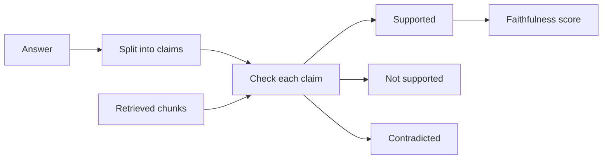

## A confident answer with one bad sentence

Sara works on the report assistant at Sahel Relief (a fictional NGO). A programme manager asks: "How many wells did the team repair in the East district in June?" Retrieval works. The top chunk, from the June field report, says: "In June, the team repaired 14 wells in the East district. The work finished three weeks late because spare pumps were delayed."

The assistant answers: "In June, the team repaired 14 wells in the East district [june#2]. The repairs were paid for by the emergency fund, and the work finished on time [june#2]."

It reads well, it has citations, and the number is right. But the manager copies it into a donor report, and two of its three facts are not in the source. One is missing from the text. One is the opposite of the text. The retrieval metrics from the last chapter would score this question perfectly, because the right chunk was at rank 1.

So you need a second kind of check: not "did we find the right text?" but "did the answer stay inside it?" By the end of this chapter you can split an answer into claims, score how many are supported, and choose a method to find unsupported claims.

<BigWordAlert term="Faithfulness" plainEnglish="An answer is faithful when every claim in it is supported by the context the model was given." whyItMatters="A RAG system is trusted because it answers from your documents. An unfaithful answer breaks that promise, even when the retrieval was perfect." />

## Claims are the unit, not answers

An answer is too big to judge as one thing. Sara's answer is partly right and partly wrong, so a single "good" or "bad" label loses information. Instead you split it into **claims**: short statements that are each true or false on their own.

Sara's answer has three claims:

1. In June, the team repaired 14 wells in the East district.
2. The repairs were paid for by the emergency fund.
3. The work finished on time.

Now you check each claim against the retrieved chunks and give it one of three labels. Claim 1 is **supported**: the chunk says it. Claim 2 is **not supported**: no retrieved chunk mentions how the repairs were paid for. Claim 3 is **contradicted**: the chunk says the work finished three weeks late.

The faithfulness score is the share of supported claims: 1 of 3, or 0.33. Across a test set you report two numbers: the mean faithfulness, and the share of answers with at least one unsupported claim. In this example, Sara checks 40 answers and finds a mean of 0.92, but 6 of 40 answers (15 percent) contain at least one unsupported claim. The second number is the one a programme manager cares about.

The diagram shows the check as a pipeline. It is the same shape whether a person, a classifier or a model does each step.



The important input is the arrow from the retrieved chunks. Faithfulness is always judged against the context the model saw, not against the whole document store or the judge's own knowledge.

## Grounding, citations and relevance

A <GlossaryTerm term="grounded" definition="Tied to a source the reader can check. A grounded answer points to the exact text that supports each claim." /> answer goes one step further than a faithful one: it shows where each claim comes from. In Sara's system that means chunk ids in brackets. Two cheap checks follow.

```predict
prompt: "Sara's second sentence cites [june#2], and june#2 really was retrieved. Does that citation show the sentence is supported?"
options:
  - id: unproven
    label: "No, the cited chunk may not say it"
  - id: proven
    label: "Yes, a real citation shows it is true"
correctOptionId: unproven
explanation: "A citation check has two levels. The id must be one of the retrieved chunks, and the cited text must support the sentence. Sara's second sentence passes the first check and fails the second."
```

The first check is **citation validity**: every cited id must be one of the retrieved chunks. Code can do this with no model at all, and your 3.5 pipeline already drops citations that were not retrieved. The second check is **citation support**: the cited chunk must contain the claim. That needs the same claim check as faithfulness.

There is also a separate question: does the answer address what was asked? This is <GlossaryTerm term="answer relevance" definition="How well an answer addresses the question that was asked, whatever its sources. A faithful answer can still be irrelevant." />. "Sahel Relief works in three districts" may be faithful to a chunk, but it does not answer the question about June. One way to measure it is to ask a model to write the question this answer would fit, then compare that question with the real one by embedding similarity.

Finally, faithful is not the same as correct. If the June report itself has a typo, a faithful answer repeats the typo. Teams that can write reference answers also track **correctness** against them. Faithfulness tells you the generation step behaves; correctness tells you the whole system, including the documents, is right.

## Four ways to catch made-up claims

A made-up claim that sounds true is called a <GlossaryTerm term="hallucination" definition="A claim in a model's output that is not supported by its input or by facts, often stated with full confidence." />. You can look for it in four ways, from cheap to expensive.

| Method | What it catches | Cost per answer |
|---|---|---|
| Rule checks | Bad citation ids; numbers not in the context | Near zero, no model call |
| NLI check per claim | Unsupported and contradicted claims | One small model call per claim |
| Model judge per claim | The same, with better handling of paraphrase | One large model call per answer or claim |
| Self-consistency | Claims that change between samples | Five or more full answers |

**Rule checks** are code. Find every number and name in the answer and check that it appears in the context. In Sara's answer, "14" passes, but the rule cannot see that "on time" contradicts "three weeks late". Rules catch little, but they run on every request in production for free.

**<GlossaryTerm term="natural language inference (NLI)" definition="A task where a model reads a premise and a hypothesis and says whether the premise entails, contradicts or is neutral to the hypothesis." />** treats the chunk as the premise and each claim as the hypothesis. A small classifier labels the pair entailment, neutral or contradiction, which map to supported, not supported and contradicted. It is cheap enough to run on many answers. It struggles when the premise is long, when the claim needs two chunks together, and with tables and arithmetic.

A **model judge** does the same check with a prompt: "Here is the context. Here is a claim. Is the claim supported? Answer supported, not supported or contradicted." It handles paraphrase better, but each call costs money and the judge has its own biases, which the next chapter covers.

**<GlossaryTerm term="self-consistency" definition="Asking the model the same question several times with some randomness and comparing the answers. Facts that change between runs are less likely to be true." />** needs no sources. You sample, say, five answers at a temperature above 0. Claims that appear in all five are more likely grounded; claims that change ("emergency fund" in one, "winter grant" in another) are suspect. It costs five times the generation, and it misses errors the model makes the same way every time.

## Choosing a method

The choice depends on risk and volume. For Sahel Relief's donor reports, a wrong number has a real cost. So Sara runs rule checks on every request and an NLI check on every answer in a nightly batch. Each week, a model judge and a person review a sample of 40. A low-risk internal chatbot might stop at rule checks and a monthly sample.

Whatever you choose, start by hand-labelling 30 to 50 answers yourself. You need those labels to know if your automatic checker agrees with a careful human.

## Failure modes and debugging

**The claim splitter drops claims.** If "paid for by the emergency fund" is merged into the first claim, and the checker only looks at the number, the answer scores 1.0. Read a sample of split claims by hand.

**The checker uses its own knowledge.** A model judge may mark a claim supported because it believes the claim is true in the world. The judge prompt must say: judge only against the given context.

**True but unsupported.** The model sometimes adds a fact it knows from training that happens to be right. It still counts as unsupported: next year the policy changes, the documents change, and the model's memory does not.

<Callout type="tip" title="Store the context with the answer">
You can only check faithfulness later if you log the exact chunks the model saw for each answer. Without them, you are checking against today's documents, not the ones the model read.
</Callout>

```quiz
type: mcq
question: "Lina's clinic assistant answers: 'The clinic opens at 8 am and is closed on Fridays [c3].' Chunk c3, which was retrieved, says only: 'The clinic opens at 8 am.' How should the faithfulness check label this answer?"
options:
  - "Fully faithful, because c3 was retrieved and the citation id is valid"
  - "Fully unfaithful, because one part of the answer is not in the chunk"
  - "One claim supported, and 'closed on Fridays' is not supported by c3"
  - "One claim supported, and 'closed on Fridays' is contradicted by chunk c3"
correct: 2
explanations:
  - "A valid id only passes the first citation check. The chunk must also support each claim, and it says nothing about Fridays."
  - "Splitting into claims keeps the supported part: the opening time is in c3. A whole-answer label loses that information."
  - "Right. The opening time is supported. The chunk does not mention Fridays at all, so that claim is not supported. The score is 1 of 2."
  - "Contradicted means the chunk says the opposite. c3 gives an opening time and says nothing about which days, so the Friday claim is not supported, but it is not contradicted either."
```

## In the interview

Faithfulness questions come up whenever you say "RAG reduces hallucination". The interviewer wants to know how you measured that, and what it costs to measure. Answer each question aloud first, then open it and compare.

<FaqGroup title="Practice questions">
<FaqItem question="How would you measure hallucination in a RAG system that answers 10,000 questions a day?">

I would not check every answer with a large model, because that doubles the model cost. On every request I run rule checks: citation ids must be retrieved, and numbers in the answer must appear in the context. Each night I run an NLI check per claim on a random sample, for example 500 answers. Each week a person labels 50 answers, and I compare those labels with the automatic checker to see how often it agrees. I report the share of answers with at least one unsupported claim, not only the mean.

**Follow-up probes:**

- What would you do if the NLI checker disagrees with humans on 30 percent of answers?
- Which answers would you sample first, if not at random?

</FaqItem>
<FaqItem question="What is the difference between faithfulness and correctness, and why track both?">

Faithfulness asks whether the answer is supported by the context the model saw. Correctness asks whether the answer is true, usually against a reference answer. They fail in different places. Low faithfulness with good retrieval points at the prompt or the model. High faithfulness with low correctness points at the documents or retrieval: the model faithfully repeated the wrong or outdated text. Tracking both tells me which part of the pipeline to fix.

**Follow-up probes:**

- How would you get reference answers without a large labelling budget?
- Can an answer be correct but unfaithful? Is that a problem?

</FaqItem>
</FaqGroup>

**Next:** Most of these checks need a judge, and the cheapest judge is often another model. In the next chapter you design an LLM judge and learn the ways it can be wrong.
