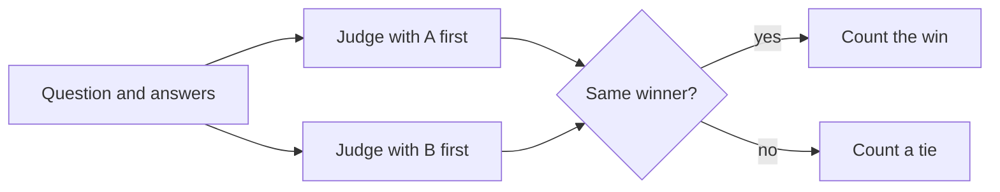

## A win that was not a win

Karim at Sahel Relief (a fictional NGO) has two prompts for the report assistant: the current one, A, and a new one, B. He asks a large model to act as a judge. For each of 100 questions it sees both answers and says which is better. B wins 72 times. Karim is ready to ship B.

Then a colleague asks two questions. Which answer did the judge see first? B, every time. And how long are B's answers? About twice as long as A's. Karim runs the judge again with the order swapped, so A comes first. Now B wins only 55 times. Some of the "win" was the judge preferring whatever came first, and some was the judge preferring longer text.

A model judge is fast and cheap compared with people. It is also a measuring tool with its own errors. By the end of this chapter you can write a judge prompt with a rubric and choose how the judge compares answers. You can also name its biases and measure how far to trust it.

## Why use a model as a judge at all

People are the best judges of answer quality, but they do not scale. In this example, if a careful reviewer needs 2 minutes per answer, one run of 200 golden questions is almost 7 hours of work. Nobody does that after every prompt change.

A model judge can grade the same 200 answers in minutes. That makes it possible to run quality checks on every change, the same way you run unit tests. The cost is that you now have two systems to evaluate: your assistant, and the judge.

<BigWordAlert term="LLM-as-judge" plainEnglish="Using a language model, guided by a written rubric, to grade or compare the outputs of another model." whyItMatters="It makes quality checks fast enough to run on every change, but a judge you have not checked against people can give you confident, wrong numbers." />

## Start with a rubric

A judge without a rubric grades on a general feeling, the same as a person would. A <GlossaryTerm term="rubric" definition="A written list of criteria, each with a short description of what every score means, so different judges grade the same way." /> names the criteria and says what each score means. Keep the scale small. A 3-point scale with clear anchors gives more consistent grades than a 10-point scale with none.

```text
You grade one answer from a report assistant.
Use only the CONTEXT. Do not use your own knowledge.

Criteria (score each 1, 2 or 3):
- Faithful: 3 = every claim is in the context;
  2 = one minor claim is missing from it; 1 = a key claim is unsupported or wrong.
- Complete: 3 = answers every part of the question;
  2 = misses a minor part; 1 = misses the main point.

First write one sentence of reasoning per criterion.
Then output JSON: {"faithful": n, "complete": n}
```

Three choices in this prompt matter. It tells the judge to use only the context, so it does not mark a claim supported because it believes it. It asks for reasoning before the score, which makes the score easier to audit. And it asks for structured output, so your code can parse the grade without guessing.

## Pointwise, pairwise and reference-based

A **pointwise** judge grades one answer at a time, like the prompt above. Pointwise scores can be tracked over weeks and compared with a threshold: "mean faithfulness must stay above 2.7". Their weakness is drift: a judge may give a 3 to answers today that it gave a 2 last month.

A **pairwise** judge sees two answers to the same question and says which is better, or that they are equal. Comparing is easier than scoring, for people and for models, so pairwise judgments are often more consistent. They are the natural fit for "is prompt B better than prompt A?" But they give no absolute level: B can beat A while both are poor.

A **reference-based** judge also gets a reference answer written by a person, and checks the new answer against it. This measures correctness, not only faithfulness. It needs reference answers, which cost time to write but can be reused for every run. A **reference-free** judge sees only the question, the context and the answer.

## The biases you must test for

Karim met two of the three biases interviewers ask about most often.

**Position bias.** In a pairwise comparison, the judge prefers the answer in one position, often the first. The fix is to run every pair twice with the order swapped. The flow below shows how to combine the two runs.



A win only counts if the judge picks the same answer in both orders. If it flips, the judge was following position, not quality, so you record a tie. This doubles the judge cost, and it is still the standard fix.

**Verbosity bias.** Judges tend to prefer longer answers, even when the extra text adds nothing. Tell the judge in the rubric that length is not a criterion. Then check the effect: compare win rates on pairs of similar length, or trim answers to the same length and judge again.

**Self-preference.** A judge may prefer text written by its own model or a model like it. If you compare two systems and one uses the same model as the judge, the comparison is not fair. Use a judge from a different model family, or confirm the result with human labels.

```predict
prompt: "Karim's pairwise judge says prompt B wins 72 of 100 pairs, and B was always shown second. What should he do before he believes the result?"
options:
  - id: more
    label: "Rerun on 100 more new pairs"
  - id: swap
    label: "Rerun with A and B swapped"
correctOptionId: swap
explanation: "More pairs in the same order repeat the same position bias. Swapping the order and counting only wins that survive both orders removes it."
```

## Calibrate the judge against people

The only way to know if a judge is right is to compare it with careful humans. Take 100 answers. Have a person label each one (for example pass or fail on faithfulness). Run the judge on the same 100. The <GlossaryTerm term="agreement rate" definition="The share of items where two judges, such as a model and a person, give the same label." /> is the number of matching labels divided by 100.

Agreement rate alone can fool you. In this example, people mark 88 answers pass and 12 fail. A judge that says "pass" to everything agrees on 88 of 100 and catches no failures at all. So also check agreement on each label: of the 12 answers people failed, how many did the judge fail? If it is 7 of 12, the judge misses 5 of every 12 bad answers. There are chance-corrected scores, such as Cohen's kappa, for exactly this problem.

What is good enough? Compare with people. If two people agree with each other on 90 of 100 labels, a judge at 85 is close to human level. A judge at 70 is not ready. After any change to the judge's prompt or model, you calibrate again.

## Cost and practice

Judging is not free. In this example, 200 questions judged pairwise in both orders is 400 judge calls per run. If you run it on every pull request, that adds up. Many teams run cheap checks (retrieval metrics, rule checks) on every change, and the judge nightly or before a release.

A few habits make a judge stable. Use temperature 0. Version the judge prompt and model name next to its scores. Store the judge's reasons, so you can read why a score changed. Keep a small set of tricky examples with known grades and re-run them when anything about the judge changes.

<Callout type="warning" title="Calibrate on the hard cases too">
If people never labelled answers with tables or numbers, you do not know how the judge performs on them. Add those cases to the human-labelled set before trusting the judge there.
</Callout>

```quiz
type: mcq
question: "Nour calibrates a faithfulness judge on 100 answers. People marked 92 answers pass and 8 fail. The judge agrees with people on 90 of 100, but it failed only 2 of the 8 answers that people failed. What should Nour conclude?"
options:
  - "The judge is ready, because 90 percent agreement is close to human level"
  - "The people are likely wrong on the 8 failures, so relabel those first"
  - "The judge misses most bad answers, so it cannot yet guard against them"
  - "A 10-point scale would give the judge enough detail to catch failures"
correct: 2
explanations:
  - "Most answers pass, so a high agreement rate is easy to reach. The judge caught only 2 of 8 failures, which is the job it is needed for."
  - "There is no evidence the people were wrong. A second person could check a sample, but the judge's low catch rate is the clear finding."
  - "Right. Overall agreement hides that the judge missed 6 of 8 failures. Nour should improve the rubric or the judge and calibrate again."
  - "A longer scale usually makes judges less consistent, not more. The problem is that the judge does not detect failures."
```

## In the interview

Interviewers ask about LLM judges when you mention automatic evaluation. They want to hear that you know the judge is a model with errors, and that you checked it against people. Answer each question aloud first, then open it.

<FaqGroup title="Practice questions">
<FaqItem question="How would you show that your LLM judge can be trusted?">

I would have people label a sample, for example 100 answers, using the same rubric as the judge. Then I compare: overall agreement, and agreement on the failing class, because most answers usually pass. I also measure how often two people agree, since that is the ceiling. If people agree on 90 percent and the judge on 85 percent with most failures caught, I use it; if not, I fix the rubric and repeat. I re-calibrate whenever I change the judge prompt or model.

**Follow-up probes:**

- What would you do if the judge is good on short answers but bad on long ones?
- How often would you re-label a fresh sample after launch?

</FaqItem>
<FaqItem question="You want to compare a new prompt with the current one. Pointwise or pairwise judging?">

For a direct comparison I would use pairwise judging, because judging which of two answers is better is more consistent than giving each a score. I run every pair in both orders and only count a win when both orders agree, to remove position bias. I also check whether the winner is simply longer. Pairwise does not tell me the absolute level, so I keep a pointwise faithfulness score as well, to make sure both versions are good enough.

**Follow-up probes:**

- What does it cost to run both orders on 300 questions on every change?
- How would you handle many ties?

</FaqItem>
<FaqItem question="Name three biases of an LLM judge and how you reduce each one.">

Position bias: in pairwise mode the judge favours one slot, so I swap the order and count only consistent wins. Verbosity bias: it favours longer answers, so I say in the rubric that length is not a criterion and compare answers of similar length. Self-preference: it may favour outputs from its own model family, so I use a judge from a different family or check the result against human labels. For all three, the final check is agreement with people on a labelled sample.

**Follow-up probes:**

- How would you detect verbosity bias in your own results?
- Why ask the judge for reasoning before the score?

</FaqItem>
</FaqGroup>

**Next:** You have the ideas: labels, metrics, faithfulness and judges. In the next chapter you build them into your repository as a golden set and a test that fails when quality drops.
