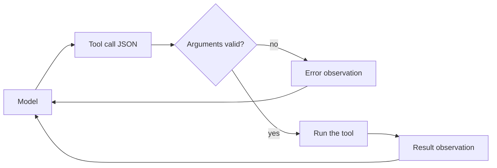

## One bad argument, one crashed request

Reem's first version of the Bustan Books (a fictional online bookshop) assistant had one tool, `lookup_order`. When the model asked for it, her code took the arguments and passed them straight to the order database. It worked in every demo.

On the first busy evening, a customer wrote "my order is #1187". The model called the tool with `{"order_id": "#1187"}`. The database query found nothing, the code tried to read the status of a missing order, and the request crashed with a 500 error. The customer saw "Something went wrong." A minute later a second customer hit the same bug with `{"orderId": 1187}`: wrong key name, wrong type.

The model is not a careful API client. It writes arguments the way it writes text: usually right, sometimes not. By the end of this chapter you can define a tool so the model knows what to send. You can also check what it actually sent, and turn a bad call into something the model can fix.

## How a tool call works

The model never runs your code. It only writes a request, and your code decides what happens. The cycle has four steps.

1. **You describe the tools.** With every request, you send the model each tool's name, a short description, and a schema for its arguments.
2. **The model asks.** If it wants a tool, its reply is a structured tool call: a tool name and the arguments as JSON.
3. **Your code checks and runs it.** You validate the arguments, call the real function, and catch its errors.
4. **You send the result back.** The result becomes an <GlossaryTerm term="observation" definition="The result of a tool call, sent back to the model as input for its next step. It can be data or an error message." />, and the model uses it to write its next step.

<BigWordAlert term="Tool calling" plainEnglish="The model replies with a structured request to run a named function with given arguments; your code runs it and returns the result." whyItMatters="It is how a model reaches live data and takes actions. Every tool call is untrusted input that your code must check before it runs anything." />

## Describe the tool with a schema

The argument schema is written in <GlossaryTerm term="JSON Schema" definition="A standard way to describe the shape of JSON data: which fields exist, their types, and rules such as patterns or minimum values." />. Here is `lookup_order` as the model sees it. The description tells the model when to use the tool; the schema tells it what to send.

```json
{
  "name": "lookup_order",
  "description": "Get the status, delivery date and total of one Bustan Books order. Use it when the customer gives an order number.",
  "parameters": {
    "type": "object",
    "properties": {
      "order_id": {"type": "string", "pattern": "^[0-9]{4,8}$"}
    },
    "required": ["order_id"]
  }
}
```

The pattern says an order id is 4 to 8 digits, with no `#`. The model reads this and usually sends `"1187"`. Usually is not always, so the schema is a hint to the model and a contract for your code, never a guarantee.

The same idea works for the model's final answer. A <GlossaryTerm term="structured output" definition="A model reply that must match a schema, such as JSON with fixed fields, so code can read it without guessing." /> asks the model to reply in JSON that matches a schema, for example `{"answer": "...", "citations": [...]}`. Some model providers can force the output to match the schema. You still validate it, because your code should not depend on one provider's promise.

## Validate with Pydantic

Pydantic can hold the same rules as the schema, and check them in your code. In fact, `LookupOrderArgs.model_json_schema()` produces the parameter schema above (plus some title fields), so you write the rules once. This code, checked with Pydantic 2.14, validates a tool call and turns any failure into a short error.

```python
from pydantic import BaseModel, Field, ValidationError


class LookupOrderArgs(BaseModel):
    order_id: str = Field(pattern=r"^[0-9]{4,8}$")


class IssueRefundArgs(BaseModel):
    order_id: str = Field(pattern=r"^[0-9]{4,8}$")
    amount: float = Field(gt=0, le=500)


def run_tool_call(name: str, raw_args: str) -> dict:
    schemas = {"lookup_order": LookupOrderArgs, "issue_refund": IssueRefundArgs}
    if name not in schemas:
        return {"error": f"unknown tool {name}"}
    try:
        args = schemas[name].model_validate_json(raw_args)
    except ValidationError as exc:
        first = exc.errors()[0]
        return {"error": f"{first['loc'][0]}: {first['msg']}"}
    return {"ok": True, "args": args.model_dump()}
```

Here is what it returns for four tool calls a model might make. Notice that nothing crashes: every bad call becomes a dict the model can read.

```text
lookup_order {"order_id": "1187"}         -> {'ok': True, 'args': {'order_id': '1187'}}
lookup_order {"order_id": "#1187"}        -> {'error': "order_id: String should match pattern '^[0-9]{4,8}$'"}
lookup_order {"order_id": 1187}           -> {'error': 'order_id: Input should be a valid string'}
issue_refund {"order_id": "1187", "amount": -18}  -> {'error': 'amount: Input should be greater than 0'}
```

In a real service, the `ok` branch would call the order system instead of returning the arguments. That call can fail too, and the same rule applies: catch it and return `{"error": "order service timed out, try again"}` or `{"error": "no order 1187"}`.

```predict
prompt: "The model calls issue_refund with order_id '1187' and amount '18.00', so the amount arrives as a JSON string, not a number. With the IssueRefundArgs model above, what happens?"
options:
  - id: rejected
    label: "It is rejected as text"
  - id: accepted
    label: "It is accepted as 18.0"
correctOptionId: accepted
explanation: "By default Pydantic runs in lax mode and converts a numeric string to a float, so the call passes as 18.0. If you want exact types, set strict mode, and the same call is rejected."
```

Lax mode is often what you want: "18.00" clearly means 18. But it also means a string such as "1e2" becomes 100.0. For money, many teams turn on strict mode so the model must send a real number, and the error teaches it to.

## Errors are observations, not exceptions

When validation fails, do not raise an exception that ends the request. Send the error back to the model as the tool's result. The model reads "order_id should match pattern" and, in most cases, calls the tool again with "1187". The diagram shows both paths.



Both arrows go back to the model. An invalid call is not a crash; it is one more step in the conversation. That is why the error text matters: "order_id: String should match pattern" helps the model fix the call, while "Bad request" does not.

Set a limit. In this example, Reem allows 2 retries per tool call. If the third attempt is still invalid, the assistant stops and replies: "I could not find that order number. Could you check it?" Without a limit, a confused model can retry until it runs out of budget, which the next chapter covers.

## Read tools and write tools

`lookup_order` only reads. If it runs twice, nothing changes, so it is safe to retry and safe to run without asking anyone. `issue_refund` writes: it moves money. Treat the two kinds differently.

A write tool needs tighter rules. The schema caps the amount at 500, but the real limit is the order's total, which only the tool can check against the database. A refund also needs a person's approval before it runs, which you build in module 7.

A write tool must also be <GlossaryTerm term="idempotent" definition="Safe to run more than once: running it twice with the same input has the same effect as running it once." />. Imagine the refund request times out. Did the payment go through or not? If your code retries, a refund of 45 can become 90. The fix is an idempotency key: a unique id for this refund, such as `refund-1187-a91`, sent with every attempt. The payment system stores keys it has seen and returns the first result for a repeat, so a retry cannot pay twice.

## Failure modes and debugging

**Vague descriptions.** With "Gets order info" and "Gets customer info", the model guesses which to use. Write when to use the tool, and when not to.

**Too many tools.** Every tool's schema goes into every request. In this example, 40 tools at about 150 tokens each add 6,000 tokens to each call, and choices get worse. Group related tools or route first (chapter 6.4).

**Trusting tool output.** A tool result is text the model will read, and it can contain instructions an attacker planted. Module 8 covers this; for now, never let a tool result change which tools are allowed.

<Callout type="tip" title="Log the raw tool call">
Log the tool name and the raw arguments before validation. When a customer reports a strange answer, the raw call usually shows what the model misunderstood.
</Callout>

```quiz
type: mcq
question: "Huda's clinic agent has a book_slot tool that writes a booking. A call times out after 10 seconds, and nobody knows if the booking was saved. The agent wants to retry. What makes the retry safe?"
options:
  - "Retry only after checking with the model that the slot still looks free"
  - "Send the same unique booking key on each attempt so repeats are ignored"
  - "Raise the timeout to 60 seconds so that the first attempt always finishes"
  - "Mark book_slot as a read tool so that the agent may retry it freely"
correct: 1
explanations:
  - "The model cannot know if the first write was saved. Asking it adds a guess, not a guarantee."
  - "Right. With an idempotency key, the booking system recognises a repeat and returns the first result, so a retry cannot book twice."
  - "A longer timeout makes the problem rarer but not impossible. Any write can still time out after it was saved."
  - "book_slot changes data, so it is a write tool. Calling it a read tool hides the risk instead of removing it."
```

## In the interview

Tool calling shows up in hands-on rounds ("write the code that runs a tool call") and in design rounds ("what could go wrong with this agent?"). The interviewer listens for validation, errors returned to the model, and a clear line between read and write tools. Answer each question aloud first, then open it.

<FaqGroup title="Practice questions">
<FaqItem question="The model sometimes sends invalid tool arguments. How do you handle it?">

I validate every tool call against a Pydantic model built from the same rules as the JSON Schema I send the model. If validation fails, I do not raise; I return a short, specific error as the tool's observation, such as 'order_id should be 4 to 8 digits'. The model usually fixes the call on the next step. I cap retries, for example at 2, and then ask the user for the information instead. I also log the raw arguments, so I can improve the tool description if one mistake keeps coming back.

**Follow-up probes:**

- Would you use Pydantic's lax mode or strict mode for a refund amount, and why?
- What is the cost of each retry, in tokens and latency?

</FaqItem>
<FaqItem question="What makes a tool safe to give to an agent?">

First, I know whether it reads or writes. Read tools can usually run freely and be retried. Write tools need tight argument limits checked in the tool itself, such as a refund never above the order total. They need an idempotency key so a retry cannot repeat the action, and a human approval step when the action is costly or cannot be undone. Finally, the tool has the smallest permissions it needs, for example access to one customer's orders and not the whole database.

**Follow-up probes:**

- Where exactly would you check the order total: in the schema or in the tool?
- How would you test that a retry cannot refund twice?

</FaqItem>
</FaqGroup>

**Next:** One tool call is one step. In the next chapter you chain steps into a loop, trace it turn by turn, and set the limits that stop it.
