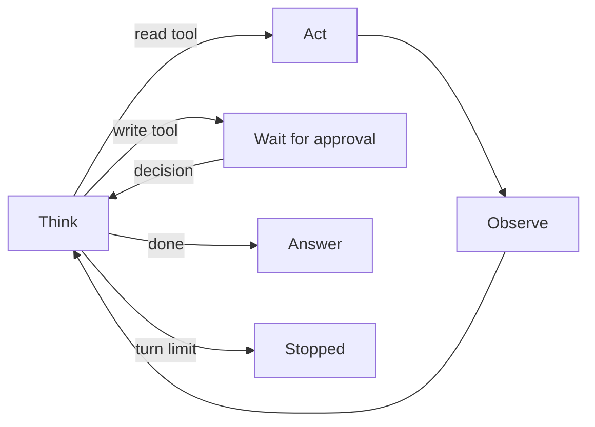

## The loop that did not stop

Yousef wrote the first agent loop for Bustan Books (a fictional online bookshop) in an afternoon. It was a `while True` loop: ask the model what to do, run the tool it picks, give it the result, repeat until it answers. In testing, every conversation ended in two or three turns.

Then the order service went down for twenty minutes one evening. Every `lookup_order` call timed out. The model saw the error, decided to try again, saw the error, tried again. One conversation made 214 model calls before someone noticed the cost graph and stopped the process. The customer never got an answer, not even "please try later".

The loop was not wrong. It was missing its stop rules. By the end of this chapter you can trace an agent loop turn by turn, and you can name the five ways it should end, with numbers for each limit.

## Think, act, observe

The pattern behind most agents is called ReAct, short for reason plus act. Each turn, the model first reasons about what it knows and what it needs. Then it either acts, by calling a tool, or it answers. If it acted, your code runs the tool and returns the result as an observation. The next turn starts from everything so far.

<BigWordAlert term="ReAct loop" plainEnglish="An agent loop where the model thinks about the next step, acts by calling a tool, observes the result, and repeats until it answers." whyItMatters="Almost every agent design question starts from this loop, and most agent failures are a loop that runs too long, calls the wrong tool, or acts without permission." />

The core of the loop is short. This is a sketch, not a full program: `model_step`, `run_tool` and `wait_for_approval` stand for your own code, and `WRITE_TOOLS` is the set of tools that change data.

```python
def run_agent(question, max_turns=6):
    history = [question]
    approved = set()
    for turn in range(1, max_turns + 1):
        step = model_step(history)                # Think
        if step.kind == "answer":
            return step.text                      # Answer
        call = (step.tool, step.args_json)
        if step.tool in WRITE_TOOLS and call not in approved:
            decision = wait_for_approval(step)    # Wait for a person
            if decision.approved:
                approved.add(call)
            history.append(decision)
            continue
        history.append(run_tool(step))            # Act, then Observe
    return "Handing you to a person."             # Stopped: turn limit
```

A **turn** here is one Think: one call to the model. Each turn ends in one of three ways: an answer, a tool call, or a request that needs a person. The `for` loop is the first stop rule. Even if every other rule fails, the loop ends after `max_turns`.

In this sketch, a write tool goes to a person first. When the person approves, the exact call (tool and arguments) is remembered as approved, and the decision goes into the history. On the next turn the model makes the same call, and this time it runs. A call with different arguments, such as a bigger amount, would need a new approval. Module 7 builds this approval step properly, with LangGraph.

## One conversation, turn by turn

A customer writes: "Where is order 1042? It arrived damaged and I want a refund." Here is the run with a turn limit of 6.

| Turn | Think | Act and observe |
|---|---|---|
| 1 | I need the order first | lookup_order('1042') runs at once: delivered 3 days ago, total 45 |
| 2 | Damaged books qualify, so refund 45 | issue_refund is a write tool: wait for a support lead |
| 3 | The lead approved 45 | issue_refund('1042', 45) runs: refund id R-77 |
| 4 | I have everything | Answer: refund R-77 of 45 is on its way |

Turn 1 is a read, so it runs at once. Turn 2 wants a write, so the loop pauses until a support lead approves. If the lead rejects it, the decision still goes back to Think, and the agent replies without a refund, explaining why. Turn 3 runs the approved refund. Turn 4 answers. Four turns, well inside the limit of 6.

The diagram shows the same loop as states. Read it as "where can the agent go next from here?"



Every path out of Think either comes back to Think or ends the run. Only two states end it: Answer and Stopped. A safe agent is one where Stopped is always reachable, whatever the tools do.

```predict
prompt: "In a separate run, lookup_order times out on every call. The model keeps deciding to try again. With a turn limit of 6, how does this run end?"
options:
  - id: stops
    label: "Stops at turn 6 and hands off"
  - id: retries
    label: "Retries until the tool works"
correctOptionId: stops
explanation: "The model will happily keep trying, so the loop cannot rely on it to stop. The turn limit ends the run after the sixth Think, and the agent hands the customer to a person."
```

<InteractiveCanvas slug="agent-react-loop" />

**What this shows.** The Bustan Books refund conversation, step by step, between four parties: the model, your app, the tools and a support lead. The model only asks for tools; the app runs them. A read tool runs at once, a write tool waits for a person, and a turn limit guarantees the loop ends.

**Try this.** First, step through the happy path and count the turns: the answer arrives at turn 4, two turns before the limit. Second, open the last step, where lookup_order keeps timing out, and see the app stop the run at the turn limit of 6 instead of looping.

**What changed.** In the happy path, every observation gave the model new facts, so each turn moved closer to an answer. In the timeout run, the observations repeat, the model learns nothing new, and only the turn limit ends the run.

**Limits of the model.** The canvas shows one conversation with fixed tool results. Real models sometimes call tools in a different order, call two tools at once, or answer too early. It also does not show the other stop rules in this chapter: the repeated-call check and the budget.

## Five ways the loop should end

A good agent ends for a reason you chose, not by luck. There are five.

**1. An answer.** The model decides it has enough. This is the normal end.

**2. A turn limit.** A hard cap on model calls per run. Pick it from data: if 95 percent of real conversations finish in 4 turns, a limit of 6 to 8 leaves room without allowing a runaway. When the limit hits, the user still gets a reply: "I could not finish this. A person from our team will follow up."

**3. A repeated-call check.** If the model calls the same tool with the same arguments twice in a row and gets the same result, a third call will not help. Your code can catch this before the turn limit: return an observation such as "You already called lookup_order with 1042 twice; it timed out both times. Do not call it again," or stop the run. This catches the timeout loop at turn 3 instead of turn 6.

**4. A budget.** Turns are not the only cost. Set a <GlossaryTerm term="budget" definition="A hard limit on what one run may spend, such as tokens, money or seconds. When it runs out, the run stops." /> per conversation, for example 20,000 tokens or 30 seconds in this scenario. A turn with a long tool result can cost more than five short turns, so a token budget catches costs the turn limit misses.

**5. Stop and ask.** Some runs should pause for a person, not end. If the order id is missing, ask the customer. If the next step is a write tool, wait for approval. If the request falls outside policy, such as a refund for a book bought two years ago, hand off to support with a summary. Asking is not a failure: it is the agent knowing the limit of its authority.

## Failure modes and debugging

**The agent loops on errors.** Usually the error observation is unhelpful ("Error 500"), so the model has nothing to change. Return specific errors, and say in the observation when retrying will not help.

**The agent answers too early.** The model skips the tool and guesses: "Your order is on its way." Check traces for answers with no tool call when a tool was needed, and say in the system prompt that order questions require `lookup_order`.

**The agent acts without asking.** If approval is only an instruction in the prompt ("ask before refunds"), a model can ignore it. Enforce it in code, as in the sketch: write tools go to a person, whatever the model says.

<Callout type="warning" title="Stopped still needs a reply">
A run that hits a limit must still tell the user something useful and pass the conversation to a person. A silent stop looks like a crash to the customer.
</Callout>

```quiz
type: mcq
question: "Karim's research agent searches a library catalogue. It calls search with 'water grants 2025' three times in a row, gets the same empty result each time, and has a turn limit of 10. Which stop rule should end this pattern earliest?"
options:
  - "The turn limit of 10, because it caps every run whatever happens inside"
  - "A token budget, because three identical searches cost too many tokens"
  - "A repeated-call check that sees the same tool, arguments and result"
  - "An approval step, because a person should confirm each search request"
correct: 2
explanations:
  - "The turn limit would end the run, but only after 10 turns. Seven more identical searches waste time and money first."
  - "Three short searches use few tokens, so a token budget may not trigger for a long time."
  - "Right. The same call with the same result means the model learns nothing new. A repeated-call check catches it at the third call, long before the turn limit."
  - "Search is a read tool. Asking a person to approve every search adds delay and does not fix the loop."
```

## In the interview

Interviewers use the loop to test whether you have run an agent in the real world. They ask how it stops, what it does on errors, and where a person comes in. Answer each question aloud first, then open it and compare.

<FaqGroup title="Practice questions">
<FaqItem question="How do you stop an agent from looping forever?">

I use several stop rules, because each catches a different failure. A hard turn limit, set from data: if 95 percent of runs finish in 4 turns, I cap at 6 to 8. A repeated-call check, so the same tool with the same arguments and result cannot run a third time. A budget in tokens and seconds per run, because one long tool result can cost more than many turns. When any limit hits, the user still gets a reply and the run is handed to a person with a summary.

**Follow-up probes:**

- What would you log when a run hits the turn limit?
- How would you know if your turn limit is too low?

</FaqItem>
<FaqItem question="Walk me through an agent that can refund a damaged order.">

The customer gives an order id and says it is damaged. Turn 1: the model calls lookup_order, which is read-only, so it runs at once and returns the status and total. Turn 2: the model wants issue_refund; it is a write tool, so the code pauses and shows a support lead the order, the amount and the reason. If the lead approves, turn 3 runs the refund with an idempotency key, and turn 4 answers with the refund id. If the lead rejects it, the model explains that to the customer instead.

**Follow-up probes:**

- What should the support lead see on the approval screen?
- What if the refund call times out after the approval?

</FaqItem>
</FaqGroup>

**Next:** An agent loop is powerful, but it is not always the right tool. In the next chapter you compare it with fixed workflows and routers, and learn when not to use an agent.
