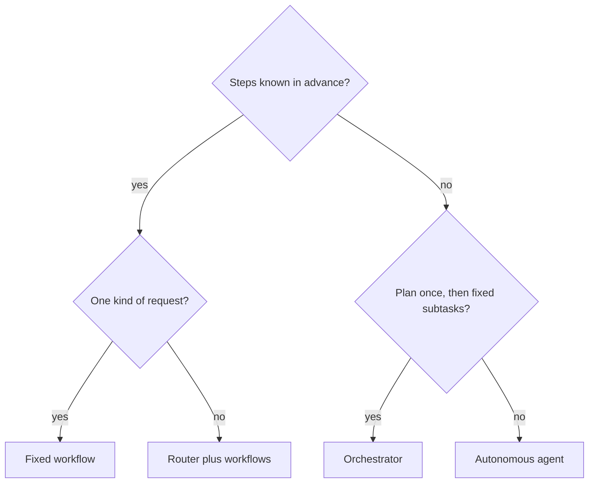

## Nine tools for a three-step job

Tamer rebuilt the Bustan Books (a fictional online bookshop) support assistant as one autonomous agent. It had nine tools: order lookup, refunds, password reset links, policy search, and more. Every message went into the same ReAct loop, and the model decided what to do. The demo was impressive.

After a month, the numbers told another story. In this scenario, 70 percent of messages were some form of "Where is my order?", which always needs the same three steps. Yet the agent used 5 model calls per message on average, and the slowest 5 percent of replies took 14 seconds. Twice it sent a password reset link to a customer who only asked about shipping. Each extra decision the model made was another chance to be slow, expensive or wrong.

Tamer's team rebuilt it. A small router sends each message to one of four paths, and most paths are fixed code with one or two model calls. Average model calls fell to 1.4, and the slowest 5 percent of replies now take under 3 seconds. By the end of this chapter you can choose between four designs for a task, with reasons an interviewer will accept.

## Who decides the next step?

All four designs use a model. The difference is who decides what happens next: your code, or the model. The more the model decides, the more flexible the system is, and the harder it is to predict, test and pay for.

<BigWordAlert term="Workflow (versus agent)" plainEnglish="In a workflow, your code fixes the steps and the model fills in parts of them. In an agent, the model chooses the steps as it goes." whyItMatters="Most production LLM features are workflows. Choosing an agent when a workflow would do adds cost, latency and risk with no gain." />

**A fixed workflow** runs the same steps every time. This is also called <GlossaryTerm term="prompt chaining" definition="A fixed sequence of model calls where the output of one step becomes the input of the next, with code checks in between." />. For "Where is my order?": a model call extracts the order id as structured output; code checks it and calls `lookup_order`; a second model call writes the reply from the result. Code decides every step, so it is easy to test and its cost is known.

**A router** makes one decision at the start and then hands off to a fixed path. One model call, or a small classifier, labels the message: policy question, order status, refund request, or something else. Each label has its own workflow: RAG for policy, the order workflow for status, a refund workflow with approval, and a person for anything else. The model chooses the path, but not the steps inside it.

**An orchestrator** plans at run time. A model reads the task, splits it into subtasks, sends each to a worker (a model call or a workflow), and combines the results. The subtasks are not known until the task is read. Bustan Books uses this once a month: "Summarise this month's complaints about damaged parcels by courier, and suggest policy changes." How many couriers and which complaints only appear when the orchestrator looks at the data.

**An autonomous agent** is the ReAct loop from the last chapter: the model picks each tool, sees the result, and decides again. It fits open-ended requests where the path depends on what each step finds: "I have two accounts, one order is missing, and my gift card does not work."

## Compare them with numbers

The table uses the Bustan Books scenario's own numbers. Your numbers will differ, but the order usually holds.

| Design | Model calls per request | Best when |
|---|---|---|
| Fixed workflow | 1 to 2, always the same | The steps are known and the same every time |
| Router | 2 to 3 (route, then a path) | A few known kinds of request, each with known steps |
| Orchestrator | 3 to 10, set by the plan | Subtasks appear only after reading the task |
| Autonomous agent | 3 to 10 or more, varies | The next step depends on what the last one found |

Read the table along four lines. **Predictability**: a workflow does the same thing on every run, so tests cover it; an agent can take a new path on the next run. **Cost**: every model call costs tokens, and an agent's cost varies with its path. **Latency**: model calls run one after another, so 5 calls at about 1 second each take about 5 seconds. **Risk**: in a workflow, a write action happens only where your code puts it. In an agent, the model decides when to act, so every write tool needs stop rules and an approval.

The flow below is a quick way to choose. Start at the top and stop at the first design that fits.



Notice that the agent is the last stop, not the first. You reach it only when the steps cannot be known in advance, even after planning. Many real systems mix designs: Tamer's router sends the rare open-ended message to a small agent, while the common cases stay fixed.

```predict
prompt: "Seventy percent of Bustan Books messages are 'Where is my order?'. Tamer must pick a design for just these messages. Which is the better fit?"
options:
  - id: workflow
    label: "A fixed three-step workflow"
  - id: agent
    label: "The agent with all nine tools"
correctOptionId: workflow
explanation: "The steps never change: extract the order id, look it up, write the reply. A workflow does this in two model calls with no chance of picking the wrong tool, so it is cheaper, faster and easier to test."
```

## When not to use an agent

An interviewer often asks this directly, because the honest answer shows judgment. Do not use an agent when any of these is true.

**The steps are known.** If you can draw the flow chart, write it as code. An agent will rediscover the same path every time, at a cost.

**Latency is tight.** A chat reply that must start within 2 seconds cannot afford 5 model calls in a row. Use a workflow and stream the one call that writes the answer.

**The action is risky and cannot be undone.** Payments, deletions and messages to customers need a fixed place in the flow where a person or a rule approves them. An agent can still use them, but only behind an approval step enforced in code.

**You cannot measure it.** If you have no golden set and no traces, you will not know when the agent's choices go wrong. Build the eval first, for a workflow, then compare an agent against it.

The decision is reversible in one direction. It is easy to start with a workflow and add an agent for the cases it cannot handle. It is much harder to take an agent away once users rely on its flexibility.

## Failure modes and debugging

**The router misroutes.** A refund request labelled as a policy question gets a polite policy answer and no refund. Give the router its own golden set of labelled messages, and measure its accuracy per label, like any classifier.

**The workflow is too rigid.** Customers send two requests in one message: "Where is order 1187, and how do I reset my password?" A single-path workflow answers only one. Let the router return more than one label, or send multi-part messages to the agent path.

**The agent becomes the dumping ground.** Every new feature becomes another tool for the one agent, until it has 30 tools and chooses poorly. When one kind of request becomes common, give it its own fixed path.

<Callout type="tip" title="Measure before you upgrade">
Run the same golden set through the simple design and the complex one. Move to the complex design only if it wins on the questions that matter, by more than its extra cost and latency.
</Callout>

```quiz
type: mcq
question: "Sara builds intake for Sahel Relief (a fictional NGO). Every grant application goes through the same three steps: extract the fields, check them against fixed eligibility rules, and draft a reply. An auditor must see exactly which rules ran. Which design fits best?"
options:
  - "An autonomous agent that picks its checking tools for each application"
  - "An orchestrator that plans new subtasks after reading each application"
  - "A router that sends each application to one of several possible paths"
  - "A fixed workflow, with model calls to extract fields and draft a reply"
correct: 3
explanations:
  - "The steps never change, so letting the model choose them adds cost and makes the audit trail harder to read."
  - "An orchestrator fits when subtasks are only known after reading the task. Here they are the same three steps every time."
  - "There is only one kind of request and one path, so a router has nothing to choose between."
  - "Right. The steps are known and fixed, and the eligibility rules run as code in a fixed place, which is exactly what the auditor needs to see."
```

## In the interview

"Would you use an agent for this?" is a favourite system design question, because a candidate who says yes to everything has not run one in production. The interviewer wants a choice tied to predictability, cost, latency and risk. Answer each question aloud first, then open it.

<FaqGroup title="Practice questions">
<FaqItem question="When would you not use an agent?">

When the steps are known in advance, I write them as a workflow, because it is cheaper, faster and testable. When latency is tight, I avoid chains of model calls; 5 sequential calls at about 1 second each already break a 2-second target. When an action is risky and cannot be undone, I keep it at a fixed point with an approval step, not at the model's discretion. And when I have no eval or tracing yet, I start with a workflow, build the eval, and only then test whether an agent does better.

**Follow-up probes:**

- Give an example from your own work where you chose not to use an agent.
- What evidence would make you switch from a workflow to an agent?

</FaqItem>
<FaqItem question="Design support automation for an online shop. Router plus workflows, or one agent with all the tools?">

I would start with a router plus workflows, because most support traffic falls into a few known types, such as order status, returns and account help. The router is one cheap call, and each path has fixed steps I can test with a golden set. Refunds get their own workflow with a human approval step. Messages the router cannot label go to a person at first, and if they are common and varied, to a small agent with a turn limit. I would measure the router's accuracy per label, because a misrouted refund is a silent failure.

**Follow-up probes:**

- How would you handle a message that contains two different requests?
- What would you show on the dashboard in the first week?

</FaqItem>
</FaqGroup>

**Next:** A short quiz on tool schemas, the loop and design choices, then the module gate, where you write your own agent design.
