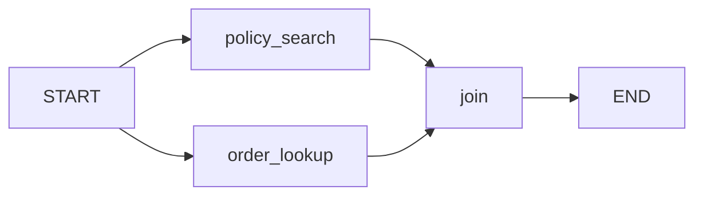

## A bug that lost half an answer

Lina is rebuilding the Bustan Books (a fictional online bookshop) support agent as a graph. A customer asks "Can I return order 1042?". To answer, the agent needs two facts: the returns policy and the order's status.

In Lina's first version, the order lookup ran first and the policy search ran second. Both wrote their result to one key called `context`. The answer used the policy and forgot the order. The lookup had run, but its update was replaced.

Then Lina ran the two steps at the same time to save about a second, and the run crashed with an error.

By the end of this chapter you can explain why that happened, and you can choose, for each key in your state, what should happen when updates meet. Every snippet below was run with LangGraph 1.2.16 on 2026-10-22.

## Three parts: state, nodes, edges

A LangGraph graph has three parts. The **state** is the shared data, described as a Python <GlossaryTerm term="TypedDict" definition="A Python type that describes a dictionary with fixed keys and a type for each key. It documents the shape; Python does not check it at run time." />. A **node** is a plain function. It receives the current state and returns a dictionary with only the keys it wants to change, not the whole state.

An **edge** says which node runs next. A normal edge always goes to the same node. A <GlossaryTerm term="conditional edge" definition="An edge that calls a small function to choose the next node, based on the current state." /> calls a function that looks at the state and returns the name of the next node. `START` and `END` are the fixed entry and exit points.

Here is a small graph that sends order questions to a lookup and other questions to a policy search. First the state and the nodes:

```python
import operator
from typing import Annotated, TypedDict

from langgraph.graph import END, START, StateGraph


class State(TypedDict):
    question: str
    route: str
    notes: Annotated[list[str], operator.add]


def classify(state: State) -> dict:
    is_order = "order" in state["question"].lower()
    return {"route": "order" if is_order else "policy", "notes": ["classified"]}


def order_lookup(state: State) -> dict:
    return {"notes": ["looked up order 1042"]}


def policy_search(state: State) -> dict:
    return {"notes": ["searched the returns policy"]}
```

Then the wiring. `pick_route` is the function behind the conditional edge:

```python
def pick_route(state: State) -> str:
    return state["route"]


builder = StateGraph(State)
builder.add_node("classify", classify)
builder.add_node("order_lookup", order_lookup)
builder.add_node("policy_search", policy_search)
builder.add_edge(START, "classify")
builder.add_conditional_edges(
    "classify", pick_route, {"order": "order_lookup", "policy": "policy_search"}
)
builder.add_edge("order_lookup", END)
builder.add_edge("policy_search", END)
graph = builder.compile()

print(graph.invoke({"question": "Where is order 1042?"}))
```

```text
{'question': 'Where is order 1042?', 'route': 'order', 'notes': ['classified', 'looked up order 1042']}
```

Look at `notes`. Two nodes each returned a one-item list, and the final state holds both items. Now look at `route`. It was simply set. The difference is the `Annotated[..., operator.add]` on `notes`.

## Reducers decide how updates merge

When a node returns `{"notes": [...]}`, LangGraph has to combine that value with the value already in the state. The rule it uses is the key's reducer.

<BigWordAlert term="Reducer" plainEnglish="A small function that takes the current value of a state key and a new update, and returns the merged value. You attach it to a key with Annotated." whyItMatters="Without a reducer, each update replaces the old value. With the wrong reducer you lose data or duplicate it, and parallel steps can fail." />

A key without a reducer is overwritten: the newest update replaces the value. That is right for `route` or `status`, where only the latest value matters.

For lists that should grow, use `operator.add`, which joins the two lists. For chat history, LangGraph ships `add_messages` (from `langgraph.graph.message`). It appends new messages, but if a new message has the same `id` as an old one, it replaces the old one. That lets a node correct a message instead of adding a duplicate:

```python
from langgraph.graph.message import add_messages

old = [{"role": "user", "content": "Where is order 1042?", "id": "m1"}]
new = [{"role": "assistant", "content": "Checking now.", "id": "m2"}]
merged = add_messages(old, new)
print([(m.id, m.content) for m in merged])

fixed = [{"role": "assistant", "content": "It shipped on Monday.", "id": "m2"}]
merged = add_messages(merged, fixed)
print([(m.id, m.content) for m in merged])
```

```text
[('m1', 'Where is order 1042?'), ('m2', 'Checking now.')]
[('m1', 'Where is order 1042?'), ('m2', 'It shipped on Monday.')]
```

You can also write your own reducer: any function of `(current, new)` that returns the merged value. Two common ones are "keep the highest" and "merge two dictionaries":

```python
def keep_max(current: int, new: int) -> int:
    return max(current, new)


def merge_dicts(current: dict, new: dict) -> dict:
    return {**current, **new}


class State(TypedDict):
    notes: Annotated[list[str], operator.add]
    risk: Annotated[int, keep_max]
    facts: Annotated[dict, merge_dicts]
    status: str
```

## Parallel branches

Lina's bug came from running two nodes at once. If two edges leave `START`, both nodes run in the same <GlossaryTerm term="superstep" definition="One round of a LangGraph run. All nodes scheduled for that round run, then all their updates are applied to the state together." />. LangGraph collects every update from that round and applies them together.

To wait for both branches before the next step, pass a list of sources to one edge: `builder.add_edge(["policy_search", "order_lookup"], "join")`. This joining point is often called the <GlossaryTerm term="fan-in" definition="The point where several parallel branches meet and one node runs after all of them have finished." />.

The diagram shows the shape Lina wanted. Two branches leave the start, and one node waits for both.



The arrows into `join` are the dangerous part. Both branches hand their updates to the state in the same round, so every key they both write needs a rule for combining two values.

The canvas below uses the same shape with two keys: `messages`, declared as `Annotated[list, operator.add]`, and `status`, a plain `str`. Both nodes start from the same snapshot: one user message and status "new". Before you open it, predict what happens when both nodes also write `status`.

```predict
prompt: "The policy node returns status 'searched' and the order node returns status 'found' in the same superstep. status has no reducer. What happens?"
options:
  - id: error
    label: "The run stops with an error"
  - id: last
    label: "The last node to end wins"
correctOptionId: error
explanation: "A key without a reducer can take only one value per superstep. LangGraph cannot know which of two values you meant, so it raises InvalidUpdateError instead of silently picking one."
```

<InteractiveCanvas slug="langgraph-reducer-merge" />

**What this shows.** Two parallel nodes read the same snapshot and each returns one new message: "policy: refunds within 30 days" and "order 1042: delivered". The append reducer on `messages` keeps both, so the state holds 3 messages, and `status` stays "new" because neither node wrote it. When both nodes also return a status in the same step, the merge has two values for a plain key and fails with `InvalidUpdateError`.

**Try this.** First, before the merge step, predict how many messages the state holds afterwards. Expect 3: the user's message plus one from each node. Second, before the step where both nodes write `status`, predict whether one value wins. Expect the run to fail with "At key 'status': Can receive only one value per step". Then see the fix: only a later answer node writes `status`, and its single write replaces "new" with "answered".

**What changed.** The nodes did the same work in both runs. Only the number of writers to a key without a reducer in one step changed, from zero or one to two, and that turned a quiet replace into an error.

**Limits of the model.** The canvas shows two nodes and two keys. It leaves out custom reducers, `add_messages` replacing a message by id, checkpoints and conditional edges. The two new messages are appended in an order set by the graph, not by which node finished first, so never depend on finish order.

Here is the same failure in code, so you can see the real error text. The imports are the same as before, plus `from langgraph.errors import InvalidUpdateError`:

```python
class State(TypedDict):
    notes: Annotated[list[str], operator.add]
    status: str


def policy_search(state: State) -> dict:
    return {"notes": ["policy: 30-day returns"], "status": "policy done"}


def order_lookup(state: State) -> dict:
    return {"notes": ["order 1042: shipped"], "status": "order done"}


builder = StateGraph(State)
builder.add_node("policy_search", policy_search)
builder.add_node("order_lookup", order_lookup)
builder.add_edge(START, "policy_search")
builder.add_edge(START, "order_lookup")
builder.add_edge("policy_search", END)
builder.add_edge("order_lookup", END)
graph = builder.compile()

try:
    graph.invoke({"notes": [], "status": "new"})
except InvalidUpdateError as err:
    print("InvalidUpdateError:", str(err).splitlines()[0])
```

```text
InvalidUpdateError: At key 'status': Can receive only one value per step. Use an Annotated key to handle multiple values.
```

The error is a gift. Lina's first bug, the sequential overwrite of `context`, raised nothing and reached a customer. An error tells you at once; a silent overwrite ships. Her fix was to give each fact its own key, or to put both into one key with a merge reducer. With the custom reducers above and a fan-in node, the parallel run printed `'risk': 3` (the higher of 1 and 3) and `'facts': {'order_total': 24.0, 'window_days': 30}` (both dictionaries merged).

```quiz
type: mcq
question: "A research agent at a fictional NGO runs three search nodes in parallel. Each returns a list of document ids under the key found_docs, and a later node ranks them all. found_docs is declared as list[str] with no Annotated reducer. What should you change?"
options:
  - "Add Annotated[list[str], operator.add] to found_docs, so the three lists are joined."
  - "Run the three searches one after another, so each one overwrites found_docs in a safe order."
  - "Keep found_docs as it is, because LangGraph merges lists from parallel nodes by default."
  - "Give each search node a retry policy, so a failed write to found_docs is tried again later."
correct: 0
explanations:
  - "Right. Three writers in one superstep need a reducer, and joining lists is exactly what the ranking node needs."
  - "Running them in sequence avoids the error, but each search overwrites the last one, so only one list reaches the ranking node."
  - "A key without a reducer accepts one value per superstep. Three writers raise InvalidUpdateError."
  - "The write is not failing by chance. It fails every time because the key has no rule for two values, so retrying cannot help."
```

## Failure modes to check

Most reducer bugs are one of three kinds. **Lost updates:** a list or dictionary without a reducer, written by two nodes at different times, keeps only the last write. **Duplicates:** a node returns the whole list instead of only the new items, and `operator.add` appends the old items again, so the list doubles each step. Return only what is new.

**Unbounded growth:** an append reducer on chat history grows every turn, which raises token cost. Module 7.3 covers trimming and summarising.

<Callout type="tip" title="A quick way to debug a merge">
Print the update each node returns, not only the final state. If a node returns more than the keys it owns, that is usually the bug.
</Callout>

## In the interview

Interviewers use reducers to check whether you have built a graph or only read about one. They often ask what happens when two branches write the same key, and how you keep message history from growing. Answer each question below aloud first, then open it to compare.

<FaqGroup title="Practice questions">
<FaqItem question="Two nodes in your graph run in parallel and both update the same key. What happens, and how do you design for it?">

It depends on the key's reducer. Without a reducer, a key can take one value per superstep, so two writers raise InvalidUpdateError. With a reducer, LangGraph merges both values with it: operator.add joins lists, add_messages appends messages and replaces by id, and a custom reducer can keep the maximum or merge dictionaries. I decide per key: status-like keys get no reducer and exactly one writer per step, and collections get an append or merge reducer. I also make each node return only the keys it owns, so ownership is clear.

**Follow-up probes:**

- How would you merge two dictionaries if both branches set the same field?
- Can you rely on the order in which parallel updates are applied?

</FaqItem>
<FaqItem question="Why would you build an agent as a graph instead of a while loop?">

A graph turns each step into a small function I can test alone, and it makes the allowed paths explicit in edges. Because the state is typed and saved after each superstep, I can pause before a risky step, resume after a restart, and replay a run to debug it. In a loop all of that is hand-written. The cost is more structure up front, so for a two-step flow with no pauses I would keep a plain function.

**Follow-up probes:**

- Which part of the graph would a model decide, and which parts stay fixed?
- How do you test one node without running the whole graph?

</FaqItem>
<FaqItem question="Your chat agent's message list doubles in size every turn. What is the likely bug?">

The likely bug is a node that returns the whole message list instead of only its new messages, while the key uses operator.add. Each turn the old messages are appended again, so 10 messages become 20, then 40. The fix is to return only new messages. With add_messages the same mistake does no harm, because re-sent messages keep their ids and replace themselves, which is one reason it is the usual reducer for chat history. I would still fix the node and add a test on the update it returns.

**Follow-up probes:**

- How would a test catch this before release?
- What else would you do once the history is legitimately long?

</FaqItem>
</FaqGroup>

**Next:** Memory and checkpoints: how a saved state lets one conversation remember, and how a store lets the agent remember across conversations.
