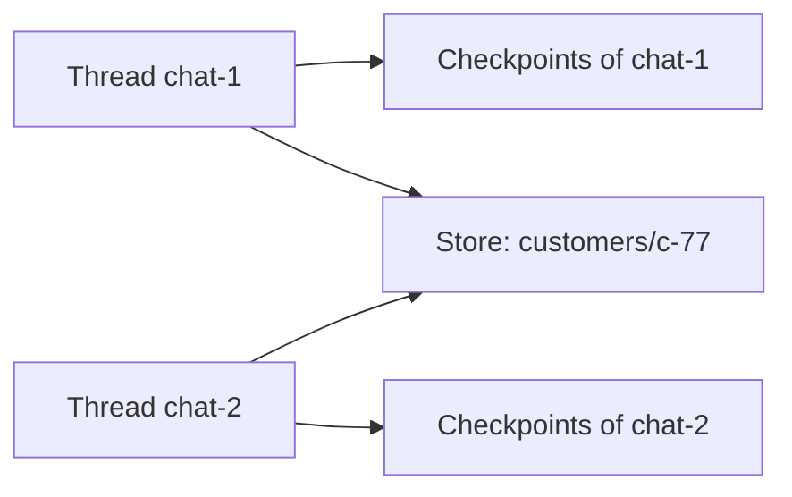

## Two memory bugs in one week

Karim maintains the Bustan Books (a fictional online bookshop) support agent. On Monday a customer wrote "My order is 1042", then "Can I return it?". The agent asked for the order number again. It had no memory between messages.

On Thursday, after Karim added memory, a different customer asked "Where is my order?" and the agent answered with the status of order 1042. Karim had used one fixed conversation id for every customer, so everyone shared one memory.

The first bug annoys a customer. The second leaks one customer's data to another. By the end of this chapter you can separate memory inside one conversation from memory across conversations. You can choose what each one keeps, and use saved state to resume or replay a run. The snippets ran with LangGraph 1.2.16 on 2026-10-22.

## Thread memory comes from checkpoints

When you compile a graph with a checkpointer, LangGraph saves the full state after every superstep. Each saved copy is a checkpoint, and every checkpoint belongs to a thread.

<BigWordAlert term="Checkpoint" plainEnglish="A saved copy of the graph's whole state at one moment in a run, stored under a thread id, so the run can continue, be inspected, or be replayed from that moment." whyItMatters="Checkpoints are how an agent remembers a conversation, survives a restart and waits for approval. Interviewers expect you to say where they are stored and what happens when that storage is lost." />

You choose the thread with `{"configurable": {"thread_id": ...}}` in the config. The same thread id continues the same state. A new thread id starts empty. In this snippet the reply node counts how many turns it can see:

```python
class State(TypedDict):
    turns: Annotated[list[str], operator.add]


def reply(state: State) -> dict:
    return {"turns": [f"bot saw {len(state['turns'])} turn(s)"]}


builder = StateGraph(State)
builder.add_node("reply", reply)
builder.add_edge(START, "reply")
builder.add_edge("reply", END)
graph = builder.compile(checkpointer=InMemorySaver())

lina = {"configurable": {"thread_id": "lina-1"}}
omar = {"configurable": {"thread_id": "omar-1"}}
graph.invoke({"turns": ["hi"]}, lina)
print(graph.invoke({"turns": ["order 1042?"]}, lina)["turns"])
print(graph.invoke({"turns": ["hello"]}, omar)["turns"])
```

```text
['hi', 'bot saw 1 turn(s)', 'order 1042?', 'bot saw 3 turn(s)']
['hello', 'bot saw 1 turn(s)']
```

The imports are the ones from 7.2 plus `from langgraph.checkpoint.memory import InMemorySaver`. Lina's second message sees her first one. Omar's thread sees nothing of Lina's.

Karim's Thursday bug was a fixed thread id. The fix was one thread id per conversation. The server builds it from the signed-in customer and a conversation id, never from the message text.

`InMemorySaver` keeps checkpoints in the Python process. It is right for tests and wrong for production, because a restart deletes every thread. In production you use a checkpointer backed by a database such as PostgreSQL, installed as a separate LangGraph package. The graph code does not change; only the object you pass to `compile()` does.

## Long-term memory lives in a store

Thread memory ends with the thread. Some facts should outlive it: a customer prefers paperbacks, or writes in Arabic. LangGraph keeps these in a store, a separate key-value space that every thread can read.

Items are grouped under a <GlossaryTerm term="namespace" definition="A tuple of strings that groups stored items, such as ('customers', 'c-77'). It works like a folder path." />. If you compile with `store=...`, a node that declares a `store` parameter receives it:

```python
def greet(state: State, *, store: BaseStore) -> dict:
    namespace = ("customers", state["customer_id"])
    item = store.get(namespace, "preferences")
    if item is None:
        store.put(namespace, "preferences", {"format": "paperback"})
        return {"reply": "Welcome. Noted: you like paperbacks."}
    return {"reply": f"Welcome back. Still {item.value['format']}?"}


graph = builder.compile(checkpointer=InMemorySaver(), store=InMemoryStore())
first = {"configurable": {"thread_id": "chat-1"}}
second = {"configurable": {"thread_id": "chat-2"}}
print(graph.invoke({"customer_id": "c-77"}, first)["reply"])
print(graph.invoke({"customer_id": "c-77"}, second)["reply"])
```

```text
Welcome. Noted: you like paperbacks.
Welcome back. Still paperback?
```

Here the state has `customer_id` and `reply`, `BaseStore` comes from `langgraph.store.base` and `InMemoryStore` from `langgraph.store.memory`. Two threads, one customer: the second conversation remembers the first.

The diagram shows the two kinds of memory side by side. Notice which arrows cross from one thread to another.



Checkpoints never cross threads. Only the store is shared, so the store is where a leak would happen, and the namespace must always include the customer's id.

## Long histories: trim and summarise

An append reducer keeps every message. In this example, a support chat of 60 turns at about 120 tokens a turn sends 7,200 tokens of history with every model call. Most of it no longer matters. A common fix keeps the last 8 turns word for word, about 960 tokens, plus a running summary of the older turns of about 200 tokens. That is about 1,160 tokens a call instead of 7,200.

The trade-off is detail. A summary written by a model can drop the one fact that matters later, such as an order number. So keep hard facts in their own typed state keys, like `order_id`, and let the summary hold only the story. Summarising also costs a model call, so do it every N turns, not every turn.

## What not to remember

Memory is data you store about people, so decide what you keep on purpose. Never store payment card numbers, passwords or one-time codes, even if a customer types them. Do not keep personal details the task does not need. A customer may explain a late delivery by describing a family crisis; the agent needs the delivery fact, not the story. Give stored items a retention period, delete a customer's namespace when they ask, and tell customers what is remembered.

<Callout type="warning" title="Checkpoints hold everything">
A checkpoint stores the whole state, including every message. Privacy rules apply to your checkpointer's database, not only to the store.
</Callout>

## Resume, inspect and replay

Because every step is saved, you can look back. `graph.get_state(config)` returns the latest snapshot, and its `next` field names the node that would run next. `graph.get_state_history(config)` lists every checkpoint, newest first. Here a customer gave order 1024 by mistake when they meant 1042:

```python
config = {"configurable": {"thread_id": "karim-7"}}
graph.invoke({"order_id": "1024", "steps": []}, config)
for snap in graph.get_state_history(config):
    print(snap.next, snap.values.get("steps"))

before = next(s for s in graph.get_state_history(config) if s.next == ("lookup",))
fork = graph.update_state(before.config, {"order_id": "1042"})
print(graph.invoke(None, fork)["steps"])
```

```text
() ['lookup 1024', 'answer']
('answer',) ['lookup 1024']
('lookup',) []
('__start__',) []
['lookup 1042', 'answer']
```

The graph has two nodes, `lookup` and `answer`, and a `steps` list with `operator.add`. `update_state` on an old checkpoint creates a new branch of the thread, often called time travel. Invoking with `None` as the input continues from that branch instead of starting over. Time travel like this needs LangGraph 1.2 or later; on 1.0 the same snippet gives a different answer, which is why chapter 7.6 pins `langgraph>=1.2,<2`. This is how you debug a bad run: find the checkpoint before the wrong step, fix the state and run forward. The same mechanism resumes a run after a crash, because the last checkpoint is still in the database.

## Failure modes to check

Memory bugs are quiet, so test for them on purpose. **Shared threads:** a fixed or guessable thread id lets one person load another's conversation, as in Karim's Thursday bug. Write a test that runs two customers on two threads and checks that neither sees the other's messages.

**Lost threads:** the in-memory saver slipped into production, so every restart forgets every conversation; check which checkpointer your production config builds. **Leaky store:** a namespace without the customer's id, such as `("preferences",)`, is shared by everyone.

**Endless growth:** checkpoints pile up for every step of every thread. Decide how long you keep them, for example 30 days for finished conversations, and delete older ones on a schedule.

When a run goes wrong, start with `get_state_history`. It tells you which node ran, in what order, and what the state was before each step, which is usually faster than reading logs.

```quiz
type: mcq
question: "A fictional microfinance lender's loan assistant should remember each loan officer's preferred report language across conversations. Within one conversation it must remember which loan file is open. Where should each fact live?"
options:
  - "Both facts in the thread state, because the checkpointer already saves it after every step"
  - "The open loan file in the thread state, and the preferred language in the store under the officer"
  - "Both facts in the store, under one shared namespace that all loan officers read from"
  - "The preferred language in the thread state, and the open loan file in the store under the officer"
correct: 1
explanations:
  - "Thread state ends with the thread. A new conversation starts empty, so the language preference would be lost."
  - "Right. The open file matters only inside this conversation, and the language must outlive it, keyed by the officer."
  - "A shared namespace would leak one officer's data to others, and the open file does not need to outlive the conversation."
  - "This is reversed. The preference would be forgotten next time, and the open file would wrongly carry over."
```

## In the interview

Memory questions test whether you know where state physically lives and who can see it. Expect a restart question and a privacy question. Answer aloud first, then open each item.

<FaqGroup title="Practice questions">
<FaqItem question="How does your agent remember a conversation, and what happens if the server restarts mid-conversation?">

The graph is compiled with a checkpointer, so the full state is saved after every step under the conversation's thread id. In tests I use an in-memory saver, but in production the checkpointer writes to a database. After a restart, the next request with the same thread id loads the last checkpoint and continues. If I used the in-memory saver in production, a restart would wipe every conversation. I also build the thread id on the server from the user and conversation, so one user can never load another's thread.

**Follow-up probes:**

- How long do you keep checkpoints, and who can read them?
- What happens to a run that was halfway through a node when the server died?

</FaqItem>
<FaqItem question="Your conversations average 60 turns. How do you keep the context from growing without losing important facts?">

I keep the last few turns word for word and replace older turns with a running summary. In my example that cut about 7,200 tokens of history to about 1,160 per call. Facts the agent must not lose, like the order id, go into their own typed state keys, not into the summary. I summarise every N turns to limit the extra model calls. Then I check with an evaluation set that answers did not get worse after trimming.

**Follow-up probes:**

- What would you measure to choose the number of recent turns to keep?
- Where would a summary error show up, and how would you notice it?

</FaqItem>
</FaqGroup>

**Next:** Human-in-the-loop approvals: pausing a graph before a risky tool call and resuming it with a person's decision.
