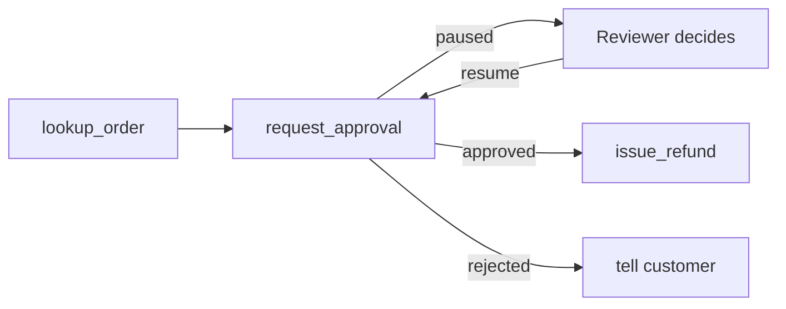

## Two emails for one refund

Huda runs customer service at Bustan Books (a fictional online bookshop). She asked for one rule: the agent may prepare a refund, but a person approves it before money moves. Omar built an approval node with LangGraph. It sent the customer an email saying "your refund is under review", then paused for Huda.

It worked. But every customer whose refund Huda approved received the "under review" email twice, and nobody could explain why.

By the end of this chapter you can pause a graph before a risky tool call, decide what the reviewer must see, and resume with their decision. You can also explain why Omar's email went out twice. The code ran with LangGraph 1.2.16 on 2026-10-22.

## Pausing with interrupt()

A graph pauses when a node calls `interrupt(value)`, from `langgraph.types`. The value is what you want a person to see. LangGraph saves a checkpoint and returns to the caller.

The result of `invoke` then holds a key `__interrupt__` with the value. Later, any process that can reach the same checkpointer resumes the run with `graph.invoke(Command(resume=answer), config)`, using the same thread id. Inside the node, the `interrupt(...)` call now returns `answer`.

<BigWordAlert term="Human-in-the-loop" plainEnglish="A design where an automated system stops at chosen points and waits for a person to approve, edit or reject the next action before it continues." whyItMatters="It is the main safety control for agents that move money or change records. Interviewers ask where you put it, what the person sees, and what happens while they are away." />

The pause needs a checkpointer, because the state has to be stored somewhere while nobody is running. Without one, LangGraph still stops at the interrupt, but resuming fails with `RuntimeError: Cannot use Command(resume=...) without checkpointer`. The pause also costs nothing while it waits: no process holds the run in memory, so Huda can approve tomorrow after a restart.

Here is a cut-down version of Omar's node. The imports are the ones from 7.3 plus `from langgraph.types import Command, interrupt`. Read it and predict before you look at the output.

```python
emails_sent = []


class State(TypedDict):
    order_id: str
    decision: str


def approve_refund(state: State) -> dict:
    emails_sent.append(f"'Refund under review' for {state['order_id']}")
    decision = interrupt({"order_id": state["order_id"], "amount": 24.0})
    return {"decision": decision}


builder = StateGraph(State)
builder.add_node("approve_refund", approve_refund)
builder.add_edge(START, "approve_refund")
builder.add_edge("approve_refund", END)
graph = builder.compile(checkpointer=InMemorySaver())

config = {"configurable": {"thread_id": "refund-1042"}}
paused = graph.invoke({"order_id": "1042"}, config)
print("paused with:", paused["__interrupt__"][0].value)
done = graph.invoke(Command(resume="approve"), config)
print("decision:", done["decision"])
print("emails sent:", len(emails_sent))
```

```predict
prompt: "The graph pauses once and is resumed once with 'approve'. How many times did the email line run?"
options:
  - id: one
    label: "Once: it continues from the pause"
  - id: two
    label: "Twice: the node starts again"
correctOptionId: two
explanation: "On resume, LangGraph runs the paused node again from its first line. This time interrupt() returns the resume value instead of pausing, but every line before it runs a second time."
```

```text
paused with: {'order_id': '1042', 'amount': 24.0}
decision: approve
emails sent: 2
```

## The node runs again from the top

This is the most important rule in the chapter. LangGraph does not freeze the Python function in the middle. It saves the state from before the node started. On resume, it calls the node again, and `interrupt()` returns the saved answer instead of pausing. Any <GlossaryTerm term="side effect" definition="Anything a function does outside its return value, such as sending an email, writing to a database or calling a payment API." /> before the `interrupt()` call runs twice: once on the way in and once on resume.

So the design rules are short:

- Put `interrupt()` at the top of its own node, with nothing risky before it.
- Put the risky action in the next node, which runs only after approval.
- Make that action safe to repeat anyway, because retries, double clicks and crashes still happen.

The diagram shows the graph Omar ended with. Notice that the pause and the payment are two separate nodes.



The arrow from the reviewer goes back into `request_approval`, not into `issue_refund`. That is the re-run. Because nothing in `request_approval` touches money, running it twice is harmless.

## What the reviewer must see

A pause is only as good as the decision it collects. A prompt like "Approve tool call issue_refund? yes/no" trains people to click yes. The interrupt value should hold everything needed to decide in about 30 seconds without opening another system:

- **The action and the amount:** issue a refund of 24.00 for order 1042.
- **The reason:** the customer's words, such as "arrived damaged".
- **The evidence:** order status, items, delivery date, earlier refunds for this customer.
- **Why it paused:** which rule fired, for example "all refunds need approval" or "over the 50.00 limit".

The answer should be structured, not free text: `{"approved": True, "reviewer": "huda"}`, or an edited amount if partial refunds are allowed. Treat anything unclear as a rejection. This is called failing closed: when the system cannot tell what a person meant, it chooses the action that moves no money. Record who decided and when in the state, so the audit trail lives with the run.

Check who is allowed to resume. The resume endpoint must confirm that the caller is a reviewer with the right role. A customer must never be able to approve their own refund by calling it.

## Timeouts and idempotency

Approvals can wait hours. Decide what happens if nobody answers. A common design records the request time in the state and reminds the reviewer after 24 hours. After 48 hours it resumes the thread with a rejection marked "expired" and tells the customer a person will contact them. A paused thread simply stays paused in the checkpointer; the expiry is a scheduled job you own, which finds old paused threads and resumes them.

Then make the payment idempotent. Huda double-clicks "approve". A network error makes the dashboard retry. Two reviewers approve the same request. In each case the refund node may run twice.

Pass an <GlossaryTerm term="idempotency key" definition="A unique value sent with a request so the receiver can tell a repeat from a new request and perform the action only once." /> such as `refund-1042` to the payment service, or check your own ledger before paying. A second call with the same key returns the first result instead of paying again.

<Callout type="warning" title="Do not rely on the graph alone">
If a thread has already finished, a second resume may run nothing. That is not a guarantee you should build on. The payment itself must refuse to run twice.
</Callout>

## Failure modes and debugging

Three errors cover most broken approval flows.

**The resume starts a fresh run.** If the resume uses a different thread id, or a new graph with its own empty saver, there is no paused state to continue. The graph starts again from `START` with an empty state, and the first node usually fails with a `KeyError` on a key it expected. Check that the thread id and the checkpointer are the same objects or the same database as the first call.

**The resume is refused.** `RuntimeError: Cannot use Command(resume=...) without checkpointer` means the graph was compiled without one. The first call still pauses, which hides the bug until someone approves.

**The world changed while waiting.** The customer cancelled the order, or another agent already refunded it, during the 6 hours the request waited. So the refund node checks the order again just before it pays, instead of trusting facts collected before the pause.

```quiz
type: mcq
question: "A fictional NGO's grant agent must email a field office and then wait for a manager to approve releasing funds. A developer puts send_email(), then interrupt(), then release_funds() in one node. What is the best change?"
options:
  - "Keep one node and add a flag in state that says the email was sent, checked before sending it"
  - "Move send_email() after interrupt() in the same node, so it runs only once on resume"
  - "Split it: the email in one node, the pause in a second, and release_funds() in a third"
  - "Replace interrupt() with a loop that checks a database row for the manager's answer every minute"
correct: 2
explanations:
  - "State updates made inside the node are not saved before the pause, so the flag would not be set when the node runs again."
  - "The email would then wait for approval, which changes the process, and release_funds() would still share a node with the pause."
  - "Right. Each side effect runs in its own node, the pause node has nothing before interrupt(), and the funds move only after approval."
  - "A polling loop keeps a process alive for hours and loses the run on restart, which is what checkpoints were meant to fix."
```

## In the interview

Approval questions are where interviewers separate demos from production agents. They probe what happens on resume, who sees what, and how you prevent a double action. Answer aloud first, then open each item.

<FaqGroup title="Practice questions">
<FaqItem question="Walk me through how your agent pauses for approval before a refund and continues afterwards.">

The refund path has a request_approval node that calls interrupt() with the action, amount, reason and evidence. The graph uses a database checkpointer, so the state is saved and no process waits. A reviewer dashboard shows the payload; the decision is sent back with Command(resume=...) on the same thread id. The node runs again from the top, so it holds no side effects, and the refund happens in the next node with an idempotency key. In my example, a refund of 24.00 waits until a reviewer approves it, and an unclear answer counts as a rejection.

**Follow-up probes:**

- What happens if two reviewers approve the same request at the same moment?
- How does the customer know the request is waiting?

</FaqItem>
<FaqItem question="What happens if nobody approves the request for three days?">

Nothing runs while it waits, because the state is in the checkpointer. So cost is not the issue; the customer's experience is. I store the request time in the state and remind the reviewer at 24 hours. At 48 hours a scheduled job resumes the thread with an expired rejection, and the customer is told a person will follow up. I also watch the number of waiting approvals as a metric, because a growing queue means the rule or the staffing is wrong.

**Follow-up probes:**

- Would you ever auto-approve after a timeout? For which actions?
- How would you change the threshold if the queue keeps growing?

</FaqItem>
</FaqGroup>

**Next:** Multi-agent orchestration: when one agent is enough, and when a supervisor or handoffs between agents are worth their cost.
