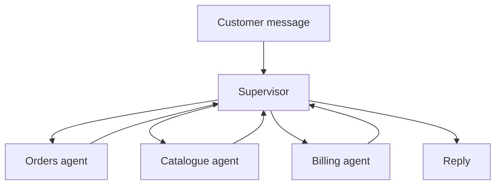

## Three agents, slower and no better

Yousef was asked to grow the Bustan Books (a fictional online bookshop) assistant. It now had to answer order questions, recommend books and handle refunds. He read about multi-agent systems and built three: an orders agent, a catalogue agent and a billing agent, with a supervisor agent that chose between them. In his demo every answer was correct.

In his load test, the average reply took twice as long as the old single agent, and the cost per conversation almost doubled. When one answer was wrong, it took him an hour to find which agent caused it.

Multi-agent designs are a favourite interview topic because they sound advanced. A strong candidate knows the three common shapes, what each one costs, and how to argue for the simplest one that works. That is this chapter's outcome.

<BigWordAlert term="Multi-agent system" plainEnglish="A design where several agents, each with its own prompt and tools, work on one request, and some rule or agent decides which one acts next." whyItMatters="It can make large systems easier to own and safer to permission, but it multiplies model calls and failure points. Interviewers want to hear when it is worth that price." />

## Three shapes

**A single agent with many tools.** One prompt, one loop, all the tools. It is the cheapest and easiest to debug, because one trace shows every decision. It struggles when the tool list gets long or the instructions start to conflict.

In Yousef's case, the single prompt had 22 tool descriptions and about 3,000 tokens of instructions. On his own 50-question test set, it picked the wrong tool 9 times. Those are his numbers, not a rule.

**A supervisor.** A supervisor agent reads the request and routes it to a <GlossaryTerm term="worker agent" definition="An agent with a narrow job, its own prompt and a small set of tools, which the supervisor calls and which reports back when done." />. When the worker finishes, control returns to the supervisor, which decides whether to call another worker or answer. The flow is easy to follow, because everything passes through one place.

**Handoffs, sometimes called swarm style.** There is no central router. The active agent can pass control directly to another agent with a <GlossaryTerm term="handoff" definition="A step where one agent ends its turn by naming the next agent to act and passing it the state it needs." />, and the receiving agent talks to the customer until it hands off again. This saves the supervisor's extra calls, but no single place shows the whole flow.

The diagram shows Yousef's supervisor design. Notice that every arrow returns to the supervisor.



Every return arrow is a model call. That loop is where Yousef's extra seconds came from.

## Handoffs in LangGraph

In LangGraph, a node can return a `Command` that sets both the update and the next node. That is how a handoff is built. The type hint `Command[Literal["billing", "shipping"]]` tells LangGraph which nodes it may go to. In the capstone, a model would choose the target; here a keyword stands in for the model so the snippet runs offline:

```python
class State(TypedDict):
    question: str
    trail: Annotated[list[str], operator.add]


def triage(state: State) -> Command[Literal["billing", "shipping"]]:
    target = "billing" if "refund" in state["question"] else "shipping"
    return Command(goto=target, update={"trail": [f"triage -> {target}"]})


def billing(state: State) -> dict:
    return {"trail": ["billing answered"]}


def shipping(state: State) -> dict:
    return {"trail": ["shipping answered"]}


builder = StateGraph(State)
builder.add_node("triage", triage)
builder.add_node("billing", billing)
builder.add_node("shipping", shipping)
builder.add_edge(START, "triage")
builder.add_edge("billing", END)
builder.add_edge("shipping", END)
graph = builder.compile()
print(graph.invoke({"question": "I want a refund for 1042"})["trail"])
```

```text
['triage -> billing', 'billing answered']
```

`Literal` comes from `typing` and `Command` from `langgraph.types`; the rest of the imports are as in 7.2. There is no edge from `triage` in the wiring: the `Command` it returns is the edge. In a real system each of these nodes could be a whole agent with its own tools.

## A worked cost comparison

Put numbers on the three shapes. In this example, every model call takes about 1.2 seconds, and a refund question needs three steps of real work: look up the order, check the policy, prepare the refund.

| Design | Model calls | Time at 1.2 s each |
|---|---|---|
| Single agent | 3 | about 3.6 s |
| Handoff | 1 triage + 3 = 4 | about 4.8 s |
| Supervisor | 1 route + 3 + 1 finish = 5 | about 6.0 s |

The supervisor costs two extra calls on every request, and more if it routes to two workers in turn. Cost per conversation grows the same way. Each worker also needs the relevant context passed in. If you pass the full history to every worker, tokens grow fast; if you pass a short brief, the worker may miss a fact. That trade-off appears in every multi-agent design.

Debugging also changes. With one agent, one trace shows each tool call and why it was made. With a supervisor, a wrong answer can come from bad routing, a worker's mistake, or context lost in the brief. You need a trace that links every agent's calls to one request id, and an evaluation set for the router alone.

## When several agents are worth it

Split into several agents when you can name one of these benefits, and ideally measure it:

- **Permissions.** Only the billing agent holds `issue_refund`. A catalogue agent that reads untrusted book reviews cannot pay anyone, even if a review tricks it. Module 8 builds on this.
- **Conflicting instructions.** The catalogue agent should be chatty and suggestive; the billing agent should be brief and careful. One prompt doing both does each badly.
- **Ownership.** Different teams own and test different agents, and release them separately.
- **Parallel work.** Independent research tasks can run at the same time and be merged with a reducer, as in 7.2.

If none applies, start with one agent and good tools, measure tool-choice errors on a test set, and split only the part that fails. Yousef's fix was a middle path. He kept one main agent for orders and books and moved only refunds to a separate billing agent with its own approval step. Replies went back to near the old speed, and the risky tool lived behind one door.

## Failure modes and debugging

Multi-agent systems fail in ways a single agent cannot.

**Ping-pong:** with handoffs, the orders agent sends a refund question to billing, and billing sends it back because the order id is missing. Without a step limit, the two pass it back and forth until a timeout. Set a limit, such as 8 steps per request, and treat hitting it as an error you log.

**Lost context:** the supervisor sends the worker a short brief and leaves out the customer's reason, so the billing agent asks the customer again. Pass named fields, such as `order_id` and `reason`, not a free-text summary.

**Misrouting:** the router sends a refund question to the catalogue agent, which answers politely and wrongly. Keep a test set of 30 to 50 questions with the expected agent for each, and measure routing accuracy on its own before you measure final answers.

<Callout type="tip" title="Name the benefit first">
In an interview, never say "I would use multiple agents" without the reason that follows "because". The reason is what the interviewer is scoring.
</Callout>

```quiz
type: mcq
question: "A fictional remote software team has an internal bot with 6 tools that answers questions about runbooks and on-call schedules. Answers are correct on 47 of 50 test questions, and one team owns it. A teammate proposes a supervisor with three worker agents. What is the strongest response?"
options:
  - "Agree, because three specialist agents will be more accurate than one general agent on most questions"
  - "Agree, but use handoffs instead of a supervisor, so the design stays multi-agent at a lower cost"
  - "Disagree, because LangGraph cannot run more than one agent inside the same compiled graph"
  - "Disagree for now: there is no named benefit, and the split adds calls, latency and debugging work"
correct: 3
explanations:
  - "Specialists are not automatically more accurate, and the bot is already at 47 of 50 with no sign that routing would fix the 3 failures."
  - "Handoffs are cheaper than a supervisor, but they still add calls and hide the flow, with no stated benefit to pay for it."
  - "This is false. A graph can contain several agents as nodes or subgraphs; the question is whether you should."
  - "Right. With few tools, one owner and good results, the split adds two or more calls per request and new failure points for no named gain."
```

## In the interview

Interviewers ask about multi-agent designs to see if you follow trends or reason about cost. Bring numbers and a default. Answer aloud first, then open each item.

<FaqGroup title="Practice questions">
<FaqItem question="When would you use several agents instead of one?">

I start with one agent and good tools, because one trace shows every decision and each request needs the fewest model calls. I split when I can name a benefit. Examples are separate permissions, such as only a billing agent holding the refund tool, conflicting instructions, separate team ownership, or parallel work. In my example a supervisor turned 3 model calls into 5, about 3.6 seconds into 6.0, so the benefit has to be worth that. I would measure tool-choice errors on a test set before and after.

**Follow-up probes:**

- How would you pass context to a worker without sending the whole history?
- How do you evaluate the router on its own?

</FaqItem>
<FaqItem question="Compare a supervisor design with a handoff design.">

A supervisor routes every request and every worker reports back to it. The flow is visible in one place and easy to log, but it adds a routing call and a finishing call per request. With handoffs, the active agent passes control straight to the next one. That saves those calls but spreads the routing logic across agents, so loops and lost context are harder to spot.

I pick a supervisor when control and auditing matter most and handoffs when the conversation naturally moves from one specialist to the next. Either way I add a step limit and a trace that ties all agents to one request id.

**Follow-up probes:**

- How would you stop two agents from handing off to each other forever?
- Where does the approval step sit in each design?

</FaqItem>
</FaqGroup>

**Next:** Build an agent with an approval step: you write the Bustan Books graph that pauses before a refund, and nine tests prove it is safe.
