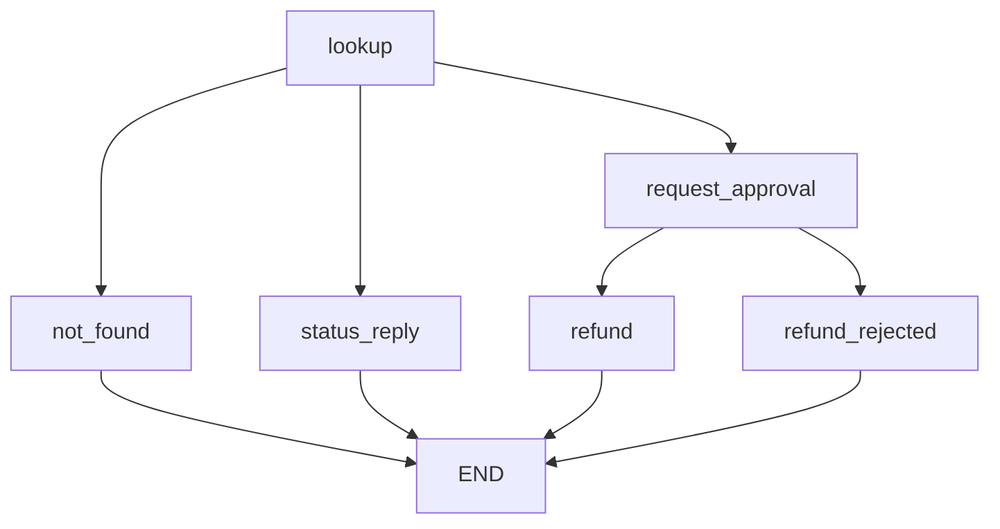

## What you will have at the end

At the end of this chapter your `rag-agent-service` repository has a new file, `app/agent.py`, and a test file, `tests/test_agent.py`, with nine passing tests.

The agent supports Bustan Books (a fictional online bookshop). It has two tools. `lookup_order` is safe: it only reads. `issue_refund` is risky: it moves money. The graph runs the safe tool on its own, but it pauses before every refund and waits for a person's decision.

The tests prove five promises. The graph pauses before paying. Approval pays exactly once, and rejection pays nothing. Resuming twice does not pay twice. An unknown order is handled without a crash.

Hands-on interview rounds for agent roles often ask for exactly this: "Add a human approval step before this tool, and show me a test that proves it works." Build it once here, with the re-run trap from 7.4 in mind. Then you can do it in an interview in under 40 minutes and explain every line.

## What you need

You need your laptop, the repository from chapters 1.4, 3.5 and 5.5, and Python 3.11 or later. This chapter adds one package, LangGraph, with its dependencies.

The packages for this chapter and module 9 are pytest, LangGraph, FastAPI, httpx and uvicorn. With their dependencies they download about 10 MB in total and take about 45 MB on disk, measured on 2026-10-22. Download them when your connection is good; the rest of the chapter works offline. No model and no API key are needed: the routing is plain Python, so every test is fast and gives the same result every time. The tests were checked with LangGraph 1.2.16.

## The design

The agent receives a small structured request: an order id, an intent (`"status"` or `"refund"`) and, for refunds, the customer's reason. It always looks the order up first. Then a routing function picks one of three paths. The diagram shows the whole graph. Notice that `refund` is reachable only through `request_approval`.



There is no path from `lookup` to `refund` that skips the pause. That property is what the tests check from several directions.

Here is why the design looks like this, decision by decision.

**The pause and the payment are separate nodes.** You learned in 7.4 that the paused node runs again from its first line on resume. So `request_approval` contains nothing except building the review payload and calling `interrupt()`. The money moves in `refund`, which runs only after a decision arrives.

**The payment is idempotent anyway.** `issue_refund` checks a ledger before paying. If the order already has a refund, it returns the earlier record with status `"already_refunded"` and pays nothing. A real payment API would take an <GlossaryTerm term="idempotency key" definition="A unique value, such as refund-1042, sent with a request so the receiver performs the action only once even if the request repeats." /> for the same reason.

**The decision fails closed.** The reviewer resumes the graph with a dictionary such as `{"approved": True, "reviewer": "huda"}`. Only the exact value `True` under `approved` counts as approval. A typo, a string like `"yes please"` or a missing key is a rejection.

**The audit trail lives in the state.** An `audit` key with an append reducer collects one line per important step. After a run you can read what was looked up, who decided, and what was paid, from the state alone.

**The routing is deterministic.** Two small functions choose the next node from the state. In the capstone a model will make the main routing choice. For example, it reads the customer's message and decides whether to look up an order, answer from the policy documents or prepare a refund. It will sit behind the same graph: the approval node, the checkpointer, the idempotent refund and these tests stay exactly as they are.

That is the point of the graph. The model may choose a path, but it can never draw a new edge around the pause.

## The interfaces

Use these exact names, because the tests import them and later chapters build on them.

The shop's data is fixed so the tests are repeatable. Copy it as it is:

```python
ORDERS = {
    "1042": {"status": "delivered", "total": 24.0, "items": ["The Olive Grove"]},
    "1043": {"status": "shipped", "total": 31.5, "items": ["Maps of Home", "Salt"]},
}

REFUNDS: list[dict] = []
```

`REFUNDS` is the fake payment ledger. The tests empty it before and after each test.

The two tools are plain functions:

- `lookup_order(order_id: str) -> dict | None` returns a copy of the order, or `None` if the id is unknown.
- `issue_refund(order_id: str, amount: float) -> dict` appends `{"order_id": ..., "amount": ..., "status": "refunded"}` to `REFUNDS` and returns it. If `REFUNDS` already holds a record for that order, it appends nothing and returns a copy of the earlier record with `"status": "already_refunded"`.

The state is a `TypedDict`. `total=False` means a key may be missing until a node sets it:

```python
class SupportState(TypedDict, total=False):
    order_id: str
    intent: Literal["status", "refund"]
    reason: str
    order: dict | None
    approval: dict
    reply: str
    audit: Annotated[list[str], operator.add]
```

The graph has six nodes. The names, replies and audit lines must match this table exactly, because the tests compare strings:

| Node | Writes | Exact text |
|---|---|---|
| `lookup` | `order`, `audit` | audit: `lookup_order 1042: delivered` (or `not found`) |
| `not_found` | `reply` | `I could not find order 9999.` |
| `status_reply` | `reply` | `Order 1043 is shipped.` |
| `request_approval` | `approval`, `audit` | audit: `refund approved by huda` or `refund rejected by huda` |
| `refund` | `reply`, `audit` | `Refund of 24.00 for order 1042: refunded.` and audit `issue_refund 1042: refunded` |
| `refund_rejected` | `reply` | `The refund for order 1042 was not approved.` |

If the reviewer's dictionary has no `reviewer` key, use `unknown` in the audit line. Finally, `build_graph(checkpointer=None)` wires the nodes and returns `builder.compile(checkpointer=checkpointer)`.

## The acceptance tests

Create `tests/test_agent.py` with the following content. It is split into four parts here so it reads well on a phone; paste all four into one file, in order. First the setup:

```python
import pytest
from langgraph.checkpoint.memory import InMemorySaver
from langgraph.types import Command

from app import agent

REFUND_1042 = {"order_id": "1042", "intent": "refund", "reason": "arrived damaged"}
APPROVE = Command(resume={"approved": True, "reviewer": "huda"})
REJECT = Command(resume={"approved": False, "reviewer": "huda"})


@pytest.fixture(autouse=True)
def empty_refunds():
    agent.REFUNDS.clear()
    yield
    agent.REFUNDS.clear()


@pytest.fixture
def graph():
    return agent.build_graph(checkpointer=InMemorySaver())


def thread(thread_id="t-1"):
    return {"configurable": {"thread_id": thread_id}}
```

Then the safe path and the pause:

```python
def test_status_question_needs_no_approval(graph):
    out = graph.invoke({"order_id": "1043", "intent": "status"}, thread())
    assert "__interrupt__" not in out
    assert out["reply"] == "Order 1043 is shipped."
    assert agent.REFUNDS == []


def test_refund_pauses_before_paying(graph):
    out = graph.invoke(REFUND_1042, thread())
    request = out["__interrupt__"][0].value
    assert request["action"] == "issue_refund"
    assert request["amount"] == 24.0
    assert request["reason"] == "arrived damaged"
    assert "delivered" in request["evidence"]
    assert graph.get_state(thread()).next == ("request_approval",)
    assert agent.REFUNDS == []
```

Then approval, rejection and an unclear answer:

```python
def test_approve_resumes_and_refunds_once(graph):
    graph.invoke(REFUND_1042, thread())
    out = graph.invoke(APPROVE, thread())
    assert agent.REFUNDS == [
        {"order_id": "1042", "amount": 24.0, "status": "refunded"}
    ]
    assert out["reply"] == "Refund of 24.00 for order 1042: refunded."
    assert out["audit"] == [
        "lookup_order 1042: delivered",
        "refund approved by huda",
        "issue_refund 1042: refunded",
    ]


def test_reject_does_not_refund(graph):
    graph.invoke(REFUND_1042, thread())
    out = graph.invoke(REJECT, thread())
    assert agent.REFUNDS == []
    assert out["reply"] == "The refund for order 1042 was not approved."
    assert out["audit"][-1] == "refund rejected by huda"


def test_unclear_decision_counts_as_reject(graph):
    graph.invoke(REFUND_1042, thread())
    graph.invoke(Command(resume="yes please"), thread())
    assert agent.REFUNDS == []
```

Finally repeats, unknown orders and separate threads:

```python
def test_resuming_twice_does_not_refund_twice(graph):
    graph.invoke(REFUND_1042, thread())
    graph.invoke(APPROVE, thread())
    graph.invoke(APPROVE, thread())
    assert len(agent.REFUNDS) == 1


def test_issue_refund_is_idempotent():
    first = agent.issue_refund("1042", 24.0)
    second = agent.issue_refund("1042", 24.0)
    assert first["status"] == "refunded"
    assert second["status"] == "already_refunded"
    assert len(agent.REFUNDS) == 1


def test_unknown_order_is_handled(graph):
    out = graph.invoke({"order_id": "9999", "intent": "refund"}, thread())
    assert "__interrupt__" not in out
    assert out["reply"] == "I could not find order 9999."
    assert agent.REFUNDS == []


def test_threads_are_separate(graph):
    graph.invoke(REFUND_1042, thread("a"))
    graph.invoke({"order_id": "1043", "intent": "refund"}, thread("b"))
    graph.invoke(APPROVE, thread("a"))
    assert [r["order_id"] for r in agent.REFUNDS] == ["1042"]
    assert graph.get_state(thread("b")).next == ("request_approval",)
```

Read the tests before you write any code. Each one states a promise in a few lines, and together they are the specification. Notice that `test_resuming_twice_does_not_refund_twice` and `test_issue_refund_is_idempotent` check the same promise at two levels: the graph and the tool.

## Build it

<Steps title="Build the approval agent">
<Step title="Add LangGraph and install it" stepNumber="1">

Add this line to `requirements.txt`, under `pytest>=8`:

```text
langgraph>=1.2,<2
```

Activate your virtual environment and install. On macOS or Linux:

```bash
source .venv/bin/activate
pip install -r requirements.txt
```

On Windows:

```bash
.venv\Scripts\activate
pip install -r requirements.txt
```

</Step>
<Step title="Write the two tools" stepNumber="2">

Create `app/agent.py` with the imports, `ORDERS`, `REFUNDS`, `lookup_order` and `issue_refund`. Return `dict(order)` from `lookup_order`, so no caller can change the shop's data by accident. In `issue_refund`, loop over `REFUNDS` first and return early if the order is there. Then run only the tool test: `pytest -q tests/test_agent.py -k idempotent`. It should show `1 passed, 8 deselected` even though the graph does not exist yet.

</Step>
<Step title="Add the state, lookup and the first routes" stepNumber="3">

Add `SupportState`, the `lookup` node, `not_found` and `status_reply`. Write a function `route_after_lookup(state)` that returns a node name: `"not_found"` when `order` is `None`, `"request_approval"` when the intent is a refund, otherwise `"status_reply"`. A conditional edge can use the returned string directly as the next node's name.

</Step>
<Step title="Add the approval node" stepNumber="4">

In `request_approval`, build the review payload and pause. The shape of the call is:

```python
decision = interrupt({
    "action": "issue_refund",
    "order_id": ...,
    "amount": ...,
    "reason": ...,
    "evidence": ...,
})
```

Fill `evidence` with a short string that includes the order's status and items, such as `status=delivered; items=The Olive Grove`. After the call, decide `approved` with the fail-closed rule, then return `approval` and one audit line. Put nothing that changes the world above the `interrupt()` call.

</Step>
<Step title="Add the refund paths and build_graph" stepNumber="5">

Write `route_after_approval`, `refund` and `refund_rejected`. The refund amount is the order's `total`. Format it with two decimals in the reply. Then write `build_graph(checkpointer=None)`: add the six nodes, an edge from `START` to `lookup`, the two conditional edges, and an edge to `END` from each of the four final nodes.

</Step>
<Step title="Run the tests" stepNumber="6">

Run the agent tests on their own, then the whole suite to check you broke nothing from earlier modules. The whole suite shows a larger number, because it includes your earlier tests.

```bash
pytest -q tests/test_agent.py
pytest -q
```

</Step>
</Steps>

## Verify

A correct build prints this for the agent tests. Timings vary by laptop; the first run is slower because Python loads LangGraph.

<TerminalBlock title="Run the agent tests" cwd="rag-agent-service">
  <TerminalLine type="prompt">pytest -q tests/test_agent.py</TerminalLine>
  <TerminalLine type="output">9 passed in 3.00s</TerminalLine>
</TerminalBlock>

Now break it on purpose, to see the 7.4 trap with your own eyes. In `request_approval`, add one line above the `interrupt()` call that pays the refund: `issue_refund(state["order_id"], state["order"]["total"])`. Run the tests again. You should see five failures. The important lines are:

```text
FAILED tests/test_agent.py::test_refund_pauses_before_paying - AssertionError...
FAILED tests/test_agent.py::test_approve_resumes_and_refunds_once - Assertion...
FAILED tests/test_agent.py::test_reject_does_not_refund - AssertionError: ass...
FAILED tests/test_agent.py::test_unclear_decision_counts_as_reject - Assertio...
FAILED tests/test_agent.py::test_threads_are_separate - AssertionError: asser...
5 failed, 4 passed in 3.86s
```

Read the approval failure closely. The reply says `already_refunded` instead of `refunded`. The payment line ran once before the pause and once more when the node re-ran on resume, and only the ledger check stopped a second payment. The rejection test fails because money moved before anyone decided. Remove the line and confirm you are back to nine passing tests.

<Callout type="info" title="Why idempotency did not save the build">
The ledger check stopped a double payment, but the refund still happened before approval. Idempotency limits damage; the right place for the side effect prevents it.
</Callout>

If your own build fails, the two most likely mistakes are these.

**`KeyError: 'order_id'` when you resume.** The resume used a thread with no saved state, so the graph started from `START` with an empty state and `lookup` found no `order_id`. Check that the resume uses the same `thread_id` as the first call, and the same graph object, because each `InMemorySaver` holds its own threads.

**`RuntimeError: Cannot use Command(resume=...) without checkpointer`.** Your `build_graph` ignores its argument and calls `compile()` with no checkpointer. The first call still pauses, which hides the bug until the resume. Pass `checkpointer=checkpointer` to `compile()`.

Other failures are usually a string that differs from the table by one character, such as a missing full stop. pytest prints both strings; compare them letter by letter.

## Acceptance checklist

- [ ] `pytest -q tests/test_agent.py` shows 9 passed
- [ ] `pytest -q` passes for the whole repository, including earlier modules
- [ ] `request_approval` has no side effect above `interrupt()`
- [ ] `issue_refund` pays at most once per order, even when called twice
- [ ] Only `{"approved": True}` counts as approval; anything else is a rejection
- [ ] After an approved refund, the `audit` list shows the lookup, the decision with the reviewer, and the payment
- [ ] I caused the failure mode on purpose, saw 5 failed, and fixed it again
- [ ] The changes are committed and pushed to my repository

## Submit your work

Commit with a clear message, for example "Add LangGraph support agent with refund approval", and push.

```openquestion
prompt: "Paste the link to your rag-agent-service repository with app/agent.py and tests/test_agent.py. Optionally, paste the final summary line of pytest -q tests/test_agent.py."
required: true
minWords: 0
allowSpeechInput: true
allowUrl: true
urlRequired: true
urlLabel: "Repository link"
urlHint: "A link your mentor can open. If your repository is private, add your mentor as a reader."
modelAnswer: "Repository: a link to the learner's rag-agent-service repository. Final test line: 9 passed in 3.00s. The agent pauses in request_approval before any refund, issue_refund checks the ledger before paying, and only approved True counts as approval."
```

**Next:** Stateful agents (quiz): five scenarios on reducers, memory, approvals and multi-agent designs.
