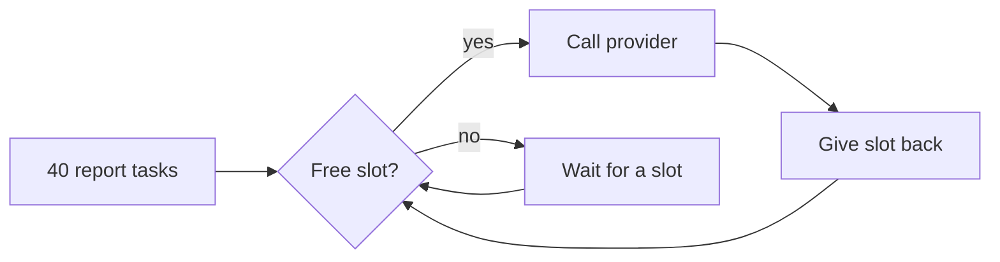

<BigWordAlert term="Event loop" plainEnglish="The part of asyncio that runs your async functions. When one function waits for the network, the loop switches to another one that is ready, so a single thread can keep many calls in progress." whyItMatters="Model calls spend almost all their time waiting on the network. The event loop turns that waiting time into useful work, which is why AI services are usually written with async code." />

## Forty reports, one at a time

After the Monday outage in chapter 9.1, Omar looked at Sahel Relief's nightly job. It summarises the 40 field reports that arrive each day. The code called the provider in a plain loop: send report 1, wait about 3 seconds, send report 2, wait again. The job took 2 minutes, and the computer did almost nothing during those 2 minutes except wait.

His first fix ran all 40 calls at once. The job finished in about 3 seconds on a good night. On a bad night the provider, which allows Sahel Relief 5 calls at a time, rejected 35 of them with "too many requests". The goal of this chapter is the version in between: run calls at the same time, but never more than the provider allows, and stop cleanly when a call is no longer needed.

## Waiting is not working

A normal Python function runs from start to end. An `async def` function is different: calling it creates a <GlossaryTerm term="coroutine" definition="The object you get when you call an async def function. It does nothing until it is awaited or wrapped in a task, and it can pause at every await." />, and the code inside only runs when the event loop drives it. At each `await`, the coroutine says to the loop: "I am waiting. Run someone else." That is the whole trick. Async code does not make the network faster. It lets one thread wait on many things at once.

The snippet below uses `asyncio.sleep` to stand in for a model call. It runs the same two calls twice: first one after another, then together with `asyncio.gather`, which runs several awaitables at the same time and returns their results in the order you passed them.

```python
import asyncio
import time


async def call_model(question: str, seconds: float) -> str:
    await asyncio.sleep(seconds)  # stands in for waiting on the network
    return f"answer to {question}"


async def main():
    start = time.perf_counter()
    await call_model("q1", 1.0)
    await call_model("q2", 1.0)
    print(f"one after another: {time.perf_counter() - start:.1f}s")

    start = time.perf_counter()
    answers = await asyncio.gather(call_model("q1", 1.0), call_model("q2", 1.0))
    print(f"gather: {time.perf_counter() - start:.1f}s {answers}")


asyncio.run(main())
```

```text
one after another: 2.0s
gather: 1.0s ['answer to q1', 'answer to q2']
```

The later snippets in this chapter leave out the two imports and the last `asyncio.run(main())` line to stay short. Add them back if you run a snippet on your laptop; every snippet here was run with Python 3.12, and the outputs shown are real.

## When one call fails

By default, `gather` passes the first exception up to the caller. The other calls are **not** cancelled: they keep running in the background, and their results are lost to you. For a batch job that is rarely what you want. Pass `return_exceptions=True` and every result comes back, with the exceptions in their place, so one bad report does not hide 39 good summaries.

```python
async def call_model(question: str) -> str:
    await asyncio.sleep(0.1)
    if question == "q2":
        raise RuntimeError("provider returned 503")
    return f"answer to {question}"


async def main():
    results = await asyncio.gather(
        call_model("q1"), call_model("q2"), call_model("q3"),
        return_exceptions=True,
    )
    for r in results:
        print("failed:" if isinstance(r, Exception) else "ok:", r)
```

```text
ok: answer to q1
failed: provider returned 503
ok: answer to q3
```

Python 3.11 added `asyncio.TaskGroup` for the opposite case: work where one failure makes the rest useless. If any task in the group raises, the group cancels the other tasks and raises the errors together as an `ExceptionGroup`, which you catch with `except*`. Think of a request that runs keyword search and vector search in parallel: if one fails and you cannot answer without both, there is no point letting the other finish.

```python
async def step(name: str, seconds: float, fail: bool = False) -> str:
    try:
        await asyncio.sleep(seconds)
        if fail:
            raise ValueError(f"{name} failed")
        return name
    except asyncio.CancelledError:
        print(f"{name} was cancelled")
        raise  # always re-raise, or the cancel is lost


async def main():
    try:
        async with asyncio.TaskGroup() as tg:
            tg.create_task(step("search", 0.1, fail=True))
            tg.create_task(step("rerank", 1.0))
    except* ValueError as group:
        print("caught:", group.exceptions)
```

```text
rerank was cancelled
caught: (ValueError('search failed'),)
```

## A limit on calls in flight

Now the provider's rule: at most 5 calls at a time. The tool for this is a <GlossaryTerm term="semaphore" definition="A counter that allows a fixed number of holders at once. A task takes a slot before it starts and gives it back when it ends; when no slot is free, the task waits." />. You create one `asyncio.Semaphore(n)` and wrap each call in `async with`. Before you read the result below, make a prediction.

```predict
prompt: "Ten calls each take 1 second. They all start with gather, but each one must hold a slot of asyncio.Semaphore(3). About how long does the whole batch take?"
options:
  - id: four
    label: "About 4 seconds"
  - id: one
    label: "About 1 second total"
correctOptionId: four
explanation: "Only 3 calls run at once, so the 10 calls go in waves of 3, 3, 3 and 1. Four waves of 1 second each is about 4 seconds."
```

```python
limit = asyncio.Semaphore(3)  # at most 3 calls to the provider at once
in_flight = 0
peak = 0


async def call_model(i: int) -> str:
    global in_flight, peak
    async with limit:
        in_flight += 1
        peak = max(peak, in_flight)
        await asyncio.sleep(1.0)
        in_flight -= 1
    return f"answer {i}"


async def main():
    start = time.perf_counter()
    await asyncio.gather(*(call_model(i) for i in range(10)))
    print(f"10 calls, peak {peak} at once, {time.perf_counter() - start:.1f}s")
```

```text
10 calls, peak 3 at once, 4.0s
```

The diagram shows what each task does when it reaches the semaphore. Read it as a loop that every one of Omar's 40 report tasks goes through.



The point of the picture: the semaphore turns "40 calls at once" into "5 calls at once, 35 waiting in line", and waiting tasks cost almost nothing. With 3 second calls, Omar's 40 reports take 8 waves, about 24 seconds, with zero rejected calls. That is slower than the 3 second best case, but it works every night.

There is a limit to what one semaphore can do: it only counts tasks inside one Python process. Suppose Sahel Relief later runs the summary service as 3 copies behind a load balancer, each with `Semaphore(5)`. Together they can send 15 calls at once to a provider that allows 5. You have two honest options. Divide the limit, for example 2, 2 and 1, and accept that one busy copy cannot borrow slots from an idle one. Or move the limit to a shared place, such as a single worker that owns all provider calls or a counter in a shared store. Interviewers like this follow-up, because it shows you know where the code's guarantee ends. Whatever you choose, still handle the provider's "too many requests" answer, as chapter 9.4 shows, because limits drift when someone adds a fourth copy.

## Stop work nobody needs

A user closes the page. A request passes its time budget. Another task in a TaskGroup fails. In each case the right move is to cancel the work, which asyncio does by raising `CancelledError` inside the waiting coroutine. Python 3.11 added `asyncio.timeout()`, which cancels the code inside it when the time is up and raises `TimeoutError` to you.

```python
async def slow_model() -> str:
    await asyncio.sleep(10)
    return "late answer"


async def main():
    try:
        async with asyncio.timeout(0.5):
            print(await slow_model())
    except TimeoutError:
        print("gave up after 0.5s; the slow call was cancelled")
```

Two rules keep cancellation safe. First, if you catch `CancelledError` to clean up, re-raise it, as the TaskGroup example does. If you swallow it, the task keeps running and the timeout silently stops working. Second, put cleanup such as closing a connection in a `finally` block, so it runs on success, failure and cancel alike.

## The blocking-call trap

Async only helps when every wait is an `await`. Some libraries, such as an older provider SDK or a PDF parser, have no async version. If you call one directly inside `async def`, it blocks the event loop: no other request on that process moves until it returns.

```python
def old_sdk_call() -> str:  # a library with no async version
    time.sleep(1.0)
    return "done"


async def blocking():
    return old_sdk_call()  # freezes the whole event loop for 1 second


async def not_blocking():
    return await asyncio.to_thread(old_sdk_call)  # runs in a worker thread
```

Three calls with `gather` take 3.0 seconds with the blocking version and 1.0 second with `asyncio.to_thread`. The trap is easy to miss, because a single request looks fine. It only shows up under load, as a slowdown on every endpoint at once. `to_thread` suits waiting, such as network or disk. For heavy CPU work, such as parsing hundreds of large PDFs, a process pool is the usual answer.

## Choosing the tool

| Situation | Tool | Why |
|---|---|---|
| A batch where each item stands alone | gather with return_exceptions | One failure must not lose the rest |
| Parallel steps that all must succeed | TaskGroup | It cancels the others when one fails |
| A provider with a limit on calls at once | Semaphore shared by all tasks | Calls wait their turn instead of failing |
| A call that may hang | asyncio.timeout | It cancels the call when time is up |
| A sync library inside async code | asyncio.to_thread | The event loop keeps running |

## Debugging async code

Most async bugs fall into four groups. A missing `await` gives you a coroutine object instead of a result, and Python prints "coroutine was never awaited" as a warning. A blocking call shows up as every endpoint slowing down together. A swallowed `CancelledError` shows up as timeouts that never fire. And a semaphore created inside each request gives every request its own private limit, so there is no shared limit at all.

```quiz
type: mcq
question: "Sara's handler starts with limit = asyncio.Semaphore(5) and wraps the model call in async with limit. Under load, the provider still sees 40 calls at once. What is wrong?"
options:
  - "A semaphore only limits calls started with gather, not in a handler"
  - "The limit of five is too high, so it needs a value of one to work"
  - "Each request creates its own semaphore, so no limit is shared"
  - "The handler needs time.sleep inside it so the semaphore can count"
correct: 2
explanations:
  - "A semaphore works anywhere tasks share it. How the tasks were started does not matter."
  - "Any value works as a limit. A value of one would only make every request wait in a single line."
  - "Right. The semaphore must be created once, for example when the app starts, and shared by every request."
  - "time.sleep blocks the event loop and makes things worse. The semaphore counts holders, not time."
```

## In the interview

Async questions appear in the hands-on round as small coding tasks, such as "call this fake model for 100 inputs, at most 10 at a time". They appear again in system design as "what happens when the provider is slow?". Strong answers name the tool, the limit and a number. Answer each question below aloud first, then open it to compare.

<FaqGroup title="Practice questions">
<FaqItem question="You must summarise 500 documents with a provider that allows 10 calls at a time. How do you write it?">

I would start one task per document with `asyncio.gather` and `return_exceptions=True`, and wrap each model call in a single shared `asyncio.Semaphore(10)`. Each call gets its own timeout, so one hung call cannot hold a slot forever. If a call takes about 4 seconds, 500 documents in waves of 10 take about 200 seconds. Failed items are collected and retried once at the end, so one bad document does not lose the batch. For a much larger batch I would switch to a queue with 10 worker tasks, so I do not create thousands of tasks at once.

**Follow-up probes:**

- What changes if the provider limits calls per minute, not calls at once?
- How would you resume the batch if the process crashed at document 300?

</FaqItem>
<FaqItem question="What is the difference between asyncio.gather and a TaskGroup when one task fails?">

With `gather` and the default settings, the first exception goes to the caller, but the other tasks are not cancelled and keep running. With `return_exceptions=True`, every result comes back, with exceptions in place of the failed ones. A TaskGroup, added in Python 3.11, cancels the remaining tasks as soon as one fails and raises an `ExceptionGroup`. I use gather for independent batch items and a TaskGroup when the parts are only useful together, such as two retrieval calls feeding one answer.

**Follow-up probes:**

- How do you catch one type of error from an ExceptionGroup?
- What happens to a task that catches CancelledError and does not re-raise it?

</FaqItem>
<FaqItem question="After you added a PDF library, every endpoint in your async service got slow under load. What do you check first?">

I would suspect a blocking call: a sync function running directly inside `async def`, which freezes the event loop for every request on that process. To confirm, I would time one request alone and then ten at once; if ten take ten times longer, something is blocking. The fix for waiting work is `asyncio.to_thread`; for heavy CPU work such as parsing large PDFs, a process pool or a separate worker service. I would also add a test that runs several requests at once, because a single request hides this bug.

**Follow-up probes:**

- Why does to_thread not help much for CPU-heavy parsing?
- How would you find which call is blocking in a large codebase?

</FaqItem>
</FaqGroup>

**Next:** A FastAPI service with Pydantic validation, where these async calls sit behind an endpoint that checks every request and returns clear errors.
