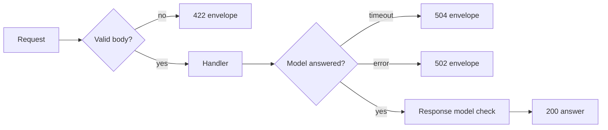

<BigWordAlert term="Request validation" plainEnglish="Checking every incoming request against clear rules, such as length, type and range, before your code uses it, and rejecting bad requests with a message that says what was wrong." whyItMatters="Every request that reaches the model costs money and time. Validation at the door stops bad input before it becomes a bad answer, a bill or a crash." />

## Two bad requests in one week

Karim maintains the policy assistant API at Najm Microfinance (a fictional lender for small businesses). Loan officers ask it questions about loan rules from a mobile app. In one week, two requests showed how thin the API was.

The first had an empty question. The API sent it to the model anyway. The model, given only the retrieved context, invented a question and answered it, and the officer saw a confident paragraph about late fees that nobody had asked about. The second request had 40,000 characters of pasted PDF text in the question field. The model call failed with a context length error, the API returned a 500 with a full Python <GlossaryTerm term="stack trace" definition="The list of function calls Python prints when an error is not handled. It shows file paths and code, which helps you debug but should never reach a user." />, and the mobile app showed the trace on the officer's screen.

Both requests should have been rejected in the first millisecond, with a message the app could show. This chapter shows how, with FastAPI and Pydantic v2: models that check requests and responses, one error shape for every failure, and status codes that tell the caller what to do next.

## Rules as code

In FastAPI, you describe the request body as a Pydantic model. The model is the rule book: each field has a type, and `Field` adds limits such as `min_length`, `max_length`, `ge` (greater than or equal) and `le` (less than or equal). FastAPI reads the JSON, checks it against the model and only calls your function if everything passes.

```python
from pydantic import BaseModel, ConfigDict, Field


class PolicyQuestion(BaseModel):
    model_config = ConfigDict(extra="forbid", str_strip_whitespace=True)
    question: str = Field(min_length=3, max_length=500)
    branch_code: str = Field(pattern=r"^[A-Z]{3}$")
    top_k: int = Field(default=3, ge=1, le=10)


class PolicyAnswer(BaseModel):
    answer: str
    sources: list[str]
```

Two settings in `model_config` close common gaps. `str_strip_whitespace=True` removes spaces at both ends before the length check, so a question of five spaces counts as empty. `extra="forbid"` rejects fields the model does not know, so a typo such as `topk` fails loudly instead of being ignored. The 500 character limit is a product decision: Najm's longest real question in a month of logs was about 300 characters, so 500 leaves room without letting a whole PDF through.

```predict
prompt: "An older version of the officers' app sends top_k as the string '5' instead of the number 5. The model above says top_k is an int. What does Pydantic do by default?"
options:
  - id: rejects
    label: "Rejects it with a validation error"
  - id: converts
    label: "Converts it to the number 5"
correctOptionId: converts
explanation: "By default Pydantic v2 runs in lax mode: a string that is clearly a whole number becomes an int. Strict mode, set per field or per model, refuses it instead."
```

Pydantic's default lax mode converts obvious cases, such as the string `"5"` to the integer 5. That is usually helpful for JSON from many clients. If your contract says numbers must be numbers, turn on strict mode with `ConfigDict(strict=True)`. Here is what the model did with three inputs in a real run (each also had a valid `branch_code`), shortened to the error type and field:

```text
question "   "              -> string_too_short, question
extra field "debug": true   -> extra_forbidden, debug
top_k "5" (a string)        -> accepted, top_k=5
```

The three code blocks in this chapter form one small app when you put them in one file in order. They were run together with FastAPI 0.159 and Pydantic 2.14.

The response model matters as much as the request model. When you set `response_model=PolicyAnswer` on a route, FastAPI checks your return value against it and drops any field the model does not list. If Karim's handler returns a dictionary that also contains the full prompt, the prompt never leaves the server. If the handler returns something that does not match, such as a missing `sources` list, FastAPI raises an error, and the caller gets a 500 rather than a broken answer.

## One shape for every error

Callers handle errors more easily when every error looks the same. Najm's team chose an <GlossaryTerm term="error envelope" definition="A fixed JSON shape that every error response uses, such as an error object with a code and a message, so clients can handle all failures with one piece of code." /> with a machine-readable `code` and a human-readable `message`. FastAPI's default validation error has a different shape, a `detail` list, so the team replaces it with a custom exception handler. A second handler turns their own `UpstreamTimeout` exception into a 504.

```python
from fastapi import Depends, FastAPI, Request
from fastapi.exceptions import RequestValidationError
from fastapi.responses import JSONResponse

app = FastAPI()


class UpstreamTimeout(Exception):
    pass


def error(status: int, code: str, message: str) -> JSONResponse:
    body = {"error": {"code": code, "message": message}}
    return JSONResponse(status_code=status, content=body)


@app.exception_handler(RequestValidationError)
async def on_validation(request: Request, exc: RequestValidationError):
    first = exc.errors()[0]
    return error(422, "validation_error", f"{first['loc'][-1]}: {first['msg']}")


@app.exception_handler(UpstreamTimeout)
async def on_timeout(request: Request, exc: UpstreamTimeout):
    return error(504, "upstream_timeout", "The model did not answer in time.")
```

Add one more handler for plain `Exception` that logs the full trace on the server and returns a 500 envelope with a generic message. That is the fix for the stack trace on the officer's screen: the details go to your logs, never to the client.

## Status codes tell the caller what to do

A status code is an instruction to the caller. Should it fix the request, wait and retry, or give up? This table lists the codes an LLM service uses most.

| Code | Meaning | Example in an LLM service |
|---|---|---|
| 400 | Valid shape, but it breaks a business rule | A branch code that closed last year |
| 422 | The body failed schema validation | Empty question, top_k of 50, bad JSON |
| 429 | This caller sent you too many requests | An app retrying in a loop; send Retry-After |
| 500 | A bug in your own code | An unhandled KeyError; log it, hide details |
| 502 | The upstream answered with an error | The provider kept returning 500 after retries |
| 503 | You are overloaded on purpose | Queue full or provider switched off; send Retry-After |
| 504 | The upstream did not answer in time | The model call passed its time budget |

FastAPI returns 422 for anything that fails the model, and in a real run it also returned 422 for a body that was not valid JSON at all. Many teams keep 422 for "the body does not match the schema" and use 400 for "the body is fine, but the request breaks a rule your code checks", such as a closed branch. Some teams use one code for both. Interviewers care less about which one you choose than whether you can explain it and apply it the same way everywhere.

Note the difference between 429 and 503. If the provider rate limits you, the officer's app did nothing wrong, so returning 429 to it is misleading. A 503 with a `Retry-After` header says "we are busy, come back in 30 seconds".

## Swapping the model in tests

The route should not create the model client itself. It asks for one with `Depends`, which is FastAPI's form of <GlossaryTerm term="dependency injection" definition="Passing a function the objects it needs from outside, instead of letting it create them, so tests and different environments can pass in different objects." />. In production, `get_model` returns the real provider client. In tests, you override it with a fake.

```python
class FakeModel:
    async def complete(self, prompt: str) -> str:
        return "Loans above 2,000 need a second signature. [loans#4]"


def get_model():
    return FakeModel()  # in production: the real provider client


@app.post("/policy/ask", response_model=PolicyAnswer)
async def ask(body: PolicyQuestion, model=Depends(get_model)):
    text = await model.complete(body.question)
    return {"answer": text, "sources": ["loans#4"], "prompt": "internal only"}
```

A test can now replace the model with one that raises `UpstreamTimeout`, using `app.dependency_overrides[get_model] = lambda: SlowModel()`, and check the 504 envelope. In a real run with `TestClient`, the four cases returned:

```text
200 {'answer': 'Loans above 2,000 need a second signature. [loans#4]', 'sources': ['loans#4']}
422 {'error': {'code': 'validation_error', 'message': 'question: String should have at least 3 characters'}}
422 {'error': {'code': 'validation_error', 'message': '1: JSON decode error'}}
504 {'error': {'code': 'upstream_timeout', 'message': 'The model did not answer in time.'}}
```

The first line shows the response model at work: the `prompt` field is gone. The third line shows a weakness of the simple handler: for broken JSON, the last part of the location is a character position, so the message says `1:`. A real service would build the message from the whole location.

The diagram shows where each response is decided as a request moves through the service.



The takeaway: validation rejects bad input before it costs anything, the handler only deals with good input, and every exit has a clear code and the same body shape.

## Validate what the model returns too

The same tools protect you from the model. If you ask the model for JSON, as in chapter 2.4, parse its reply with `PolicyAnswer.model_validate_json(text)`. A `ValidationError` there is not the caller's fault. Treat it as an upstream failure: retry once with the error in the prompt, then return a 502 envelope if it still fails.

## Common mistakes

The most common mistake is forgetting to register the validation handler. FastAPI then returns its default `detail` list, and a client written for the envelope breaks. The second is a response model that does not match what the handler returns, which shows up as 500 errors only for some answers. The third is creating the provider client inside the handler, which makes the route impossible to test without a network.

```quiz
type: mcq
question: "Karim wants the tests for /policy/ask to run on a laptop with no network and no API key. Which approach fits FastAPI best?"
options:
  - "Call the provider's test endpoint from the tests with a free trial key"
  - "Add an if TESTING branch inside the handler that returns a fixed answer"
  - "Call the ask function directly in Python and skip HTTP in the tests"
  - "Override the get_model dependency with a fake model in the tests"
correct: 3
explanations:
  - "This needs a network and a key, costs money and fails when the provider is down. It is not an offline test."
  - "Test-only branches in production code are easy to leave switched on, and the real path stays untested."
  - "This skips request validation, the error handlers and the response model, which are what the tests need to check."
  - "Right. dependency_overrides swaps the client for a fake, and the request still goes through validation and the handlers."
```

## In the interview

Hands-on rounds often start with "write an endpoint that takes a question and returns an answer from this fake model". The interviewer watches whether you validate input, define a response model and return clear errors without being asked. In design rounds, expect questions on status codes and error contracts. Answer aloud first, then open each question.

<FaqGroup title="Practice questions">
<FaqItem question="How would you design the error responses for an LLM API that a mobile app calls?">

I would use one error envelope for every failure, with a stable machine-readable code and a short message, for example validation_error, upstream_timeout and upstream_unavailable. The status code tells the app what to do: 422 means fix the input, 503 and 504 mean wait and retry, 500 means our bug. Retryable errors carry a Retry-After header. Stack traces and prompts never reach the client; they go to the logs with a request id, and the envelope includes that id so support can find the log line.

**Follow-up probes:**

- Would you put the request id in the body, a header or both?
- How do you change the envelope later without breaking old app versions?

</FaqItem>
<FaqItem question="When do you return 400 and when 422?">

FastAPI returns 422 when the body fails the Pydantic model, including bad JSON. I keep 422 for schema problems and use 400 when the body is valid but breaks a rule the code checks, such as a branch that no longer exists. Either convention is fine if it is written down and used everywhere. The real test is whether the client can tell "fix your input" apart from "try again later", and both 400 and 422 say the first.

**Follow-up probes:**

- What status do you return when the provider rate limits you?
- Would you validate a business rule inside the Pydantic model or in the handler?

</FaqItem>
<FaqItem question="Why validate the model's output, not just the user's input?">

The model is an external system that can return the wrong shape, such as missing fields, extra text around the JSON or a citation id that does not exist. If I pass that straight to the client, the client breaks or shows something wrong. I parse the model reply with a Pydantic model and check citations against the retrieved ids. On failure I retry once with the error message in the prompt, then return a 502 envelope. I also count these failures, because a rise often means a prompt or model version changed.

**Follow-up probes:**

- How many validation retries would you allow per request, and why?
- What would you log when the model output fails validation?

</FaqItem>
</FaqGroup>

**Next:** Retries, timeouts and rate limits: what the service does when the model call itself fails.
