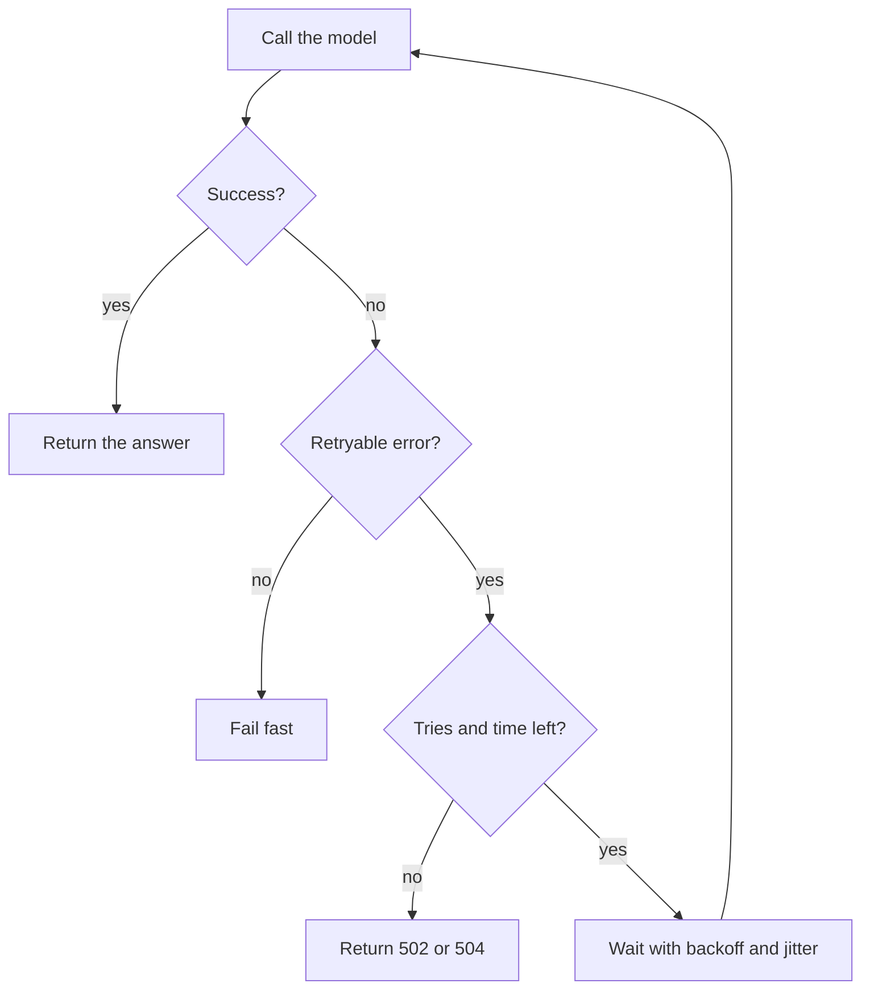

<BigWordAlert term="Exponential backoff" plainEnglish="Waiting longer after each failed try, for example up to 0.5 seconds, then 1, then 2, then 4, usually with a random part so many clients do not retry at the same moment." whyItMatters="Retrying at once, again and again, turns a short provider problem into a long one. Backoff gives the provider room to recover, and interviewers expect you to know why." />

## Ninety seconds that became ten minutes

Huda works on the repayment reminder service at Najm Microfinance (a fictional lender for small businesses). The service asks a model to write a short, polite reminder for each borrower, then sends it by SMS through an SMS gateway. One afternoon the model provider had a 90 second problem and returned errors to everyone.

Huda's code retried every failed call at once, up to 5 times. So did the officers' mobile app, which called the same service. In this example, traffic to the provider jumped from about 20 calls a second to about 100. The provider's rate limiter started answering "429 Too Many Requests" to Najm's key, and the retries kept the traffic high. The 90 second problem lasted 10 minutes for Najm.

The same afternoon brought a second, quieter failure. A call to the SMS gateway timed out after 10 seconds, and the code retried it. The gateway had in fact sent the first message; only the reply was slow. About 200 borrowers received the same reminder twice, and some three times. Two borrowers called their loan officer to ask whether they owed twice as much.

Both failures came from one habit: retrying everything, at once, with no limit. This chapter replaces it with four rules: retry only safe failures, wait with backoff and jitter, stay inside a total time budget, and stop retrying when the provider is clearly down.

## Which failures to retry

A retry is a bet that the next try will succeed. That bet is good for failures caused by a passing condition, such as a busy server or a dropped connection. It is bad for failures caused by the request itself, which will fail the same way every time.

| Failure | Retry? | Why |
|---|---|---|
| Timeout or dropped connection | Yes, if the call is safe to repeat | Often a passing network or load problem |
| 429 Too Many Requests | Yes, after the wait it asks for | The provider is asking you to slow down |
| 500, 502, 503 from the provider | Yes, a few times | Usually a passing server problem |
| 400 or 422 | Never | The request is wrong and will fail again |
| 401 or 403 | Never | A key or permission problem; alert a person |
| A write that is not idempotent, with no key | Never automatically | A retry can do the action twice |

The last row explains the duplicate reminders. A call is <GlossaryTerm term="idempotent" definition="Safe to repeat: doing it twice has the same effect as doing it once. Reading an order is idempotent; sending an SMS or charging a card is not, unless the API uses an idempotency key." /> when doing it twice has the same effect as doing it once. Asking a model to write a reminder is safe to repeat: the worst case is a second bill for a few tokens. Sending the SMS is not. The fix is an idempotency key: a unique id, such as the borrower id plus the reminder date, that the gateway stores. When a retry arrives with a key it has already seen, the gateway returns the first result instead of sending again. If an API offers no such key, do not retry the write automatically; mark it as unknown and check its status first.

## Back off, and add jitter

Waiting between tries gives the provider time to recover. Doubling the wait each time, 0.5 seconds, then 1, then 2, means a short blip costs little, while a long outage does not get hammered. A cap, such as 8 seconds, stops the wait from growing without limit.

Doubling alone is not enough when many clients fail at the same moment. Make a prediction first.

```predict
prompt: "1,000 app clients fail at the same moment. Each retries after exactly 1, then 2, then 4 seconds, with no random part. What does the provider see?"
options:
  - id: spikes
    label: "Three spikes of about 1,000 calls"
  - id: smooth
    label: "A smooth, steady flow of retries"
correctOptionId: spikes
explanation: "Every client waits exactly the same time, so their retries land together: about 1,000 calls at 1 second, again at 3 and again at 7. Each spike can knock the provider over again."
```

This pattern is called a <GlossaryTerm term="thundering herd" definition="Many clients doing the same thing at the same moment, such as retrying together after a shared failure, so the load arrives in sharp spikes." />. The fix is <GlossaryTerm term="jitter" definition="A random part added to a wait time so that clients spread out instead of acting at the same moment." />. With "full jitter", each client waits a random time between zero and the backoff value. The average wait halves, and the retries spread evenly across the window instead of arriving together.

```python
import random


def next_delay(attempt: int, base: float = 0.5, cap: float = 8.0,
               retry_after: float | None = None) -> float:
    """Seconds to wait before retry number `attempt` (0 for the first retry)."""
    if retry_after is not None:
        return retry_after  # the provider told us when to come back
    return random.uniform(0, min(cap, base * 2 ** attempt))  # full jitter


random.seed(7)
print([round(next_delay(a), 2) for a in range(5)])
print(next_delay(0, retry_after=3.0))
```

```text
[0.16, 0.15, 1.3, 0.29, 4.29]
3.0
```

The output shows the point: the waits are random, but each one stays under its ceiling of 0.5, 1, 2, 4 and 8 seconds. When a 429 or 503 response includes a `Retry-After` header, use that value instead, because the provider knows its own state better than your formula does.

## A total time budget

Each try needs its own timeout, but that is not enough. A loan officer waiting in the app does not care how many tries happened. They care about the total wait. So every request also gets a deadline, and the retry loop checks it before every sleep and every try.

Here is a worked example with this scenario's numbers. Huda's settings are 4 attempts, 3 seconds per attempt, backoff base 0.5 seconds, and a normal model call takes about 2.5 seconds. In the worst case, that is 4 times 3 seconds of tries plus up to 0.5, 1 and 2 seconds of waiting: 15.5 seconds. The product team says an officer should wait at most 8 seconds. So the deadline is 8 seconds, and it wins.

Follow a slow afternoon through it. Attempt 1 times out at 3 seconds. After a wait of up to 0.5 seconds, attempt 2 times out between 6 and 6.5 seconds. After the next wait of up to 1 second, between 0.5 and 2 seconds remain. That is less than a normal 2.5 second call, so starting attempt 3 would only spend money on an answer that cannot arrive in time. In practice, Huda gets 2 real attempts, not 4, and the code should check the time left before each one.

The same deadline decides what to do with a long `Retry-After`. If the provider says "come back in 30 seconds" and the request has 6 seconds left, waiting is pointless. Fail now with a 503 and your own `Retry-After`, so the app can tell the officer when to try again.

The diagram shows the decision the retry loop makes after every failed call.



Read it from the failure. The first question is about the error, the second is about the budget, and only then does the code wait. Most retry bugs skip one of the two questions.

## Retries multiply

Retries at several layers multiply. If the app retries 3 times, the service retries 3 times, and the provider SDK also retries 3 times, one tap in the app can become 27 calls to the provider. Pick one layer to own retries, usually the service closest to the provider, and set the others to zero or one.

A retry budget limits the total. For example, Najm's service allows retries to add at most 10% on top of normal calls in any minute. On a good day, that is plenty. During an outage the budget runs out in seconds, and the service fails fast instead of tripling the load.

A <GlossaryTerm term="circuit breaker" definition="A switch in your code that stops calling a failing dependency for a short time after many failures, returns an error at once instead, then lets one test call through to see if the dependency has recovered." /> takes this one step further. After, say, 20 failures in 30 seconds, it stops calling the provider for 30 seconds and returns 503 at once. Then it lets one test call through. If that succeeds, normal traffic resumes. Fast failure is kinder to users than a spinner, and it gives the provider room to recover.

Rate limits also apply in the other direction. Your own service should limit each client, for example 30 requests a minute per officer, and return 429 with `Retry-After` when a client goes over. That stops one buggy app version from using the whole provider quota.

<Callout type="warning" title="A retry can double a side effect">
Before you add a retry, ask what happens if the first try succeeded and only the reply was lost. If the answer is a second SMS, a second refund or a second charge, you need an idempotency key first.
</Callout>

## Debugging retry code

When retry code misbehaves, check four things. Does it catch too much, such as every `Exception`, so it retries a 400 or a bug in your own code? Does it sleep with `time.sleep` inside async code, freezing the event loop? Is there a deadline, or can the loop run past what the user will wait? And do logs show the attempt number and the wait for each try? Without those, an outage review cannot tell a retry storm from real traffic.

```quiz
type: mcq
question: "A call to a payments API that issues a refund times out after 10 seconds. The API accepts an Idempotency-Key header, and the first call sent one. What should the service do?"
options:
  - "Retry with the same key, so a done refund is returned, not repeated"
  - "Retry with a new key, so the payments API treats it as a fresh request"
  - "Never retry, and tell the customer that the refund has definitely failed"
  - "Retry at once without any key, since the first refund most likely failed"
correct: 0
explanations:
  - "Right. With the same key, the API returns the first result if the refund went through, and does the refund if it did not. Either way it happens once."
  - "A new key tells the API this is a different refund, so a refund that already happened would be done a second time."
  - "A timeout does not mean the refund failed. It may have gone through, so 'definitely failed' can be false."
  - "A timeout says nothing about whether the refund happened. Without a key, a retry can refund twice."
```

## In the interview

Retry questions show up in coding rounds ("add a retry to this client"), in system design ("the provider is flaky, what do you do?") and in the managerial round as incident stories. Interviewers listen for which errors you retry, how you wait, and how you stop. Answer each question aloud first.

<FaqGroup title="Practice questions">
<FaqItem question="Write down the retry policy you would use for calls to a model provider, and explain each part.">

I retry timeouts, dropped connections, 429 and 5xx responses, and never 4xx validation or auth errors. I wait with exponential backoff and full jitter, for example a base of 0.5 seconds and a cap of 8, and I use Retry-After when the provider sends it. Every request has a total deadline, for example 8 seconds for an interactive call, and I do not start an attempt that cannot finish inside it. Retries live in one layer only, with a budget of about 10% extra calls, and a circuit breaker fails fast during a real outage. Each retry is logged with its attempt number and wait.

**Follow-up probes:**

- How would you test this policy without waiting real seconds?
- What would you change for a nightly batch job with no user waiting?

</FaqItem>
<FaqItem question="Why add jitter to backoff? Is doubling the wait not enough?">

Doubling spaces out one client's retries, but many clients that failed together still retry together. With fixed waits of 1, 2 and 4 seconds, 1,000 clients create three spikes of about 1,000 calls, and each spike can knock a recovering provider over again. Full jitter picks a random wait between zero and the backoff value, so the same retries arrive as an even flow. The average wait is also shorter. The trade-off is that one unlucky client may wait close to the full cap.

**Follow-up probes:**

- What is the difference between full jitter and adding a small random amount?
- How does Retry-After interact with jitter?

</FaqItem>
<FaqItem question="A model call times out. Is it safe to retry?">

Calling the model itself is usually safe to repeat: the worst case is paying for tokens twice. The danger is in what the call triggers. If the timed-out step also sent a message, wrote to a database or called a tool such as a refund, a retry can repeat that side effect. So I separate the steps: the model call is retried freely, and side effects go through an idempotency key or a status check before any retry. For an agent, I make tool calls idempotent before I let the loop retry them.

**Follow-up probes:**

- How would you build an idempotency key for a refund request?
- What do you do if the downstream API has no idempotency support?

</FaqItem>
</FaqGroup>

**Next:** Streaming, caching, cost and latency budgets: making each request feel fast and cost a known amount.
