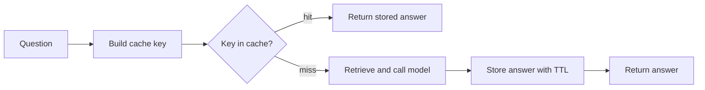

<BigWordAlert term="Latency budget" plainEnglish="The most time a request may take, split into a share for each step, such as retrieval, reranking and the model call." whyItMatters="Without a budget, every step grows a little and the total becomes too slow. With one, you can say which step is over and what to cut, which is exactly what interviewers ask you to do." />

## Nine seconds of nothing

Reem built the staff help assistant at Sahel Relief (a fictional NGO that runs food and water programmes). Field staff ask it about procedures, such as how to claim travel costs or when reports are due. Most of them use phones on slow, expensive connections.

Three complaints arrived in the first month. Answers took about 9 seconds to appear, all at once, and many staff thought the app had frozen, so they asked again, which doubled the cost. About a quarter of all questions were the same few, asked again and again, and each one paid for a full model call. And the finance lead asked a simple question that nobody could answer: what does one question cost us?

This chapter answers all three. Streaming makes the wait feel shorter. Caching stops paying twice for the same answer. A budget for cost and time turns "it feels slow and expensive" into numbers you can act on.

## Streaming: show the first words early

A model writes its answer one token at a time. Without streaming, your service waits for the last token, then sends everything. With streaming, it sends each piece as it arrives. The total time stays about the same, but the user sees text after the <GlossaryTerm term="time to first token" definition="How long a user waits from sending a request until the first piece of the answer appears. Often written TTFT." /> instead of after the last one.

The usual way to stream over plain HTTP is <GlossaryTerm term="server-sent events" definition="A simple HTTP format for a server to push a series of messages to a client over one open response. Each message is a line starting with data: followed by a blank line." /> (SSE). FastAPI supports it through `StreamingResponse`. The fake token source below stands in for a streaming model client.

```python
import asyncio
import json

from fastapi import FastAPI
from fastapi.responses import StreamingResponse

app = FastAPI()


async def fake_tokens():
    for word in ["Field", "reports", "are", "due", "on", "Thursday."]:
        await asyncio.sleep(0.05)  # stands in for the model producing a token
        yield word + " "


@app.get("/stream")
async def stream():
    async def events():
        async for token in fake_tokens():
            yield f"data: {json.dumps({'token': token})}\n\n"
        yield "data: [DONE]\n\n"

    return StreamingResponse(events(), media_type="text/event-stream")
```

Reading this endpoint with FastAPI's `TestClient` in a real run gave the content type `text/event-stream; charset=utf-8`, then one line per token, such as `data: {"token": "Field "}`, and finally `data: [DONE]`.

Streaming has costs that interviewers like to probe. You cannot check the whole answer before the user sees it, so a citation check or an output guardrail must run on the finished text and then add a warning, or you must hold back the stream until a check passes. Errors after the first token cannot change the status code, which was already sent as 200, so you send an error event instead. Some proxies buffer responses and silently undo streaming. And a retry after half an answer is visible to the user. So stream for chat-style answers that a person reads. Do not stream short answers, JSON that your own code will parse, or batch jobs.

## Caching: do not pay twice

An exact-match cache stores the answer under a key and returns it when the same key comes back. The hard part is the key. It must include everything that changes the answer, not just the question. If the prompt, the model or the documents change, an old answer may now be wrong.

```python
import hashlib
import json


def cache_key(question: str, *, model: str, prompt_version: str,
              index_version: str, top_k: int) -> str:
    normalised = " ".join(question.lower().split())
    parts = {"q": normalised, "model": model, "prompt": prompt_version,
             "index": index_version, "k": top_k}
    raw = json.dumps(parts, sort_keys=True)
    return hashlib.sha256(raw.encode()).hexdigest()[:16]
```

In a real run, "When are field reports due?" and "  when are FIELD reports due? " produced the same key, because the question is lowercased and its spaces are normalised. The same question with prompt version `v5` instead of `v4` produced a different key, so a prompt change never serves an answer written for the old prompt. The `index_version` changes whenever documents are re-indexed, which retires every old answer at once. A time-to-live, such as 24 hours, is a second safety net.

The diagram shows where the cache sits on the request path.



The takeaway: a hit skips retrieval and the model completely, so it costs almost nothing and returns in milliseconds. That is why the key must be strict. A wrong hit is fast, cheap and wrong.

A semantic cache goes further: it embeds the question and returns a stored answer when an old question is similar enough, for example cosine similarity above 0.95. It catches rephrased questions that an exact cache misses. Make a prediction about its main risk.

```predict
prompt: "A semantic cache stores the answer to 'Can I claim travel costs after 30 days?'. Later someone asks 'Can I claim travel costs within 30 days?'. The similarity is 0.97 and the threshold is 0.95. What happens?"
options:
  - id: safe
    label: "The cache sees that the meaning differs"
  - id: wrong
    label: "The second person gets the first answer"
correctOptionId: wrong
explanation: "Embeddings measure overall similarity, and the two questions share almost every word. The cache returns the first answer, which is the opposite of what the second person needs."
```

Semantic caches fail in exactly this way: one small word flips the meaning, and similarity stays high. They can also leak data. If an answer mentions one person's case, a similar question from someone else returns it. Use a semantic cache only for general questions, scope it to the same tenant and permission level, keep the threshold high, and log every hit so a person can review a sample. Many teams start with the exact cache alone, measure the <GlossaryTerm term="cache hit rate" definition="The share of requests answered from the cache, for example 25 hits out of 100 requests is a 25% hit rate." />, and only add a semantic cache if the gain is worth the risk.

## A cost budget, worked out

Here is Reem's answer to the finance lead. The prices are this example's own, not any provider's: 1 dollar per million input tokens and 4 dollars per million output tokens.

One question sends a 400 token system prompt, 5 retrieved chunks of 300 tokens (1,500), 600 tokens of chat history and a 50 token question: 2,550 input tokens. The answer is about 250 tokens. Input costs 2,550 divided by 1,000,000, times 1 dollar: 0.00255 dollars. Output costs 250 divided by 1,000,000, times 4 dollars: 0.001 dollars. One question costs about 0.0036 dollars, under a third of a cent.

At 3,000 questions a day, that is about 10.65 dollars a day, or roughly 320 dollars a month. With a 25% cache hit rate, only 2,250 questions reach the model, about 8 dollars a day. Trimming chat history from 600 to 200 tokens saves another 400 tokens per call, about 11% of the per-question cost. Reem sets the budget at half a cent per question and adds an alert if the daily average goes above it.

## A latency budget, worked out

The product target is first text within 3 seconds and the full answer within 8 seconds, at the <GlossaryTerm term="p95" definition="The 95th percentile: 95 out of 100 requests are this fast or faster. It shows what slow users experience, which an average hides." />. In this example, retrieval takes 150 ms, reranking 250 ms, and the model's time to first token is 1.2 seconds. First text appears at about 1.6 seconds, inside the target.

Generation is the big share. At 40 tokens a second, a 250 token answer takes about 6.25 seconds, so the full answer arrives at about 7.85 seconds. That just fits, but without streaming the user would stare at nothing for all 7.85 seconds. If the budget is broken, the options are clear: cap answers at 150 tokens (about 3.75 seconds of generation), route simple questions to a smaller, faster model, or skip reranking when the top retrieval score is already high.

<Callout type="tip" title="Budget per step, not just per request">
Write the budget as a list: retrieval 200 ms, rerank 300 ms, first token 1.5 s, generation 6 s. When the p95 gets worse, the trace from chapter 10.3 shows which line broke its share.
</Callout>

## Common mistakes

The most common cache bug is a key without the prompt or model version, which serves stale answers after a deploy. The most common streaming bug is a proxy that buffers the response, so users see everything at the end even though the code streams. The most common budget mistake is measuring averages: an average of 3 seconds can hide a p95 of 12.

```quiz
type: mcq
question: "Reem rolls out prompt v5 to 10% of users while 90% stay on v4. Users on v5 report answers that look like the old prompt. The cache key is the normalised question only. What fixes this?"
options:
  - "Clear the whole cache by hand after each deploy finishes"
  - "Lower the time-to-live from 24 hours to 1 minute everywhere"
  - "Add the prompt and model version to every cache key"
  - "Switch the exact-match cache to a semantic cache instead"
correct: 2
explanations:
  - "Both versions are live at once, so a cleared cache fills with mixed answers again within minutes."
  - "This shrinks the window but still mixes v4 and v5 answers, and it throws away most of the cache's value."
  - "Right. With the version in the key, v4 and v5 answers are stored separately and can never be served to the wrong group."
  - "A semantic cache has the same missing version problem, and it adds the risk of near-match wrong answers."
```

## In the interview

Budgets and caching come up in system design ("how much will this cost at 10,000 users?") and in the managerial round ("how did you bring cost down?"). Streaming comes up when the interviewer asks how you make a slow model feel fast. Answer each question aloud first.

<FaqGroup title="Practice questions">
<FaqItem question="Estimate the cost of one request to your RAG assistant, and say how you would cut it.">

I add up the input tokens: system prompt, retrieved chunks, chat history and the question, then the expected output tokens, and multiply each by its price. In my example that was 2,550 input and 250 output tokens, about 0.0036 dollars at the example prices. The biggest levers are fewer or shorter chunks, trimming history, capping output length, caching repeated questions and routing simple questions to a smaller model. I would measure answer quality on the golden set after each cut, because a cheaper answer that fails recall is not a saving.

**Follow-up probes:**

- Which of those levers is most likely to hurt quality, and how would you detect it?
- How would you report cost per request in production?

</FaqItem>
<FaqItem question="When would you not stream a model response?">

I would not stream when the output is JSON that my own code parses, because a half object is useless and I need to validate the whole thing first. I would not stream short answers that arrive in under a second, or batch jobs with no person waiting. I would also hold back the stream when a strict output check must pass before anyone sees the text, for example in a regulated setting. Streaming is for long, human-read answers where time to first token matters more than total time.

**Follow-up probes:**

- How do you report an error that happens after streaming has started?
- How would you apply a guardrail to a streamed answer?

</FaqItem>
<FaqItem question="Would you add a semantic cache to a support assistant?">

Only after an exact cache, and only if the numbers justify it. A semantic cache catches rephrased questions, but it can return a wrong answer when one word flips the meaning, and it can leak one user's details to another. If I add one, I scope it per tenant and permission level, cache only general policy answers, use a high threshold, and review a sample of hits each week. I would compare the extra hit rate against the error rate found in that review before keeping it.

**Follow-up probes:**

- How would you pick the similarity threshold?
- What must be in the cache key besides the question?

</FaqItem>
</FaqGroup>

**Next:** Build the async service. You will put validation, a concurrency limit, retries and a timeout together in your own repository, with tests.
