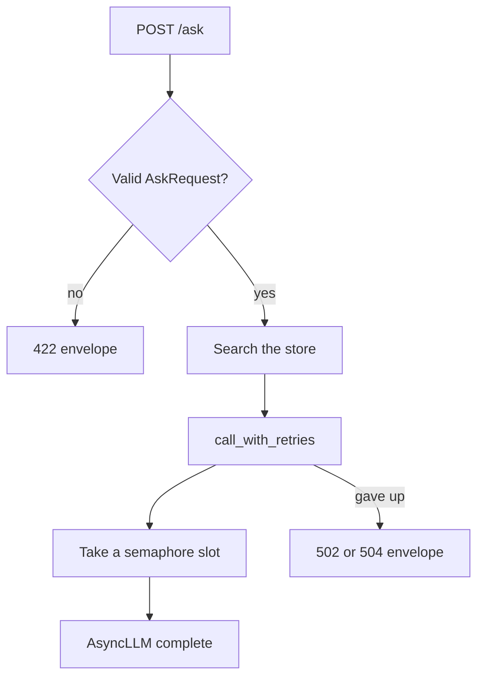

By the end of this chapter your `rag-agent-service` repository has a working `POST /ask` endpoint for Bustan Books (a fictional online bookshop). It checks every request, answers from your chapter 3.5 pipeline with citations, never runs more than a fixed number of model calls at once, retries failures that may pass, gives up inside a time budget, and returns every error in one shape. Thirteen tests prove each of those behaviours, offline, in a few seconds.

Interviewers care because this is a common hands-on task: "Here is a fake model client. Put it behind an endpoint, add a timeout, a retry and a limit, and show me the tests." Chapters 9.2 to 9.4 taught each part on its own. Here you put them together in code you can show and explain.

## What you need

- A laptop with Python 3.11 or later. The code uses `asyncio.timeout()`, which Python 3.11 added.
- Your `rag-agent-service` repository with the chapter 3.5 files: `app/store.py`, `app/embedding.py`, `app/llm.py` and `app/rag.py`. The later chapters (5.5 and 7.6) do not need to be finished, but their tests should still pass.
- Three new packages: FastAPI, httpx (which FastAPI's test client needs) and uvicorn (a server to run the app by hand). If you installed LangGraph in chapter 7.6, all of the course packages together are about 10 MB to download and about 45 MB installed (measured on 2026-10-22). Download them once, on a good connection.
- No API key and no network after the install. The tests use a fake async model.

## How the pieces fit

You will write three files. `app/model_client.py` defines what an async model looks like and gives you a fake one that can fail or be slow on command. `app/resilience.py` holds one function that retries a call with backoff inside a time budget. `app/service.py` builds the FastAPI app around your store and a model. The diagram follows one request.



Notice where the semaphore sits: inside the retry loop, around each single model call. A request that is waiting between retries holds no slot, so a struggling request does not block healthy ones. Notice also that the store search happens before any model call. If nothing relevant is found, the service answers "I don't know" without spending a call, exactly as `rag.answer` does in chapter 3.5.

## The interfaces

These names and signatures are the contract. Later chapters and the capstone import them, so keep them exactly as written. The bodies are yours to write.

```python
# app/model_client.py
class AsyncLLM(Protocol):
    async def complete(self, prompt: str) -> str: ...

class TransientModelError(Exception):
    """A provider failure that may succeed on retry: timeout, 429 or 5xx."""

class FakeAsyncLLM:
    def __init__(self, fail_times: int = 0, delay: float = 0.0): ...
    async def complete(self, prompt: str) -> str: ...
```

`FakeAsyncLLM` keeps three counters the tests read: `calls` (how many times `complete` started), `in_flight` (how many are running now) and `max_in_flight` (the highest `in_flight` ever seen). Each call adds one to `calls` and `in_flight`, updates `max_in_flight`, waits `delay` seconds with `asyncio.sleep`, then raises `TransientModelError` if `calls` is still at or below `fail_times`. Otherwise it returns what your chapter 3.5 `FakeLLM().complete(prompt)` returns. Lower `in_flight` again in a `finally` block, so a failed or cancelled call does not leave the counter too high.

```python
# app/resilience.py
async def call_with_retries(make_call, attempts: int = 3, base_delay: float = 0.1,
                            timeout: float = 2.0, *, attempt_timeout: float | None = None): ...
```

`make_call` is a function with no arguments that returns a new awaitable each time, for example `lambda: llm.complete(prompt)`. It must be a function, not a coroutine, because a coroutine can be awaited only once and a retry needs a fresh one. `timeout` is the total budget for all attempts and all waits together. `attempt_timeout`, if given, also limits each single attempt. The function must:

- Retry only `TransientModelError` and a single attempt that ran out of its `attempt_timeout`. Any other exception goes straight to the caller on the first try.
- Wait between tries with full jitter: a random time between 0 and `base_delay * 2 ** attempt`, using `asyncio.sleep`, never `time.sleep`.
- Raise `TimeoutError` when the total budget is used up, and never start a wait that would end after the deadline.
- When the attempts run out, raise the last error it saw.

A hint for the deadline: read the loop clock once at the start with `asyncio.get_running_loop().time()`, add `timeout` to get a deadline, and before each attempt give `asyncio.timeout()` only the time that is left.

```python
# app/service.py
class AskRequest(BaseModel):
    question: str = Field(min_length=1, max_length=500)
    top_k: int = Field(default=3, ge=1, le=10)

class AskResponse(BaseModel):
    answer: str
    citations: list[str]

def create_app(llm: AsyncLLM, store: InMemoryVectorStore, *, max_concurrency: int = 4,
               timeout: float = 2.0, attempts: int = 3, base_delay: float = 0.1) -> FastAPI: ...
```

`create_app(llm, store)` with no other arguments must work. The keyword settings exist so the tests can use small numbers. Inside `create_app`, create one `asyncio.Semaphore(max_concurrency)` that every request shares. `POST /ask` searches the store with `top_k`, keeps chunks scoring at least 0.1, and returns the answer "I don't know based on the documents." with empty citations, without calling the model, when none are left. Otherwise it builds the prompt with `build_prompt` from `app/rag.py`, calls the model through `call_with_retries`, and keeps only the cited ids that were retrieved.

Every error uses the body `{"error": {"code": "...", "message": "..."}}`: code `validation_error` with status 422, `upstream_timeout` with 504 when `call_with_retries` raises `TimeoutError`, and `upstream_unavailable` with 502 when it raises `TransientModelError`.

## Build it

<Steps title="Build the async service">
<Step title="Add the packages" stepNumber="1">

Add three lines to `requirements.txt`, under the ones from earlier chapters:

```text
fastapi>=0.115
httpx>=0.27
uvicorn>=0.30
```

Activate your virtual environment, then install. On macOS or Linux run `source .venv/bin/activate`; on Windows run `.venv\Scripts\activate`. Then, on both:

```bash
pip install -r requirements.txt
```

Run `pytest -q` once before you write any code. Every test from earlier chapters should still pass. If something fails now, fix it first, so that later failures can only come from this chapter.

</Step>
<Step title="Write the fake async model" stepNumber="2">

Create `app/model_client.py` with `AsyncLLM`, `TransientModelError` and `FakeAsyncLLM` as described above. Import `FakeLLM` from `app.llm` and reuse it for the answer text, so the async fake answers exactly like the sync one.

Keep the order inside `complete` as described: count first, then sleep, then decide whether to fail. Counting before the sleep is what lets the concurrency test see every call that is waiting at the same moment. If you count after the sleep, the test cannot tell five calls in flight from five calls one after another.

</Step>
<Step title="Write the retry function" stepNumber="3">

Create `app/resilience.py` with `call_with_retries`. Write it as a loop over attempt numbers. In each round: work out the time left, stop with `TimeoutError` if there is none, run one attempt inside `async with asyncio.timeout(...)`, return the result if it worked, and otherwise remember the error. Then pick the jittered wait, and stop if the wait would pass the deadline.

There is one subtle case. When `asyncio.timeout()` fires, you get a `TimeoutError` in both situations: a single slow attempt, and the whole budget being gone. Check the clock to tell them apart. If the deadline has passed, raise `TimeoutError` at once. If it has not, the attempt was only slow, and you can try again.

</Step>
<Step title="Write the service" stepNumber="4">

Create `app/service.py` with the two Pydantic models and `create_app`. Inside `create_app`, create the app, the semaphore and three exception handlers: one for `RequestValidationError` (from `fastapi.exceptions`), one for `TimeoutError` and one for `TransientModelError`. For the validation message, take the first item of `exc.errors()` and join its field location and its `msg`.

The route itself is short. Inside it, define a small async function that takes a semaphore slot with `async with` and awaits `llm.complete(prompt)`. Pass that function, not a call to it, to `call_with_retries` with the settings from `create_app`. Let the two upstream exceptions rise out of the route; the handlers turn them into envelopes.

</Step>
<Step title="Add the acceptance tests" stepNumber="5">

Create `tests/test_service.py`. The file is long, so it is shown in five parts. Paste them one after another into the same file, in order. The first part builds a small store with three Bustan Books chunks and a helper that creates a test client with a short backoff, so retries take milliseconds.

```python
import asyncio
import time

import httpx
import pytest
from fastapi.testclient import TestClient

from app.embedding import HashingEmbedder
from app.model_client import FakeAsyncLLM
from app.resilience import call_with_retries
from app.service import create_app
from app.store import Chunk, InMemoryVectorStore

CHUNKS = [
    Chunk("returns#0", "returns", "You can return a book within 30 days of delivery. Keep the receipt."),
    Chunk("shipping#0", "shipping", "Standard shipping is free on orders over 50 dollars."),
    Chunk("accounts#0", "accounts", "Reset your password from the sign in page."),
]
QUESTION = {"question": "Can I return a book within 30 days?"}


@pytest.fixture
def store():
    s = InMemoryVectorStore(HashingEmbedder())
    s.add(CHUNKS)
    return s


def make_client(llm, store, **settings):
    settings.setdefault("base_delay", 0.01)
    return TestClient(create_app(llm, store, **settings))
```

The second part checks the happy path and five invalid requests. Each invalid request must get the 422 envelope, and the model must never be called.

```python
def test_valid_question_returns_answer_with_citations(store):
    llm = FakeAsyncLLM()
    response = make_client(llm, store).post("/ask", json=QUESTION)
    assert response.status_code == 200
    body = response.json()
    assert body["citations"] == ["returns#0"]
    assert "30 days" in body["answer"]
    assert llm.calls == 1


@pytest.mark.parametrize("payload", [
    {},
    {"question": ""},
    {"question": "x" * 501},
    {"question": "Where is my order?", "top_k": 0},
    {"question": "Where is my order?", "top_k": 11},
])
def test_invalid_request_returns_structured_422(store, payload):
    llm = FakeAsyncLLM()
    response = make_client(llm, store).post("/ask", json=payload)
    assert response.status_code == 422
    error = response.json()["error"]
    assert error["code"] == "validation_error"
    assert isinstance(error["message"], str) and error["message"]
    assert llm.calls == 0
```

The third part checks the "no relevant chunk" path and the retries: a model that fails twice and then answers, and a model that never answers.

```python
def test_no_matching_chunk_answers_without_calling_the_model():
    llm = FakeAsyncLLM()
    empty = InMemoryVectorStore(HashingEmbedder())
    response = make_client(llm, empty).post("/ask", json=QUESTION)
    assert response.status_code == 200
    assert response.json()["citations"] == []
    assert llm.calls == 0


def test_model_that_fails_twice_then_succeeds_is_retried(store):
    llm = FakeAsyncLLM(fail_times=2)
    response = make_client(llm, store, attempts=3).post("/ask", json=QUESTION)
    assert response.status_code == 200
    assert response.json()["citations"] == ["returns#0"]
    assert llm.calls == 3


def test_model_that_always_fails_returns_502(store):
    llm = FakeAsyncLLM(fail_times=1000)
    response = make_client(llm, store, attempts=3).post("/ask", json=QUESTION)
    assert response.status_code == 502
    assert response.json()["error"]["code"] == "upstream_unavailable"
    assert llm.calls == 3
```

The fourth part checks the time budget and the concurrency limit. `TestClient` sends one request at a time, so the concurrency test uses httpx's `ASGITransport` to send six requests to the app at once, inside `asyncio.run`.

```python
def test_slow_model_returns_504_within_the_time_budget(store):
    llm = FakeAsyncLLM(delay=5.0)
    client = make_client(llm, store, timeout=0.3)
    started = time.perf_counter()
    response = client.post("/ask", json=QUESTION)
    elapsed = time.perf_counter() - started
    assert response.status_code == 504
    assert response.json()["error"]["code"] == "upstream_timeout"
    assert elapsed < 1.5


def test_semaphore_keeps_concurrent_model_calls_under_the_limit(store):
    llm = FakeAsyncLLM(delay=0.05)
    app = create_app(llm, store, max_concurrency=2)

    async def send_many():
        transport = httpx.ASGITransport(app=app)
        async with httpx.AsyncClient(transport=transport, base_url="http://test") as client:
            return await asyncio.gather(*[client.post("/ask", json=QUESTION) for _ in range(6)])

    responses = asyncio.run(send_many())
    assert [r.status_code for r in responses] == [200] * 6
    assert llm.calls == 6
    assert llm.max_in_flight == 2
```

The last part tests `call_with_retries` on its own: an error that is not transient is never retried, and a single slow attempt is cut off and retried.

```python
def test_a_non_transient_error_is_not_retried():
    calls = []

    async def broken():
        calls.append(1)
        raise ValueError("bad prompt")

    with pytest.raises(ValueError):
        asyncio.run(call_with_retries(broken, attempts=3, base_delay=0.01))
    assert len(calls) == 1


def test_a_slow_attempt_is_cut_off_and_retried():
    calls = []

    async def slow_then_fast():
        calls.append(1)
        if len(calls) == 1:
            await asyncio.sleep(5)
        return "ok"

    result = asyncio.run(call_with_retries(
        slow_then_fast, attempts=3, base_delay=0.01, timeout=1.0, attempt_timeout=0.1))
    assert result == "ok"
    assert len(calls) == 2
```

The tests use `asyncio.run` inside normal test functions, so you do not need an extra pytest plugin for async tests.

</Step>
<Step title="Run the tests" stepNumber="6">

Run only the new file first, then the whole suite.

<TerminalBlock title="Run the service tests" cwd="rag-agent-service">
  <TerminalLine type="prompt">pytest -q tests/test_service.py</TerminalLine>
  <TerminalLine type="output">13 passed in 2.06s</TerminalLine>
</TerminalBlock>

The five invalid requests count as five tests because of `parametrize`, which is why one file gives 13. Your time will differ; most of it is the 0.3 second budget test and the import of FastAPI. If the whole file takes more than about 10 seconds, something is sleeping for real, usually a `time.sleep` instead of `asyncio.sleep`, or a retry wait that ignores `base_delay`. Then run `pytest -q` with no path and check that the tests from earlier chapters still pass too.

</Step>
<Step title="Call it by hand" stepNumber="7">

Tests prove the behaviour, but in an interview you may be asked to run the service. Create a small `app/main.py` that wires the real pieces together:

```python
from app.embedding import HashingEmbedder
from app.ingest import load_chunks
from app.model_client import FakeAsyncLLM
from app.service import create_app
from app.store import InMemoryVectorStore

store = InMemoryVectorStore(HashingEmbedder())
store.add(load_chunks("data/docs"))
app = create_app(FakeAsyncLLM(), store)
```

Start it from the repository folder with `uvicorn app.main:app`, then open `http://127.0.0.1:8000/docs` in a browser. FastAPI builds this page from your Pydantic models. Use "Try it out" on `POST /ask` with a returns question, then with an empty question. On macOS or Linux you can also use curl:

```bash
curl -s -X POST http://127.0.0.1:8000/ask -H "content-type: application/json" -d '{"question": ""}'
```

The empty question returns `{"error":{"code":"validation_error","message":"question: String should have at least 1 character"}}`. A returns question returns an answer that ends with a citation such as `[returns#0]`, with the same id in `citations`. The exact answer text depends on the documents you wrote in chapter 3.5. Stop the server with Ctrl+C.

</Step>
</Steps>

## Verify

The run that counts is the full test file: `13 passed`. Now break one thing on purpose, so you know the tests can catch it. In `app/service.py`, remove the `async with` line around the model call, so every call runs without taking a semaphore slot, and fix the indentation. Run the tests again.

<TerminalBlock title="The concurrency test catches a missing limit" cwd="rag-agent-service">
  <TerminalLine type="prompt">pytest -q tests/test_service.py</TerminalLine>
  <TerminalLine type="output">FAILED tests/test_service.py::test_semaphore_keeps_concurrent_model_calls_under_the_limit</TerminalLine>
  <TerminalLine type="output">E       assert 6 == 2</TerminalLine>
  <TerminalLine type="output">1 failed, 12 passed in 3.98s</TerminalLine>
</TerminalBlock>

Six calls ran at once instead of two. Every other test still passes, which is the lesson: without this test, a missing limit is invisible until the provider starts returning 429 in production. Put the line back and confirm `13 passed` again.

If your tests fail before you break anything, the two most likely causes are these.

**`KeyError: 'error'` in the five 422 tests.** The response has FastAPI's default body, a `detail` list, not your envelope. Check that the handler is registered for `RequestValidationError` from `fastapi.exceptions`, that it is added inside `create_app` to the same app you return, and that it returns status 422 with the `error` object.

**`assert 3 == 1` in `test_a_non_transient_error_is_not_retried`.** Your retry loop catches too much, usually `except Exception`. It then retries a `ValueError`, which is a bug in the caller's input, not a passing failure. Catch only `TransientModelError` and `TimeoutError`, and let everything else rise.

<Callout type="warning" title="Create the semaphore once per app">
If you create the semaphore inside the route, each request gets its own private limit and the concurrency test fails with six calls in flight. Create it once, inside create_app, next to the app itself.
</Callout>

## Acceptance checklist

- [ ] `requirements.txt` lists fastapi, httpx and uvicorn, and they install in my virtual environment
- [ ] `app/model_client.py`, `app/resilience.py` and `app/service.py` use the exact names and signatures from this chapter
- [ ] `pytest -q tests/test_service.py` shows 13 passed, and the full `pytest -q` run still passes
- [ ] Removing the semaphore makes the concurrency test fail with `assert 6 == 2`, and restoring it makes it pass
- [ ] The slow model test returns 504 in well under 1.5 seconds
- [ ] I called the running service once by hand and saw the 422 envelope for an empty question
- [ ] My changes are committed and pushed with small, clear commit messages

## Share your repository

Your mentor will open your repository, run the tests and read `app/service.py`. Push your work first.

```openquestion
prompt: "Paste the link to your rag-agent-service repository. Optionally, paste the last line of your pytest -q run, for example '13 passed in 2.06s'."
required: true
minWords: 0
allowSpeechInput: true
allowUrl: true
urlRequired: true
urlLabel: "Repository link"
urlHint: "A link your mentor can open. If your repository is private, add your mentor as a reader."
modelAnswer: "Repository link submitted. The final run of pytest -q on the whole repository shows all tests passing, including 13 in tests/test_service.py. The service file creates one semaphore inside create_app, retries only TransientModelError and per-attempt timeouts, and maps them to 502 and 504 envelopes."
```

**Next:** A graded quiz with service scenarios: async code, validation, retries and budgets.
