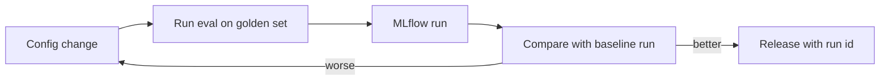

<BigWordAlert term="Experiment tracking" plainEnglish="Recording, for every test run of your system, exactly which settings went in, which numbers came out and which files it produced, in one place you can search and compare." whyItMatters="If nobody can run it again and get the same number, a result is only a claim. Tracking turns 'recall was 0.81 at launch' into a record anyone on the team can check, which is what interviewers mean when they ask how you compared options." />

## A number nobody could rebuild

After the failover incident in chapter 10.1, Ahmad wanted to compare the new short chunks with the old long ones. His launch notes said "recall@5 = 0.81". He ran the evaluation again with the old settings and got 0.74. Was the old index different? Had the <GlossaryTerm term="golden set" definition="A fixed list of test questions with the chunks or answers that count as correct, used to score a system the same way every time." /> changed? It had: a teammate had added 10 harder questions, taking it from 30 to 40. Nobody had written that down, so the two numbers measured different things.

This is the most common way teams fool themselves with evaluation. The numbers are real, but the context around them is lost. Experiment tracking fixes this by saving the context with every number, automatically, every time. By the end of this chapter you can log a run with MLflow, an open-source tool for tracking experiments, compare runs, and say what an LLM team should record.

## Runs, parameters, metrics and artifacts

MLflow organises records in a simple way. An **experiment** is a named group, such as "runbook-bot-retrieval". Inside it, each **run** is one try: one evaluation with one set of settings. A run holds four kinds of data.

| Kind | What it holds | Example for the runbook bot |
|---|---|---|
| Parameter | A setting that went in | chunk_size 600, top_k 5, prompt_version v3 |
| Metric | A number that came out | recall_at_5 0.81, mrr 0.66 |
| Artifact | A file the run produced | eval_results.jsonl with one row per question |
| Tag | A label for searching | git_commit a1b2c3d, author ahmad |

Parameters answer "what did we try?". Metrics answer "how well did it do?". An <GlossaryTerm term="artifact" definition="A file saved with a run, such as per-question results, a prompt or a config file, so you can open exactly what the run produced." /> answers "which questions did it get wrong?", which a single average can never answer. Tags make runs easy to find later.

## Logging a run

Install MLflow in a virtual environment with `pip install mlflow`. It is a large install: on 2026-10-22 the environment was about 300 MB, so download it on a good connection. On Windows, keep the project in a short folder path such as `C:\code\runbook-eval`. In a test run inside a very long folder path, MLflow's database setup failed because some of its file paths passed the Windows path length limit.

The script below logs two runs, one per chunk size. The `run_eval` function stands in for your real evaluation from chapter 5.5. It returns the metrics and one result row per question.

```python
import json

import mlflow

mlflow.set_experiment("runbook-bot-retrieval")


def run_eval(chunk_size: int):
    # Stands in for your real eval. Returns metrics and one row per question.
    recall = {300: 0.72, 600: 0.81}[chunk_size]
    return {"recall_at_5": recall, "mrr": round(recall - 0.15, 2)}, [{"id": "q01", "hit": True}]


for chunk_size in (300, 600):
    with mlflow.start_run(run_name=f"chunks-{chunk_size}"):
        mlflow.set_tag("git_commit", "a1b2c3d")
        mlflow.log_param("chunk_size", chunk_size)
        mlflow.log_param("top_k", 5)
        mlflow.log_param("prompt_version", "v3")
        mlflow.log_param("golden_set", "golden-v2")
        metrics, rows = run_eval(chunk_size)
        for name, value in metrics.items():
            mlflow.log_metric(name, value)
        with open("eval_results.jsonl", "w") as f:
            f.writelines(json.dumps(row) + "\n" for row in rows)
        mlflow.log_artifact("eval_results.jsonl")
```

`mlflow.start_run` opens a run and closes it when the `with` block ends, even if the code inside fails. `log_param` and `log_metric` record one value each. `log_artifact` copies a file into the run's storage. With MLflow 3.17, run without any setup, the records went into a local database file called `mlflow.db` in the working folder, and the artifacts into a folder called `mlruns`. A team would point all runs at one shared tracking server instead.

To compare runs in code, search them and sort by a metric:

```python
import mlflow

runs = mlflow.search_runs(
    experiment_names=["runbook-bot-retrieval"],
    order_by=["metrics.recall_at_5 DESC"],
    output_format="list",
)
for run in runs:
    p, m = run.data.params, run.data.metrics
    print(run.info.run_name, p["chunk_size"], p["golden_set"], m["recall_at_5"], m["mrr"])
```

```text
chunks-600 600 golden-v2 0.81 0.66
chunks-300 300 golden-v2 0.72 0.57
```

Both scripts were run with MLflow 3.17.2 on Python 3.12, and the output above is real. The recall numbers are the stand-in values from `run_eval`, not a measurement. To browse runs in a browser instead, run `mlflow ui` in the same folder and open `http://127.0.0.1:5000`. You can select runs and compare their parameters and metrics side by side.

## What an LLM team should log

Classic machine learning teams log training settings. An LLM application team logs everything that can change an answer. The list is longer than most people expect.

**Parameters:** the exact model version (a dated version id, not a moving alias such as "latest"), temperature, prompt version or a hash of the prompt text, chunk size and overlap, embedding model, top_k, reranker on or off, and the golden set version. **Metrics:** retrieval metrics such as recall@k and MRR, generation metrics such as faithfulness, plus p95 latency and cost per question from the run. **Artifacts:** the per-question results, the prompt text and the full config file. **Tags:** the Git commit, who ran it, and why.

Never log secrets. An API key logged as a parameter is now in a database that the whole team, and maybe a backup, can read.

Make a prediction about comparing two runs.

```predict
prompt: "Ahmad's two runs. Launch run: recall_at_5 0.81, golden_set golden-v1 (30 questions). Re-run with the old settings: recall_at_5 0.74, golden_set golden-v2 (40 questions). Are the old settings now worse?"
options:
  - id: unknown
    label: "We cannot tell from these two runs"
  - id: worse
    label: "Yes, recall fell by 7 points since launch"
correctOptionId: unknown
explanation: "The two runs used different question sets, so the scores measure different things. Re-run both setups on the same golden set, then compare."
```

Only compare runs that share the golden set. The diagram shows the loop that makes that easy.



The loop has one rule hidden in it: every release points to the run that justified it. When something goes wrong in production, you look up the release, find its run, and see exactly which settings went out and how they scored. That is the record Wadi Labs did not have.

## Noise: when a difference is real

A hosted model does not always give the same answer twice, even with the same prompt and a low temperature. Retrieval metrics such as recall@k are stable, because your retriever is deterministic, but anything that involves the model's text, such as faithfulness scored by a judge, moves a little between runs. So one run per setup is not enough when the difference is small. In this example, Ahmad runs each prompt version 3 times on the same 40 questions and logs each run separately, with a tag such as `repeat=1`. If version 5 scores 0.84, 0.86 and 0.85, and version 4 scores 0.83, 0.85 and 0.86, the honest conclusion is "no clear difference", not "version 5 is better". Logging every repeat, instead of only the best one, is what keeps the team honest.

## Choosing a tool

A spreadsheet works for a week. It breaks when two people edit it, when someone forgets a column, or when you need the per-question files. Plain JSON files written by your eval script are a fair middle step: free, and easy to keep in Git. MLflow adds search, a comparison view, artifact storage and a shared server for the team, at the cost of one more service to run. For a team of 12 with weekly prompt changes, Wadi Labs chose MLflow with one shared tracking server and a rule that the eval script logs automatically, so nobody has to remember.

## Common mistakes

The first mistake is logging only averages. When recall drops from 0.81 to 0.78, the average cannot say which questions broke; the per-question artifact can. The second is logging a model alias that the provider moves to a new version, so two runs with "the same model" used different models. The third is changing two things in one run, such as the chunker and the prompt together, which is exactly what made Wadi Labs' incident hard to explain. Change one thing per run when you can.

```quiz
type: mcq
question: "Between two runs, recall_at_5 drops from 0.81 to 0.78. Sara must find out which questions broke and why. Which record makes this possible?"
options:
  - "The mean recall_at_5 metric logged in each of the two runs"
  - "The temperature parameter value logged in each of the two runs"
  - "The start time and duration that MLflow stores for each run"
  - "A per-question results file logged as an artifact in each run"
correct: 3
explanations:
  - "The mean shows that quality dropped, but not which questions moved. Two different sets of failures can give the same average."
  - "Temperature is useful context, but it does not show which questions changed between the runs."
  - "Timing data helps with cost and speed, but says nothing about which answers changed."
  - "Right. With one row per question in each run, Sara can list the questions that passed before and fail now, then read their retrieved chunks."
```

## In the interview

Tracking questions come up in the managerial round and in project deep dives: "How did you compare the two chunking strategies?" or "Can you reproduce your launch numbers?". A strong answer names what was logged and shows the comparison was fair. Answer aloud first, then open each question.

<FaqGroup title="Practice questions">
<FaqItem question="How do you make an LLM experiment reproducible?">

I log every input that can change an answer: the dated model version, temperature, prompt version, chunking settings, embedding model, top_k and the golden set version, plus the Git commit as a tag. The eval script logs these automatically to MLflow, so nobody has to remember. I also save per-question results and the prompt text as artifacts. Even then, a hosted model can change behind the same version id or vary between calls, so I re-run the baseline next to any new run instead of comparing with a number from last month.

**Follow-up probes:**

- How do you handle randomness in the model's answers?
- What do you do when the golden set itself needs to change?

</FaqItem>
<FaqItem question="Why not keep evaluation results in a spreadsheet?">

A spreadsheet is fine for a solo week of experiments. It fails when several people add rows by hand, because columns get skipped and settings get forgotten. It also cannot hold the per-question files that explain a drop. MLflow logs from the eval script itself, keeps artifacts next to each run, and lets the team search and compare runs. The cost is one more service to run, which a team of more than two or three people usually finds worth it.

**Follow-up probes:**

- What would you put in Git instead of MLflow?
- How would you link a production release to an MLflow run?

</FaqItem>
<FaqItem question="You changed the prompt and the faithfulness score went up. How do you know the change caused it?">

First I check the runs share the same golden set, model version and retrieval settings, so the prompt is the only difference. Then I re-run both prompts in the same session, because hosted models and caches can drift. I look at the per-question results to see whether the gain comes from many questions or from two or three that flipped, which could be noise on a 40 question set. If the gain is small, I run each prompt a few times and compare the spread, not one number.

**Follow-up probes:**

- How big must the golden set be before a 3 point change means something?
- Why would a prompt change leave recall@k exactly the same?

</FaqItem>
</FaqGroup>

**Next:** Tracing and observability: recording what happened inside each request, step by step.
