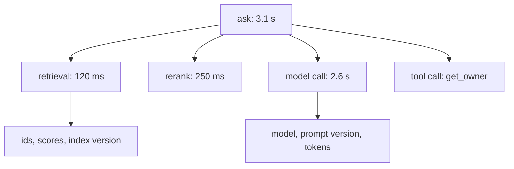

<BigWordAlert term="Trace" plainEnglish="The record of one request's journey through your system. It is made of spans: one span per step, such as retrieval, the model call or a tool call, each with a start time, an end time and details." whyItMatters="When an answer is wrong or slow, a trace shows which step caused it. Without one, you are guessing, and interviewers can hear the difference." />

## One log line is not enough

After the failover incident in chapter 10.1, Nour wanted to know one thing: why did the bot answer with the old database steps? The service log had a single line for her question: `POST /ask 200 3.1s`. It said the request worked. It did not say which chunks retrieval found, which prompt version ran, or what the model was given. Was it a retrieval failure, a ranking failure or a model failure? The log could not tell.

A trace would have answered in one look. The retrieval step would have shown the chunk ids it returned, and one of them, `db-failover-2023#2`, came from the retired runbook. That points straight at the fix: remove retired documents from the index, or filter them out at query time. By the end of this chapter you can trace one request through retrieval, the model and tools, choose what to record, and keep private data out of it.

## Logs, metrics and traces

Observability data usually comes in three kinds, and each answers a different question. Logs are lines of text or JSON written at a moment, such as "request finished with status 504". They are good for a single event. Metrics are numbers counted over time, such as requests per minute or p95 latency. They are cheap to keep for months and good for dashboards and alerts, but they cannot tell you about one request. Traces follow one request through every step. They are the most detailed and the most expensive. A healthy LLM service uses all three: metrics to notice that something changed, traces to see where, and logs for the events in between. Wadi Labs had one log line per request and a few metrics for uptime and speed, but no traces at all.

## Spans, attributes and the trace tree

A trace is a tree. The root span covers the whole request. Each step inside it, such as retrieval, reranking, the model call and any tool call, is a child span. Each span has a name, a start and end time, and attributes: key and value pairs such as `llm.input_tokens = 2900`. All spans of one request share a trace id, so you can find them together.

The diagram shows the trace for one question to the Wadi Labs bot.



Read it from the top. The root span tells you the request took 3.1 seconds. The children tell you where the time went, and the attributes on each child tell you what that step saw and did. When latency rises, you compare span durations. When quality drops, you read retrieval ids and versions.

Interviewers often call this pattern "LangSmith-style tracing", after tools built for LLM apps. The open standard underneath many tools is OpenTelemetry. It defines an API for creating spans, an SDK that collects them, and an <GlossaryTerm term="exporter" definition="The part of a tracing setup that sends finished spans somewhere, such as the console, a file, or a tracing backend where you can search them." /> that sends them to a backend. Because it is a standard, you can change your tracing backend without rewriting your code.

## Tracing a request with OpenTelemetry

Install the SDK with `pip install opentelemetry-sdk`. The example below uses an in-memory exporter so you can print the spans; in production you would use an exporter for your tracing backend. The `time.sleep` calls stand in for real work.

```python
import time

from opentelemetry import trace
from opentelemetry.sdk.trace import TracerProvider
from opentelemetry.sdk.trace.export import SimpleSpanProcessor
from opentelemetry.sdk.trace.export.in_memory_span_exporter import InMemorySpanExporter

exporter = InMemorySpanExporter()  # in production: an exporter to your tracing backend
provider = TracerProvider()
provider.add_span_processor(SimpleSpanProcessor(exporter))
trace.set_tracer_provider(provider)
tracer = trace.get_tracer("runbook-bot")


def ask(question: str) -> str:
    with tracer.start_as_current_span("ask") as root:
        root.set_attribute("app.prompt_version", "v5")
        with tracer.start_as_current_span("retrieval") as span:
            time.sleep(0.12)
            span.set_attribute("retrieval.chunk_ids", ["db-failover-2023#2", "db-failover#0"])
        with tracer.start_as_current_span("model_call") as span:
            time.sleep(0.3)
            span.set_attribute("llm.model", "large-model-2026-09")
            span.set_attribute("llm.input_tokens", 2900)
            span.set_attribute("llm.output_tokens", 210)
        return "Promote the standby with the failover script. [db-failover-2023#2]"
```

Spans opened inside another span's `with` block become its children automatically. Printing the finished spans after one call gave this, with OpenTelemetry SDK 1.45 on Python 3.12:

```text
retrieval    120 ms  parent=ask  {'retrieval.chunk_ids': ('db-failover-2023#2', 'db-failover#0')}
model_call   301 ms  parent=ask  {'llm.model': 'large-model-2026-09', 'llm.input_tokens': 2900, 'llm.output_tokens': 210}
ask          421 ms  parent=-  {'app.prompt_version': 'v5'}
```

Children finish first, so they print first. The first line is the one Nour needed: a retired runbook in the retrieval results. When a request crosses services, for example from the bot to a separate retrieval service, OpenTelemetry passes the trace id in an HTTP header called `traceparent`, so both services add spans to the same trace.

## What to record

Record what you need to explain a slow or wrong answer, and nothing more. This table is a good starting set for an LLM service.

| Span | Record | Why |
|---|---|---|
| Root request | Route, status, total time, user role, versions | Find slow and failed requests by version |
| Retrieval | Chunk ids, scores, top_k, index version | Tell retrieval failures from model failures |
| Rerank | Ids in and out, time | See whether reranking helped or hurt |
| Model call | Model version, prompt version, tokens in and out, time to first token, retries | Cost, latency and version drift |
| Tool call | Tool name, argument shape, result status, time | Debug agent loops and failed actions |

Notice what is missing: the full prompt, the full answer and the user's raw question. Those are the most useful fields for debugging and the most dangerous to store.

## Keep private data out

Questions and documents often contain <GlossaryTerm term="PII" definition="Personally identifiable information: data that points to a person, such as a name, email, phone number, address or an id number." />. Traces are copied to a backend, kept for weeks and read by many engineers. A rule that works: no raw personal data leaves the service in a span. Replace user ids with a hashed id, so you can still group one user's requests without knowing who they are. Run a redaction step over any text you do record, replacing emails and phone numbers with placeholders. Record ids of retrieved chunks, not their text, because the text can be read from the index by people with access.

When a team needs full prompts to debug, it records them separately: for a small sample, with a short retention such as 7 days, and with access limited to a few people. Never record API keys or tokens, even inside headers.

## Sampling: keep what matters

Tracing every request can cost more than the service. In this example, Wadi Labs gets 20,000 requests a day with 6 spans each. At about 1 KB per span, that is about 120 MB a day. If each request also stores its full prompt and answer, about 20 KB, that adds about 400 MB a day, mostly text nobody will read. Sampling keeps a share of traces. Make a prediction first.

```predict
prompt: "Wadi Labs keeps a random 10% of traces, decided when each request starts. A rare bug fails 1 request in 2,000. Will the trace of a failed request usually be kept?"
options:
  - id: kept
    label: "Yes, failed requests are kept by the sampler"
  - id: dropped
    label: "No, about 9 in 10 failures are dropped"
correctOptionId: dropped
explanation: "The keep or drop choice is made before anyone knows the request will fail, so failures are kept at the same 10% rate as everything else."
```

Deciding at the start is called head sampling. It is cheap, but it loses most of the rare traces you care about. <GlossaryTerm term="tail sampling" definition="Deciding whether to keep a trace after the request has finished, so you can keep every error and every slow request and only a small share of the normal ones." /> waits until the request is done. A common rule: keep every error, every request slower than the p95 target, every request with negative user feedback, and 5% of the rest. Tail sampling needs a component that holds traces until they finish, such as the OpenTelemetry Collector, which adds one more piece to run.

## Common mistakes

The first mistake is tracing timings but not versions, so a quality drop cannot be tied to a prompt or model change. The second is losing the parent link, so steps show up as separate traces; this happens when work moves to a new process or service without passing the trace context. The third is storing raw questions in attributes by default, which turns a debugging tool into a privacy problem. The fourth is adding so many attributes per span that storage costs grow faster than traffic.

```quiz
type: mcq
question: "Tamer adds tracing to Najm Microfinance's loan assistant. A loan officer's question includes the borrower's full name and phone number. What should the retrieval span record?"
options:
  - "The full question text, so the trace shows exactly what was asked"
  - "Nothing at all, since any question might contain personal data"
  - "Only the retrieved chunk ids and scores, no question text"
  - "The question with the name kept and only the phone number masked"
correct: 2
explanations:
  - "This copies a name and a phone number into a system that many engineers can read for weeks."
  - "This loses the ids and scores needed to debug retrieval. The ids themselves contain no personal data."
  - "Right. The ids and scores are enough to debug retrieval, and they hold no personal data from the question."
  - "A full name is personal data too. Partial masking still leaves the borrower identifiable."
```

## In the interview

Tracing questions show up in system design ("how would you debug a wrong answer in production?") and in the managerial round ("what did you monitor?"). Interviewers listen for spans per step, versions on every span, and a clear rule for personal data. Answer each question aloud first.

<FaqGroup title="Practice questions">
<FaqItem question="A user says your assistant gave a wrong answer yesterday. How do you find out why?">

I find the request's trace by time and hashed user id, then read it from the top. The retrieval span shows which chunk ids came back and their scores, so I can see whether the right document was found at all. If it was, I check the prompt version and model version on the model span and replay the same input with the same versions. If it was not, the problem is in indexing or retrieval, and I add the question to the golden set so the fix is tested. Without the trace, I could only guess.

**Follow-up probes:**

- What if the request was not sampled?
- How would you replay the request without the full prompt stored?

</FaqItem>
<FaqItem question="What do you record on the model call span, and what do you leave out?">

I record the exact model version, the prompt version, input and output tokens, time to first token, total time, the number of retries and the finish reason. Those explain cost, latency and most quality changes. I leave out the full prompt and answer by default, because they can contain personal data and they make storage large. If we need them, I record them for a small sample with a short retention and limited access. API keys are never recorded anywhere.

**Follow-up probes:**

- How would you record cost per request from these attributes?
- How do you check that redaction is working?

</FaqItem>
<FaqItem question="Head sampling or tail sampling for an LLM service?">

Tail sampling, if we can afford to run it. LLM failures are often rare and specific: one bad document, one prompt edge case. Head sampling at 10% drops 90% of them before we know they matter. With tail sampling I keep all errors, all requests over the latency target, all requests with negative feedback, and a few percent of the rest. The cost is a collector that holds traces until they finish, so for a small team I might start with head sampling plus always logging errors, and move to tail sampling when traffic grows.

**Follow-up probes:**

- How do you keep traces for requests that get negative feedback hours later?
- How much storage would your sampling rule need per day?

</FaqItem>
</FaqGroup>

**Next:** Deployment: serverless or Kubernetes, and how to choose where an LLM service runs.
