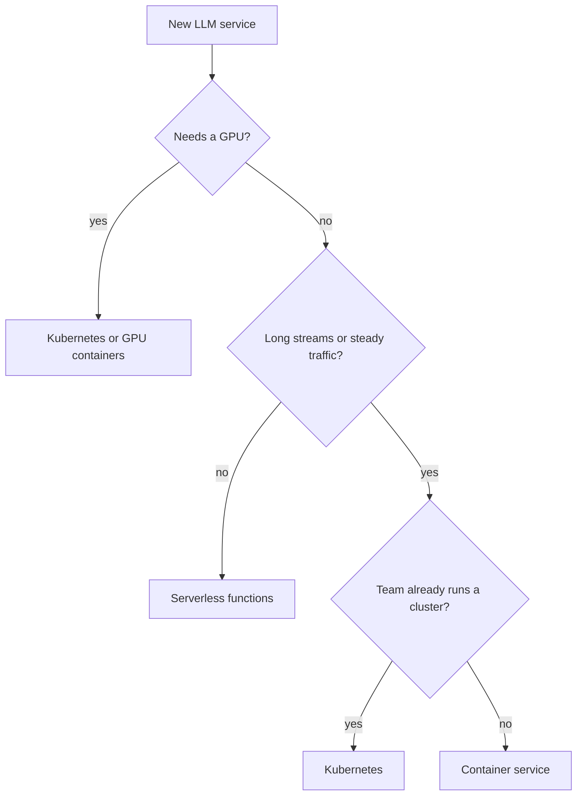

<BigWordAlert term="Cold start" plainEnglish="The extra delay when a platform has to start a new copy of your service before it can answer, for example loading Python, your packages and any model files." whyItMatters="Platforms that scale to zero save money when nobody is using them, and pay for it with cold starts. Whether your users can accept that delay is one of the first deployment questions an interviewer asks." />

## Moving the bot off a spare server

Until now, Wadi Labs' runbook bot has run on a spare server under Ahmad's desk, which goes down whenever the power does. After the incident in chapter 10.1, the team agreed to host it properly. Ahmad listed what the bot needs, because the right platform depends on the workload, not on fashion.

In this example: about 2,000 questions a day on weekdays, almost none at night or at weekends, and bursts of 50 questions in 5 minutes during an incident. Answers stream for up to 40 seconds. At start-up the service loads a small embedding model into memory, which takes about 6 seconds. The bot calls a hosted model, so it needs no GPU today, but the team may run a small model of its own next year, which would need one. Nobody on the team of 12 operates a cluster full time.

This chapter compares three ways to run that service, works out the cost at low and high traffic, and lists what belongs in the container image. By the end you can choose a deployment target and defend it with reasons.

## Three ways to run a service

**Serverless functions.** You upload code, and the platform runs a copy for each request or small group of requests. You pay only while code runs, and the platform scales to zero when there is no traffic. In return you accept cold starts, a maximum run time per request that the provider sets, often limited streaming support, and usually no GPU.

**A container service.** You build a container image, and a managed service runs copies of it behind a load balancer, adding copies as traffic grows. One copy of an async Python service can handle many requests at once, because most of each request is waiting on the model. Many such services can also scale to zero, or keep a minimum number of copies warm.

**Kubernetes.** A cloud provider's managed Kubernetes runs your containers on a cluster of machines you size yourself. It gives the most control: GPU machines, extra containers next to yours such as a tracing collector, fine-grained scaling rules and many services on one cluster. It also needs the most skill to run safely, and a cluster costs money even when your service is idle.

The table compares them on the questions that matter for an LLM service. The details vary by provider, so check yours before you decide.

| Need | Serverless functions | Container service | Kubernetes |
|---|---|---|---|
| Cold starts | Common after idle time | Avoidable with a warm minimum | Rare; copies stay running |
| Long streamed answers | Limited by the run time cap | Usually fine | Fine |
| GPU | Usually not offered | Offered by some services | GPU machine pools |
| Cost at low traffic | Lowest; near zero when idle | Low; cost of the warm minimum | Highest; the cluster runs anyway |
| Cost at high traffic | Grows with every second of waiting | Grows slowly; requests share copies | Lowest per request at scale |
| Team skills | Least to learn | Moderate | Most; someone must own it |

## The cold start in numbers

Make a prediction about the bot on a serverless platform.

```predict
prompt: "On a serverless platform, the bot's copy shuts down after 15 minutes without traffic. Start-up takes about 6 seconds to load the embedding model. What does the first engineer to ask a question after a quiet night experience?"
options:
  - id: slow
    label: "About 6 extra seconds before any answer"
  - id: normal
    label: "The usual wait, as the code is small"
correctOptionId: slow
explanation: "After a quiet night no copy is running, so the platform must start one and load the model before it can even begin the request. The size of the code matters less than what start-up loads."
```

For Wadi Labs this is not a small detail. The first question after a quiet night is often the one asked at 2 a.m. during an incident. A 6 second delay before the stream even starts, on top of the normal answer time, is exactly when the team can least afford it. A warm minimum of one copy removes that delay for a small fixed cost.

## Cost at low and high traffic

The prices here are this example's own, not any provider's. A serverless function costs 0.0001 dollars per second it runs. A container copy costs 0.05 dollars an hour, which is 1.20 dollars a day, and one async copy can serve 20 questions at once. Each question runs for about 4 seconds, almost all of it waiting on the model.

At 2,000 questions a day, serverless costs 2,000 times 4 seconds times 0.0001 dollars: 0.80 dollars a day. The container service with one warm copy costs 1.20 dollars a day. Serverless is cheaper, by a little.

Now imagine the bot is opened to the whole company, at 100,000 questions a day. Serverless now costs 40 dollars a day, because it charges for every second each question waits on the model. On the container service, 100,000 questions of 4 seconds spread over a day means only about 5 in progress at any moment on average. Even with a busy-hour peak five times higher, 2 copies cover it, and 3 give room for one to fail: 3.60 dollars a day.

The lesson is about waiting, not about any one platform. An LLM request spends most of its time waiting on the model. A platform that bills each request's waiting time separately gets expensive as traffic grows. A platform where one async process shares its waiting across many requests does not.

## A rule of thumb

The diagram turns the comparison into three questions. Treat it as a starting point for a discussion, not a law.



Two rules sit inside it. If answers stream for longer than the platform's run time cap, serverless functions are out. If nobody can own a cluster and none exists, Kubernetes is out, because a cluster nobody looks after is a security and reliability risk. For Wadi Labs, both rules point the same way: a container service, with one warm copy and a maximum of 4. When the team starts running its own model on a GPU, it should look at this question again.

## What goes in the container image

The <GlossaryTerm term="container image" definition="A packaged file system with your code, its packages and the commands to start it, which runs the same way on a laptop and in production." /> should be small, repeatable and free of secrets. Ahmad's list:

- **In the image:** the application code, packages pinned to exact versions from a lock file, a small Python base image, and a start command that runs uvicorn.
- **In the image, for safety:** a non-root user, and a health check endpoint such as `/health` that does not call the model, so the platform does not restart the service when only the provider is slow.
- **Not in the image:** API keys and other secrets. The platform injects them at start-up as environment variables or from a secret store.
- **Not in the image:** the vector index. It changes more often than the code, so it lives in storage or in a database such as PostgreSQL with pgvector.
- **Your choice:** model files. Baking a small embedding model into the image makes cold starts shorter but the image bigger. Downloading it at start-up keeps the image small but adds to every cold start.

Tag each image with the Git commit it was built from. Then a trace from chapter 10.3 and a run from chapter 10.2 can both point to the exact build that served a request.

## Common mistakes

The most common mistake is a health check that calls the model. When the provider slows down, the check fails, the platform restarts healthy copies, and a slow provider becomes a full outage, as in chapter 9.1. The second is a synchronous server with one request per copy on a container platform, which throws away the main cost advantage of async code. The third is choosing Kubernetes because a job advert mentions it, for a service that a container service would run with less risk.

```quiz
type: mcq
question: "Najm Microfinance has 3 engineers and no cluster. Its policy assistant streams answers for up to 90 seconds, gets a steady 30,000 questions a day and needs no GPU. In this example, their serverless platform stops any function after 60 seconds. Which target fits best?"
options:
  - "Serverless functions with more memory per copy"
  - "A container service with a warm minimum of copies"
  - "A new managed Kubernetes cluster for this one service"
  - "One virtual machine sized for the busiest hour"
correct: 1
explanations:
  - "More memory does not lift the 60 second cap, so 90 second answers would still be cut off."
  - "Right. It handles long streams and steady traffic, and a team of 3 with no cluster can run it."
  - "It would work technically, but nobody on a team of 3 can own a cluster, which is a reliability and security risk."
  - "A single machine is a single point of failure and must be resized by hand when traffic changes."
```

## In the interview

Deployment questions appear in system design ("where would you run this?") and in the managerial round ("how did you deploy it, and what did it cost?"). Interviewers want reasons tied to the workload, not a favourite tool. Answer aloud first.

<FaqGroup title="Practice questions">
<FaqItem question="Would you deploy an LLM chat service on serverless functions?">

It depends on the workload. For low, spiky traffic with short answers, serverless is cheap and simple, and a cold start may be acceptable. For long streamed answers, steady traffic or GPU needs, I would not: the run time cap can cut answers off, and the platform bills every second each request waits on the model. In my example, at 100,000 questions a day serverless cost about 40 dollars a day against about 3.60 for a small container service. I would also check how long a cold start takes with my packages loaded.

**Follow-up probes:**

- How would you reduce cold start time if you had to use serverless?
- At what traffic level would you switch, and how would you measure it?

</FaqItem>
<FaqItem question="When is Kubernetes worth it for an AI team?">

When the team needs what only it offers, and someone can own it. The usual reasons are GPU machines for self-hosted models, many services that share one cluster, and fine control over scaling and networking. The cost is a cluster that runs when idle, and real skill to keep it patched and secure. If the team already runs a cluster with a platform engineer, adding one more service is cheap. If not, I would start on a container service and move later.

**Follow-up probes:**

- What would you monitor to decide that it is time to move?
- How would you scale a GPU model service differently from the API in front of it?

</FaqItem>
<FaqItem question="What do you put in the container image for a RAG service, and what do you leave out?">

The image holds the code, packages pinned from a lock file, a small base image, a non-root user and a health check that does not call the model. Secrets are injected at runtime, never baked in. The vector index lives in storage or in PostgreSQL with pgvector, because it changes more often than the code. For a small embedding model I weigh image size against cold start time. Every image is tagged with its Git commit so traces and experiment runs can point to the exact build.

**Follow-up probes:**

- Why should the health check not call the model?
- How would you roll back a bad image?

</FaqItem>
</FaqGroup>

**Next:** Monitoring evals in production and incident stories: noticing a quality drop in hours, not weeks.
