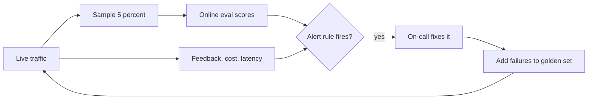

<BigWordAlert term="Online evaluation" plainEnglish="Scoring a sample of real answers in production, every day, with the same kind of checks you run on your golden set before release." whyItMatters="Your golden set only covers the questions you thought of. Online evaluation watches the questions users actually ask, so a quality drop shows up in hours instead of weeks." />

## Green dashboards, bad answers

Go back to the two weeks in chapter 10.1. Uptime was 100%, errors were near zero and latency was normal. Every dashboard Wadi Labs had was green, while the share of unhelpful answers tripled. The dashboards measured whether the service was running. Nothing measured whether it was right.

This chapter adds the missing half. You will set up four kinds of signals for an LLM service, decide which ones deserve an alert, and then learn to tell the story of an incident the way interviewers want to hear it. By the end you can say how you would have caught Wadi Labs' drop on day one, and describe an incident with a clear shape and numbers.

## Four kinds of signals

**Online evaluation.** Each day, take a random sample of real questions and answers, say 5%, and score them. Some checks are cheap and run on every sampled answer: does it cite at least one chunk, are the cited ids real, is it an "I don't know"? Groundedness, whether the answer is supported by the retrieved text, needs an LLM judge like the one in chapter 5.4. At 2,000 questions a day, 5% is 100 judged answers a day, which costs little and gives a daily number you can plot.

**User feedback.** Thumbs up and down are useful but rare: in this example, only about 3% of answers get a vote, and unhappy users vote more often than happy ones. Quieter signals add volume. A user who asks the same question again in different words within 2 minutes probably did not get what they needed. A user who opens a cited runbook probably found the answer useful. A user who gives up and messages a colleague is a clear failure.

**Drift.** <GlossaryTerm term="drift" definition="A slow change in what your system sees or does over time, such as new kinds of questions, new documents or a change in a provider's model, that can lower quality without any code change." /> means the world moved under your system. When Wadi Labs moved to a new deploy tool, engineers began asking questions the runbooks did not cover yet. Two numbers catch this early. The share of "I don't know" answers rises. And the top retrieval score falls, because no chunk matches the new questions well. Grouping the week's questions by topic and comparing with the month before shows which new topic appeared.

**Cost and latency.** Plot p50 and p95 latency per span from your traces, tokens per question, cost per hour and per day, cache hit rate, retry rate and error counts by code. Cost and latency often move first when something changes, such as a prompt that makes answers twice as long, or an agent that calls a tool in a loop.

## From signals to alerts

A dashboard nobody looks at caught nothing in chapter 10.1. An alert sends a message to a person, usually the <GlossaryTerm term="on-call" definition="The engineer responsible, for a set period, for answering alerts and handling incidents, including outside working hours." /> engineer. Make a prediction about how to set one up.

```predict
prompt: "Ahmad wants an alert on groundedness. One alert could fire whenever a single judged answer scores below 0.5. Another could fire when the average over the last 24 hours drops below 0.80, with at least 50 answers judged. Which helps the on-call engineer more?"
options:
  - id: single
    label: "Every single low-scoring answer"
  - id: window
    label: "The 24 hour average with a minimum"
correctOptionId: window
explanation: "Single low scores happen every day, from hard questions or judge mistakes, so an alert on each one fires constantly and people learn to ignore it. A rate over a window with a minimum count moves only when quality really changes."
```

Alerts that fire too often cause <GlossaryTerm term="alert fatigue" definition="When people get so many alerts, most of them unimportant, that they start to ignore or mute them, and then miss the one that matters." />. Good alerts watch a rate over a window, need a minimum number of events, compare with a baseline such as the last 7 days, and name an owner and a first step. This table shows a starting set for the runbook bot, with this example's thresholds.

| Signal | What it catches | Example alert |
|---|---|---|
| Groundedness, online eval | Wrong or unsupported answers | 24 hour mean below 0.80, at least 50 judged |
| "I don't know" share | Missing documents, retrieval breaks | Above 10% over 24 hours, baseline 4% |
| Negative feedback rate | Unhappy users | Above 2 times the 7 day average |
| Cost per hour | Loops, long prompts, traffic spikes | Above 3 times the 7 day average for that hour |
| p95 latency, 504 count | Slow provider, slow retrieval | p95 above 8 s for 15 minutes |

With the first two rows in place, Wadi Labs' quality drop would have fired an alert within a day of the chunker change, not two weeks later.

The diagram shows how the signals connect to the work that follows an alert.



The last arrow is the one teams forget. Every incident should leave new questions in the golden set from module 5, so the regression test fails if the same bug comes back. Monitoring finds problems; the golden set stops them returning.

## Telling an incident story

"Tell me about an incident you handled" is one of the most common questions in the managerial round. Strong answers follow the STAR shape (situation, task, action, result) with numbers, and add two parts interviewers listen for: how it was detected and what changed afterwards. Here is a full example from Wadi Labs, told by Yousef, who was on call.

**What happened.** On a Friday at 17:00 we released prompt version 6 for the bot's tool mode. The new prompt dropped one line telling the agent to stop when the search tool returns "not found". When a runbook did not exist, the agent searched again with slightly different words, until it hit the step limit of 6.

**Impact.** For 1 hour and 50 minutes, about 38% of questions hit the step limit. The p95 latency went from 6 to 21 seconds, and the cost per question went from about 0.4 cents to 2.9 cents. About 240 questions were affected. No wrong action was taken, because the bot's tools were read-only.

**Detection.** At 17:50 the cost per hour alert fired, at more than 3 times the 7 day average for that hour. I was on call. The traces showed the same search tool called 6 times in one request, with "not found" each time.

**Fix.** At 18:40 I rolled back to prompt version 5 by redeploying the previous image tag, and by 18:50 cost and latency were back to normal. On Monday we restored the stop line in version 7 and confirmed the fix on the golden set.

**Prevention.** We added 15 "not found" questions to the golden set. The release check now fails if the average steps per question rise by more than 20%. We lowered the step limit from 6 to 4 and added an alert on average steps per question, which would have fired about 20 minutes earlier than the cost alert.

Notice what makes the story trustworthy. It has times and numbers. It says what the speaker did, not only "we". It names the cause plainly, without blaming a person. And it ends with changes that make the same incident less likely, which is what a hiring manager most wants to hear. In an interview, tell it in about two minutes, then let the interviewer ask for detail.

<Callout type="tip" title="Write your incident notes on the day">
Times, numbers and the order of events fade within a week. Write five lines the day an incident ends: what happened, impact, detection, fix, prevention. That note becomes your interview story later.
</Callout>

## Common mistakes

The first mistake is monitoring only what the platform gives for free, which is uptime, errors and latency, and nothing about quality. The second is an online judge that is never checked. Read 20 judged answers each month and compare the scores with your own judgement, or the judge can drift too. The third is alerts without owners. An alert that goes to a shared channel and to nobody's phone is no better than a dashboard: nobody sees it in time.

```quiz
type: mcq
question: "A week after launch, Reem's bot at Sahel Relief shows normal latency and errors, but the share of 'I don't know' answers has grown from 4% to 12%, and the top retrieval scores have dropped. What is the most likely cause to check first?"
options:
  - "The model provider is slow, so many answers are timing out"
  - "Users are asking about topics the indexed documents do not cover"
  - "The cache is returning old answers for questions it has seen before"
  - "The online judge has drifted and is scoring good answers too low"
correct: 1
explanations:
  - "Timeouts would show up as higher latency and more 504 errors, and both are normal here."
  - "Right. Low top scores mean no chunk matches the questions well, and the bot then says it does not know. That points to new topics the documents miss."
  - "Cached answers would come back fast and with the old wording, not as more 'I don't know' answers with low retrieval scores."
  - "The judge does not affect the 'I don't know' rate or the retrieval scores, which come straight from the service."
```

## In the interview

Monitoring and incident questions are the core of the managerial round for AI engineers. Interviewers ask how you knew the system worked after launch, what alerted you, and what you changed after a failure. Answer aloud first, then open each question.

<FaqGroup title="Practice questions">
<FaqItem question="How do you monitor the quality of an LLM system in production?">

I combine four kinds of signals. Online evaluation scores a daily sample, for example 5% of answers, with cheap checks such as valid citations and an LLM judge for groundedness. User feedback adds explicit votes and implicit signals such as rephrasing within two minutes. Drift signals, such as the "I don't know" rate and the top retrieval score, show new topics the documents miss. Cost and latency per step come from traces. Each key signal has an alert on a rate over a window, with an owner, and every incident adds questions to the golden set.

**Follow-up probes:**

- How do you know your online judge is still accurate?
- What sample size do you need for a daily quality number to be stable?

</FaqItem>
<FaqItem question="Tell me about an incident you were involved in.">

Use your own incident, in this shape. What happened: one or two sentences with the change or event that started it. Impact: how long, how many users or requests, and the effect in numbers. Detection: what alerted you, when, and how long after the start. Fix: what you did, when, and how you confirmed it worked. Prevention: what changed so it is less likely to happen again, such as a new test, a new alert or a lower limit. Keep it to about two minutes, say what you did yourself, and describe the cause without blaming a person.

**Follow-up probes:**

- What would you do differently if it happened again tomorrow?
- How long did detection take, and how could it have been faster?

</FaqItem>
<FaqItem question="How do you avoid alert fatigue on an LLM service?">

I alert on rates over a window instead of single events, with a minimum number of events so a quiet night does not fire on two bad answers. I compare with a baseline, such as the same hour over the last 7 days, instead of fixed numbers that ignore normal daily patterns. Every alert has an owner and a first step written down. Anything that fires often and leads to no action is fixed or removed within a week, because one noisy alert teaches people to ignore all of them.

**Follow-up probes:**

- Which signals would you show on a dashboard but never alert on?
- How would you test that an alert fires when it should?

</FaqItem>
</FaqGroup>

**Next:** A graded quiz with production scenarios: tracking, tracing, deployment and monitoring.
