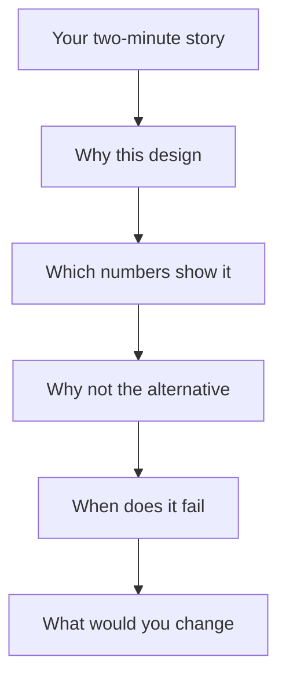

## "It is the standard size"

Karim built a question-answering assistant over his faculty's exam regulations: a 120-page PDF and 30 short FAQ pages. It worked, his friends used it, and he put it first on his CV. In his first real deep dive, the interviewer asked, "Why did you choose 300-token chunks?" Karim said, "It is the standard size." The interviewer asked, "Standard for what?" Karim had no second answer, and the next ten minutes felt like a slow fall.

Karim did choose 300 tokens for a reason. He had tried 150 and 600 on a few questions and 300 found more right answers. He simply had not prepared to say it. The deep dive does not test whether your project is impressive. It tests whether you made decisions and can show how you checked them.

By the end of this chapter you can answer a deep-dive probe with a decision, a number, a trade-off and an honest limit, and you have a one-page fact sheet for your own project. All numbers in Karim's story are his project's own numbers, used as an example.

## How the deep dive works

<BigWordAlert term="Project deep dive" plainEnglish="An interview round where the interviewer picks one project you built and asks why, how and what if, step by step, until they find the limit of your understanding." whyItMatters="It is the round where real experience shows. A small project you can defend with numbers beats a large one you can only describe." />

The interviewer usually starts with "Tell me about a project you are proud of." You give the two-minute story from chapter 1.3. Then they pick one part of it, often the part that sounds most interesting or most vague, and go down. Each answer opens the next question.

The diagram shows the usual ladder. Read it from the top: each step is a probe the interviewer can ask about the step above.



The ladder has two lessons. First, every step below the story needs evidence, so a project with no numbers stops at step B. Second, the interviewer will keep going until you reach a step you cannot answer. That is expected and fine. What they score is how you behave at that edge: do you guess, or do you say what you know and how you would find out?

## The answer shape: decision, evidence, trade-off, limit

Use the same four parts for almost every probe in this round. Each part is one or two sentences, so a full answer takes 45 to 90 seconds.

1. **Decision.** Say what you chose in the first sentence. "I used hybrid search: BM25 plus vectors, merged with rank fusion."
2. **Evidence.** Give the number that made you choose it, and how you measured it. "On my 40-question golden set, recall@5 went from 0.70 to 0.85."
3. **Trade-off.** Name what it cost or the option you rejected. "It added about 15 milliseconds and a second index to keep in sync."
4. **Limit.** Say where it still fails or what you did not test. "It still misses questions whose answer is in a grade table."

The order matters. An interviewer who hears the decision first can follow the rest. If you start with background, they wait, and the clock runs. The limit is not a weakness. It shows you looked for failure, and it often chooses the next probe for you, which means you steer the interview toward something you know.

## Worked example: "Why hybrid search?"

Here is Karim's first answer to "Why did you add keyword search?", before practice:

> "Vector search is good, but it is not perfect, so many people use hybrid search now. It combines the strengths of both. I read that it improves results, so I added it, and it worked better."

There is no decision detail, no number, no cost and no limit. "It worked better" invites the probe "How do you know?", and Karim has to start again.

Here is his answer after a week of practice:

> "I added BM25 next to the vector search and merged the two lists with reciprocal rank fusion. I added it because students search with course codes like CS-341, and the embeddings treated those codes as noise. On my 40-question golden set, vector search alone had recall@5 of 0.70. With hybrid it was 0.85, and every one of the six recovered questions contained a code or a rule number. The cost was a second index and about 15 milliseconds per query. It did not fix questions about the grade boundary table. Those still fail, and that is my next change."

It is about 100 words and 45 seconds. Each sentence does one job. Notice how the last line hands the interviewer the next probe. If they follow it, Karim talks about table indexing from chapter 4.4, which he prepared.

## Prepare a one-page fact sheet

Before any interview, write one page of numbers about your project and read it the night before. You will not read it during the call, but writing it forces you to find the gaps. Include speed as <GlossaryTerm term="p95 latency" definition="The time within which 95 out of 100 requests finish. It shows the slow cases that an average hides." />, not only the average. Karim's sheet had these lines:

| Fact | Karim's number |
|---|---|
| Documents and chunks | 150 pages, about 1,100 chunks |
| Chunk size and overlap | 300 tokens, 50 overlap |
| Golden set | 40 questions, 4 with no answer |
| Retrieval quality | recall@5 0.85, MRR 0.74 |
| Speed | p95 latency 2.4 seconds |
| Prompt size | about 1,500 input tokens per question |
| One failure | grade table questions |
| One change | index tables as rows with headers |

If a line is empty, you have two choices. Measure it this week with your module 5 tools, or prepare an honest sentence: "I did not measure latency under load. I would run 50 concurrent requests against the service and record p50 and p95." Both are fine. Inventing a number is not. Interviewers often ask how you measured it, and a made-up number falls apart in one probe.

Also prepare one <GlossaryTerm term="ablation" definition="A test where you remove or switch off one part of a system and measure how much quality changes, to show what that part contributes." />. "Without the reranker, MRR drops from 0.74 to 0.58" is the strongest kind of evidence, because it proves a part earns its cost.

```quiz
type: mcq
question: "In a deep dive, the interviewer asks Sara, 'What was your recall@5?' She never built a golden set. She checked 15 questions by hand and the right chunk was in the top five for 12 of them. Which answer is strongest?"
options:
  - "About 0.9, I think, because it answered almost every question I tried during development."
  - "I did not build a golden set. In a hand check, 12 of 15 questions found the right chunk."
  - "Recall is not very important for my use case, because the model fixes most retrieval mistakes."
  - "I am not sure about the exact number, but users told me that the answers were very helpful."
correct: 1
explanations:
  - "This is a guess presented as a number. The first follow-up probe ('How did you measure it?') breaks it."
  - "Right. It is honest, it gives the real evidence she has, and it invites the next probe about how she would measure properly."
  - "A model cannot use a chunk that was never retrieved, so this claim is wrong and signals weak understanding of RAG."
  - "User praise is not a retrieval metric, and the answer avoids the question instead of giving the evidence she has."
```

## When you reach the edge

Every deep dive reaches a question you cannot fully answer. Use three moves. Say what you do know. Reason aloud from it. Say how you would find out. For example: "I did not test with Arabic questions. Our embedder was trained mostly on English, so I expect recall to drop. I would add 20 Arabic questions to the golden set and compare."

This answer scores well because it shows the habit the job needs. Saying "I don't know" and stopping scores low. Bluffing scores lowest, because the interviewer usually knows the answer.

<Callout type="warning" title="Do not claim the team's work as yours">
Interviewers often ask, "Which part did you build yourself?" Say "I" for your work and "we" for the team's. If a teammate chose the vector database, say so, and explain what you would check before keeping it.
</Callout>

## Common mistakes in this round

- **Background first.** Three sentences about RAG before the decision. Start with what you chose.
- **No numbers.** "It was faster" instead of "p95 went from 4.1 to 2.4 seconds".
- **A tour of every tool.** Naming ten libraries tells the interviewer nothing about your choices.
- **No limit.** "It works well" sounds like you never looked for failure.
- **Defending a bad choice.** If a probe shows a real weakness, agree, and say what you would do now.

## How to practise this round

Alone: write your fact sheet first (30 minutes, once). Then pick two bank questions a day. Start a 90-second timer, answer aloud, and record it. Open the model answer, score your four parts, and answer once more. Then answer both probes, 60 seconds each.

With a partner: give them your two-minute story and your fact sheet. They choose one part and walk down the ladder for 10 minutes, asking at least four probes. Swap roles. Once a week, run a full 30-minute deep dive: the story, then 25 minutes of probes, then five minutes of feedback.

## In the interview

This round usually comes first and sets the tone for the rest of the loop. The questions below are written for a RAG project, because that is the most common project fellows bring. Answer each one aloud about your own project first, then open the item and compare the shape, not the words. The model answers use Karim's fictional exam-regulations assistant.

<FaqGroup title="Practice questions">
<FaqItem question="Walk me through what happens when a student asks your system a question.">

A question first goes through a small router: greetings and very short questions get a direct reply with no retrieval. Everything else is embedded and searched with BM25 and vectors, the two lists are fused, and a reranker reorders the top 20. The top 5 chunks go into the prompt with their ids, and the model must cite ids in brackets. If no chunk scores above a threshold, the system says it does not know instead of calling the model. End to end, p95 is 2.4 seconds, and most of that is the model call.

**Follow-up probes:**

- Which step would you remove first if latency had to halve?
- Why route short questions away from retrieval at all?

</FaqItem>
<FaqItem question="How did you choose your chunk size and overlap?">

I chose 300 tokens with a 50-token overlap. I tested 150, 300 and 600 on my golden set. 150 split rules from their exceptions and recall@5 was 0.71; 600 retrieved the right section but filled the prompt, and the model missed the exact rule; 300 gave 0.85. The overlap protects rules that cross a chunk border. The cost is about 20 percent more chunks to store and embed, which is small at 1,100 chunks.

**Follow-up probes:**

- Would you use the same size for the FAQ pages as for the regulations?
- What would you measure first if a new document type arrived?

</FaqItem>
<FaqItem question="Why did you add a reranker, and what did it cost?">

Hybrid search found the right chunk, but often at rank 4 or 5, and the model sometimes trusted rank 1. I added a cross-encoder reranker over the top 20. MRR went from 0.58 to 0.74 on the golden set. It adds about 120 milliseconds on a CPU, which is acceptable inside a 2.4 second budget. I rerank only 20 because the cost grows with every candidate, and recall@20 was already 0.95, so a longer list gave almost nothing.

**Follow-up probes:**

- What would you do if the reranker made p95 too slow?
- How would you know if the reranker made some answers worse?

</FaqItem>
<FaqItem question="How do you know your retrieval is good?">

I built a golden set of 40 real student questions, each labelled with the chunk ids that answer it, including 4 questions with no answer in the documents. I measure recall@5 and MRR on every change: today they are 0.85 and 0.74. The eval runs as a pytest test that fails if recall@5 drops below 0.80. The limit is size: 40 questions means one question moves recall by more than two points, so I treat small changes as noise.

**Follow-up probes:**

- How did you choose the 40 questions, and who labelled them?
- Your recall is high but students still complain. What do you check next?

</FaqItem>
<FaqItem question="A student asks a question whose answer is inside a table. What does your system do?">

Today it often fails. The PDF tables were flattened into text, so a row like a grade boundary lost its column headers, and the chunk no longer says what each number means. My fix is to extract tables separately and index each row as a sentence with its headers, for example "Grade B: 70 to 79 percent". I would add 8 table questions to the golden set to measure it. I did not consider Graph RAG here, because my questions are lookups, not relationships between many entities.

**Follow-up probes:**

- When would a graph actually help a document assistant like this?
- How would you keep row chunks in sync when the table changes?

</FaqItem>
<FaqItem question="Some questions need two documents. Can your system answer them?">

Partly. "Can I resit an exam I missed for medical reasons?" needs the resit rule and the medical evidence rule, which live in different sections. With one search, recall@5 for my 6 two-part questions was only 0.50. I added a query rewriting step that splits such a question into two sub-questions and searches each, which raised it to 0.83 on those 6. The cost is one extra small-model call, so I only split when a cheap check sees two conditions in the question.

**Follow-up probes:**

- How does the system decide that a question has two parts?
- What happens when the split is wrong?

</FaqItem>
<FaqItem question="Why did you use RAG instead of fine-tuning a model on the regulations?">

The regulations change every year, and students need the exact rule with a citation. RAG lets me update the index in minutes and show the source paragraph. Fine-tuning teaches style and format well, but it does not reliably store exact facts, and it gives no citation. I would consider fine-tuning only for behaviour, for example if a small model kept ignoring the citation format after prompt fixes.

**Follow-up probes:**

- What would make you combine RAG and fine-tuning?
- How would you update the system when next year's regulations arrive?

</FaqItem>
<FaqItem question="If you had one more month, what would you change?">

I would fix tables first, because grade boundary questions are my largest group of failures: 5 of my 9 failed golden questions. Second, I would grow the golden set from 40 to 100 questions so that small changes become measurable. I would not add an agent: students only ask questions, and nothing in the system needs to take actions. That keeps it cheaper and easier to test.

**Follow-up probes:**

- Why tables before a larger golden set, and not the other way round?
- What would make you add an agent later?

</FaqItem>
</FaqGroup>

**Next:** Round two, hands-on coding: how to think aloud through a practical task.
