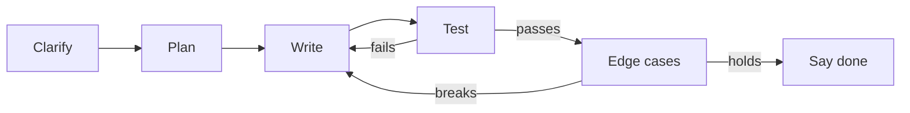

## Twelve silent minutes

Sara's hands-on round started well. The interviewer shared an editor and said, "Write a function that calls the model for a list of prompts, but never more than three at a time." Sara knew this from chapter 9.2. She started typing at once and did not speak for twelve minutes.

When she stopped, the code had a bug: she created the semaphore inside the function that each task ran, so every task had its own semaphore and the limit did nothing. She had no test, so she did not see it. The interviewer had watched twelve minutes of typing with no idea what she was thinking, and her score for communication was the lowest on the sheet.

Sara knew the concept. She lost points on process. By the end of this chapter you can run a five-step routine for a practical coding task, think aloud while you do it, and test your own code before you say "done".

## What this round tests

In AI engineering loops, the hands-on round is rarely a puzzle about trees or graphs. It is usually a small piece of real work: a metric, a retry helper, a concurrency limit, a validator for a tool call, a small endpoint. You get 30 to 45 minutes, a shared editor or a screen share, and often a follow-up extension if you finish early.

The interviewer scores four things, roughly equally: did you understand the task, does the code work, did you test it, and could they follow your thinking. That last one surprises people. A correct solution written in silence can score lower than a nearly correct one where the interviewer saw clear reasoning and a test that caught the bug.

<BigWordAlert term="Thinking aloud" plainEnglish="Saying what you are doing and why while you code: what you assume, what you are about to write, and what you expect to happen." whyItMatters="The interviewer cannot score reasoning they cannot hear. Thinking aloud also lets them give you a hint before you go far in the wrong direction." />

## The routine: clarify, plan, write, test, edge cases

Use the same five steps for every task. The times below are for a 30-minute task; scale them for longer ones.

1. **Clarify (2 to 4 minutes).** Repeat the task in your own words. Ask about inputs, outputs and the cases you are unsure of. "Is rank one-indexed? What should happen if the list is empty?"
2. **Plan (2 to 3 minutes).** Say the approach in two or three sentences before you type. Name the function signature. Write one example input and the output you expect.
3. **Write (12 to 18 minutes).** Write the simplest correct version first. Say what each block does as you write it. Use clear names.
4. **Test (3 to 5 minutes).** Run your example. If you cannot run code, trace it by hand, line by line, out loud.
5. **Edge cases (3 to 5 minutes).** Check each <GlossaryTerm term="edge case" definition="An unusual input at the boundary of what the code expects, such as an empty list, a zero, or a value at the maximum, where bugs often hide." />: empty input, zero, very large input, wrong types, duplicates. Fix what breaks, or say how you would.

The diagram shows the loop that matters most: a failing test sends you back to writing, not to "done".



The takeaway: "done" is something your tests say, not something you feel. Interviewers notice candidates who test without being asked, because that is what they will do on the job.

## Worked example: "Compute MRR for these runs"

Sara's second mock used a task from the module 5 material. The interviewer pasted three runs: for each question, the list of chunk ids the retriever returned, and the set of ids that are relevant. "Compute the mean reciprocal rank."

**Clarify.** Sara said: "So for each run I find the first relevant chunk in the list, take one over its rank, and average over runs. Is rank one-indexed, so the first item is rank 1? Can a run have several relevant chunks? I assume only the first one counts. And what should I return for an empty list of runs?" The interviewer said yes, yes, and "your choice, but say it".

**Plan.** "Two functions. `reciprocal_rank` walks the list with `enumerate` starting at 1 and returns 1 over the first rank that hits. `mean_reciprocal_rank` averages them. For an empty list of runs I will raise a `ValueError`, because an average of nothing has no meaning and silently returning 0 would hide a bug in the caller. My example: hits at rank 1, rank 3 and none should give one third of 1 plus a third plus 0, which is about 0.444."

Before you read her code, decide one detail yourself.

```predict
prompt: "In Sara's third run, none of the returned chunks is relevant. How should that run count towards MRR?"
options:
  - id: drop
    label: "It is left out of the average, since there is no rank to divide by"
  - id: zero
    label: "It counts as a reciprocal rank of 0, and it stays in the average"
correctOptionId: zero
explanation: "Reciprocal rank is defined as 0 when no relevant item is returned. Dropping the run would hide retrieval failures and make the system look better than it is."
```

**Write.** Sara talked through each line as she typed:

```python
def reciprocal_rank(retrieved: list[str], relevant: set[str]) -> float:
    for rank, chunk_id in enumerate(retrieved, start=1):
        if chunk_id in relevant:
            return 1.0 / rank
    return 0.0


def mean_reciprocal_rank(runs: list[tuple[list[str], set[str]]]) -> float:
    if not runs:
        raise ValueError("no runs to score")
    return sum(reciprocal_rank(r, rel) for r, rel in runs) / len(runs)


runs = [
    (["a", "b", "c"], {"a"}),        # first hit at rank 1
    (["d", "e", "f"], {"f", "x"}),   # first hit at rank 3
    (["g", "h", "i"], {"z"}),        # no hit
]
print(round(mean_reciprocal_rank(runs), 3))  # 0.444
```

**Test.** She ran it and it printed `0.444`, the number she predicted in her plan. Predicting first is what makes the test meaningful: a number you only see afterwards is easy to accept.

**Edge cases.** She listed them aloud: an empty `retrieved` list returns 0 (correct by definition); an empty `relevant` set also returns 0, which she flagged as a question for the data, not the code; duplicate ids do not matter because the function returns at the first hit; an empty list of runs raises. The whole answer took 19 minutes. With the time left, the interviewer asked for recall@k, and she reused the same routine.

## Common mistakes in this round

- **Typing before clarifying.** You solve a slightly different problem and lose ten minutes.
- **Silence.** Even while stuck, say what you are trying: "I am checking whether the semaphore is shared."
- **The clever version first.** Write the plain version that works, then improve it if there is time.
- **No test.** "I think it works" is not evidence. Run it, or trace it by hand.
- **Ignoring the error path.** In AI code, the failure path is often the whole point: what happens when the provider times out or the model returns bad JSON?

<Callout type="tip" title="If you get stuck">
Say exactly where you are stuck and offer a simpler version: "I will write it without jitter first, then add jitter." Interviewers often help a candidate who shows a clear partial plan.
</Callout>

## How to practise this round

Practise in a plain editor without autocomplete, because many interview editors have none. Set a 30-minute timer for each task. Record your voice while you code, then listen to the first five minutes: did you clarify and plan out loud before typing?

Alone, take a task from the bank below, close the model answer, and write your solution on your laptop. Run it with the Python version from your build chapters. Then compare. Do one task a day.

With a partner, the interviewer reads the task aloud and answers clarifying questions, but only if asked. They watch your screen over a call, or you paste the code into a chat every five minutes if the connection is weak. At the end, they give one comment on the code and one on your talking.

## In the interview

These tasks are common in AI engineering hands-on rounds because they come straight from service work. Each model answer is a short solution that runs on Python 3.11 or later; all were run before publishing. Write your own version first, out loud and timed, then open the item.

<FaqGroup title="Practice questions">
<FaqItem question="Write a retry decorator with exponential backoff for a flaky model call.">

Retry only failures that a second try can fix, back off exponentially with jitter, and re-raise after the last attempt. The delay doubles each time up to a cap, and full jitter picks a random wait so many clients do not retry at the same moment.

```python
import random
import time
from functools import wraps


class TransientError(Exception):
    """A failure worth retrying, such as a timeout or a 503."""


def retry(attempts=3, base_delay=0.1, max_delay=2.0, retry_on=(TransientError,)):
    if attempts < 1:
        raise ValueError("attempts must be at least 1")

    def decorator(func):
        @wraps(func)
        def wrapper(*args, **kwargs):
            for attempt in range(1, attempts + 1):
                try:
                    return func(*args, **kwargs)
                except retry_on:
                    if attempt == attempts:
                        raise
                    delay = min(max_delay, base_delay * 2 ** (attempt - 1))
                    time.sleep(random.uniform(0, delay))  # full jitter
        return wrapper
    return decorator
```

In the check run, a function that failed twice with `TransientError` returned on the third call, and a function raising `ValueError` was called once, not three times. A validation error will fail the same way every time, so retrying it only adds load.

**Follow-up probes:**

- How would you make this work for an `async` function?
- How do you stop retries from blowing a 2-second request budget?

</FaqItem>
<FaqItem question="We call the model for 10 prompts. Limit it to 3 calls at a time.">

Create one `asyncio.Semaphore` shared by all tasks, acquire it around the model call, and gather the tasks. The counter here proves the limit: it records the highest number of calls running at once.

```python
import asyncio


async def call_model(prompt: str, state: dict) -> str:
    state["active"] += 1
    state["peak"] = max(state["peak"], state["active"])
    await asyncio.sleep(0.05)  # stands in for a slow provider
    state["active"] -= 1
    return f"answer to {prompt}"


async def answer_all(prompts: list[str], limit: int = 3):
    sem = asyncio.Semaphore(limit)
    state = {"active": 0, "peak": 0}

    async def one(prompt: str) -> str:
        async with sem:
            return await call_model(prompt, state)

    results = await asyncio.gather(*(one(p) for p in prompts))
    return results, state["peak"]


results, peak = asyncio.run(answer_all([f"q{i}" for i in range(10)]))
print(len(results), peak)  # 10 3
```

The common bug is creating the semaphore inside `one`, which gives each task its own limit. `gather` returns results in the order of the prompts, not the order they finished.

**Follow-up probes:**

- What happens to the other calls if one raises an exception?
- Where would this semaphore live in a FastAPI service?

</FaqItem>
<FaqItem question="The model returned a refund tool call as JSON. Validate it before running the tool.">

Define the arguments as a Pydantic model with tight types, forbid extra fields, and turn a validation error into a short message the agent can show the model so it can try again.

```python
from typing import Literal

from pydantic import BaseModel, ConfigDict, Field, ValidationError


class RefundArgs(BaseModel):
    model_config = ConfigDict(extra="forbid")
    order_id: str = Field(pattern=r"^\d{4,8}$")
    amount: float = Field(gt=0, le=500)
    reason: Literal["damaged", "late", "wrong_item"]


def parse_tool_call(raw_json: str) -> RefundArgs | str:
    try:
        return RefundArgs.model_validate_json(raw_json)
    except ValidationError as err:
        first = err.errors()[0]
        field = ".".join(str(part) for part in first["loc"])
        return f"Invalid refund arguments: {field}: {first['msg']}"
```

A negative amount returned `Invalid refund arguments: amount: Input should be greater than 0`, and an unexpected `admin` field returned `Extra inputs are not permitted`. Validation checks shape, not permission: a valid refund still needs the approval step from chapter 7.4.

**Follow-up probes:**

- Pydantic accepts the string "19.5" for a float by default. When would you turn on strict mode?
- How many times would you let the model retry a bad call?

</FaqItem>
<FaqItem question="Add a timeout to a model call and return a friendly fallback.">

Wrap the call in `asyncio.timeout`, which Python added in 3.11, and catch `TimeoutError`. The slow call is cancelled when the budget runs out, so it stops using a connection.

```python
import asyncio


async def slow_model(prompt: str) -> str:
    await asyncio.sleep(5)  # a provider having a bad day
    return "late answer"


async def answer_with_budget(prompt: str, budget_s: float = 0.2) -> str:
    try:
        async with asyncio.timeout(budget_s):  # Python 3.11 or later
            return await slow_model(prompt)
    except TimeoutError:
        return "The assistant is busy. Please try again in a minute."


print(asyncio.run(answer_with_budget("Where is order 1042?")))
```

It prints the fallback after 0.2 seconds instead of waiting 5. On older Python, `asyncio.wait_for` does the same job. In a real service, a timeout should become a 504 with a structured error, not a fake answer, as in chapter 9.6.

**Follow-up probes:**

- How would you combine this timeout with retries inside one total budget?
- Should a timed-out request be counted in your error rate?

</FaqItem>
<FaqItem question="Merge a keyword result list and a vector result list with reciprocal rank fusion.">

Each list adds 1 divided by (60 plus the rank) to a document's score, and documents are sorted by the total. Ties are broken by id so the output is stable in tests.

```python
def rrf(ranked_lists: list[list[str]], k: int = 60) -> list[str]:
    scores: dict[str, float] = {}
    for ranked in ranked_lists:
        for rank, doc_id in enumerate(ranked, start=1):
            scores[doc_id] = scores.get(doc_id, 0.0) + 1.0 / (k + rank)
    return sorted(scores, key=lambda d: (-scores[d], d))


keyword = ["returns#2", "shipping#0", "returns#0"]
vector = ["returns#0", "returns#2", "accounts#1"]
print(rrf([keyword, vector]))
```

It prints `['returns#2', 'returns#0', 'shipping#0', 'accounts#1']`: the two chunks found by both lists rise to the top. Fusion uses ranks, not raw scores, so BM25 scores and cosine scores never need to be on the same scale.

**Follow-up probes:**

- Why is 60 a common value for k, and what happens if k is 1?
- When would you weight one list more than the other?

</FaqItem>
<FaqItem question="Write a FastAPI endpoint that validates a question and a top_k value.">

Put the limits in Pydantic models, so FastAPI rejects bad input with a 422 before your code runs, and declare the response model so the output shape is checked too.

```python
from fastapi import FastAPI
from fastapi.testclient import TestClient
from pydantic import BaseModel, Field

app = FastAPI()


class AskRequest(BaseModel):
    question: str = Field(min_length=1, max_length=500)
    top_k: int = Field(default=3, ge=1, le=10)


class AskResponse(BaseModel):
    answer: str
    citations: list[str]


@app.post("/ask", response_model=AskResponse)
async def ask(req: AskRequest) -> AskResponse:
    return AskResponse(answer=f"echo: {req.question}", citations=[])


client = TestClient(app)
print(client.post("/ask", json={"question": "", "top_k": 2}).status_code)  # 422
```

An empty question and a `top_k` of 50 both returned 422; a valid request returned 200. Say aloud that a real version would return your own structured error body and call the model through the retry and semaphore code.

**Follow-up probes:**

- How would you change the 422 body into your own error format?
- Why is `max_length=500` a cost control, not only a validation rule?

</FaqItem>
</FaqGroup>

**Next:** Round two, AI system design: a seven-step answer for a 40-minute design question.
