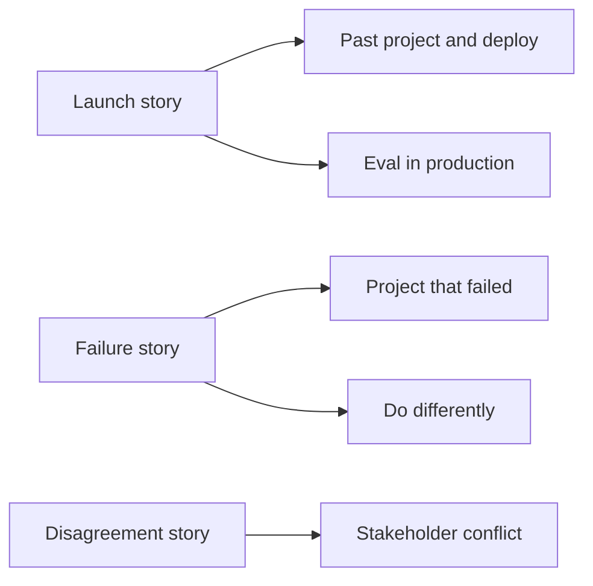

## "It was not really my fault"

Nour reached the last round of a loop for a remote LLM engineer role. The hiring manager asked, "Tell me about a project that did not go well." Nour told a story about an FAQ assistant that gave wrong answers after launch. She explained that the product team changed the prices without telling her, the documents were messy, and the deadline was short. All true. The manager asked, "What would you do differently?" Nour said, "Ask the product team to tell me about changes."

The manager's notes said: no ownership, no numbers, no change in her own process. The story was a good one. The way she told it made her sound like a passenger. By the end of this chapter you can tell a project story that owns your part, carries a number and ends with what you changed, and you have a small bank of stories that cover most managerial questions.

## What this round tests

The managerial round is usually with an engineering manager or a team lead, for 30 to 45 minutes. The questions sound soft, but they are testing hard things: do you take ownership, can you work with people who are not engineers, and do you understand life after launch, where most of the real work in AI systems happens. A manager is asking one question underneath all the others: "If I give this person a problem, will it get solved, and will I hear about it early if it does not?"

For AI roles, this round has a technical edge. Expect "How did you deploy it?", "How did you know it still worked a month later?" and "Tell me about an incident". Those come straight from modules 5 and 10.

## The answer shape: STAR plus reflection

Use one shape for every story question. It keeps you short and makes sure the parts a manager scores are always there.

<BigWordAlert term="STAR answer" plainEnglish="A short story in four parts: the Situation, the Task you owned, the Actions you took, and the Result, ideally with a number." whyItMatters="Managers hear many stories in a day. A fixed shape makes yours easy to follow and easy to score, and it stops you from talking for six minutes." />

This course adds a fifth part, **Reflection**: what you learned and what you now do differently. The full answer takes about two minutes:

1. **Situation (2 sentences).** Where, when, and what was at stake. Name the users and the size.
2. **Task (1 sentence).** What you personally owned. Use "I".
3. **Action (3 to 5 sentences).** What you did, in order, with your reasons. This is the longest part.
4. **Result (1 or 2 sentences).** What happened, with a number: a metric, a time, a count.
5. **Reflection (1 or 2 sentences).** What you changed in how you work, not only in the project.

Most weak answers have a long Situation and no Result. Managers forgive a story that did not end well. They do not forgive a story with no lesson.

## Build a story bank

You will not invent good stories under pressure, so prepare four or five before any loop. One story can answer several questions, which is why a small bank is enough. The diagram shows how three stories cover the common managerial questions.



The takeaway: you need depth in a few stories, not a story for every question. For each one, write the five STAR plus reflection parts in bullet points, with the numbers, on one page. Fellows' stories can come from a job, an internship, freelance work, a university project, or the capstone you will build in module 12. A project you built alone is fine if you can defend it.

## Worked example: the failure story

Here is Nour's failure story, rewritten after practice. Tala Learning is a fictional online tutoring platform where Nour worked part time.

> **Situation.** At Tala Learning I built an FAQ assistant for parents. It answered about 200 questions a day from 25 help pages, including the price list.
>
> **Task.** I owned the assistant end to end, including how the documents got into the index.
>
> **Action.** Two months after launch, prices changed. I had built the index once by hand and never re-indexed, so for nine days the assistant quoted old prices. A parent complained, and I traced it the same day. I re-indexed, then fixed the cause: the help pages now trigger a re-index when they change. I also wrote 30 golden questions, six of them about prices, and made them a test that runs before every deploy.
>
> **Result.** In those nine days, 41 of about 1,800 answers had a wrong price; support refunded the difference for 6 families. In the next three months we had no stale-answer incidents, and the price questions caught one broken re-index before release.
>
> **Reflection.** I now treat "how does the data stay fresh?" as a design question on day one, and I do not launch without a small golden set.

Notice what changed. The cause is her own design choice, said plainly. The product team is not blamed. The numbers show the size of the damage honestly, and the reflection is a change in her process, not a promise to try harder. It is about 220 words, under two minutes spoken.

## Questions about production

Managers in AI teams almost always ask how you know a system still works after launch. Answer with what you watch, how often, and what happens when a signal moves. A strong answer names three layers: traces for every request, so one bad answer can be found and replayed; dashboards for latency, cost and error rate; and a regular quality check on real traffic, because offline golden sets do not contain next month's questions.

```quiz
type: mcq
question: "A manager asks Ahmad: 'Your assistant passed all its evals at launch. How would you know if answer quality dropped a month later?' Which answer is strongest?"
options:
  - "Users would tell us. We added a feedback button, and support forwards complaints to me."
  - "We re-run the launch golden set every night, and it still passes, so quality is the same."
  - "A judge model scores every answer, and we trust its score because it is a large model."
  - "We score a weekly sample of real answers and add each failure to the golden set."
correct: 3
explanations:
  - "Complaints are a late and partial signal. Most users who get a wrong answer leave without saying anything."
  - "The launch golden set does not contain new kinds of questions or document changes, so it can pass while real traffic fails."
  - "A judge model has its own biases and must be checked against human labels first. Being large does not make it calibrated."
  - "Right. Sampling real traffic catches new failure types, and turning them into golden questions makes the regression test stronger over time."
```

## Remote work questions

Remote-first teams also ask how you work when nobody can see you. Be concrete and honest. Say how you write updates, how you handle time zones, and what you do when you are blocked. If your power or internet is unreliable, you do not have to hide it. Say what your plan is, for example a backup connection, a power bank, and written handovers so an outage never blocks the team. A clear plan reads as reliability.

## Common mistakes in this round

- **Blaming others.** Even when others were involved, tell the part you owned and what you changed.
- **The fake failure.** "My weakness is that I work too hard" tells the manager you will hide problems.
- **"We" for everything.** The manager is hiring you. Say "I" for your actions.
- **No result.** A story that ends at the action leaves the manager guessing.
- **No questions at the end.** It can sound like you do not care where you work.

<Callout type="info" title="Keep private details out">
Change client names and leave out personal data in your stories, as in "a tutoring platform" or "Client A". Managers notice, and it tells them you will protect their data too.
</Callout>

## How to practise this round

First, write your story bank: one page per story, five parts, with numbers (45 minutes, once). Then practise one story a day aloud with a two-minute timer. Record it, listen back, and check the parts. Most people find their Situation is too long and their Result is missing a number.

With a partner, they play the manager. They pick a question from the bank below, and after your answer they ask two probes: "What exactly was your part?" and "What would you do differently?" Swap roles. Once before your real loop, do a 30-minute mock with five questions in a row and two questions you ask them at the end.

## In the interview

The questions below are the common ones in this round for AI engineering roles. Answer each aloud with a story from your own bank first, then open the item. The model answers use fictional projects and fictional numbers.

<FaqGroup title="Practice questions">
<FaqItem question="Tell me about a project you shipped. What was your part?">

At a fictional logistics startup I built a document assistant that answered drivers' questions about delivery rules from 60 pages of procedures. I owned retrieval, the evaluation and the API; a teammate built the mobile screen. I chose hybrid search because drivers type depot codes, and I built a 50-question golden set before launch. It reached recall@5 of 0.88, handled about 300 questions a day, and cut calls to the dispatch desk by about a quarter in the first month. If I did it again, I would log the questions it could not answer from day one, because they were our best source of new golden questions.

**Follow-up probes:**

- How did you measure the drop in calls, and what else could explain it?
- What was the hardest decision you made alone?

</FaqItem>
<FaqItem question="Tell me about a project that failed.">

I built a ticket classifier for a small support team that was meant to route 80 percent of tickets automatically. I tuned prompts for two weeks on 40 examples and it looked good, but in the first week live it routed only 55 percent correctly. My mistake was a test set that was too small and too clean: it had no tickets with two problems in one message. I stopped the rollout, collected 300 real tickets, and found that a simpler rule for the top three categories plus the model for the rest reached 78 percent. I now build the test set from real traffic before I tune anything.

**Follow-up probes:**

- Why did you stop the rollout instead of fixing it live?
- How did you explain the delay to the support lead?

</FaqItem>
<FaqItem question="How did you deploy it, and how did you release changes safely?">

The service ran in a container with two replicas, and every change went through CI, where unit tests and the regression eval had to pass. Prompt and model changes were treated like code: versioned in the repository, with the eval scores logged in MLflow so we could compare runs. New versions went to 10 percent of traffic for a day while we watched error rate, latency and the flag rate. One release raised p95 from 2 to 5 seconds on that 10 percent, and we rolled back in minutes.

**Follow-up probes:**

- What exactly did you log in MLflow for each run?
- How did you decide that 10 percent and one day were enough?

</FaqItem>
<FaqItem question="How do you evaluate quality in production, after launch?">

In three layers. Every request has a trace with spans for retrieval, reranking and the model call, including the chunk ids and token counts, so one bad answer can be replayed. Dashboards track p95 latency, cost per 1,000 questions, error rate and the share of "I don't know" answers. Each week we score 50 sampled answers for faithfulness: a judge model scores them first, and a person checks 15 of them, because judges prefer longer answers and can miss subtle errors. Failures become new golden questions.

**Follow-up probes:**

- How did you check that the judge agreed with humans?
- What would you do if the "I don't know" rate doubled overnight?

</FaqItem>
<FaqItem question="Tell me about a time you disagreed with a stakeholder.">

A product manager wanted the assistant to answer every question, with no "I don't know" replies, because they looked bad in demos. I disagreed because guessing meant wrong policy answers. Instead of arguing in general, I ran our 60 golden questions both ways: forcing an answer turned 7 "I don't know" replies into 7 answers, and 5 of them were wrong. I showed the 5 examples, and we agreed on a middle path: the assistant says what it could not find and links the closest document. The PM presented that version, and complaints about unhelpful answers fell.

**Follow-up probes:**

- What would you have done if the PM still disagreed after the data?
- How did you keep the relationship good after this?

</FaqItem>
<FaqItem question="Looking back at your project, what would you do differently?">

I would build the evaluation before the features. In my project, the golden set came in week four, and it showed that two weeks of prompt tuning had made retrieval worse on table questions, which I only noticed then. With 30 questions on day one, I would have seen it the same afternoon. I would also add tracing from the start, because my first incident took three hours to debug from plain logs. Both changes are cheap early and expensive late.

**Follow-up probes:**

- What would you keep exactly the same?
- How would you convince a team under deadline to build evals first?

</FaqItem>
<FaqItem question="Tell me about an incident in production.">

On a Monday morning our assistant's error rate went from under 1 percent to 30 percent. The traces showed the model calls timing out, not our code: the provider was slow. Our retries made it worse, because three attempts each with no total budget meant some requests waited 30 seconds. I lowered retries to two with a 6-second total budget and showed a clear "try again shortly" message. Afterwards I added an alert on p95 latency and wrote a short incident note with the timeline and two follow-ups.

**Follow-up probes:**

- How long did it take you to notice, and how would you shorten that?
- Why did the retries make things worse?

</FaqItem>
<FaqItem question="Do you have any questions for me?">

Yes, two or three, chosen to show what you care about. Good ones for AI teams: "How do you decide that a prompt or model change is ready to ship?" "Who owns the evaluation sets, and how often do they grow?" "What does <GlossaryTerm term="on-call" definition="A rota where one engineer at a time is responsible for answering alerts and fixing production problems, including outside normal hours." /> look like for the AI features?" "What would a strong first 90 days look like in this role?" Avoid questions answered on the job page. Listen to the answer, because it tells you how mature their AI practice is.

**Follow-up probes:**

- Which of these would you ask a hiring manager, and which a future teammate?
- What answer would worry you, and why?

</FaqItem>
</FaqGroup>

**Next:** The quiz: five scenarios where you choose the stronger interview answer.
