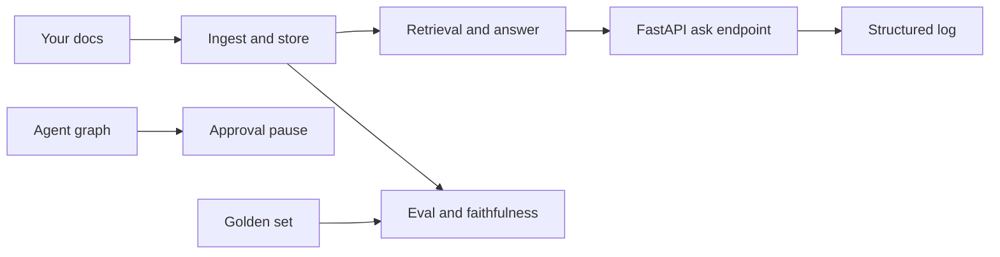

## What you will have at the end

By the end of this chapter you will have one repository for your scenario where a single `pytest -q` run proves everything the capstone promises: retrieval with citations, a golden set of at least 20 questions, a regression eval, an agent whose risky tool waits for a human, an async endpoint with retries and a timeout, one structured log line per request, and a faithfulness check. All of it runs with no API key.

Interviewers care about this for a simple reason. In a deep dive they ask "How do you know it works?", and in a hands-on round they ask you to write pieces of exactly this code. A repository where the tests answer the first question is the best evidence you can bring.

This chapter does not contain a solution. You already wrote most of the code in chapters 3.5, 5.5, 7.6 and 9.6. Here you get the plan, the few new interfaces, the acceptance tests, and hints in prose.

<BigWordAlert term="Acceptance test" plainEnglish="A test that checks a promise the whole project makes, such as 'the service works with no API key', rather than one small function." whyItMatters="Acceptance tests turn a capstone's must-haves into something a mentor, or an interviewer, can check in one command." />

## What you need

A laptop with Python 3.11 or later and the virtual environment from your build chapters. You need no new packages. If you completed chapters 7.6 and 9.6, everything is installed. If not, `pip install -r requirements.txt` downloads about 10 MB for pytest, fastapi, httpx, uvicorn and langgraph with their dependencies, about 45 MB installed (measured on 2026-10-22). No model is downloaded and no API key is used.

## How the pieces connect

The capstone adds only three small files to what you built. The diagram shows the request path and where the new parts sit.



Two things to notice. Retrieval feeds both the endpoint and the evaluation, so a change to chunking changes both, and your golden labels with them. And the agent sits beside the endpoint, not inside it: the must-have is that the risky tool pauses for approval in the graph and its tests. Exposing the agent over HTTP is a should-have.

## The new interfaces

Keep every interface from the build chapters as it is: `chunk_words`, `HashingEmbedder`, `InMemoryVectorStore`, `load_chunks`, `FakeLLM`, `answer`, the metric functions, `evaluate`, `build_graph`, `call_with_retries` and `create_app(llm, store)`. The capstone adds these:

```text
app/main.py           class AsyncAdapter: __init__(self, llm: LLM); async def complete(self, prompt: str) -> str
                      def build_default_app() -> FastAPI   (loads data/docs, uses the fake model unless MODEL_BACKEND says otherwise)
                      app = build_default_app()            (so "uvicorn app.main:app" works)
app/logs.py           def log_event(event: str, **fields) -> None   (one JSON line on the logger "rag_agent_service", level INFO)
app/faithfulness.py   def is_faithful(ans: Answer, retrieved: list[Chunk], min_overlap: float = 0.6) -> bool
                      def evaluate_answers(store, llm, golden: list[dict], k: int = 3) -> dict[str, float]
                      (keys "faithfulness" and "citation_rate", each the share of golden questions)
tests/conftest.py     fixtures golden and docs_dir
```

Hints, in prose. `AsyncAdapter` wraps the synchronous `FakeLLM` so `create_app` can await it; its `complete` just returns the wrapped model's answer. `build_default_app` reads the environment variable `MODEL_BACKEND`, defaulting to `fake`, and raises a clear error for any value you have not built an adapter for. `log_event` builds a dictionary from the event name and the fields and logs it with `json.dumps`; call it exactly once per request, in a `finally` block, so errors are logged too. Log ids, counts and timings, never the question text.

For `is_faithful`, start with a cheap lexical rule. An answer with no citations is faithful only if it is the "I don't know" answer. Every citation must be one of the retrieved chunks. Then take the answer's content words (lowercase, citation brackets removed, stopwords dropped) and check that at least `min_overlap` of them appear in the cited chunks' text. This rule has a real limit, which 12.3 asks you to report: it cannot see negation. "A rollback needs approval" passes against a chunk that says "A rollback needs no approval", because every content word is present.

## The staged plan

Five sessions of about 60 to 75 minutes. Commit at the end of each one, so a power cut never costs more than a session.

<Steps title="Five sessions from Bustan Books to your scenario">
<Step title="Session 1: documents and retrieval" stepNumber="1">

Copy your `rag-agent-service` repository into a new repository named for your scenario, for example `nakhla-knowledge-bot`. Keep the `app/` and `tests/` names so every interface still lines up. Activate the environment:

```bash
python -m venv .venv
source .venv/bin/activate        # macOS or Linux
.venv\Scripts\activate           # Windows
pip install -r requirements.txt
```

Replace the three Bustan Books files in `data/docs/` with your 6 to 10 scenario documents. Update the questions and expected chunk ids in `tests/test_rag.py` so they ask about your documents. Done when `pytest -q tests/test_rag.py` passes.

</Step>
<Step title="Session 2: golden set and regression eval" stepNumber="2">

Print your chunks with their ids, then write at least 20 questions in `data/golden.jsonl`, each with the ids that answer it. Write questions the way your users would type them, including a few with words that do not appear in the documents. Add `tests/conftest.py` and `tests/test_capstone_data.py` from below. Run `python -m app.evaluate`, then set the thresholds in `tests/test_eval_regression.py` a little below your first numbers. Done when `pytest -q -m eval` passes.

</Step>
<Step title="Session 3: the agent and its approval step" stepNumber="3">

Rename the two tools in `app/agent.py` to your scenario's safe and risky tools, with a small in-memory table of fake records. Validate the risky tool's arguments with Pydantic. Adapt `tests/test_agent.py` so it still proves three things: the risky tool does not run before approval, runs once after approval, and does not run after a rejection. Done when `pytest -q tests/test_agent.py` passes.

</Step>
<Step title="Session 4: the default app and structured logs" stepNumber="4">

Write `app/main.py` and `app/logs.py`, and call `log_event` once per request in your `/ask` handler. Make sure `/ask` returns the "I don't know" answer with empty citations when no chunk passes the score threshold, as `answer()` does. Add `tests/test_capstone_service.py` and `tests/test_capstone_logs.py`. Done when both pass and `uvicorn app.main:app` starts.

</Step>
<Step title="Session 5: faithfulness, README and a clean run" stepNumber="5">

Write `app/faithfulness.py` and add `tests/test_capstone_eval.py`. Write the README: what the service does, install, `pytest -q`, `python -m app.evaluate`, and how to start the service. Then clone your repository into a new folder, follow only your README, and run the full suite. Done when it passes there too.

</Step>
</Steps>

## The acceptance tests

Copy these files exactly. If you already have a `tests/conftest.py`, add the two fixtures to it.

```python
# tests/conftest.py
import json
from pathlib import Path

import pytest

DATA = Path(__file__).resolve().parent.parent / "data"


@pytest.fixture(scope="session")
def golden() -> list[dict]:
    lines = (DATA / "golden.jsonl").read_text(encoding="utf-8").splitlines()
    return [json.loads(line) for line in lines if line.strip()]


@pytest.fixture(scope="session")
def docs_dir() -> str:
    return str(DATA / "docs")
```

```python
# tests/test_capstone_data.py
from app.ingest import load_chunks


def test_golden_set_has_at_least_20_questions(golden):
    assert len(golden) >= 20
    assert len({item["id"] for item in golden}) == len(golden)
    for item in golden:
        assert item["question"].strip() and item["relevant"], item["id"]


def test_every_relevant_chunk_exists(golden, docs_dir):
    chunk_ids = {c.id for c in load_chunks(docs_dir)}
    for item in golden:
        missing = set(item["relevant"]) - chunk_ids
        assert not missing, f"{item['id']} points at missing chunks {missing}"
```

```python
# tests/test_capstone_service.py
import os

from fastapi.testclient import TestClient

from app.embedding import HashingEmbedder
from app.llm import FakeLLM
from app.main import AsyncAdapter, build_default_app
from app.service import create_app
from app.store import InMemoryVectorStore


def test_runs_without_any_api_key(monkeypatch, golden):
    for name in list(os.environ):
        if "KEY" in name.upper() or "TOKEN" in name.upper():
            monkeypatch.delenv(name)
    client = TestClient(build_default_app())
    body = client.post("/ask", json={"question": golden[0]["question"]}).json()
    assert body["citations"], body


def test_no_matching_chunk_means_i_dont_know():
    empty_store = InMemoryVectorStore(HashingEmbedder())
    client = TestClient(create_app(AsyncAdapter(FakeLLM()), empty_store))
    body = client.post("/ask", json={"question": "Can I get a refund?"}).json()
    assert body["citations"] == []
    assert "don't know" in body["answer"].lower()
```

```python
# tests/test_capstone_logs.py
import json
import logging

from fastapi.testclient import TestClient

from app.main import build_default_app


def test_ask_writes_one_structured_log_line(caplog, golden):
    caplog.set_level(logging.INFO, logger="rag_agent_service")
    question = golden[0]["question"]
    TestClient(build_default_app()).post("/ask", json={"question": question})
    lines = [r.getMessage() for r in caplog.records if r.name == "rag_agent_service"]
    assert len(lines) == 1
    event = json.loads(lines[0])
    for key in ("event", "request_id", "latency_ms", "retrieved", "citations", "outcome"):
        assert key in event, key
    assert question not in lines[0]  # never log the raw question
```

```python
# tests/test_capstone_eval.py
import pytest

from app.embedding import HashingEmbedder
from app.faithfulness import evaluate_answers
from app.ingest import load_chunks
from app.llm import FakeLLM
from app.store import InMemoryVectorStore

MIN_FAITHFULNESS = 0.95
MIN_CITATION_RATE = 0.90


@pytest.mark.eval
def test_golden_answers_are_faithful_and_cited(golden, docs_dir):
    store = InMemoryVectorStore(HashingEmbedder())
    store.add(load_chunks(docs_dir))
    scores = evaluate_answers(store, FakeLLM(), golden, k=3)
    assert scores["faithfulness"] >= MIN_FAITHFULNESS, scores
    assert scores["citation_rate"] >= MIN_CITATION_RATE, scores
```

With the fake model, faithfulness is close to 1.0 by construction, because it copies a sentence from the top chunk. The test is still worth having: it checks the citation path end to end, and the day you plug in a real model behind `MODEL_BACKEND`, an unfaithful answer fails the build.

Together with your earlier files, these are the tests that must pass:

| Test file | What it proves | From |
|---|---|---|
| `test_rag.py` | Chunking, search and cited answers on your documents | 3.5 |
| `test_metrics.py`, `test_eval_regression.py` | Metrics are right; quality has a floor | 5.5 |
| `test_agent.py` | The risky tool waits for approval | 7.6 |
| `test_service.py` | Validation, retries, timeout, semaphore | 9.6 |
| `test_capstone_*.py` | Golden set, no key, logs, faithfulness | 12.2 |

## Verify

Run only the new acceptance tests first, then everything. On the reference repository used to check this chapter (a Nakhla Systems corpus with 6 documents and 20 golden questions), the new tests gave this result. Your timing will vary.

<TerminalBlock title="Run the capstone acceptance tests" cwd="nakhla-knowledge-bot">
  <TerminalLine type="prompt">pytest -q tests/test_capstone_data.py tests/test_capstone_service.py tests/test_capstone_logs.py tests/test_capstone_eval.py</TerminalLine>
  <TerminalLine type="output">6 passed in 2.13s</TerminalLine>
</TerminalBlock>

Then run `pytest -q` for the whole suite. The exact count depends on your earlier test files; the line must end in `passed` with no `failed` or `error`.

Now break it on purpose, to see that the golden set is tied to your chunking. In `app/ingest.py`, change the default `size` of `load_chunks` from 60 to 120 and run `pytest -q tests/test_capstone_data.py`. Bigger chunks mean fewer chunks, so some labelled ids no longer exist. On the reference repository it failed like this:

```text
E           AssertionError: q03 points at missing chunks {'deploys#2'}
1 failed, 1 passed in 0.75s
```

Your id will be different. Put the size back and the test passes again. The lesson for your report: every time you change chunking, you must re-label the golden set, or your metrics measure the wrong thing.

If something fails, check the two most common mistakes first:

- **`FileNotFoundError` for `data/golden.jsonl` or `data/docs`.** A path was written relative to the folder you ran from. Build paths from `__file__`, as `conftest.py` does, and do the same where `build_default_app()` loads `data/docs`. Then run pytest from the repository root.
- **The log test finds 0 lines or 2 lines.** Zero usually means a different logger name or a level below INFO is filtered; use `logging.getLogger("rag_agent_service")` and `logger.info`. Two means `log_event` is called in more than one place; keep one call in the handler's `finally` block.

<Callout type="warning" title="No real data in a public repository">
Your documents and golden questions are fictional. Keep them that way. Never commit a real API key, even in a test; the no-key test exists to prove you never need one.
</Callout>

## Acceptance criteria

- [ ] My repository has 6 to 10 fictional documents for my scenario in `data/docs/`
- [ ] `data/golden.jsonl` has at least 20 questions, each labelled with existing chunk ids
- [ ] The risky tool pauses for approval, and `tests/test_agent.py` proves it does not run before approval or after a rejection
- [ ] `/ask` validates input, retries transient failures, has a timeout, limits concurrency and returns structured errors
- [ ] Each `/ask` request writes exactly one JSON log line with no raw question text
- [ ] `pytest -q` passes from a fresh clone, following only my README, with no API key set
- [ ] I saw the chunk-size failure, put the size back and the tests pass again

## Submit your progress

```openquestion
prompt: "Paste the link to your capstone repository. Optionally, paste the last line of your full pytest -q run and name your scenario."
required: true
minWords: 0
allowSpeechInput: true
allowUrl: true
urlRequired: true
urlLabel: "Repository link"
urlHint: "A link your mentor can open. If your repository is private, add your mentor as a reader."
modelAnswer: "Scenario C, the Nakhla Systems knowledge bot. My full pytest -q run ends in passed with no failures, from a fresh clone and with no API key set. The README has the install, test, eval and run commands."
```

**Next:** Evaluate and write the report: run the eval, find one failure, fix it and show the numbers.
