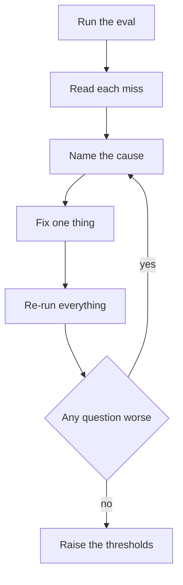

## Numbers you can defend

Your tests pass. That proves the code does what you wrote. It does not yet tell an interviewer how well the system answers your users' questions, where it fails, or what you did about it. That is the job of the evaluation report: one page, with numbers first, one failure traced to a cause, the fix, and the numbers after.

By the end of this chapter you will have two files in your repository, `docs/evaluation-report.md` and `docs/design-note.md`, both based on runs you can repeat with one command. In the deep dive, "How do you know it works?" will be the easiest question of the interview, because you will answer it with your own report.

<BigWordAlert term="Error analysis" plainEnglish="Reading the failed cases one by one, grouping them by cause, and fixing the biggest group first, instead of tuning settings and hoping the average goes up." whyItMatters="An average score tells you that something is wrong. Only the individual misses tell you what, and interviewers ask for the story behind the number." />

## The loop

The process has one rule that people skip: after any fix, re-run the whole golden set and compare question by question, not only the averages. A fix for one question can quietly break another.



The loop ends by raising the regression thresholds to just below the new numbers. That locks in the gain: if a later change undoes your fix, the test fails.

## Worked example: Reem's Nakhla Systems bot

Reem built scenario C, the knowledge bot for Nakhla Systems (a fictional remote software team). Her corpus has 6 documents, 16 chunks and 20 golden questions, and she evaluates at k = 3. The numbers below are from her repository; yours will be different.

She first extended `python -m app.evaluate` to print every question whose recall is below 1, with what was retrieved. Her first run:

```text
recall_at_k: 0.875
precision_at_k: 0.383
mrr: 0.867
MISS q03 recall=0.50 rr=1.00 relevant=['deploys#1', 'deploys#2'] retrieved=['deploys#1', 'incidents#0', 'deploys#0']
MISS q07 recall=0.50 rr=1.00 relevant=['oncall#1', 'oncall#2'] retrieved=['oncall#1', 'oncall#0', 'deploys#1']
MISS q12 recall=0.00 rr=0.00 relevant=['access#0'] retrieved=['releases#0', 'releases#1', 'access#2']
MISS q15 recall=0.50 rr=0.33 relevant=['decisions#0', 'decisions#1'] retrieved=['deploys#2', 'access#1', 'decisions#0']
```

Precision@3 looks low, but that is expected here: most questions have one or two relevant chunks, so even a perfect top 3 has precision of 0.33 to 0.67. Reem noted that in her report so a reader would not misread it.

Three misses were partial: one relevant chunk was found, at rank 1 for q03 and q07 and rank 3 for q15, but a second one was missing. q12 was a total miss. The question was "Who has to sign off before I reboot a live service?" The document says "Restarting a production service requires approval". The words sign off, reboot and live are not in the text, and the only shared words were weak ones such as "service". Her hashing embedder only matches exact words, so release chunks that happen to contain "before" ranked higher. The cause was vocabulary mismatch, and engineers on her team really do say "reboot" and "prod".

Her fix was query rewriting from chapter 4.3, in its cheapest form: a small team glossary that adds the document's word to the query before search.

```python
TEAM_TERMS = {
    "reboot": "restart",
    "live": "production",
    "prod": "production",
    "sign off": "approval",
}
```

She re-ran the eval. Recall@3 rose from 0.875 to 0.925 and q12 was fixed. But MRR went down, from 0.867 to 0.858.

```predict
prompt: "Reem's glossary fixed q12 and raised recall@3, but MRR went down slightly. What should she do next?"
options:
  - id: keep
    label: "Keep the fix, because recall rose more than MRR fell: a net win"
  - id: compare
    label: "Compare each question's rank before and after, to find what got worse"
correctOptionId: compare
explanation: "A falling MRR means some question's first relevant chunk moved down. Until she knows which one and why, she cannot say the fix is safe."
```

Comparing per question showed it at once. q13, "Where do API keys live?", had its answer at rank 1 before and rank 2 after. The rule "live" to "production" fired on a question where "live" means "are stored", and pulled in production chunks. She changed the rule to the phrase "live service". Third run: recall@3 0.925, precision@3 0.400, MRR 0.917, with q12 at rank 1 and q13 back at rank 1. She then raised the thresholds in her regression test to recall@3 0.90 and MRR 0.90.

That paragraph is exactly what an interviewer wants to hear: the miss, the cause, the fix, the regression it caused, and how she caught it.

## Faithfulness, honestly

With the fake model, Reem's faithfulness and citation rate were both 1.00 before and after the fix. She did not present that as a quality result. The fake model copies a sentence from the top chunk, so it cannot invent anything. Her report says what the check proves (citations point at retrieved chunks, and the answer's words come from them) and what it misses. She wrote one deliberately wrong answer, "A rollback needs approval", against a chunk that says "A rollback needs no approval", and her lexical check passed it. That limit goes in the report, with the next step: a judge model scored against her own labels on a sample, once a real model is plugged in.

<Callout type="tip" title="One fix, well explained, beats five">
You only need one failure, fixed and re-measured. Spend the time on understanding the cause and checking for regressions, not on a long list of small tweaks.
</Callout>

## Your turn

<Steps title="Evaluate, fix and report">
<Step title="Run the baseline" stepNumber="1">

Activate your environment (`source .venv/bin/activate` on macOS or Linux, `.venv\Scripts\activate` on Windows). Run `python -m app.evaluate` and save the output to `docs/eval-baseline.txt`. Extend it first, if needed, so it also prints each question with recall below 1, its reciprocal rank, the relevant ids and the retrieved ids. Also print the two numbers from `evaluate_answers`.

</Step>
<Step title="Read every miss and name a cause" stepNumber="2">

For each miss, open the relevant chunk and the retrieved chunks side by side. Write one line per miss in your notes with a cause: vocabulary mismatch, a chunk boundary that split the answer, a table flattened into text, a missing document, or a wrong label in the golden set. A wrong label is a real finding too; fix the label and say so.

</Step>
<Step title="Fix one failure and re-run everything" stepNumber="3">

Choose the cause behind the most misses, or the worst single miss. Make one change. Re-run the full eval and compare every question's recall and reciprocal rank with the baseline. If any question got worse, find out why before you keep the change. Save the final output as `docs/eval-after.txt`, and re-label the golden set if you changed chunking.

</Step>
<Step title="Raise the thresholds and run the tests" stepNumber="4">

Set the thresholds in your regression test just below your new numbers, then run `pytest -q`. Everything must pass. Commit the fix, the outputs and the test change together, with a message that names the failure you fixed.

</Step>
<Step title="Write the report and the design note" stepNumber="5">

Copy the two templates below into `docs/evaluation-report.md` and `docs/design-note.md`, fill them in, and keep each to one page. Link both from your README.

</Step>
</Steps>

## Writing a report people read

Your mentor, and later an interviewer who opens your repository, will give the report about two minutes. Write for that. Put the results table near the top, before any explanation. Say what k is and how many questions the numbers come from, because 0.92 on 20 questions and 0.92 on 500 questions mean different things: on 20 questions, one question moves recall@k by up to 0.05.

Do not hide numbers that look bad. Explain them, as Reem did with precision@3. A reader who finds a low number you did not mention stops trusting the rest. Use plain words and short sentences, and name the failure with its question id so anyone can find it in your golden set. The design note follows the same rule: one page, headings that match the template, and one trade-off with a number rather than five without.

## The evaluation report template

```text
# Evaluation report: <scenario name>

Setup
- Corpus: <n> documents, <n> chunks (size <n> words, overlap <n>)
- Golden set: <n> questions, labelled by <who>; <n> with two or more relevant chunks
- k = <n>; model: fake model (deterministic); date: <date>

Results (before -> after the fix)
| Metric          | Before | After |
| recall@k        |        |       |
| precision@k     |        |       |
| MRR             |        |       |
| faithfulness    |        |       |
| citation rate   |        |       |

The failure I fixed
- Question: <id and text>
- Cause: <one sentence>
- Fix: <one sentence>
- Regression found while fixing, if any: <what and how fixed>

What the numbers do not show
- <limit of the faithfulness check>
- <limit of the golden set size or coverage>

Regression test
- Thresholds now: recall@k >= <n>, MRR >= <n>; run with pytest -m eval

Next step
- <the one change you would make next, and the number you expect it to move>
```

## The design note template

```text
# Design note: <scenario name>

Problem and users
- Who asks what, and what a good answer is (with a citation)

Design
- Request path: question -> retrieval -> prompt with chunk ids -> fake or real model -> cited answer
- Agent: <safe tool>, <risky tool>; the risky tool pauses for <who> to approve
- Service: validation limits, retries, timeout, concurrency limit, error codes

Main trade-off
- <what you chose, what you gave up, and the number behind it>

Risks and defences
- Prompt injection: <defence>
- Wrong or stale answer: <defence>
- Provider slow or down: <defence>
- Privacy in logs: <defence>

Deployment (designed, not built)
- Where it would run and why; what you would monitor; cost per question in tokens

What I would change with another month
- <one or two items, in priority order>
```

## Acceptance criteria

- [ ] `docs/eval-baseline.txt` and `docs/eval-after.txt` are in my repository and come from runs anyone can repeat
- [ ] My report names one failure, its cause, the fix, and every metric before and after
- [ ] I compared every question before and after my fix, not only the averages
- [ ] My regression thresholds are raised to just below the new numbers, and `pytest -q` passes
- [ ] My report states at least one limit of my faithfulness check
- [ ] My design note fits on one page and names the approval point and one trade-off with a number

## Submit your report

```openquestion
prompt: "Paste the link to your capstone repository with the report and design note committed. Optionally, paste your before and after numbers for recall@k and MRR, and the failure you fixed in one sentence."
required: true
minWords: 0
allowSpeechInput: true
allowUrl: true
urlRequired: true
urlLabel: "Repository link"
urlHint: "A link your mentor can open. If your repository is private, add your mentor as a reader."
modelAnswer: "Report: docs/evaluation-report.md. At k = 3, recall went from 0.875 to 0.925 and MRR from 0.867 to 0.917. I fixed q12, a vocabulary mismatch (reboot and live service versus restart and production service), with a small glossary rewrite. My first rule broke q13, so I narrowed it to a phrase."
```

**Next:** Record your mock-interview defence: a five-minute walkthrough and three follow-up probes.
