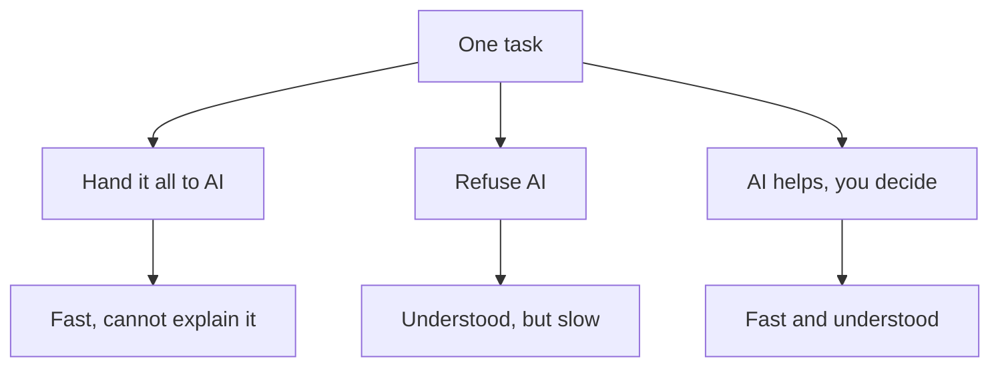

<BigWordAlert term="Enabler" plainEnglish="A tool that makes your work faster or possible, while you stay in charge of it." whyItMatters="When AI is your enabler, you get its speed and you keep the skill, the decisions and the credit. When it replaces your thinking, you lose all three." />

## Three fellows, one month

Khaled, Rana and Yara are fellows in the same programme. All three are building careers in tech, and all three started a project this month. They have the same tools in front of them, the same weak connection on some days, and about the same number of free hours. What is different is how each of them treats AI.

Their three stories run through this whole module. None of them is a villain or a hero. Each one made a choice that seemed sensible at the time. Watch what each choice cost, and what each one gained.

## Khaled hands it all to AI

Khaled wanted a project for his portfolio, fast. On a Friday he opened an AI coding assistant and typed what he wanted: an online store with product pages, a cart, discount codes and a page for the owner. He accepted almost everything the assistant wrote. By Sunday night, the store was running on his laptop. It looked finished. He posted screenshots in the fellowship group, and people were impressed.

A week later his mentor asked for one small change: show the cheapest products first. Khaled asked the assistant to add it, and the list came out in a strange order. A product at 100 shekels appeared before a product at 20 shekels. For the first time, he opened the part of the code that saves the products. Every price was stored as text, not as a number. Text is sorted letter by letter, so "100" comes before "20", in the same way that "apple" comes before "banana".

Khaled could fix the order with one more instruction. What worried him was a different question. Why were prices stored as text at all? Was it a mistake, or a choice with a reason? He did not know, because he had never made that choice. The assistant had made it, and he had accepted it without reading. He had a store that worked on screenshots, and he could not explain how it worked.

## Rana refuses to touch it

Rana is careful and hard-working. She has read that AI may change many jobs in tech, and she is afraid it will take the job she is training for. So she made a rule for herself: no AI, ever. She wants every skill she has to be her own.

This month Rana needed a code library for her project: a package of ready-made code that makes PDF receipts. The library came with a long manual, more than 200 pages in this example. Rana read it from the first page, over three evenings. Most of it was about features she would never use. The three sections she needed were near the end.

An AI tool could have summarised the manual and pointed her to those three sections in minutes. She would still have needed to read them herself, try the code and check that it worked. But she would have saved most of three evenings, and those evenings were the only project time she had that week. Reading 200 pages she did not need did not teach her more about the three pages she did need.

Rana's worry is reasonable, and it deserves a serious answer. AI is changing how tech work is done, and nobody can promise what every job will look like in a few years. The problem is her conclusion. Refusing the tool does not protect her career. It makes her slower than people who use the tool well, and it leaves her without a skill that employers and clients now expect.

## Yara takes a third path

Yara studies software on her own, about 8 hours a week for her project, on top of her course time. She has an old laptop that she charges in the evening, and a phone she uses for reading and listening. Her project for the next six months is called Qasir, which is Arabic for "short". It is a link shortener: you paste a long link, and it gives you a short one. Qasir is for small shops and NGOs that share links in group chats, and it counts how many times each link is clicked.

Yara uses AI every day, but in a particular way. When she started Qasir, she asked a chat assistant to explain in plain words what parts a link shortener needs. The answer was clear and fast. It also listed many things she did not need: user accounts, paid plans and maps of where clicks come from. The AI did not know who her users were, how many hours she had, or what her laptop could run. Nobody had told it.

So Yara did three things the AI could not do for her. She told it the facts only she knew, and asked again. She checked the new answer against the official guide of the tool she planned to use. And she made the decisions herself: what to build first, what to leave out, and why. She wrote each decision in her notes, in her own words, so that she can explain it to anyone who asks.

Yara is not faster than Khaled. In one weekend he built more than she will build in a month. She is not more careful than Rana, either. But she gets the speed of the tool, and she keeps the understanding and the decisions. That is what an enabler means in this course, and it is the path the next five modules teach.

## Two loud stories

Khaled and Rana each believe a story about AI that you probably hear every week. The first story says AI can do it all: describe what you want, and it builds it for you. The second story says AI will take it all: the jobs, the skills, the reason to learn. One story is full of hope and the other is full of fear. But they lead to the same place. In both stories, the person stops thinking.

Khaled stopped thinking about his own code, because he believed the tool had it covered. Rana stopped thinking about the tool, because she believed it was a threat. Neither story matches the evidence, which is more mixed and more useful than either. A fair summary is this: AI changes the work, and people still decide and check. Chapter 1.4 shows what careful studies found, with their limits.

The diagram below shows the three paths from one task. Read it from the top: the same task, three ways to meet it, and what each way leaves you with.



What to notice: speed and understanding are not a trade you are forced to make. Khaled got speed without understanding. Rana kept her understanding but paid for it in time she did not have. Yara's path gets both, because she lets the AI do the fast parts and keeps the thinking parts for herself. The takeaway is that the question is never "AI or no AI". It is "which parts does the AI do, and which parts do I keep?"

## Why this matters for your career

Building a first version of an app used to take weeks of work. AI coding tools have made it much faster, and many people can now produce a working demo in a weekend. When something becomes easy, it stops being what makes you stand out. A reviewer who sees ten quick stores in one week will remember the one fellow who could explain why each part works the way it does.

The same is true with clients. A small shop that pays a freelancer $400 for a website does not only want a website. It wants someone who can fix the site when it breaks, change it when the shop changes, and answer questions honestly. A freelancer who cannot explain their own work cannot do any of those things. A freelancer who uses AI well, and understands every part, can do all of them faster than before.

This course is not about one tool. It names real tools as examples, but tools change their names, their limits and their rules, sometimes within months. What lasts is the habits. Know what the AI does not know, and keep the decisions yours. Learn deeply instead of only reading answers. Build small labs, plan a project you understand, and share your work honestly.

This module starts with the first habit. You will learn to see what an AI tool is missing in any task. You will separate what it can draft from the calls a person must make and own. You will look at what studies found about AI and learning. And you will see why one project you understand is worth more than a big one you cannot explain.

```openquestion
prompt: "Think of one task from your study or work this month, or use Rana's 200-page manual if you prefer. Which path did you take, or would you take: hand it all to AI, refuse AI, or let AI help while you decide? Say why in two or three sentences."
required: true
minWords: 25
allowSpeechInput: true
modelAnswer: "Example answer for Rana's manual: I would take the third path. I would ask an AI tool to summarise the manual and tell me which sections cover making receipts. Then I would read those sections myself, try the code on one receipt, and check the result. That saves most of three evenings, and I still understand the part I use. A different example: last week I asked a chat assistant to write my whole cover letter and sent it almost unchanged, which was the first path. Next time I will write the main points myself and ask the AI only to fix the grammar."
```

<LearningObjectives items={["Tell apart three ways people meet AI: handing it everything, refusing it, and using it as an enabler", "Name what an AI tool does not know in a task: your context, your private data, local and recent facts, and the obvious things nobody wrote down", "Separate what AI can draft from the calls a person must check, decide and own", "Explain what studies found about AI and learning, with their limits", "Explain why a project you understand and can defend is worth more than a big one you cannot explain"]} />

## Key words

| Word | Plain English |
|---|---|
| **AI chat assistant** | A tool you type or talk to that answers in sentences. At the time of writing, Gemini, ChatGPT and Claude are examples |
| **AI coding assistant** | An AI tool that writes and changes code from your instructions |
| **Context** | The facts around a task: who it is for, the budget, the deadline, the place |
| **Accountable** | Being the person who answers for a result, and fixes it, when it goes wrong |
| **Hype** | Claims that make something sound bigger or more certain than the evidence shows |

## What is in this module

| Chapter | You will practice |
|---|---|
| 1.2 | Finding what an AI tool does not know about your task |
| 1.3 | Letting AI draft while you check, decide and own the result |
| 1.4 | Using AI in ways that help your learning, not harm it |
| 1.5 | Choosing a project you understand over a big one you cannot explain |
| 1.6 | Splitting one real or provided task into AI help and your own calls |

**Next:** What an AI tool does not know about your task, and why it answers confidently anyway.
