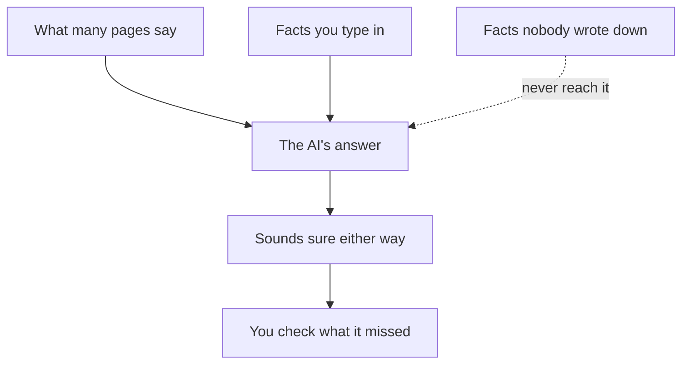

## A plan for a different shop

Majd takes small jobs on a freelance marketplace. A print and copy shop near his university asked him for a simple website where customers can send print orders. The owner can pay $300 in total. Majd opened a chat assistant and typed one line: "How should I build an online order form for a print shop?"

In a few seconds he had a full plan. It suggested a modern web app, cloud hosting with a monthly bill, card payments, email confirmations and a login for every customer. The plan was clear, well organised and confident. Majd nearly started building it that evening.

The next morning he showed the plan to the owner, who shook his head. His customers pay cash at the counter. He already pays for a hosting account for this year, and he will not pay a second bill every month. Most of his customers order from their phones, often with little data left. The plan was good for a print shop. It was not good for this print shop.

The AI did not make a careless mistake. It answered the question it was given, and that question said almost nothing about the shop. This chapter is about the gap between the two. It covers what an AI tool does not know about your task, and how to find that gap before you build on its answer.

## Four things the AI does not know

You met the word context in the key words of chapter 1.1: the facts around a task. An AI tool sees only the words you type, plus whatever it learned from text written before you asked. Everything else about your task is invisible to it. It helps to sort what is missing into four kinds, because each kind needs a different fix.

**Your context.** Who the work is for, the budget, the deadline, the devices people use, the skills you have. Majd's AI did not know the budget was $300, that customers use phones with weak data, or that Majd works alone. Context is the easiest kind to fix: you can type it.

**Your private data.** The files, code, messages and numbers that are not on the public web. The AI has not seen the shop's price list, its order book or the code on its hosting account. Some of this you can describe in a sentence. Some of it you should never paste into a tool at all, such as passwords or a client's customer list. Module 2 shows how to decide.

**Local and recent facts.** What things cost this month in your city, which courier delivers to your area, which tools open where you live, what changed in a library last month. An AI answer can be out of date or simply wrong about these, even when it shows links. In a study by the European Broadcasting Union and the BBC, four AI assistants answered news questions. Nearly half of their answers had at least one significant problem, including out-of-date information. Check facts like these on an official page or with a person.

**The obvious things nobody wrote down.** Every workplace has facts that are so obvious to the people inside it that nobody ever says them. The staff never read email. The owner hates passwords. The volunteers share one phone. These facts are not in any document, so no AI could have learned them, and you will not find them by asking the AI better questions. You find them by asking people and by watching how the work is really done.

## Why it still sounds sure

If the AI does not know so much, why does it answer as if it does? In the Think Clearly course, module 7, you saw that an AI chat tool predicts likely words from patterns, which is why it can sound sure and still be wrong. The same idea explains Majd's plan. With no facts about the shop, the most likely answer is a plan for an average print shop, written in a confident voice.

The result is a <GlossaryTerm term="generic" definition="Made to fit most cases in general, not your case in particular." /> answer. A generic answer is not a lie, and it is often a useful start. The danger is that it does not look generic. It looks like advice written for you, with your words in the first line. Nothing in the answer warns you which parts fit and which parts do not.

The diagram shows where the answer comes from, and what never reaches it. The solid arrows are what the AI can use. The dotted arrow is the knowledge it does not have.



What to notice: the answer sounds equally sure whether you typed many facts or none. Confidence comes from how the tool writes, not from how much it knows about you. So the tone of an answer tells you nothing about whether it fits. The takeaway: you are the only one who can see the gap, so finding it is your job.

## Worked example: Yara lists what the AI cannot know

Yara wants to plan the first version of Qasir, her link shortener for small shops and NGOs that share links in group chats. Before she asks a chat assistant anything, she spends ten minutes on paper. She writes the task in one line: "Plan the first version of a link shortener." Then she goes through the four kinds of missing knowledge, one at a time, and writes what the AI cannot know under each.

**Step 1: context.** Her users are small shop owners and NGO volunteers, not companies. She has about 8 hours a week for the project. Her laptop is old, so whatever she builds must run on it. She writes these three facts first, because they change the size of everything else.

**Step 2: private data.** Qasir has no users yet, so there is nothing private to protect today. But she notes a rule for later: real shops' links and click counts will belong to them, and she will not paste them into a chat. If she needs help with them, she will describe their shape, such as "a list of links with a number next to each", not the data itself.

**Step 3: local and recent facts.** People will open Qasir's links on phones, often with little data left, so the page in between must be tiny and fast. She also notes what she cannot trust the AI on: which hosting options work where she lives today, and the latest version of each tool she will use. She will check both on official pages.

**Step 4: the obvious things nobody wrote down.** This one needs people, not a chat. Yara asks two people who would use Qasir: a phone repair shop owner and a volunteer at a local NGO. The shop owner says he will not make an account or remember another password. The volunteer only wants to see how many people clicked, not charts. Neither would have written this anywhere. Both facts change her plan.

Now Yara has a short list of facts to add to her question, and a second, separate list of things to check herself. That second list matters. Adding facts makes the AI's answer fit better, but some facts on the list, such as which hosting works where she lives, the AI can never confirm for her.

<Callout type="tip" title="Four headings before you ask">
Before a big question to an AI, write four headings on paper: context, private data, local and recent, nobody wrote it down. Two minutes under each heading often changes the question you ask.
</Callout>

## What happens when the facts go in

Go back to Majd and his print shop. After his talk with the owner, he writes four facts under his question. Customers order from phones with weak data. The budget is $300, with nothing to pay each month. The shop already has a hosting account for this year. And customers pay cash at the counter.

```predict
prompt: "Majd asks the same question again, now with the four facts about the shop under it. How different do you expect the new answer to be?"
options:
  - id: different
    label: "A different plan that fits this shop"
  - id: same
    label: "Much the same plan, with a few small changes"
correctOptionId: different
explanation: "The first plan fitted an average print shop. The four facts remove the card payments, the monthly bill and the heavy app, so the plan changes shape, not only details. Your first guess was the right one here: facts you give an AI really do change its answer. But the canvas also shows a fact that no question could have added."
```

Step through Majd's two questions below, and watch which facts change the answer and which one still has to come from a person.

<InteractiveCanvas slug="ai-missing-context" />

The canvas showed the same question asked twice. Alone, it produced a confident plan for an average shop. With four facts, it produced a light page on the hosting the shop already pays for, with no card payments and no login. The facts did not make the AI smarter. They gave it the context it needed to aim at the right shop.

The canvas also showed the limit. The new plan sent each order to the shop's email, and the staff never read email. That fact was obvious to the owner and written nowhere, so no question to the AI could have found it. Majd found it by asking. The last step is the habit in one line: add what you know, then check what the AI could never know, with the people and the pages that do.

## Where it goes wrong

The first mistake is to stop after adding facts. A fitted answer feels finished, because it now mentions your budget and your users. But it still has not been checked. Keep your second list, the things the AI cannot confirm, and work through it before you build.

The second mistake is to give context by pasting private data. Majd could have pasted the shop's whole customer list to "help the AI understand". That would have shared other people's names and phone numbers without their permission. Describe the shape of the data instead: "about 200 regular customers, mostly students". Module 2 turns this into a habit you use before every paste.

The third mistake is to trust an AI tool on local and recent facts because it shows a link. A link can be old, or it can say something different from the answer. Open the page and read it. For prices, opening hours and couriers, a phone call to the business is often faster than any search.

The fourth mistake is to skip the people. It is tempting to treat the AI as the only source, because it is always available and never busy. But the obvious things nobody wrote down live only in people's heads. Ten minutes with the person who will use your work can save a week of building the wrong thing.

## Check your understanding

```quiz
type: mcq
question: "Reem teaches computer classes to 32 students at a girls' secondary school. She asks a chat assistant for a six-week plan to teach them to build a simple web page. Every lesson in the plan starts with 'students open their laptops and download the starter files'. The school lab has 16 computers, lessons last 45 minutes, and the lab's internet is slow in the morning. What should Reem do next?"
options:
  - "Ask the same question again and hope the next plan fits better"
  - "Use the plan as it is, since it follows good teaching practice"
  - "Ask again with the lab facts, then try the plan in the lab"
  - "Drop the AI and write the whole plan herself from scratch"
correct: 2
explanations:
  - "A second answer to the same question will still be written for an average class. The AI does not know about the 16 computers until Reem tells it."
  - "The plan may follow good practice for a class with laptops, but it does not fit Reem's lab. Students cannot open laptops they do not have."
  - "Right. Adding the context (16 computers for 32 students, 45 minutes, slow morning internet) lets the AI aim at her class. Trying it in the lab checks what the AI still cannot know."
  - "That is Rana's path from chapter 1.1. The AI can still draft a useful plan quickly once it has the facts, and Reem stays in charge of checking it."
```

```quiz
type: mcq
question: "Bilal runs a small online shop that sells phone cases for 30 shekels each and delivers in his city. He asks a chat assistant what to charge for delivery. It answers: 'Most small shops charge a flat fee of 15 shekels, which covers a local courier in most cities.' Last month, Bilal's own courier changed its prices. What is the right next step?"
options:
  - "Ask his courier for this month's price, then decide the fee"
  - "Ask the AI for a source, since a source would make it safe"
  - "Charge 15 shekels, since the AI says most small shops do that"
  - "Ask a second chat assistant and charge the average of the two"
correct: 0
explanations:
  - "Right. The courier's price is a local and recent fact. Only the courier knows it for certain, and the fee Bilal charges is his decision."
  - "A source about shops in general still cannot know what Bilal's courier charges this month. The fact he needs is local and recent."
  - "The answer sounds sure, but 'most cities' is not Bilal's city, and his courier's prices changed last month. The figure may not even cover his cost."
  - "Two tools that both lack the local fact do not add up to one that has it. The average of two guesses is still a guess."
```

**Next:** AI can draft, compare and explain. Who decides, who checks, and who answers when it goes wrong?
