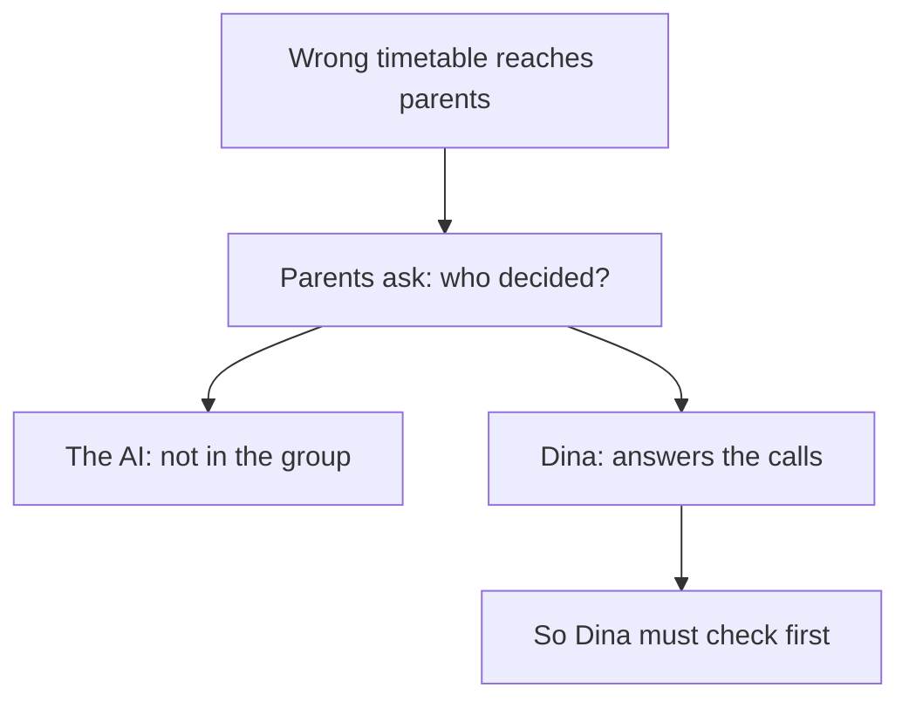

## "The AI made it"

Dina volunteers at a youth sports club with four teams. Before each term she makes the training timetable: which team uses the hall at what time, and with which coach. Last term she was busy with exams. She gave a chat assistant the team names and the coaches, asked it for a timetable, and posted the result in the parents' group without reading it closely.

Within an hour her phone was ringing. The girls' team was down for 19:00 on Thursdays, but the hall closes at 18:00 on Thursdays. One coach was down for two teams at the same time on Monday. A parent asked in the group who had made this timetable. Dina wrote back: "The AI made it." The club manager replied in one line: "The AI is not in the parents' group. You are."

The manager was not being unkind. He was pointing at something true. The AI produced the timetable, but it could not answer the parents, it could not fix the clash, and it would not be asked to make next term's timetable. Dina would. This chapter is about that line: what AI can do for you, and the calls that stay with a person.

## What AI does, and what stays with you

AI tools are fast at four kinds of work. They **draft**: a timetable, an email, a plan, a first version of some code. They **search**: they find pages and pull out the parts that look relevant. They **explain**: they turn a hard idea into plain words, as many times as you ask. And they **compare**: they list options side by side, with what each one is good and bad at. Each of these used to take a person hours, and now takes minutes.

Three things stay with a person. You **check**: you test the draft against the facts the AI does not have, which you met in chapter 1.2. You **decide**: you choose an option, using your context and what matters to the people involved. And you **own** the result: you are accountable, the word from the key words in chapter 1.1. When it goes wrong, you are the one who answers and fixes it.

Notice that the line is not "AI does the easy parts and people do the hard parts". Drafting a good timetable is not easy. The line is about who can know the facts and who can answer for the result. An AI tool cannot attend the parents' meeting. It cannot be asked next month why it chose Thursday. A person can, so a person makes the call.

<BigWordAlert term="Human in the loop" plainEnglish="A way of working where a person checks and approves what an AI produces before anyone uses it." whyItMatters="The person in the loop can catch what the AI missed, and is the one who answers for the result. Without that person, nobody checks and nobody is responsible." />

People and AI tools can work side by side in this way for a long time. The AI takes the slow, repetitive part of the work, such as first drafts and comparisons. The person brings the facts, the judgement and the responsibility. Neither replaces the other. That is what "coexist" means in practice: not a contest between you and a tool, but a split of the work where each side does what it can actually do.

## Why the person who answers must decide

The reason is simple once you follow a mistake to its end. When something goes wrong, someone has to answer for it and fix it. If that person did not make the decision, they are answering for a choice they never checked. The diagram follows Dina's timetable from the mistake to the people who are asked about it.



What to notice: the question "who decided?" has only one real answer, because only one of the two can reply, apologise and fix it. The AI branch ends there. The Dina branch leads back to the start: if she is the one who answers, she has to be the one who checks and decides before it goes out. The takeaway: responsibility cannot be handed to a tool, so the decision cannot be either.

## Worked example: Yara decides about accounts

Yara has a decision to make for Qasir: should shop owners and volunteers make an account to use it? It sounds like a small question, but it shapes the whole first version. Here is how she uses AI for the parts it is good at, and keeps the call.

**Step 1: write the question and who it affects.** She writes: "Should people make an account to use Qasir? This affects shop owners and NGO volunteers who share links in group chats." Writing who it affects reminds her whose facts matter.

**Step 2: ask the AI to draft and compare, not to decide.** She asks: "Give me three options for whether users need accounts in a link shortener, with one advantage and one risk for each. Do not pick one." The AI drafts three options in under a minute. Option A: accounts with passwords, so each owner sees only their own links. Its risk: owners forget their password. Option B: no accounts, so anyone can paste a link and see its click count. Its risk: anyone who guesses a short link can see its count too. Option C: no accounts, but each new short link comes with a second, private link that shows its click count. Its risk: an owner who loses that link loses the count.

**Step 3: check each option against her facts.** Her notes from chapter 1.2 say the phone repair shop owner will not make an account or remember another password. So option A fails her users. For option B, she asks the NGO volunteer, who says she does not want strangers to see how many people clicked their links. So B fails too. Option C fits both. The AI also wrote that option C is "simple to build". She checks that claim herself by sketching what it needs: one extra random code saved next to each link. That does look small enough for her 8 hours a week.

**Step 4: decide.** She chooses option C for the first version. The AI's comparison saved her time and showed her a risk she had not thought of. But the choice came from what her users told her, and that is what she would say if anyone asked why.

**Step 5: own it.** She writes a short decision note in her project notes. It gives the decision, the date and the reason. It also says what would make her change it: "if shops ask to see all their links in one place, look at accounts again". She signs it with her name. If a shop owner loses a private link and asks for help, Yara is the one who helps.

## Dina's second try

This term, Dina wants the speed of the AI without last term's phone calls. She asks a chat assistant for two possible timetables. It drafts timetable A and timetable B, and it recommends A.

```predict
prompt: "Dina checks timetable A against the hall hours and the coaches, and it passes every check. Can she go with the AI's pick, or must she choose B to stay in charge?"
options:
  - id: use-a
    label: "Use A: she checked it and she owns the choice"
  - id: choose-b
    label: "Choose B: picking the AI's choice means the AI decided"
correctOptionId: use-a
explanation: "Being in charge does not mean disagreeing with the AI. Dina can use A because it passed her checks, not because the AI picked it. A person with the facts made the choice, and she answers for it. Choosing B on purpose would mean ignoring her own checks."
```

Step through Dina's second try below. Watch which moves the machine refuses, and which ones only a person can make.

<InteractiveCanvas slug="who-makes-the-call" />

The canvas showed one decision moving through five states: question, options drafted, checked, decided and owned. Two moves were refused. At the question, "let the AI decide" was refused, because the AI cannot answer for the result. With the drafts in hand, "post it unchecked" was refused, because a draft nobody has checked is not yet a decision. The only way from a draft to an owned result went through a person's check and a person's choice.

The canvas also showed that the person's choice can be the AI's own suggestion. Dina chose A, the timetable the AI recommended. What changed from last term was not the timetable tool. It was the two steps in the middle: she checked it, and she chose it. Using the AI's work is not the mistake. Skipping your own steps is.

## Where it goes wrong

The first mistake is a check in name only: you look at the draft, it seems fine, and you approve it without testing it against anything. This is easy to fall into when the AI sounds sure. In a survey of 319 knowledge workers, people who trusted the AI more reported thinking less carefully about its answers. That is a survey, not proof of cause, but it matches the rule this course uses: the more sure the AI sounds, the more you check. A real check names the facts you tested against, as Dina's three checks did.

The second mistake is to ask the AI "which one is best?" and take the answer as the decision. The AI will give you the choice that fits an average case. Ask it for options and their risks instead, as Yara did, and decide with your own facts.

The third mistake goes the other way. Some people feel that being in charge means doing everything by hand, or always choosing differently from the AI. That is Rana's path from chapter 1.1, and it wastes the time AI can save. You are in charge when you check, decide and own, not when you avoid the tool.

The fourth mistake is hiding the AI's part. Owning a result includes being honest about how it was made, when that matters to the people who rely on it. Module 6 shows how to say what AI helped with in one honest line.

<Callout type="info" title="Three questions before anything goes out">
Who checked this, against what facts? Who chose it? Who will answer if it goes wrong? If the honest answer to any of them is "the AI", the work is not ready.
</Callout>

## Check your understanding

```quiz
type: mcq
question: "Majd's new client, a café with internet, wants a booking tool for its two study rooms. A chat assistant compared three options and recommended option B. Majd checked B himself: it works on phones, costs $10 a month within the café's $15 budget, and shows Arabic text correctly. What should he tell the client?"
options:
  - "Option C, since choosing the AI's pick would mean the AI decided"
  - "Option B, and that the AI chose it, so the AI is responsible"
  - "Nothing yet, until the AI confirms that B is right for the café"
  - "Option B, his reasons, and that he will help if it goes wrong"
correct: 3
explanations:
  - "Agreeing with the AI is fine when you have checked its suggestion. Choosing C on purpose would ignore Majd's own checks."
  - "Majd checked and chose B, so he is accountable for it. The AI cannot answer the café's questions or fix a problem later."
  - "The AI does not know the café, so its confirmation adds nothing to Majd's checks. Waiting for it would hand the call back to the tool."
  - "Right. Majd checked B against the café's facts and chose it. Giving his reasons and offering help is what owning the decision looks like."
```

```quiz
type: mcq
question: "Reem used a chat assistant to make the seating plan for an exam of 32 students in two rooms. She checked that every student had a seat and posted it. The school's written exam rules say students from the same family must not sit together, and on exam day two sisters sat side by side. The head teacher asks who is responsible. Which answer fits this chapter?"
options:
  - "The AI tool, since it drafted the plan that broke the rule"
  - "Reem, as she approved it; next time she checks the exam rules"
  - "Nobody, since the plan looked complete and every seat was filled"
  - "The school, since nobody told the AI about the exam rules"
correct: 1
explanations:
  - "The AI drafted the plan, but it cannot answer for it or fix it. Reem posted it, so the result is hers."
  - "Right. Reem approved and posted the plan, so she is accountable. Her check covered one fact, seats, and missed a written rule. A fuller check next time fixes the cause."
  - "A plan that looks complete can still break a rule. 'It looked fine' is a check in name only, and it does not move the responsibility."
  - "The rule was written in the school's exam rules. Giving the AI that rule, or checking the plan against it, was part of Reem's job when she chose to use the draft."
```

**Next:** What happens to your learning when AI gives you answers, and what happens when it makes you think.
