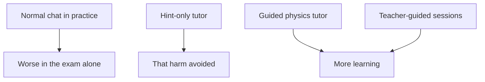

## Two hours or four

Kinan and Asma are on the same coding bootcamp. Before it starts, every student takes an entry test: 20 short problems on percentages and rates, done alone, with no AI allowed. The bootcamp gives everyone 20 practice problems to prepare. Kinan and Asma use the same chat assistant to practise, but in different ways.

Kinan pastes each practice problem into the chat and asks for the answer. Each answer comes with a clear explanation. He reads it, nods and moves on. He finishes all 20 in about two hours, every one correct.

Asma types: "Do not give me the answer. Give me one hint." Then she tries the problem herself. Sometimes she gets it wrong and has to ask for another hint. After two hours she is only on problem 9. She feels slow, and she wonders whether she is doing it wrong. Her friend is finished, with a perfect score.

Which of them is better prepared for the test? This chapter answers that question twice: once with Kinan and Asma's example, and once with what careful studies found when they looked at the same question with many students.

## Who does the thinking

The idea behind this chapter fits in one question: during practice, who does the thinking? When the AI gives you the answer, the AI did the hard part: it chose a method, worked through the steps and noticed the trap. You did the easy part, which is reading. When the AI gives you a hint, you still have to choose, work, get stuck and find your own mistake. That is slower, and it is exactly what the test will ask you to do alone.

Reading a clear answer feels like learning. The steps make sense, so it seems you could do them yourself. Module 3 looks at this feeling closely, because it fools almost everyone. For now, keep one rule in mind: the work you hand to the AI during practice is work you have not practised.

## Worked example: one problem, asked two ways

Here is one of the 20 practice problems: "A price falls by 20%, then rises by 20%. Is it back where it started?" Follow what each way of asking makes the learner do.

**Kinan asks for the answer.** The chat assistant replies: "No. Take 100 shekels. A 20% fall gives 80. A 20% rise on 80 is 16, which gives 96. The price ends 4% lower than it started." Kinan reads it. Every step is clear, so he moves on in under a minute. What did he practise? He practised reading a correct method. He did not have to notice that the second 20% is taken from a smaller number, because the answer noticed it for him.

**Asma asks for a hint.** She first guesses "yes, it is back", because 20 down and 20 up sounds equal. She asks the AI not to tell her the answer, only to check her reasoning with one question. It asks: "Try it with 100 shekels. What is the price after each step?" She works it out: 80, then 80 plus 16, which is 96. Her guess was wrong, and she can see exactly why: the rise is 20% of 80, not 20% of 100.

**What each one carries into the test.** Asma made the common mistake, then found it herself, with numbers she chose. That takes about ten minutes instead of one. But the next time a problem has two percentage changes in a row, she has a reason to stop and check which number each percentage is taken from. Kinan has a memory of reading a clear explanation, without the moment of being wrong and finding out why.

Notice what Asma did not do. She did not refuse the AI, and she did not struggle alone for an hour. She used the tool for what a good teacher does: a question at the right moment. The AI was still fast and still useful. It just did not do her thinking for her.

## Kinan and Asma's test

Here are their practice results. Kinan answered all 20 practice problems correctly in about two hours. Asma took about four hours and got 14 of the 20 right on her first try. These are numbers from their example, not from a study.

```predict
prompt: "Kinan scored 20 of 20 in practice with answers from the AI. Asma scored 14 of 20 with hints only. In the entry test, with no AI, who do you expect to score higher?"
options:
  - id: kinan
    label: "Kinan, as his practice score was much higher"
  - id: asma
    label: "Asma, since she did the thinking herself"
correctOptionId: asma
explanation: "In practice, Kinan's score measured what the AI could do. In the test, only what Kinan can do counts, and he had not practised the steps himself. Asma's practice was slower and her score lower, but she practised exactly what the test asks."
```

Step through both paths below. Each row is one way of using the same chat assistant, ending in the same test.

<InteractiveCanvas slug="answers-or-hints" />

The canvas showed the two paths side by side. On the answers path, practice was fast and perfect, and the test alone went badly: 9 of 20. On the hints path, practice was slower and scored lower, and the test went better: 15 of 20. The practice score on the answers path measured the AI's work, not Kinan's. Only the test, taken alone, showed what each of them could do.

Remember that this is one example made up to show the idea. Real results vary from person to person and from subject to subject. The next section is about what happened when researchers asked the same question with real students, in carefully designed studies.

## What the studies found

Several recent studies have looked at AI and learning. They are worth reading carefully, because loud claims about them travel fast. Each finding below is stated in plain words, with what the study cannot tell us. Most of them are a <GlossaryTerm term="randomised trial" definition="A study that puts people into groups by chance, so the groups are alike at the start. A difference at the end can then be put down to what each group did." />.

**Answers during practice, then an exam alone.** In one large study, nearly a thousand high school maths students practised with or without an AI chat. Students who used a normal AI chat during practice did better in practice, and worse in the exam without it, than students who never had it. A version that gave hints instead of answers did not cause that harm. It also did not show a clear gain in the exam. The limits: these were short-term results, in one subject, in one school system.

**A guided tutor in a physics course.** At Harvard University, teachers built an AI tutor for an introductory physics course. It guided students step by step. In a randomised trial with 194 students, students learned more in less time with the tutor than in a class lesson where students already worked through problems together. The limits matter here. It was one course at one university. The tutor used instructions and answers written by experts for each question, so a general chat is not the same thing. The authors do not claim AI tutoring will always do better, and they write that an AI tutor should not replace teaching in person.

**Teacher-guided sessions in Nigeria.** In a trial in Nigeria, secondary school students who used an AI chat with a teacher's guidance, in short regular sessions, improved their English. The sessions were after school, twice a week, for six weeks, using Microsoft Copilot. The limits: it lasted six weeks, teachers guided every session, and students used computer labs, not their own phones.

**AI that coaches the tutor.** In a randomised trial with 900 tutors and 1,800 students, a tool called Tutor CoPilot suggested teaching moves to human tutors during their lessons. Students whose tutors had it were about 4 percentage points more likely to master a topic, which is about 4 more students in every 100. With tutors who had been rated lower, the gain was about 9 points. The tutors with the tool also gave away answers less often. Here the AI helped a person teach. It did not replace the person.

The diagram sets these findings next to each other. Read each arrow as "in that study, this kind of AI use went with this result".



The Tutor CoPilot trial belongs with the last two: the AI guided a person, who guided the student.

What to notice: none of the arrows depends on the AI being "good" or "bad". The same kind of tool appears on both sides. What changes is the design and the use: answers handed out during practice in the first box, and hints, guidance or a teacher in the others. The takeaway is our summary of several studies, not the finding of any one of them. AI helps learning when it is designed or used to make the learner think. It can harm learning when it hands out answers.

That summary is why module 3 exists. Its habits, such as testing yourself, asking the AI to quiz you, and explaining in your own words, are all ways to keep the thinking on your side.

## Using a chat assistant this way

You do not need a special tool to get hints instead of answers. At the time of writing (checked 2026-10-24), some chat assistants have a mode built for this. Gemini has a Guided Learning mode, and ChatGPT has a study mode that asks you questions instead of giving the answer. ChatGPT's own help page says its study mode can make mistakes. These modes are designed to make you think, but no large study that we found has tested them yet. Check whether they work in your language and your country.

If a mode is missing, changed or blocked, any chat assistant works with one instruction at the start: "Do not give me the answer. Ask me one question at a time, and wait for my reply." That instruction is the habit. The mode is only a shortcut to it.

## Where it goes wrong

The first mistake is to turn hints back into answers. You ask for a hint, you are tired, and after the second hint you type "just tell me". Sometimes that is fine. But if it happens on every problem, you are back on Kinan's path with extra steps. A useful rule: try for at least five minutes before you ask for the next hint.

The second mistake is to read the studies as hype. "AI tutors double learning" is not what any study above found. One carefully built tutor helped in one physics course. Treat a headline that is bigger than the study as a warning sign about the headline.

The third mistake is to read the studies as fear. "AI makes you worse at learning" is not what they found either. The harm appeared when a normal chat handed out answers during practice. Guided use, hints and teacher-led sessions went the other way.

The fourth mistake is to use hints when you do not need to learn the skill. If Rana needs one PDF receipt tonight and never again, asking for working code and testing it is a sensible use of her time. The question is always what you are trying to get: a result, or a skill. When it is a skill, keep the thinking yours.

<Callout type="tip" title="A rule for any study session">
If the AI did a step during practice, you have not practised that step. Before a test, redo one problem from each topic with no AI at all.
</Callout>

## Check your understanding

```quiz
type: mcq
question: "Kinan wants to tell his bootcamp group of 25 students what the study of nearly a thousand high school maths students found. Which sentence reports it fairly?"
options:
  - "In one study, normal AI chat helped practice but hurt the exam taken without it"
  - "A study proved that using AI chat makes students worse at maths for good"
  - "A study found that AI tutors double how much students learn in maths"
  - "A study found that students who used AI did better on every test they took after"
correct: 0
explanations:
  - "Right. It names one study, says what changed in practice and in the exam alone, and claims nothing more."
  - "The study looked at short-term results in one subject and one school system. It did not show a lasting effect, and the hint version did not cause the harm."
  - "No study above found that AI doubles learning. One carefully built tutor helped in one physics course, and that was a different study."
  - "This is the opposite of what happened in the exam without AI. Practice scores went up, exam scores without AI went down."
```

```quiz
type: mcq
question: "Bilal runs a small online shop with 120 products. He is building a spreadsheet to track his stock, and he will update and fix it himself for months. He has a chat assistant and one week. Which way of using it will leave him able to fix the sheet alone?"
options:
  - "Ask for each finished formula and paste it in, so the sheet is ready today"
  - "Ask for each formula with a full explanation, and read it twice"
  - "Write each formula himself first, and ask for one hint when stuck"
  - "Avoid the AI and learn only from a long spreadsheet manual"
correct: 2
explanations:
  - "This gets the sheet done fastest, but the AI does all the thinking. When a formula breaks next month, Bilal will not know how to fix it."
  - "Reading a clear explanation twice feels like learning, but Bilal still never writes a formula himself. The thinking stays with the AI."
  - "Right. Bilal does the thinking, and the AI helps only at the moment he is stuck. That builds the skill he needs to fix the sheet alone."
  - "This avoids the harm, but it is Rana's path: slow, with no extra learning. A hint at the right moment would save him hours."
```

**Next:** Why a big app is easy to build now, and why a project you understand is the one that stands out.
