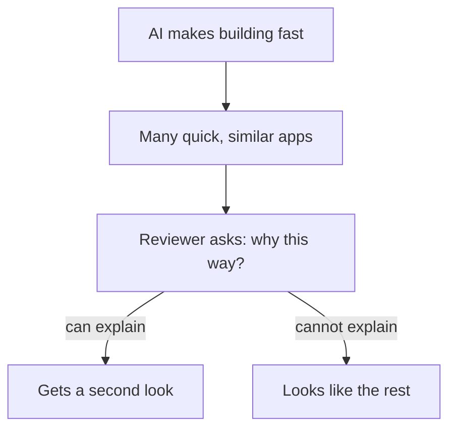

## Fourteen features and three

Once a month, the fellowship's mentors hold a short review. Each fellow shows a project for ten minutes, and the mentor asks questions. This month, Khaled and Yara are reviewed by the same mentor, one after the other.

Khaled shows his online store from chapter 1.1. It has 14 features: product pages, a cart, discount codes, reviews, a search box, an owner's page and more. The mentor is impressed for about two minutes. Then she sorts the products by price. Khaled has fixed the strange order from chapter 1.1, so she asks the next question: why were prices stored as text in the first place? Khaled does not know. She types a letter into the quantity box on the payment page, and the page goes blank. She asks what should happen there. Khaled does not know that either. He has nothing written about why the store is built the way it is, because he never decided.

Yara shows the first slice of Qasir, built in her first two weeks, about 16 hours of work. It does three things. You give it a long link, and it saves the link with a short code. Anyone who opens the short code lands on the long page, and a code that does not exist shows a clear "link not found" page. And each link keeps a click count in the simplest way: a number saved in the database, one higher on every click. That is all.

The mentor asks Yara the same kind of questions. Why is the click count a number? "Because I add one on every click, and I compare counts to sort links. You cannot add one to text." What happens with a short code that does not exist? Yara opens one, and the "link not found" page appears. Why are there no accounts? Yara opens her decision note from chapter 1.3 and reads the reason.

At the end, the mentor says which project she would show an employer. It is the small one. This chapter is about why.

## Building fast is no longer rare

In this module's example, Khaled had 14 features running by Sunday night, without understanding most of what was written. In the course's view, that kind of speed is now within reach of anyone with an AI coding assistant. That is real progress, and this course does not ask you to give it up.

But when something becomes easy, it stops being a signal. A reviewer who sees a big app cannot tell much from the app alone. Can the person behind it build anything without the tool? Can they fix it when it breaks, or change it when a client asks? Ten fast stores look much the same. So reviewers, interviewers and clients look for what is still hard: a person who knows why each part is the way it is.

The diagram follows a fast-built project to the question that decides whether a reviewer looks twice.



What to notice: the speed at the top helps everyone equally, so it does not separate anyone. The split happens at one question, and the tool that wrote the code cannot answer it for you. The takeaway: building became easier, and understanding is still the hard part.

## What a reviewer checks

Reviewers differ, but most of them check the same few things, because these are what a job or a client will need from you. Look at each one through Khaled's and Yara's review.

**Does it work when someone else tries it?** Not on screenshots: when a stranger clicks, sorts and types something odd. Khaled's store worked for the usual clicks and broke on a wrong quantity. Yara's slice worked on everything the mentor tried, partly because it does so little.

**Can you explain every part?** This is the question from the diagram. A reviewer picks a part and asks why. "The AI wrote it" is an honest answer, but it explains nothing. Yara could explain each of her parts. Khaled could not explain the first part he was asked about.

**What happens when something fails?** Real users type letters into number boxes and open links that do not exist. A strong project shows that its builder thought about at least one failure and decided what should happen. Yara's "link not found" page is one small example. Khaled's blank page shows nobody decided.

**Are the choices written down?** A short note on why you chose each part, and what you gave up, shows that decisions were made by a person. Yara's decision note took ten minutes to write. It answered a question before the mentor finished asking it.

**How many features does it have?** This one is real too. Clients sometimes need many features soon, and a big app shows you can put many parts together. It is the one check where Khaled's store wins easily. The question is how much it should count.

## The explain-back rule

This course gives you one simple rule to keep your project on the strong side: the <GlossaryTerm term="explain-back rule" definition="The course's rule: keep a part of your project only if you can explain it without notes." />. It does not forbid AI-written code. A part the AI wrote is fine to keep, once you can explain it. A part you wrote yourself, which you cannot explain a week later, fails the rule too. Module 5 develops the rule properly. Here is what it looks like the first time.

## Worked example: Yara explains back before the review

Two days before the review, Yara goes through her slice with the rule. An AI chat helped her write some of it, so she cannot assume she understands it all.

**Step 1: list the parts.** She writes one line in her notes for each of five parts. These are the part that saves a link, the part that makes its short code, the part that sends visitors on, the "link not found" page, and the click counter. A list makes it hard to skip a part.

**Step 2: explain each part out loud, with no notes.** She records herself on her phone, one part at a time, in her own words. For four parts she can say what each does and why. The click count is a number in the database because she adds one on every click and sorts links by it. The short code uses only letters and numbers, so it survives being copied into a group chat.

**Step 3: mark what she cannot explain.** In the part that saves a link, there is a line the AI added that turns every new link into small letters before saving it. She cannot say why it is there. So she marks it, instead of hoping nobody asks.

**Step 4: test the doubt.** She tries a long link with capital letters in the part after the website name, like a page called "Menu". Some websites treat capital and small letters there as different, so "Menu" and "menu" can be two different pages. After the line runs, the short code sends visitors to "menu", which does not exist on that website. The line she could not explain was a mistake.

**Step 5: fix it and write the reason.** She removes the line and tests the link again. Then she writes one sentence in her decision notes: "Links are saved exactly as pasted, because some websites treat capital and small letters as different." She can now explain and defend every part.

The rule did not slow Yara down much: about an hour in total. It found a real mistake that would have broken some shops' links. And it gave her a ready answer for the review, which is what explaining your work is for.

## Weighing the two projects

The mentor's choice depended on what she cared about. A different reviewer, with different needs, might choose differently. The canvas lets you be that reviewer. It scores Khaled's store and Yara's slice from 1 to 5 on the five checks above, and you decide how much each check matters.

```predict
prompt: "Khaled's store has 14 features and Yara's slice has 3, but Yara can explain every part and Khaled cannot. Is there any setting of the weights where Khaled's store comes out ahead?"
options:
  - id: never
    label: "No, Yara's slice leads at every setting"
  - id: features
    label: "Yes, when features matter most"
correctOptionId: features
explanation: "If the number of features matters a lot and every other check matters only a little, Khaled's store wins. That is an honest result: some clients do want many features fast. But as soon as explaining your work or writing down your choices matters even a little more, the small, understood project wins again."
```

Change the weights below and watch which project comes out ahead. Try to find the settings where Khaled's store wins.

<InteractiveCanvas slug="big-app-or-understood-app" />

The canvas started with the weights a typical reviewer might use, and Yara's slice led by 44 points to 23. Khaled's store led in only two of the 243 possible settings. In one of them, "Number of features" matters a lot and the other four checks matter a little, and the store leads by 22 points to 20. Raising "Can explain every part" to "Matters" was enough to turn that back: Yara's slice led again, 25 to 23.

That is the honest shape of the choice. A big app still has value: it wins when the only thing anyone cares about is how much it does. But that is rarely what a reviewer, an interviewer or a client checks first, because a big app that nobody understands is hard to fix or change. The scores in the canvas are the course's illustrative judgement, not measurements, so treat the exact numbers as an example and the shape as the lesson.

## Where it goes wrong

The first mistake is to swing too far and build something so small it shows nothing. Yara's slice is small, but it has a real user, a real failure handled and real decisions. "Understood" does not mean "tiny". Over six months, Qasir will grow one area at a time, and each new part will be one she can explain. Module 5 plans that growth.

The second mistake is to believe you can explain a part because it looks familiar. Reading code you have seen many times feels like understanding. The test is to explain it out loud, without notes, as Yara did with her phone. If you stop in the middle, you have found a gap. Say so if a reviewer asks about it: "I do not know yet; I will test it and write down what I find" is a stronger answer than a guess.

## Check your understanding

```quiz
type: mcq
question: "Kinan's bootcamp final project is a medicine reminder app for a pharmacy. At the review, the reviewer picks one part for him to explain with no notes. His parts are these. 1) The reminder timer: he wrote it and can explain it. 2) The login: the AI wrote it, and he has never read it. 3) The medicine list page: the AI wrote it, and he has read and tested it and can explain it. He has two evenings left. Which use of them fits the explain-back rule?"
options:
  - "Rewrite the medicine list page himself, because the AI wrote that part"
  - "Read and test the login until he can explain it, since right now he cannot"
  - "Add a second kind of reminder, because more features may impress the reviewer"
  - "Remove every part the AI wrote, since only his own code can be explained"
correct: 1
explanations:
  - "Half right: the AI did write that page. But Kinan has read and tested it and can explain it, so it already passes the rule. His two evenings are needed elsewhere."
  - "Right. The login is the only part he cannot explain. Reading and testing it until he can, or removing it if he cannot, is what the rule asks."
  - "A new feature he has not yet explained adds a second gap. The reviewer may pick any part, including the login."
  - "Who wrote a part is not the test. The medicine list page was written by the AI and Kinan can explain it, so removing it loses work for no reason."
```

```quiz
type: mcq
question: "Reem's school wants a freelancer to build a small app for its library, which opens in six weeks. The library needs three things: lend a book, take it back, and count late days correctly. Three applicants show a project. 1) A: 9 features, but she could not say how late days are counted; free now. 2) B: 3 features, explains every part, and shows a clear message for a wrong date; free in one week. 3) C: 5 features and explains every part, but the demo went blank on a wrong date; free now. Who fits the library best?"
options:
  - "Applicant A, because nine features cover far more than the library needs"
  - "Applicant C, since she explains every part and can start straight away"
  - "None of them, because each one has a weakness the school would have to accept"
  - "Applicant B, since a week's wait still fits and his work covers what is needed"
correct: 3
explanations:
  - "More features than the library needs add little, and A could not explain the one thing the library cares most about: counting late days."
  - "Half right: C explains every part and is free now. But the demo broke on a wrong date, and dates are exactly what a library app handles all day."
  - "Every applicant has a weakness. The question is which weakness the school can live with, and a one-week wait inside six weeks is easy to live with."
  - "Right. B covers all three needs, can explain them, and has handled a wrong date. Starting a week later still leaves five weeks before the library opens."
```

**Next:** The module gate: split one task into what AI can help with, what it does not know, and the calls that stay yours.
