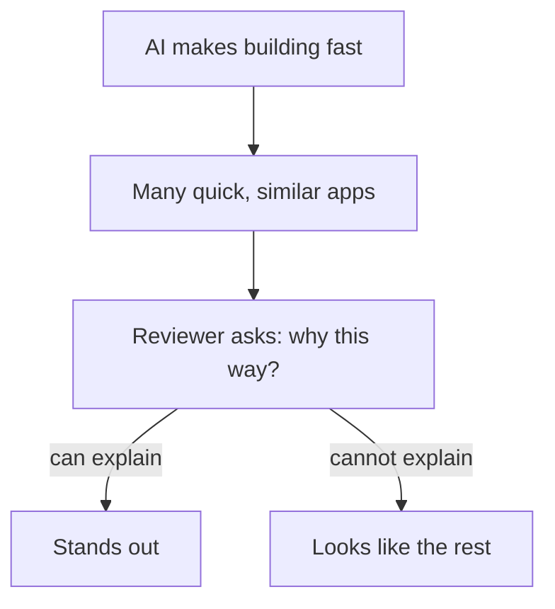

## Fourteen features and three

Once a month, the fellowship's mentors hold a short review. Each fellow shows a project for ten minutes, and the mentor asks questions. This month, Khaled and Yara are reviewed by the same mentor, one after the other.

Khaled shows his online store from chapter 1.1. It has 14 features: product pages, a cart, discount codes, reviews, a search box, an owner's page and more. The mentor is impressed for about two minutes. Then she sorts the products by price. Khaled has fixed the strange order from chapter 1.1, so she asks the next question: why were prices stored as text in the first place? Khaled does not know. She types a letter into the quantity box on the payment page, and the page goes blank. She asks what should happen there. Khaled does not know that either. He has nothing written about why the store is built the way it is, because he never decided.

Yara shows the first slice of Qasir, built in her first two weeks, about 16 hours of work. It does three things. You paste a long link and get a short one. Anyone who opens the short link lands on the long page. And each link has a click count. That is all. The mentor asks the same questions. Why are click counts stored as whole numbers? "Because I add one on every click, and I compare counts to sort links. You cannot add one to text." What happens with a short link that does not exist? Yara opens one, and Qasir shows a clear "link not found" page. Why are there no accounts? Yara opens her decision note from chapter 1.3 and reads the reason.

At the end, the mentor says which project she would show an employer. It is the small one. This chapter is about why.

## Building fast is no longer rare

A few years ago, a fellow who could build a working online store in a weekend had a rare skill. AI coding tools have changed that. With an AI coding assistant, many people can now produce a working demo with many features quickly, without understanding most of what was written. That is real progress, and this course does not ask you to give it up.

But when something becomes easy, it stops being a signal. A reviewer who sees a big app cannot tell much from the app alone. Can the person behind it build anything without the tool? Can they fix it when it breaks, or change it when a client asks? Ten fast stores look much the same. So reviewers, interviewers and clients look for what is still hard: a person who knows why each part is the way it is.

The diagram follows a fast-built project to the question that decides whether it stands out.



What to notice: the speed at the top helps everyone equally, so it does not separate anyone. The split happens at one question, and that question cannot be answered by the tool that wrote the code. The takeaway: AI raised the floor for building. Understanding is what is left above it.

## What a reviewer checks

Reviewers differ, but most of them check the same few things, because these are what a job or a client will need from you. Look at each one through Khaled's and Yara's review.

**Does it work when someone else tries it?** Not on screenshots: when a stranger clicks, sorts and types something odd. Khaled's store worked for the happy path and broke on a sort and a wrong quantity. Yara's slice worked on everything the mentor tried, partly because it does so little.

**Can you explain every part?** This is the question from the diagram. A reviewer picks a part and asks why. "The AI wrote it" is an honest answer, but it is not an explanation. Yara could explain each of her three parts. Khaled could not explain the first part he was asked about.

**What happens when something fails?** Real users type letters into number boxes and open links that do not exist. A strong project shows that its builder thought about at least one failure and decided what should happen. Yara's "link not found" page is one small example. Khaled's blank page shows nobody decided.

**Are the choices written down?** A short note on why you chose each part, and what you gave up, shows that decisions were made by a person. Yara's decision note took ten minutes to write. It answered a question before the mentor finished asking it.

**How many features does it have?** This one is real too. Clients sometimes need many features soon, and a big app shows you can put many parts together. It is the one criterion where Khaled's store wins easily. The question is how much it should count.

## The explain-back rule

This course gives you one simple rule to keep your project on the strong side: the <GlossaryTerm term="explain-back rule" definition="The course's rule: keep a part of your project only if you can explain it without notes." />. It does not forbid AI-written code. A part the AI wrote is fine to keep, once you can explain it. Module 5 develops the rule properly. Here is what it looks like the first time.

## Worked example: Yara explains back before the review

Two days before the review, Yara goes through her slice with the rule. An AI chat helped her write some of it, so she cannot assume she understands it all.

**Step 1: list the parts.** She writes one line in her notes for each of the five parts. These are the form page, the short code maker, the part that saves the link, the part that sends visitors on, and the click counter. A list makes it hard to skip a part.

**Step 2: explain each part out loud, with no notes.** She records herself on her phone, one part at a time, in her own words. For four parts she can say what each does and why. Click counts are whole numbers because she adds one on every click and sorts links by them. The short code uses only letters and numbers, so it survives being copied into a group chat.

**Step 3: mark what she cannot explain.** In the part that saves a link, there is a line the AI added that turns every new link into small letters before saving it. She cannot say why it is there. So she marks it, instead of hoping nobody asks.

**Step 4: test the doubt.** She tries a long link with capital letters in the part after the website name, like a page called "Menu". Some websites treat capital and small letters there as different, so "Menu" and "menu" can be two different pages. After the line runs, the short link sends visitors to "menu", which does not exist on that website. The line she could not explain was a mistake.

**Step 5: fix it and write the reason.** She removes the line and tests the link again. Then she writes one sentence in her decision notes: "Links are saved exactly as pasted, because some websites treat capital and small letters as different." The part she could not explain is now a part she can defend.

The rule did not slow Yara down much: about an hour in total. It found a real mistake that would have broken some shops' links. And it gave her a ready answer for the review, which is what explaining your work is for.

## Weighing the two projects

The mentor's choice depended on what she cared about. A different reviewer, with different needs, might choose differently. The canvas lets you be that reviewer. It scores Khaled's store and Yara's slice from 1 to 5 on the five checks above, and you decide how much each check matters.

```predict
prompt: "Khaled's store has 14 features and Yara's slice has 3, but Yara can explain every part and Khaled cannot. Is there any setting of the weights where Khaled's store comes out ahead?"
options:
  - id: never
    label: "No, Yara's small slice wins at every setting of the weights"
  - id: features
    label: "Yes, when the number of features matters most"
correctOptionId: features
explanation: "If the number of features matters a lot and every other check matters only a little, Khaled's store wins. That is an honest result: some clients do want many features fast. But as soon as explaining your work or writing down your choices matters even a little more, the small, understood project wins again."
```

Change the weights below and watch which project comes out ahead. Try to find the settings where Khaled's store wins.

<InteractiveCanvas slug="big-app-or-understood-app" />

The canvas started with the weights a typical reviewer might use, and Yara's slice led by 44 points to 23. Khaled's store won only in a narrow corner. With "Number of features" set to matter a lot and the other checks set to matter a little, it led by 22 points to 20. Raising "Can explain every part" to "Matters" was enough to turn that back: Yara's slice led again, 25 to 23.

That is the honest shape of the choice. A big app is not worthless. It wins when the only thing anyone cares about is how much it does. But that is rarely what a reviewer, an interviewer or a client checks first, because a big app that nobody understands cannot be fixed or changed. The scores in the canvas are the course's illustrative judgement, not measurements, so treat the exact numbers as an example and the shape as the lesson.

## Where it goes wrong

The first mistake is to swing too far and build something so small it shows nothing. Yara's slice is small, but it has a real user, a real failure handled and real decisions. "Understood" does not mean "tiny". Over six months, Qasir will grow one area at a time, and each new part will be one she can explain. Module 5 plans that growth.

The second mistake is to believe you can explain a part because it looks familiar. Reading code you have seen many times feels like understanding. The test is to explain it out loud, without notes, as Yara did with her phone. If you stop in the middle, you have found a gap.

The third mistake is to think the rule means "write everything yourself". It does not. A part the AI wrote, which you have read, tested and can explain, is yours to keep. A part you wrote yourself, which you cannot explain a week later, fails the rule too.

The fourth mistake is to hide the gaps from a reviewer. If you are asked about a part you cannot yet explain, say so, and say how you will find out. "I do not know yet; I will test it and write down what I find" is a much stronger answer than a guess.

## Check your understanding

```quiz
type: mcq
question: "Kinan has three weeks left on his bootcamp. His final project, a booking app for a sports club, has 4 features. At the final review, each student must explain one part chosen by the reviewer, with no notes, and show what happens when something fails. Which plan fits what the reviewers check?"
options:
  - "Add six more features with an AI coding assistant so the app looks bigger"
  - "Explain each part aloud, test one failure, write down his reasons"
  - "Rewrite the whole app by hand so that no part was written by an AI"
  - "Ask the AI to write an explanation of each part to read out in the review"
correct: 1
explanations:
  - "More features he cannot explain make the review harder, not easier. The reviewer will pick a part and ask why."
  - "Right. This prepares him for exactly what the review checks: explaining any part, a failure that is handled, and choices written down."
  - "Who typed the code is not what the review checks. Rewriting by hand uses his three weeks and still does not prepare him to explain or handle a failure."
  - "Reading out an explanation the AI wrote is not explaining. With no notes allowed, it would not help him in the review at all."
```

```quiz
type: mcq
question: "Bilal wants to hire a freelancer to improve his online shop with 120 products. Three applicants show him a project. Applicant A's has 12 features, but she could not say how the cart total is worked out. Applicant B's has 3 features and he explained every part, but the demo went blank when Bilal typed a letter in the quantity box. Applicant C's has 5 features; she explained every part, showed a clear message for a wrong quantity, and had a note on why orders are saved the way they are. Who fits best?"
options:
  - "Applicant A, because 12 features show she can build the most"
  - "Applicant B, because explaining every part matters most of all"
  - "None of them, because each project had at least one weakness"
  - "Applicant C, as her work held up on every check Bilal ran"
correct: 3
explanations:
  - "Many features count for something, but she could not explain how the cart total is worked out. Bilal's shop depends on that total being right."
  - "Explaining every part is a strong sign, but B's demo broke on a simple wrong input. Nobody had decided what should happen there."
  - "Every project has some weakness. C's work met every check Bilal ran, so waiting for a perfect applicant would cost him time for nothing."
  - "Right. C's project works on a wrong input, she can explain every part, and her choices are written down. Fewer features than A, but every one is understood."
```

**Next:** The module gate: split one task into what AI can help with, what it does not know, and the calls that stay yours.
