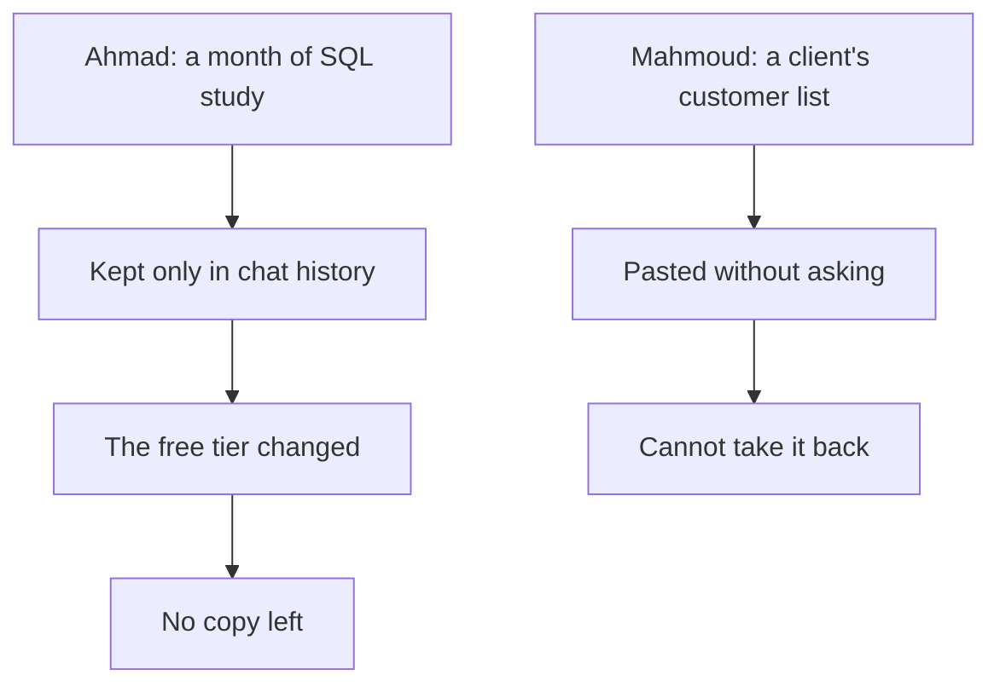

<BigWordAlert term="Free tier" plainEnglish="What a tool lets you do without paying. The company that makes the tool decides what is in it, and it can change it at any time." whyItMatters="Most fellows use free tiers. If your work lives only inside one, a change you did not choose can take that work away from you." />

## A month in one chat

Ahmad is a fellow who wants a junior backend job. In March he decided to learn SQL, the language most databases use. He had no textbook and not much money, so he used the free tier of a chat tool on his phone. Every evening he spent about an hour with it.

He used it well. He did not ask the tool to do his homework. He asked it to explain joins with a small example from a school's list of students and classes. Then he asked it to quiz him, one question at a time. When he got an answer wrong, he asked why. He opened a new chat for each topic: joins, grouping, indexes, keys. After a month he had about 30 chats. Together they were his whole course.

He never wrote anything down anywhere else. "The chats are my notes," he told a friend. "I can search them whenever I want." It felt like a good system. Everything was in one place, and it was always on his phone.

Then the tool changed its free tier. Every free user had to sign in again and confirm an email address. Ahmad had signed up a year earlier with an old school email that he could no longer open. The code went to that address. He tried for two weeks. The help form asked him to prove the account was his, using the same email. His month of explanations, quizzes and his own answers was still there, inside an account he could not reach.

What he still had was what was in his head. Two weeks later, he took a short SQL test for a job on a freelance marketplace. He passed the easy questions and missed the ones about indexes. Those were the topics he had studied last, and never reviewed. He had no page to go back to, no list of his mistakes and no copy of the examples that had helped him. He had to start those topics again.

The tool was not the problem in this story. It taught Ahmad SQL for a month, for free. Nothing in this case says that a tool deleted anyone's history. The problem was simpler. Ahmad's work lived in exactly one place, and that place belonged to someone else.

## A list that was not his

Mahmoud is a freelance web developer. He has three years of small jobs from local clients and from a freelance marketplace. Last month the owner of a print and copy shop hired him for 150 dollars. She wanted a simple page where customers can see when their print order is ready, and a text message when it is done.

First, the shop's customer list needed cleaning. It had 640 rows of names and phone numbers, typed by different staff over five years. Some numbers had the country code and some did not. Some customers appeared three times with small spelling changes. Cleaning it by hand would take Mahmoud most of a day.

So he selected the whole list, pasted it into a free chat tool, and asked it to remove the duplicates and write every number the same way. Two minutes later he had a clean list. He checked twenty rows, and they were right. He was pleased. The job was finished early.

A week later, he wrote in his invoice note: "I cleaned your customer list with an AI tool in two minutes." The owner phoned him that evening. She had promised her customers that their numbers would only be used for order messages. Now she asked a simple question: where is my list now? Mahmoud did not know.

He opened the tool's settings for the first time. He found that chats could be used to improve the tool unless a setting was switched off, and he had never looked. He deleted the chat, but that did not tell him what had already happened to the copy on the company's side. The owner paid him for the job. She gave the next job, the shop's full website, to someone else.

```predict
prompt: "Both Ahmad and Mahmoud used a free AI tool, and both lost something. Before you read on, was using an AI tool the mistake?"
options:
  - id: habits
    label: "No, the tools helped; the habits around them failed"
  - id: tools
    label: "Yes, they would have been safer doing it all by hand"
correctOptionId: habits
explanation: "The chat tool taught Ahmad SQL every evening, and it cleaned the list in two minutes. In both stories the AI did real, useful work. What went wrong was where Ahmad kept his work, and what Mahmoud put in without asking. This module teaches those habits, so you keep the speed without the risk."
```

## Two stories, one gap

The two stories look different. One is about losing your own work. The other is about putting in someone else's data. But they have the same shape. In both, a person used an AI tool for a sensible job and got a good result. In both, the person had no habit around the tool. Nobody had told them what to check before they started, or where the work should live afterwards.

The diagram puts the two stories side by side. Read each column from the top.



What to notice: neither column has a box that says "the AI gave a wrong answer". The AI's answers were fine. Each story turns bad at the second box, which is a choice the person made without thinking about it. Ahmad chose to keep his work only in the chat history. Mahmoud chose to paste the full list. The takeaway: the risky moment is not the answer. It is what goes in, and where the result is kept.

## Why this matters for your career

You will use free tiers for years, and that is fine. Many free tools are very useful. But a free tier is a promise the company can change. At the time of writing (checked 2026-10-24), one well-known tool changed its name and its free limits during the few months this course was being written. Chapter 2.4 tells that story. Plans, limits, sign-in rules and the countries a tool serves can all change. A habit you control does not.

Clients care about this more than most fellows expect. A client who gives you a customer list is trusting you with other people's details. If you paste them into a tool without asking, you have shared them with a company the client never chose. That can cost you a client, a good review on a freelance marketplace, or a reference you needed for your next job. It can also break a promise the client made to their own customers.

Employers care too. In an interview, you may be asked how you use AI at work. "I use it for everything" worries an employer. So does "I never use it". A calm, specific answer shows judgement: "I never paste client data or keys. I find the training setting in any tool I use. I keep my work in my own files, and I have a second tool for each job." That answer tells the interviewer you can be trusted with their systems.

Your learning is at stake as well. Ahmad did not only lose a month of chats. He lost the record of what he got wrong, which is the most useful part of any study. When your notes live in files you own, you can come back to your mistakes in a week, in a month, or before an interview. Module 3 builds on this. It shows how to keep notes in your own words that are still useful months later.

## What this module covers

This module is about the toolkit around the tools. Chapter 2.2 comes first on purpose. Before you open any tool, you decide what never goes into it, and you learn a short check you can do in a few seconds. You also learn to find the setting that controls whether your chats train the tool, and to check what comes back before you use it.

Chapter 2.3 is about choosing tools by the job they do. Learning from your own sources, being quizzed, searching with links, running a lab, keeping notes and sharing your work are different jobs. Each job has at least two example tools. You also learn a three-question check: does it open here, at my age, on my device?

Chapter 2.4 is about the habits that keep your work safe when a tool changes: files you own, saved prompts that worked, and a fallback for every job. Then a short quiz checks your choices on new cases. The module ends with your own toolkit page, checked and dated, which you will use for the rest of the course.

<LearningObjectives items={["Decide what never goes into an AI tool, and use a quick check before you paste anything", "Find the training setting in any AI tool you use, without a list of menus", "Check AI output before you use it: run the code, check the command, open the link", "Choose a tool by the job it does, with two examples for each job, and check that it opens for you", "Keep your work in files you own, with a fallback for every job"]} />

## Key words

| Word | Plain English |
|---|---|
| **Free tier** | What a tool lets you do without paying; the company can change it |
| **Chat history** | The past chats a tool keeps in your account; it is not a file you own |
| **Personal data** | Facts about a real person, such as a name, a phone number or an address |
| **Training setting** | A setting in an AI tool that says whether your chats may be used to improve it |
| **Fallback** | A second way to do the job when your first tool is down, blocked or changed |

## What is in this module

| Chapter | You will practice |
|---|---|
| 2.2 | Deciding what never goes into an AI tool, finding its training setting, and checking what comes back |
| 2.3 | Choosing a tool by its job, with two examples each, and checking that it opens for you |
| 2.4 | Keeping work in files you own, saving prompts that worked, and having a fallback |
| 2.5 | A graded quiz with five short cases |
| 2.6 | Your own toolkit page, checked and dated |

**Next:** What never goes into an AI tool, how to find its training setting, and how to check what comes back.
