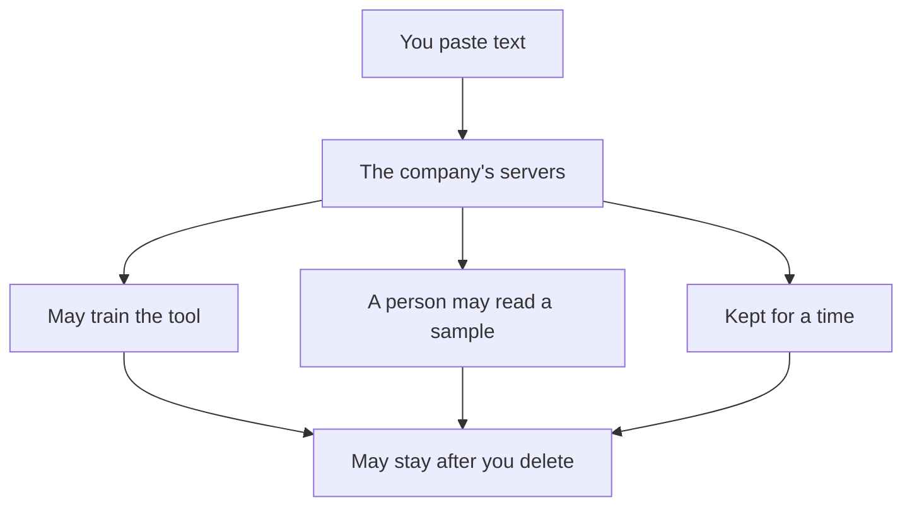

## A key on line 3

Three weeks after the print shop, Mahmoud has a new client: a sports club with 300 members. The club sends each member a text message when their monthly fee is due. Last week the reminder script stopped working, and the club's secretary asked Mahmoud to fix it for 80 dollars.

The script sends each reminder through the text message service's <GlossaryTerm term="API" definition="A set of fixed requests that one program can send to another, such as 'send this text message to this number'." />. It uses one <GlossaryTerm term="endpoint" definition="One address in an API that does one job, such as the address that sends a message." /> of it, the one that sends messages. Mahmoud opens the script. It is about 60 lines long, and he cannot see the problem. He selects the whole file, opens a chat tool, and moves to paste it.

Then he stops. Line 3 holds the club's <GlossaryTerm term="API key" definition="A long secret code that lets a program use a service, such as a text message service, in someone's name. Anyone who has the key can use the service, and the owner pays for it." /> for the text message service. If he pastes the file, the key goes with it.

That pause is what this chapter is about. After the print shop, Mahmoud learned a habit that takes a few seconds: before anything goes into an AI tool, check what is in it. This chapter teaches that habit, the setting to find in every tool you use, and how to check what comes back.

## Where a paste can go

When you paste text into an AI chat tool, it leaves your phone or laptop. It goes to the company that runs the tool. What happens next depends on the company's rules and on your settings, and most people never read either.

At the time of writing (checked 2026-10-24), many free AI chat tools use your chats to improve their models unless you change a setting. Some services also have trained people read a sample of chats. Google's own help page for Gemini says it plainly: "Please don't enter confidential information." The diagram shows the paths a paste can take once it leaves you.



What to notice: every path ends in the same box. Deleting the chat in your account may not remove every copy. Google says, for example, that reviewed Gemini chats are kept even after you delete your activity. The takeaway: the moment you fully control is the moment before you paste.

This is not only a worry for fellows. In May 2023, Samsung banned its staff from using generative AI tools on company devices. It had found that staff had uploaded sensitive code to ChatGPT. Its memo said that data held on outside servers is hard to get back and delete. A large company reached the same conclusion you can reach in a few seconds: check before you paste.

## Five things that never go in

Some things never go into an AI tool, whatever the settings say. The first is any password. The second is any key or token, like the club's API key. A key works like a password for anyone who has it, and it can cost the client money.

The third is a client's data, unless the client has said yes in writing. The data belongs to the client, and often the client has made promises to their own customers about it, as the print shop owner had. The fourth is other people's personal data: names, phone numbers, addresses, photos, health or money details. That includes friends and family. They did not choose to share it.

The fifth is private documents: contracts, ID cards, bank papers, medical papers, and an employer's code that is not public. If you are not sure whether something is private, treat it as private.

## The stranger test

You do not need to remember a long list of rules while you work. One question covers most cases: would I be fine if a stranger read this? Imagine the text printed on a sheet and left on a bench at a bus stop. If that thought makes you uneasy, the text is not ready to paste.

When the answer is no, you have two choices. You can remove the names, numbers and keys first. Or you can decide not to paste it at all, and do that part by hand or ask the owner first. Either way, the decision happens before the paste, while the text is still only on your device.

## Find the training setting in any tool you use

Every AI tool you use has rules about what it does with your chats. Most have a setting that says whether your chats may be used to improve, or train, the tool. You met this as the training setting in chapter 2.1. The names change between tools and over time. In ChatGPT, it was called "Improve the model for everyone" at the time of writing. Other tools use other words.

So learn the habit, not the menus. Before your first real chat in a new tool, open its settings and look for a section about privacy or data. If you cannot find it, search the tool's own help page for "training" or "improve the model". Read what the setting does, decide whether to turn it off, and write down the date you checked. Chapter 2.6 asks you to add this to your toolkit page.

One warning. Turning the setting off does not make a tool a safe place for secrets. A company may still keep chats for a time, for example to check for abuse. The stranger test still applies with every setting.

## Worked example: Nada's afternoon at the NGO office

Nada volunteers at an NGO that runs a coding club for teenagers. On Tuesday afternoon she has three tasks, and she wants an AI chat tool's help with each one. Watch her reasoning, one task at a time.

**Task 1: a poster.** She wants to shorten a paragraph about the club for a poster. The paragraph is already on the NGO's public website. She asks the stranger question: would I be fine if a stranger read this? Yes, strangers already read it every day. She pastes it as it is.

**Task 2: parents' feedback.** She has feedback forms from 45 parents, with names, phone numbers and comments. She wants a short summary for her manager. The stranger test fails: these are other people's personal data. So she makes a copy, deletes the name and phone columns, and reads the comments. Two comments name a child, so she removes those names too. Then she asks her manager whether the comments may go into an AI tool at all. The manager says yes, without names. Only then does she paste.

**Task 3: a sign-in error.** The NGO's social media account shows an error when she signs in. She has an email with the login details and wants to paste it. It contains a password, so it fails before any test: passwords never go in. Instead she types the error message in her own words and asks what it usually means.

**Checking what came back.** The summary says "Most parents asked for a Saturday session." That sounds useful, but Nada checks it against her sheet. She asks the tool for a formula that counts comments containing "Saturday", and runs it on her copy. It finds 3. She also counts the first ten rows by hand, to check the formula itself: it matches. So 3 of 45 is not "most". She corrects the summary before it goes to her manager.

Look at the shape of Nada's afternoon. She used the AI for all three tasks. What changed from task to task was what she pasted, and she checked the one answer that would go to her manager.

## Mahmoud's next job

Now go back to Mahmoud and the sports club. His job has two parts. The script has a bug he cannot find. The club also wants its member list cleaned, so that every phone number is written the same way. The list has 300 rows: names, phone numbers and the fee each member owes. The real list fails the stranger test, and the club never agreed to share it.

```predict
prompt: "Mahmoud needs a formula that writes 300 members' phone numbers the same way, and the real list cannot go in. Before you step through, what do you expect the AI needs from him to write that formula?"
options:
  - id: real
    label: "The real list, or at least a large part of it"
  - id: shape
    label: "A few made-up rows in the same columns"
correctOptionId: shape
explanation: "A formula works on the shape of the data: which column holds the number, and how the numbers are written. Five made-up rows in the same columns show that. The real people add nothing the formula needs."
```

Step through Mahmoud's check below. Watch which requests are refused, and what he sends instead.

<InteractiveCanvas slug="before-you-paste" />

The canvas showed two refusals and one safe path. The key was refused because keys never go in, with any setting. The full member list was refused because it fails the stranger test and the club never agreed to share it. What went in instead was the script with `KEY_HERE` on line 3, and five made-up members in the same columns. For most jobs like this, the AI needs the shape of your data, not the real data. The placeholder showed where the key goes without giving it away, and the made-up rows showed how the numbers are written. Notice the last step too. Mahmoud did not use the answer until he had checked it.

## Check what comes back

The course Think Clearly (module 7) taught three checks for any AI answer: check the rough numbers, find the source, and solve it another way. Those still apply. Work with tools adds three more checks, one for each kind of thing an AI hands you.

**Check code by running it.** Run it first on a copy, with made-up or test data, and compare the result with what you expected. Mahmoud ran the cleaned formula on his five made-up rows and then on a copy of the real list on his own laptop. He compared ten rows by hand before he touched the club's file.

**Check a command against the official documentation.** An AI can give you a command that is out of date, or that does more than you think. Find the command in the tool's own documentation, from the tool's own website, and read what it does before you run it.

**Check a link by opening it.** A link in an answer is something to check, not proof. Open it and check two things: that it is the page the AI says it is, and that it says what the AI claims. Mahmoud opened the link the AI gave for the text message service. It led to an old page that no longer existed. He found the current page from the service's own website.

## Where it goes wrong

Does deleting the chat undo the paste? No. It removes the chat from your list. It does not tell you what already happened on the company's side, as Mahmoud found with the print shop.

A second mistake is removing names and leaving everything else. A phone number, an address or a rare detail can point to one person as clearly as a name. Nada removed the children's names from inside the comments, not only the name column.

A third mistake is checking an answer by asking the same AI "are you sure?". Chat assistants have what this course calls <GlossaryTerm term="the agreeing habit" definition="Sycophancy: an AI's habit of agreeing with you, or praising your idea, because you seem to want that, not because it is right." />. So a second answer from the same tool is not a check. Run it, read the documentation, or open the link.

<Callout type="info" title="A setting does not make secrets safe">
Switching off the training setting is a good habit. It does not make a password, a key or a client's file safe to paste. Keep the stranger test with every tool and every setting.
</Callout>

## Check your understanding

```quiz
type: mcq
question: "Anas works at a pharmacy and is learning to code. He wants a chat assistant to sort the pharmacy's 400 products into groups. 1) The owner agreed in writing that he may paste the product list. 2) The same sheet has a column of customers' phone numbers. 3) The tool's training setting is on. What should he paste?"
options:
  - "The whole sheet, since the owner agreed in writing to share it"
  - "The whole sheet once the setting is off, since that keeps it private"
  - "Only the product column, since that is what the owner agreed to"
  - "Nothing yet, since customers' numbers must stay offline"
correct: 2
explanations:
  - "The owner agreed to the product list, not to the customers' phone numbers in the same sheet. Those still fail the stranger test."
  - "Switching off the setting is a good habit, but it does not make customers' phone numbers safe to paste. The stranger test still applies."
  - "Right. The product column is exactly what the owner agreed to share, and it holds no one's personal data. The phone numbers stay on the pharmacy's computer."
  - "The numbers must stay out, but the product list need not. The owner agreed to it in writing, so Anas can get the help safely today."
```

```quiz
type: mcq
question: "Yaman volunteers at a clinic desk. He keeps about 40 appointments a day in a spreadsheet on the desk's shared laptop. He asks a chat assistant for a date formula. It answers: 'Use this formula. It works in every spreadsheet app. See the official help page here.' The answer ends with a link. What should he do before he relies on it?"
options:
  - "Try it on a copy and open the link, as both give evidence"
  - "Ask the assistant if it is sure, as a second answer is a check"
  - "Use it as it is, as an answer with an official link is checked"
  - "Search a forum first, as other people's views show if it works"
correct: 0
explanations:
  - "Right. Running the formula on a copy shows whether it works in his app. Opening the link shows whether the page exists and says what the AI claims."
  - "Because of the agreeing habit, a second answer from the same tool is not a check. Yaman needs evidence from outside the chat."
  - "A link is something to check, not proof. It may lead to an old page, or to a page that says something different. He has to open it to know."
  - "Other people's opinions are some evidence, but they do not show whether the formula works in his own sheet. A test on a copy answers that directly."
```

**Next:** Choosing a tool by the job it does, and checking that it opens for you, at your age, on your device.
