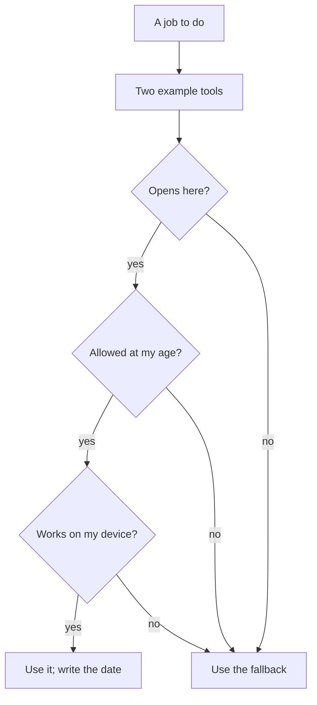

## One tool for every job

Ziad is 17 and studies web development at a coding bootcamp. In his first week, he watched a video that called one chat tool "the only AI you need". He signed up and used it for everything. He asked it to summarise the bootcamp's lecture slides, to quiz him, to find the install steps for a web <GlossaryTerm term="framework" definition="A ready-made set of code and rules that you build an app on, so you do not start from nothing." />, and to keep his notes.

By Friday, three things had gone wrong. The summary of Tuesday's slides included a step that was not in the slides. The tool had mixed in something from elsewhere, and Ziad learned it as if the teacher had taught it. The install steps were for an older version of the framework, so the commands failed on the bootcamp's laptop. And when he finally read the tool's terms, they said users must be 18 or over.

None of these problems means the tool was bad. It was being used for jobs it was not built for, by someone it was not built for. This chapter teaches the opposite order. Start from the job, and choose the kind of tool that does that job. Then check that one example of it opens for you.

## Jobs first, then tools

A job is what you need done: learn from your bootcamp's slides, be quizzed on them, find the newest install steps. Different jobs need different strengths. Learning from your own slides needs a tool that stays inside them. Finding the newest install steps needs a tool that searches recent pages and shows its links. Being quizzed needs a tool that will talk with you and wait for your answer.

Three kinds of AI tool cover most study jobs. A chat assistant is a tool you type or talk to that answers in sentences. A <GlossaryTerm term="source notebook" definition="An AI tool that answers only from the files and links you add to it, and shows where each answer came from." /> stays inside your own material. A <GlossaryTerm term="search tool with sources" definition="An AI tool that searches the web and answers with links to the pages it used, so you can open them and check." /> is for recent facts from the web. Other jobs need tools that are not AI at all: a place to run a lab, a notes app, a place to share your work.

Here are the six jobs this course uses, with two or more example tools for each. Every name is an example of a job at the time of writing (checked 2026-10-24), not a ranking. Some of these tools may be renamed, change their free tier or stop working where you are, so the last column matters as much as the others.

| Job | What the job needs | Example tools | Fallback |
|---|---|---|---|
| Learn from your own sources | Answers only from what you add, with where they came from | Gemini Notebook, called NotebookLM until July 2026; a chat assistant with your source pasted in | Read the source and write your own summary |
| Explain, tutor and quiz you | Questions one at a time, hints before answers | Gemini, ChatGPT, Claude, Microsoft Copilot | Any chat assistant told "do not give me the answer; ask me one question at a time" |
| Search with links | Recent pages, and the links it used | Perplexity; a chat assistant that shows its sources | An ordinary search engine, then read the page |
| Run a lab | A real computer where you can run and break things | Docker Desktop on a laptop; GitHub Codespaces in the browser | The provided lab log in module 4 |
| Keep notes | Files you own that work without internet | Joplin, Obsidian, Microsoft OneNote | Plain text files, or a paper notebook |
| Share your work | A page others can read and link to | A write-up kept on GitHub first; then LinkedIn, DEV, Hashnode or Medium | The write-up on GitHub alone |

Two examples per job is a rule, not a decoration. If one tool does not open for you, does not allow your age, or ends its free tier, you still have a way to do the job. For the lab job, one more fact matters. At the time of writing, GitHub Codespaces gives a limited number of free hours each month. Without a payment method, it stops when they run out, so you cannot be charged by accident. Check your usage page rather than trusting a number from a video.

## Does it open for me?

A tool that is free in one country, or for one age, may not be for you. So before you rely on any tool, ask three questions. Does it open here? Is it allowed at my age? Does it work on my device? Answer each one from the tool's own pages, not from a video or a friend.

**Does it open here?** Many tools have a page listing the countries and places they serve. At the time of writing (checked 2026-10-24), the web versions of Gemini Notebook, Gemini, ChatGPT and Claude list Palestine by name on those pages. The phone apps are the weak point. The Gemini Notebook app does not list Palestine, and neither does the download list for the Gemini Android app. Microsoft Copilot's page did not name Palestine either way, and for Perplexity we found no country page at all. So the rule is: open the web version in your phone's browser, and if a tool does not open, use the fallback.

**Is it allowed at my age?** Read the tool's terms. At the time of writing, Claude is for people aged 18 or over. ChatGPT is for 13 or over, and under 18 needs a parent's or guardian's permission. Gemini and GitHub are for 13 or over, and LinkedIn for 16 or over. Gemini Notebook is for people above the age of consent where they live, and some features are for over-18 users only. Check its page; the fallback is a chat assistant with your text pasted in. This is another reason for two tools per job: a fellow under 18 always has one.

**Does it work on my device?** A phone browser can do most study jobs. Some jobs need more. Docker Desktop needs a fairly strong laptop, with 8 GB of memory and, on Windows, <GlossaryTerm term="virtualisation" definition="A setting that lets a computer run another computer inside it." /> switched on. If an app must be downloaded, check its size before you download it on expensive data. Free access is part of this question too: read the tool's own plans or help page to see what the free tier includes today.

The diagram shows how the three questions work together. A tool must pass all three before you use it.



What to notice: there are three ways to reach "use the fallback" and only one way to reach "use it". One "no" is enough to rule a tool out for you. The takeaway: plan the fallback before you need it, because it is the more likely path the first time you check a new tool.

## Worked example: Ziad checks his tutor job

Ziad starts again, one job at a time. His first job is "explain, tutor and quiz me" on the bootcamp's topics. He has a phone, and a laptop at the bootcamp two days a week. He lists four example tools: Gemini, ChatGPT, Claude and Microsoft Copilot.

**Does it open here?** He opens each tool's supported-places page in his phone's browser. Gemini's web app, ChatGPT and Claude list Palestine. Copilot's page does not say either way, so he marks it "unclear" and does not rely on it.

**Is it allowed at my age?** He reads each tool's terms. Claude says 18 or over, so it is out for now; he notes to check again after his birthday. ChatGPT needs a guardian's permission under 18, so he asks his father, who agrees. Gemini is for 13 or over.

**Does it work on my device?** Both remaining tools work in his phone's browser, so he does not need to download an app at all. He opens each one and tries a short quiz on HTML forms to be sure.

**Write it down.** His toolkit line reads: "Tutor and quiz: Gemini (web), ChatGPT (web, with my father's permission). Checked 2026-10-24. Fallback: any chat assistant with 'ask me one question at a time'. No-AI fallback: the bootcamp exercise sheets with a study partner."

He then does the lab job the same way. His phone cannot run Docker, and the bootcamp laptop has too little memory for Docker Desktop. A computer in the browser fits instead: GitHub Codespaces, opened on the bootcamp laptop, with the usage page checked each week. Notice that none of his choices came from a ranking. Each one came from the job and from his three answers.

## Which kind of tool for which job?

The table gave examples. The harder question is how to choose between kinds of tool when a job needs several things at once. One way is to score each kind on what the job needs, and weigh each need by how much it matters for this job. Try it.

```predict
prompt: "Before you open the canvas: when all four needs matter equally, which kind of tool do you expect to come out ahead?"
options:
  - id: chat
    label: "The chat assistant, as it does a bit of everything"
  - id: notebook
    label: "The source notebook, as it sticks to your own files"
correctOptionId: chat
explanation: "With every need weighted the same, the chat assistant leads, 26 points to 24 for the source notebook and 20 for the search tool. It is a good all-rounder, which is why Ziad used it for every job. Now change what the job needs, and watch the leader change."
```

Step through it below. Change how much each need matters for your job, and watch which kind of tool comes out ahead.

<InteractiveCanvas slug="pick-a-tool-for-the-job" />

The canvas showed that the leader depends on the job. With every need weighted the same, the chat assistant leads with 26 points. Raise only "Stays inside my sources" to "Matters a lot", and the source notebook takes the lead, 29 to 28. That is Ziad's slide summary: for a job that must stay inside the slides, the all-rounder is the wrong choice. When "Finds recent pages" matters a lot and the rest matter a little, the search tool leads with 20 points. That is Ziad's install steps. The scores are the course's judgement, not measurements. But the lesson does not depend on the exact numbers. A tool that is good at everything is not the right choice for every job.

## Where it goes wrong

The first mistake is choosing from a ranking. A video that calls one tool "the best" cannot know your job, your age, your country or your phone. Start from the job and the three questions instead.

The second mistake is trusting a source notebook or a search tool because it shows sources. A link or a quote is something you can check, not proof that the answer is right. Tools that answer from real sources can still get those sources wrong. Open the page, as chapter 2.2 showed.

## Check your understanding

```quiz
type: mcq
question: "Yaman volunteers at a clinic desk and is taking a short course on the clinic's data rules. 1) The quiz marks answers against a 12-page rules document. 2) The document was updated last month. 3) It is not on the web. 4) At home he has only his phone's browser, and at the clinic desk he shares a laptop. Which kind of tool fits this job first?"
options:
  - "A search tool with sources, since it finds the newest pages"
  - "A chat assistant asked from memory, since it explains topics well"
  - "A chat assistant given last year's rules, since those are online"
  - "A source notebook with the document added, since answers must match it"
correct: 3
explanations:
  - "Finding recent pages does not help here, because the document is not on the web. A search tool cannot find it."
  - "Explaining well is useful, but a chat assistant from memory may mix in rules from elsewhere. The quiz marks answers against this one document."
  - "Last year's rules are out of date, because the document was updated last month. Answers built on them could be marked wrong."
  - "Right. The answers must match one document that is not on the web, so a tool that stays inside the files he adds fits first. Its browser version works on his phone and on the clinic laptop."
```

```quiz
type: mcq
question: "Anas works at a pharmacy and wants to start Docker labs. Three facts. The pharmacy's laptop has 4 GB of memory, and Docker Desktop's own page asks for 8 GB. The laptop has a browser, and the internet there works on weekdays. He has no bank card. What is his best next step?"
options:
  - "Install Docker Desktop anyway, since it may still run on 4 GB"
  - "Use a computer in the browser, since the laptop has one"
  - "Wait for a laptop with more memory, since labs need a strong one"
  - "Pay for extra hours, since then no lab will stop in the middle"
correct: 1
explanations:
  - "The laptop has half the memory that Docker Desktop's own page asks for. It may not run at all, and he would lose a lab day finding out."
  - "Right. A computer in the browser, such as GitHub Codespaces, needs only the browser he has. He should also check its usage page, to stay inside the free hours."
  - "Labs do need a strong computer, but it does not have to be his. The laptop has a browser and the internet works on weekdays, so a computer in the browser is a path he has today."
  - "He has no bank card, so he cannot pay. And he does not need to: free hours stop when they run out, so he cannot be charged by accident."
```

**Next:** Habits that keep your work safe when a tool is renamed, changes its free tier or stops opening.
