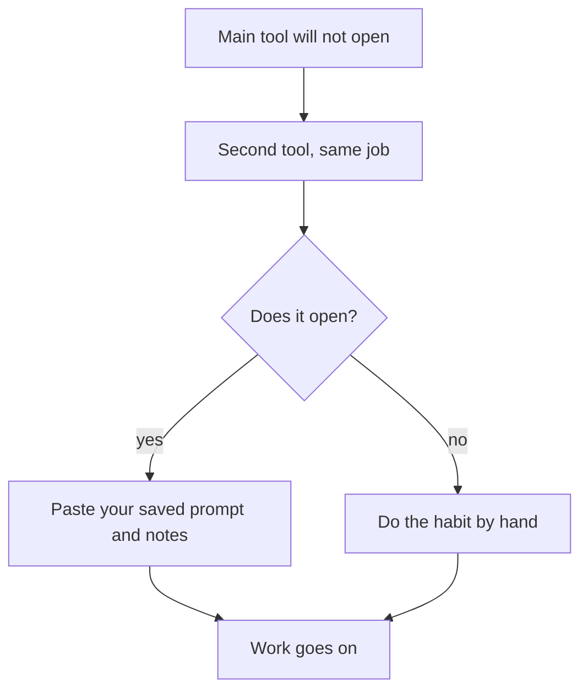

## Starting again

In May, Ahmad started his SQL topics again. He began with indexes, the topic he had missed in the job test. He used a chat tool the same way as before: he asked for an explanation with a small example, then asked it to quiz him one question at a time. The tool was not the problem in March, and he did not change it.

What he changed was what happened after each chat. Before he closed it, he spent ten minutes copying what mattered into his own notes. Once a week he put those notes somewhere a second time. He wrote down the instructions that had worked well, so he could use them again in any tool. And for each job, he picked a second tool before he needed one.

None of this is clever. It takes about ten minutes a day and a little more once a week. This chapter explains why it matters, shows Ahmad's routine in full, and then shows what happens to his work the next time a tool changes.

## Tools change while you use them

It is easy to think of a tool as fixed, like a building. It is closer to a shop whose owner can change the opening hours, the prices and the name on the door. The changes are the company's decisions, not yours, and they can come without much warning.

In 2026, three changes like this happened within a few months. On 16 July 2026, Google renamed NotebookLM to Gemini Notebook. On 2 September 2026, it changed how the free limits work, from fixed daily counts to limits that refresh every five hours, at the time of writing (checked 2026-10-24). That may change again. And on 1 March 2026, Play with Docker, a free website for practising Docker in the browser, shut down.

People who used these tools well had done nothing wrong. A guide that said "open NotebookLM" now uses a name the tool no longer has. Lab steps that started with "open Play with Docker" stopped working completely. The lesson is to keep your work, and your habits, in a form that does not depend on any one tool.

## Habit 1: keep work in files you own

A file you own is one you can open, copy and move without asking a company. Notes in plain text or <GlossaryTerm term="Markdown" definition="Plain text with a few simple marks, such as # at the start of a heading line, that any computer can open and that GitHub shows as a tidy page." /> qualify. So does a notes app that keeps notes on your phone and lets you export them. At the time of writing, Joplin and Obsidian keep notes as plain Markdown files, and OneNote works offline and syncs later. Module 3 shows how to organise those notes.

A second copy matters as much as the first. Phones are lost, borrowed and broken. A <GlossaryTerm term="repository" definition="A project folder on GitHub that keeps your files and the full history of every change you made to them." /> on GitHub gives you that second copy, with a date on every change. At the time of writing, a free GitHub account can hold unlimited public repositories. If your notes include anything private, keep that repository private. If GitHub does not open for you, a second folder on another device, or a memory card, still beats one copy.

## Habit 2: copy out what matters, the same day

You do not need to save whole chats. Most of a chat is not worth keeping. Before you close it, copy four things into your notes. Write the question you asked, the example that helped, any answer you got wrong and why, and a short summary in your own words.

Do it the same day. A chat that you plan to copy "later" is a chat you will not find in a month. Writing the summary in your own words is also the first step of real learning, as module 3 shows. If you only paste the AI's text, you have a copy of its words, not a record of what you understood.

## Habit 3: save the prompts that worked

Some instructions to an AI work much better than others. When one works, save it on a page in your notes called "prompts that worked". Ahmad's best one reads: "Explain this topic with a small example about a school's students and classes. Then ask me three questions, one at a time, and wait for my answer before you go on."

A saved prompt belongs to you, not to the tool. You can paste it into any chat assistant, today or in two years. When a tool changes, the prompt is often the slowest thing to rebuild, because you found it by trying many versions. Keep it, and you start the next tool at full speed.

## Habit 4: a fallback for every job

Chapter 2.3 asked for two example tools per job. The second one is your first fallback. The second fallback needs no AI at all: the same habit done by hand. If no chat assistant opens, you can still quiz yourself from your notes, or ask a friend to read your questions aloud.

The diagram shows the order to try when your main tool stops working.



Both paths end at "work goes on", so why does the upper path take minutes and not days? Because the prompt and the notes are already in your files. Without habits 1 and 3, the box "paste your saved prompt and notes" would be empty, and a second tool would mean starting from nothing. A fallback tool helps only if your work can move with you.

## Habit 5: check your tools again each term

Your toolkit is true on the day you check it. At the start of each term, or every three months, run the three-question check from chapter 2.3 again for every tool you rely on. Does it still open here? Is it still allowed at my age? Does it still work on my device? Then read its training setting again, because those can change too, and write the new date next to each line.

This takes about fifteen minutes. It turns a surprise into a note on your list. Chapter 2.6 asks you to start that list today.

## Worked example: Ahmad's day and week

Here is Ahmad's routine for one study session on indexes, with his reasons.

**During the chat (about 50 minutes).** He pastes his saved prompt and adds the topic: indexes. The chat assistant explains with a list of 2,000 students and shows how an index finds one student fast. It quizzes him. He gets the third question wrong. He thought an index makes every query faster. It does not, and it also slows down adding new rows.

**Before he closes it (about 10 minutes).** He opens his notes app and makes a page called `indexes.md`. He writes his question, the students example in two lines, his wrong answer and why it was wrong, and a five-line summary in his own words. He reads the summary once against the chat to check he has not got it backwards. He does not paste the AI's text.

**Once a week (about 15 minutes).** On Fridays, at a café with internet, he uploads the week's note files to his GitHub repository, `sql-notes`. It is private, because one page has notes about a job application. Now each page exists on his phone and in his repository.

**Once a term.** He rechecks his chat assistant, his second chat assistant and GitHub with the three questions, and writes the date next to each.

Notice what the routine does not need. It does not need a paid plan, a strong laptop or a particular tool. It needs a notes app or a text file, a free account he can reach, and about ten minutes a day.

## What happens next time

Now play the story forward. In June, Ahmad's chat tool stops opening for him for a whole week.

```predict
prompt: "In June, Ahmad's chat tool stops opening for a whole week. His phone still works. Which part of his routine do you expect to keep his study of indexes going that week?"
options:
  - id: upload
    label: "The weekly upload to his repository"
  - id: copy
    label: "The same-day copy into his notes app"
correctOptionId: copy
explanation: "The repository is a second copy, which matters if he loses his phone. This time the phone is fine. What keeps the week going is his notes app: the examples, his wrong answers and his saved prompt are already there. He can paste them into a second chat assistant the same day."
```

Step through both versions of Ahmad's story below: March, when everything lived in one chat tool, and May, when it did not.

<InteractiveCanvas slug="keep-work-in-your-files" />

The canvas showed the same person, the same kind of tool and the same kind of change, with two different results. In March, one change to the free tier cost Ahmad a month of work. In June, a week without the tool cost him almost nothing, because nothing important lived only inside it. The difference was ten minutes at the end of each chat, and one upload a week. He used no better tool and no paid plan.

## Where it goes wrong

The first mistake is a copy that lives in the same place as the original. A screenshot of a chat, saved on the same phone, is lost with the phone. Your second copy should be somewhere else: a repository, another device, a memory card.

The second mistake is a fallback that you have never tried. A second tool that you have not opened since you wrote it down may not open, may not allow your age, or may have changed. Try each fallback once when you first add it, and again at each term's check.

## Check your understanding

```quiz
type: mcq
question: "Aseel is a freelance translator on a freelance marketplace. Over six months she built a list of about 400 legal terms in English and Arabic. All of it is inside one long chat with a chat assistant. She wants the list to survive any change to that tool. What should she do?"
options:
  - "Pay for the tool, since then a free tier change cannot reach it"
  - "Copy it into a file she owns, since a file survives any tool change"
  - "Keep adding to the same chat, since the list stays in one place"
  - "Take screenshots each week, since that keeps a copy on her phone"
correct: 1
explanations:
  - "Paid plans can change too, and the list would still live in one place that belongs to the company. A change to the account could still take it away."
  - "Right. A file she owns survives any change to the tool, and she can paste it into a second chat assistant, or use it with no AI at all."
  - "One long chat is exactly how Ahmad lost a month of work. Keeping everything in one place makes it easier to lose, not harder."
  - "Screenshots are a copy, but they stay on the same phone as the chat app, and she cannot search, edit or paste them into another tool. A text file does all three."
```

```quiz
type: mcq
question: "Nada volunteers at an NGO that runs a coding club. Her toolkit page has four lines. 1) Quiz: chat assistant A, used every week. 2) Quiz fallback: chat assistant B, checked and tried in March. 3) Notes: a notes app on her phone, with no second copy. 4) Saved prompts: kept in a long chat inside assistant A. Today assistant A stopped opening, and her next session is tomorrow. Which line turns out to be the mistake today?"
options:
  - "Line 1, since she should not rely on one tool every week"
  - "Line 2, since a fallback checked in March may be out of date"
  - "Line 3, since her notes have no second copy anywhere else"
  - "Line 4, since the prompts are in the tool that is down"
correct: 3
explanations:
  - "Using one tool every week is fine when a fallback is ready. Line 2 gives her one, so line 1 is not what fails today."
  - "A March check is worth repeating, and she should recheck B today. But she tried B in March, so it is a working plan, not the mistake."
  - "Notes with no second copy are a real risk if she loses her phone. But her phone works, so this is not what fails today."
  - "Right. Her saved prompts are locked inside the tool that is down, so she must rebuild them before tomorrow. Saved prompts belong in her own notes."
```

**Next:** A graded quiz with five new cases on choosing tools, owning your work, privacy and checking AI output.
