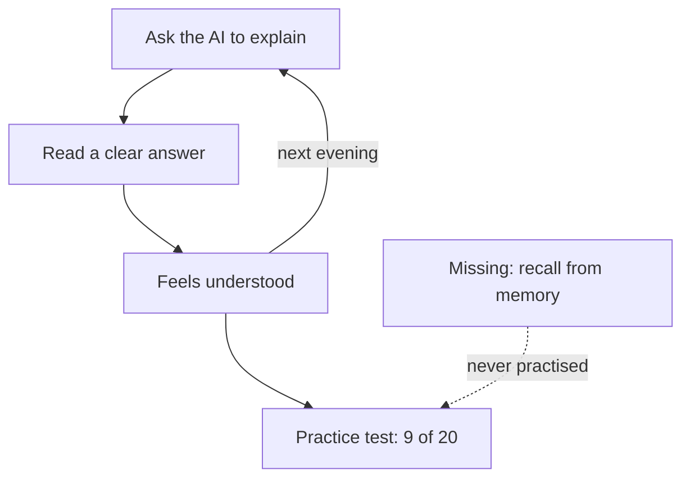

<BigWordAlert term="Retrieval practice" plainEnglish="Pulling an idea out of your own memory, for example answering questions with the book closed, so that you learn it and do not only test it." whyItMatters="Reading and listening feel like learning. Recalling from memory shows you the gaps, and it helps the idea stay." />

## Every explanation made sense

Lina is a fellow who studies computer networks at university. Her exam is in five weeks. The topic her class finds hardest is <GlossaryTerm term="subnetting" definition="Splitting one network of addresses into smaller networks, so that each group of devices gets its own block of addresses." />. Her lecturer gave the class a practice test, so that everyone could see where they stand before the real exam.

Lina prepared the way many fellows prepare now. Every evening for a week, she opened a chat assistant and asked it to explain subnetting. When a part felt hard, she asked for simpler words. She asked for an example with a home network, then another with a school network. Every answer was clear and patient. Every answer made sense. Each night she closed her laptop feeling that she understood a little more.

On the practice test, Lina scored 9 out of 20. The questions were not strange. One asked her to split a network of 256 addresses into four equal parts. Then it asked for the first address a device could use in the third part. She remembered that the AI had shown her exactly this kind of example. She remembered nodding along as she read it. But with a blank page in front of her, she could not rebuild the steps. She wrote two numbers, crossed them out, and moved on.

That evening she told her friend Odai, who is in the same class, "I do not understand it. I understood it every single night." Both sentences were true. That is the puzzle this module solves.

## What went wrong

Lina did not waste her week, and the AI did not lie to her. The explanations were correct. The problem was what Lina did with them. She read them. Each explanation was smooth, so reading it was easy, and the ease felt like understanding.

Think about who did the work in those evenings. The AI pulled the steps together, put them in order and wrote them out. Lina followed. Following a clear explanation is real work, but it is not the same work as rebuilding the steps alone. The practice test asked for the second kind, and she had never practised it.

This course calls it the fluency trap: a clear, smooth explanation makes you feel you have learned more than you have. Research on lectures shows the same pattern. In one study, students who watched a fluent, confident lecturer rated their learning higher than students who watched a halting one. But they did not learn more. The videos in that study were short and the groups were small. Treat it as a clear example of the pattern, not as a measure of its size.

An AI explanation is the smoothest lecture most fellows will ever get. It never stumbles, never loses its place and never gets tired of your questions. That is the course's own conclusion from the lecture research, not a study about AI. But it explains Lina's week well. The smoother the explanation, the stronger the feeling of knowing, and the feeling tells you little about what you can do alone.

```openquestion
prompt: "Which one thing would you change first in Lina's week, and why? Write two or three sentences. If you prefer, use a time when you followed something easily while reading and could not do it later."
required: false
minWords: 20
allowSpeechInput: true
modelAnswer: "For Lina's case: I would change what she does after each explanation. She should close it and write the steps from memory, then compare, because the test asked her to rebuild the steps alone and she never practised that. She can keep the chat assistant for explaining and for quizzing her. Other good answers: ask the AI to quiz her one question at a time; come back to the topic after a few days. A weak answer is 'stop using AI', because the explanations were correct; the method was the problem."
```

## Neither story fits

There are two loud stories about students and AI. The first says AI makes students lazy, so they should stay away from it. The second says AI is a perfect teacher, so studying will soon be easy. Lina's week fits neither story.

She was not lazy. She studied every evening. And the AI was a good explainer. What failed was the method: reading explanations, one after another, and taking the feeling of understanding as proof. The fix is to keep the tool and change what she asks it to do, and what she does herself.

You met the evidence for this in chapter 1.4. In the studies there, AI helped learning when it was designed or used to make the learner think: hints, guidance, questions. It harmed learning when it simply supplied answers. This module turns that pattern into habits you can use on any topic, with any chat assistant, on a phone.

The diagram shows the loop Lina was stuck in. Read it from the top.



What to notice: the loop from "ask" to "feels understood" turns every evening, and every turn feels like progress. Nothing in the loop asks Lina to produce anything alone. The box on the side is the skill the test needed, and the loop never touches it. The takeaway: a study method can feel productive every single day and still skip the one thing the exam will ask for.

## What Lina changes

Lina decides to keep the chat assistant and change her method. She keeps the same five weeks and roughly the same hours. What changes is who does the recalling.

After she reads an explanation, she closes it and writes the steps on a blank page. Then she compares and marks what she missed. She looks at each topic from more than one angle. She asks the AI to draw it, works through an example with real numbers, and asks what breaks. She asks the AI to quiz her one question at a time and to wait for her answer. She comes back to each topic after a few days, and again a week or two later.

She also changes how she uses her walk to the university. She puts her lecture notes and the textbook chapter into a source notebook and makes an audio overview to listen to on the way. Then she reads the sources at her desk. And she starts to keep one notes page per topic, in her own words, in a notes app that works without internet. Old habits are slow to change, and chapter 3.6 shows what her first pages really looked like.

Three weeks later she sits a second practice test and scores 15 out of 20. One test is not proof of anything, and she is not finished. But this time she knows exactly which two kinds of question she still gets wrong, because her own recall showed her. With two weeks left, she knows where to spend them.

## Why this matters for your career

In an interview or on a job, there is no chat window. A client asks why their site is slow. A team lead asks you to explain the design you chose. An interviewer asks what happens when one part of your project stops. What counts in those moments is what you can recall and use, not what you once read.

In this course's view, AI has made explanations cheap: Lina got a clear answer every evening, in seconds. That makes the other skill, knowing something well enough to use it alone, more valuable. Fellows who use AI to learn faster and still know their material without it are the ones an interviewer will remember.

Learning deeply is also a skill that lasts. Tools change: one of the tools in this module changed its name in 2026, as chapter 2.4 showed. Topics change too: you will learn a new framework, a new cloud service or a new language every year. The habits in this module work on all of them.

## What this module covers

Chapter 3.2 shows the fluency trap from the inside. You read a clear explanation, rate how well you understand it, then try to recall it with the text out of sight. Then you learn what to do with the gaps you find.

Chapter 3.3 teaches the course's five angles: a plain explanation in your own words, a picture, a worked example, a failure case, and building or teaching it. No study tests these five as a package. Each part is supported on its own, and five is the course's number, not a law. You will follow Yara as she learns caching for her project, Qasir.

Chapter 3.4 makes the AI quiz you instead of telling you. You will mix two similar topics in one practice and plan reviews days apart. Chapter 3.5 turns trusted sources into audio to listen to while you walk, then sends you back to read them and check what the audio got wrong. Chapter 3.6 is about notes you own: one notebook per project, one page per topic, in your own words.

You do not need a laptop for any of this. A phone, a free chat assistant, and paper or a notes app are enough. Every audio step is optional, and every tool has a fallback that works without it.

<LearningObjectives items={["Explain why a clear AI explanation can feel like learning when it is not, and test yourself by recall", "Learn one topic from five angles with AI, and check what the AI draws against a source", "Ask an AI to quiz you one question at a time, mix similar topics, and space your reviews", "Listen to an audio overview to meet a topic, then read the sources and check one claim", "Keep a notes page per topic in your own words, in files you own"]} />

## Key words

| Word | Plain English |
|---|---|
| **Fluency trap** | Feeling you understand because something was clear and easy to read or hear, when you cannot yet recall or use it |
| **Five angles** | The course's method: explain it, picture it, work an example, find what breaks, build or teach it |
| **Spaced review** | Coming back to a topic after a gap of days, instead of studying it all in one sitting |
| **Interleaving** | Mixing different kinds of questions in one practice, instead of doing one kind in a block |
| **Audio overview** | A spoken summary of your sources, made by AI, that you can listen to |

## What is in this module

| Chapter | You will practice |
|---|---|
| 3.2 | Rating your understanding, then recalling with the text closed |
| 3.3 | Five angles on one topic, with Yara and caching |
| 3.4 | Making the AI quiz you, mixing topics, spacing reviews |
| 3.5 | Listening to meet a topic, reading to learn it, checking one claim |
| 3.6 | A notebook per project and a page per topic, in your own words |
| 3.7 | A graded quiz with five short cases |
| 3.8 | One topic from five angles, a recall test and a notes page |

**Next:** Read a clear explanation, rate yourself, then close it and see what you can recall.
