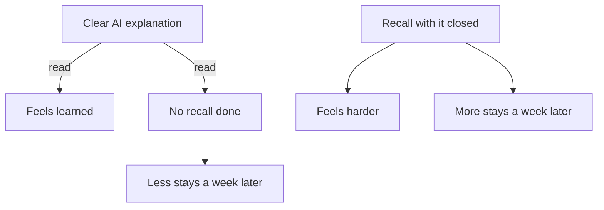

## Three times through

The night before her practice test, Lina read the AI's explanation of splitting a network three times. The first reading was slow. The second was faster. By the third, she knew what each sentence would say before she reached it. She rated her understanding 4 out of 5 and went to sleep calm.

The next day she scored 9 out of 20. Reading the explanation faster had felt like knowing subnetting better. What she knew better was the explanation itself: its words, its order, its example. The skill the test asked for, rebuilding the steps alone on a blank page, had not been practised once.

This chapter shows you the trap from the inside. You will read a short, clear explanation about an everyday topic, rate yourself, and then try to recall it with the text out of sight. Many people are surprised by the result. Then you will see what Lina did with her own gaps, and why it worked.

## Why ease feels like knowing

Your brain uses ease as a signal. When something reads smoothly, it feels familiar, and familiar feels known. Usually the signal is useful. But a clear explanation is easy to read because the writer did the hard work, not because the ideas are already in your memory. The feeling comes from the text, and the text will not be there in the exam.

You met one study on this in chapter 3.1: students rated a fluent lecturer higher but did not learn more. A second study points the same way, in a real university course. In randomised physics classes at Harvard, students in active classes learned more but felt they had learned less than students in polished lectures. The authors link this to the extra effort active learning takes. In that course, effort felt like less learning, and polish felt like more.

The common study habits follow the feeling. A large review of ten study methods rated rereading and highlighting low, because they do not reliably improve results. It rated two methods highest: practice testing and spreading study over time. Those two helped learners of different ages and abilities, on many kinds of tests.

Testing yourself does more than measure. In one study, taking a memory test helped people remember for longer than restudying the same material, even when they got no feedback on their answers. In another, recalling from memory produced more learning a week later than drawing concept maps. The students had expected the maps to work better. There is an honest limit: the gains show up more on a test days later than on a test straight away. So recall can feel slower today and still be the better choice for the exam.

## Try it yourself

Here is a short, clear explanation of the kind a chat assistant writes. The library and its rules are invented for this example. Read it once, at your normal speed. Do not take notes.

> **How the community library lends laptops.** You can borrow a laptop if you have been a member for at least one month. You book it on the sign-up sheet the day before, and collect it from the front desk after 10:00. You can keep it for up to seven days. If nobody else has booked it, you can renew it once, for seven more days. You must renew in person, with the laptop in your hands, so the staff can check it. If you bring it back late, you cannot borrow any laptop for as many days as you were late. Bring the charger back too: a laptop returned without its charger counts as not returned. The rules exist because the library has six laptops and forty members who want them.

Now rate yourself on paper or in a note: how well do you understand it, from 1 to 5? Write the number down. Then turn your phone face down, or scroll this paragraph out of sight. On a blank page, answer four questions. Who can borrow a laptop? How long can you keep it, and how do you renew? What happens if you return it late? Why does the charger matter?

When you have written everything you can, come back and compare. Mark each answer as got it, partly, or missed. Be strict: partly means something important was wrong or left out.

Here is how the comparison went for Odai, Lina's classmate. He rated himself 4 out of 5. His recall said: "Any member can book a laptop and keep it for a week. You can renew it online. If you are late, you pay a fine." Read it next to the explanation and the gaps appear quickly.

His first answer is partly right: he left out that you must have been a member for a month. His second answer is partly right too. A week is correct, but renewal is in person, with the laptop, not online. His third answer is wrong: there is no fine, only a pause in borrowing as long as the delay. His fourth answer is missed. He wrote nothing about the charger.

So a rating of 4 out of 5 hid three partly right or wrong answers and one gap. Notice also what kind of gaps they were. Odai did not forget random words. He missed the reason that holds the rules together: the library has six laptops for forty members, so every rule protects the laptops and the next borrower. In-person renewal lets the staff see the laptop; the charger rule keeps the set complete; the borrowing pause is fair to people who wait. Recall often finds the idea you followed while reading but never had to build yourself.

What Odai does next matters as much as the test. He does not reread the whole explanation. He goes back only to renewal, lateness and the charger. He writes each in his own words: "Renew at the desk, laptop in hand, so they can check it. Late by three days means three days without borrowing." Explaining an idea in your own words helps you learn it, with a moderate benefit in studies. Then he closes everything and answers the four questions again. Three days later, he answers them once more.

## Feeling and learning come apart

The diagram puts the two routes side by side. One starts from a clear explanation and stops at reading. The other starts from a recall attempt.



What to notice: each route produces a feeling and a result, and they point in opposite directions. Reading gives the good feeling and the weaker result. Recall gives the uncomfortable feeling and the stronger result. The takeaway: you cannot use the feeling to choose your method. Choose the method that makes you produce the answer, and expect it to feel harder.

## Lina closes the explanation

Now go back to Lina, a week before her second practice test. She asks the AI for its five steps for splitting one network into four equal parts. She reads them three times, as she did before her first test, and rates herself 4 out of 5, the same rating as last time.

```predict
prompt: "Lina reads the AI's five steps three times and rates herself 4 out of 5. Then she closes the explanation and writes the steps on a blank page. What do you expect?"
options:
  - id: writes-all
    label: "She writes all five, as she followed each one"
  - id: misses-some
    label: "She misses a step she followed while reading it"
correctOptionId: misses-some
explanation: "Following a step while reading is recognition: the explanation does the remembering for you. Writing it alone is recall. Lina's rating came from how easy the reading felt, so it could not tell her which steps she could rebuild."
```

Step through what happens after she closes it, one state at a time.

<InteractiveCanvas slug="close-it-and-recall" />

The canvas showed the gap between the rating and the recall. Lina felt 4 out of 5, and her blank page showed two of the five steps missing. She could not say why four parts need two extra bits in the mask, and she forgot that two addresses in every part are kept back from devices. You do not need to understand those two steps to follow the lesson. What matters is that a rating of 4 out of 5 hid them.

Then the loop did its job. She re-studied two steps, not five, and wrote each one in her own words. Three days later she recalled all five from a blank page. The last step showed the other route. If she had reread the explanation a fourth time, she would have stayed at "feels known". Both gaps would have stayed hidden until the next test found them.

The AI fits into this loop well. It wrote the clear explanation at the start. And when Lina found her two gaps, she asked it to explain only those, in a few sentences. Then she closed it again. The AI explained; Lina recalled. That division of work is the whole chapter in one line.

Recall straight after studying is the easy version, and the benefit shows up more on a test days later. That is why her second recall came three days on, and why chapter 3.4 turns this into a plan.

## Where it goes wrong

The first mistake is the quick peek. You glance at the explanation "just to get started", and after that every step looks familiar. That turns recall back into <GlossaryTerm term="recognition" definition="Knowing something when you see it again. It is much easier than producing it from memory, so it can hide gaps." />. Write everything you can first, even if it is little, and open the text only to compare.

The second mistake is a test that is too easy. Asking yourself "do I understand this?" does not make you recall anything, and neither does asking an AI the same question and answering yes. A real recall test makes you produce something: written steps, a worked answer, an explanation said aloud to an empty room. If you can answer by nodding, you have not tested yourself.

The third mistake is re-studying everything. After a recall test, it is tempting to reread the whole explanation, because it feels safe and complete. But most of that time goes to parts you already know. Re-study only what you marked as partly or missed, and put each gap in your own words.

<Callout type="tip" title="Recall on a phone">
Turn the phone face down, or open a blank note and close every other app. Write or say aloud everything you can, then compare. A paper notebook works just as well, and needs no battery.
</Callout>

## Check your understanding

```quiz
type: mcq
question: "Samer is at a coding bootcamp. He read an AI explanation of three JavaScript array methods, map, filter and reduce, and rated his understanding 5 out of 5. His test is in 4 days. Which next step will tell him most about what he really knows?"
options:
  - "Ask the AI to explain the three methods again, since slower is clearer"
  - "Highlight the key lines of the AI's answer, so the main ideas are marked"
  - "Close the chat and write each method's job, since that needs recall"
  - "Read the explanation again on the last night, as it will then be fresh"
correct: 2
explanations:
  - "Slower can be clearer, but another explanation would also feel easy, so his 5 out of 5 would stay untested. The AI would be doing the recall for him again."
  - "Marking lines helps him find them later, but highlighting was rated a low-value study method. It does not show whether he can produce the ideas himself."
  - "Right. Writing from memory is the test his rating never had. Whatever he cannot write is a gap he can re-study now, with four days still left."
  - "It will feel fresh, but that is the fluency trap again, and the last night leaves no time to fix a gap."
```

```quiz
type: mcq
question: "Layan builds websites for 2 small shops. On Monday she tested herself, notes closed, on 3 topics, 8 steps each. Image sizes: 8 of 8. Contact forms: 3 of 8. Site backups: 7 of 8. On Thursday a client needs a new contact form. Where should her next hour of study go?"
options:
  - "Contact forms, because she missed 5 steps she needs on Thursday"
  - "Image sizes, because a perfect score is the one easiest to keep"
  - "Site backups, because one missed step is quick to fix today"
  - "All three equally, because each one was tested on the same day"
correct: 0
explanations:
  - "Right. Her recall showed exactly where the gaps are, and the client work shows which ones matter first. Re-study those five steps, then test the whole form again in a few days."
  - "Her 8 of 8 shows image sizes need no work this week. A review in a few days will keep them."
  - "One missed step is quick to fix, so it is worth a few minutes. But contact forms have five gaps and a client waiting on Thursday."
  - "The topics were tested on the same day, but the results were very different. Equal time spends most of the hour on steps she already knows."
```

**Next:** One topic, five angles: how a picture, an example and a failure case each find a different gap.
